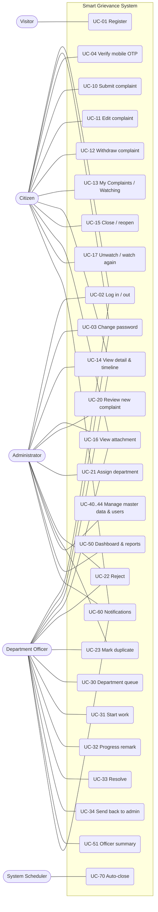

# 04 — Use Cases

| | |
|---|---|
| **Status** | Draft |
| **Depends on** | 02 Glossary & Actors, 03 Requirements |

Each use case lists the requirements (FR-xx) it implements. The allowed status changes referred to here are defined in doc 05, and the routes and screens in docs 09 and 10.

---

## 1. Use-case catalogue

| ID | Use case | Primary actor | FRs |
|---|---|---|---|
| **Account** ||||
| UC-01 | Register as citizen | Visitor | FR-01, 02, 08 |
| UC-02 | Log in / log out | Any user | FR-03, 04, 05 |
| UC-03 | Change own password | Any user | FR-06 |
| UC-04 | Verify mobile with OTP | Citizen | FR-09, 09a, 09b |
| **Citizen** ||||
| UC-10 | Submit complaint | Citizen | FR-10–15 |
| UC-11 | Edit complaint | Citizen (owner) | FR-16, 17, 19 |
| UC-12 | Withdraw complaint | Citizen (owner) | FR-18, 19 |
| UC-13 | View My Complaints / Watching lists | Citizen | FR-20, 22 |
| UC-14 | View complaint detail & timeline | Citizen, Officer, Admin | FR-21, 23, 24, 28 |
| UC-15 | Review resolution (close or reopen) | Citizen (owner) | FR-25–27 |
| UC-16 | View / download attachment | Citizen, Officer, Admin | FR-21, NFR-05 |
| UC-17 | Unwatch / watch again | Citizen (watcher) | FR-29 |
| **Admin – complaint handling** ||||
| UC-20 | Review new complaint | Admin | FR-30, 31 |
| UC-21 | Assign / reassign department | Admin | FR-32, 33 |
| UC-22 | Reject complaint | Admin, Officer | FR-34, 45 |
| UC-23 | Mark complaint as duplicate | Officer, Admin | FR-35, 44 |
| **Officer** ||||
| UC-30 | View department queue | Officer | FR-40, 47 |
| UC-31 | Start work on complaint | Officer | FR-41 |
| UC-32 | Add progress remark | Officer | FR-43 |
| UC-33 | Resolve complaint | Officer | FR-42, 48 |
| UC-34 | Send complaint back to admin | Officer | FR-46 |
| **Admin – master data** ||||
| UC-40 | Manage departments | Admin | FR-50, 56 |
| UC-41 | Manage categories | Admin | FR-51, 56 |
| UC-42 | Manage areas | Admin | FR-52, 56 |
| UC-43 | Manage officer accounts | Admin | FR-53, 55 |
| UC-44 | Manage citizen accounts | Admin | FR-54, 55 |
| **Reports & notifications** ||||
| UC-50 | View admin dashboard & reports | Admin | FR-60–62, 64, 65 |
| UC-51 | View officer summary | Officer | FR-63 |
| UC-60 | View and read notifications | Any user | FR-70–72 |
| **System** ||||
| UC-70 | Auto-close expired resolved complaints | System (scheduler) | FR-82 |

## 2. Use-case diagram

Relationships (UML, for the report diagram):
- UC-14 **«include»** UC-16: the detail page shows the attachments.
- UC-11, UC-12, UC-15 **«extend»** UC-14: their buttons appear on the detail page only when allowed.
- UC-20 to UC-23 and UC-31 to UC-34 **«include»** the access check ("complaint visible to actor") and "record history + notify".

---

## 3. Common rules (apply to every use case below)

- **R-ACCESS:** If the actor is not allowed to view the complaint (owner, watcher, officer of the assigned department, admin), the system answers **404 Not Found** (D10).
- **R-STATE:** If the requested status change is not allowed from the current status (doc 05), the system refuses it with "This action is not allowed when the complaint is <status>" and nothing changes.
- **R-CONCURRENCY:** If the complaint was changed by someone else after the actor opened the page, the action is refused with "This complaint was updated by someone else, please refresh" (FR-84).
- **R-AUDIT:** Every successful status change, edit, reassignment and duplicate link writes a history or revision row and its notifications in one transaction (NFR-30).
- **R-VALIDATION:** Invalid input re-shows the form with an error next to each field. What the user typed is kept, except passwords and files (NFR-22).

---

## 4. Use-case specifications

### UC-01 Register as citizen
- **Actor:** Visitor (not logged in)
- **Precondition:** None.
- **Main flow:**
  1. The visitor opens **Register**.
  2. They enter full name, email, mobile, password and confirm password.
  3. The system validates the input (FR-02).
  4. The system creates an active, **unverified** Citizen account with a BCrypt-hashed password.
  5. The system logs the citizen in and continues with **UC-04 Verify mobile**.
- **Alternate flows:**
  - 3a. The email or mobile is already registered: show "Email already registered" or "Mobile already registered".
  - 3b. The passwords don't match or are too weak: show a field error.
- **Postcondition:** A Citizen account exists (role `CITIZEN`).

### UC-02 Log in / log out
- **Actor:** Any user
- **Main flow:**
  1. The user enters email and password.
  2. The system authenticates them and checks the account is active.
  3. The system redirects to the role's home page: Citizen → My Complaints, Officer → Department Queue, Admin → Dashboard.
  4. Later, the user clicks **Logout**. The session ends and they return to Login with "You have been logged out".
- **Alternate flows:**
  - 2a. Wrong credentials or inactive account: show "Invalid email or password, or account inactive" (one message for all cases).
  - *Session timeout:* after 30 minutes idle, the next request goes to Login.

### UC-03 Change own password
- **Actor:** Any logged-in user
- **Main flow:** The user enters the current password and the new password twice. The system checks the current one, validates the new one (FR-02), saves the hash, and shows "Password changed".
- **Alternate flow:** If the current password is wrong, show a field error.

### UC-04 Verify mobile with OTP
- **Actor:** Citizen (logged in, unverified)
- **Main flow:**
  1. The system generates a random 6-digit OTP, stores only its hash with an expiry time (now + 5 minutes), and sends it through `OtpSender`. In the demo, it is shown on the page as "Demo OTP: 123456" and logged.
  2. The citizen enters the OTP.
  3. The system checks that it matches, has not expired, and attempts are below 3.
  4. The system marks the mobile as verified and invalidates the OTP, then redirects to My Complaints with "Mobile verified, you can now file complaints".
- **Alternate flows:**
  - 3a. Wrong OTP: increment attempts and show "Incorrect OTP, N attempts left".
  - 3b. Expired, or 3 wrong attempts: show "OTP expired, please request a new one".
  - *Resend:* allowed 60 seconds after the last send and at most 5 per hour. It invalidates the previous OTP.
  - *Skip for now:* the citizen can browse, but New Complaint redirects back here (FR-09a).
- **Postcondition:** `mobileVerified = true`.

### UC-10 Submit complaint
- **Actor:** Citizen
- **Precondition:** Logged in as a **verified** Citizen (otherwise redirect to UC-04).
- **Main flow:**
  1. The citizen opens **New Complaint**.
  2. The system shows the form: category and area dropdowns (active entries only), title, description, address, and attachments (0–5).
  3. The citizen fills it in and submits.
  4. The system validates the fields and files (FR-10, FR-11).
  5. The system generates the complaint number `GRV-YYYY-NNNNNN`.
  6. The system saves the complaint (`SUBMITTED`), stores the files under random names, writes the history entry "Complaint submitted", and notifies the owner and all admins.
  7. The system shows the confirmation page with the complaint number and a "View complaint" link.
- **Alternate flows:**
  - 4a. A field is invalid: re-show the form with errors (R-VALIDATION).
  - 4b. A file has the wrong type, is over 5 MB, or there are more than 5 files: re-show the form with the error for that file. Nothing is saved.
  - 6a. Saving a file fails: roll back the whole transaction, delete any files already written, and show "Could not save your complaint, please try again".
- **Postcondition:** The complaint exists in `SUBMITTED`. The owner and admins have notifications.

### UC-11 Edit complaint
- **Actor:** Citizen (owner)
- **Precondition:** The complaint is owned by the actor and its status is `SUBMITTED` or `UNDER_REVIEW`.
- **Main flow:**
  1. The owner clicks **Edit** on the detail page.
  2. The system shows the form pre-filled, the current attachments (each with a remove checkbox) and a field to add new files.
  3. The owner changes fields and/or attachments, optionally enters a "reason for change", and saves.
  4. The system validates (FR-10, FR-11). The total of active attachments after the change must be ≤ 5.
  5. The system compares the old and new values and writes one revision row per changed field. Each added attachment is recorded as "attachment added", and each removed one is soft-deleted and recorded as "attachment removed".
  6. The system notifies all admins ("GRV-… was edited by the citizen").
  7. The system redirects to the detail page with "Complaint updated". The timeline shows the edit.
- **Alternate flows:**
  - 1a. The status is no longer editable: the Edit button is hidden, and a direct POST is refused (R-STATE).
  - 5a. Nothing changed: show "No changes to save". No revision is written.
- **Postcondition:** The complaint shows its new values, and the old values are kept in the revisions.

### UC-12 Withdraw complaint
- **Actor:** Citizen (owner)
- **Precondition:** The status is `SUBMITTED`, `UNDER_REVIEW` or `ASSIGNED`.
- **Main flow:**
  1. The owner clicks **Withdraw**, which asks for confirmation and a reason (10–500 characters).
  2. The system sets the status to `WITHDRAWN` and writes history (remark = reason).
  3. The system notifies all admins, and the department's officers if the complaint was assigned.
  4. The detail page shows "Withdrawn on … : <reason>".
- **Alternate flows:**
  - The status is already `IN_PROGRESS` or later: refused (R-STATE), with the message "Work has already started; it can no longer be withdrawn."
  - Other citizens' duplicates are linked to this complaint: refused with "Other citizens are following this complaint; it cannot be withdrawn." (BR-47)
- **Postcondition:** The complaint is final (`WITHDRAWN`) and remains visible as read-only.

### UC-13 View My Complaints / Watching
- **Actor:** Citizen
- **Main flow:**
  1. The citizen opens **My Complaints**. The system lists their own complaints, newest first, paginated, with an optional status filter and search by number.
  2. The citizen switches to the **Watching** tab, which lists the complaints they watch.
- **Alternate flow:** An empty list shows "No complaints yet" and a **New Complaint** button.

### UC-14 View complaint detail & timeline
- **Actor:** Citizen (owner or watcher), Officer (assigned department), Admin
- **Main flow:**
  1. The actor opens a complaint from a list, a notification or a link.
  2. The system checks access (R-ACCESS).
  3. The system shows: number, status badge, category, area, address, title, description, attachments, department, created and updated dates, overdue badge (officer and admin only), and a **timeline** that merges status history, remarks and edit revisions, oldest first.
  4. The system shows only the action buttons the actor may use for the current status, e.g. Edit, Withdraw, Close and Reopen for the owner, and Start, Resolve, Duplicate, Reject and Send back for the officer.
- **Alternate flows:**
  - 3a. The status is `DUPLICATE`: show the banner "Linked to GRV-… which is already being handled" with a link (FR-24). The citizen can open the original because they are now its watcher.
  - 3b. The actor is a watcher: show the label "You are watching this complaint". No owner actions are shown.

### UC-15 Review resolution (close or reopen)
- **Actor:** Citizen (owner)
- **Precondition:** The status is `RESOLVED` and the review window has not expired.
- **Main flow (close):**
  1. The detail page shows "Resolved on …. Please review by <date>" with **Close** and **Reopen** buttons.
  2. The owner clicks **Close** and optionally adds feedback.
  3. The system sets the status to `CLOSED`, writes history, and notifies the department's officers.
- **Alternate flow (reopen):**
  - 2a. The owner clicks **Reopen** and enters a reason (10–500 characters).
  - 2b. The system checks that the reopen count is below `max-reopens` (FR-27), sets the status to `REOPENED`, increments the reopen count, writes history, and notifies the department's officers and all admins.
  - 2c. The reopen limit has been reached: Reopen is not offered, and the page shows "Reopen limit reached; please contact the department".
- **Exception:** The window has expired, or the complaint was auto-closed in the meantime: refused (R-STATE).
- **Postcondition:** The complaint is `CLOSED` (final) or `REOPENED`, and it is back in the department queue.

### UC-16 View / download attachment
- **Actor:** Anyone who can view the complaint
- **Main flow:** The actor clicks an attachment. The system checks R-ACCESS for the parent complaint, then streams the file with its stored content type. Images open inline; PDFs open inline or download.
- **Alternate flows:** A missing file on disk returns 404 and an error is logged. Soft-deleted attachments can be viewed only by the Admin.

### UC-17 Unwatch / watch again
- **Actor:** Citizen
- **Main flow (unwatch):** On a complaint they watch, the citizen clicks **Unwatch**. The system sets their watcher record to inactive, so it leaves their Watching list and their notifications stop. The page shows "You will no longer receive updates".
- **Alternate flow (watch again):** The citizen opens their own `DUPLICATE` complaint, follows the link to the original, and clicks **Watch again**. The watcher record becomes active again.
- **Rule:** Unwatching never removes access for the owner of a linked duplicate (BR-52).

### UC-20 Review new complaint
- **Actor:** Admin
- **Precondition:** The status is `SUBMITTED`.
- **Main flow:**
  1. The admin opens **All Complaints**, filtered to `SUBMITTED` by default on the dashboard link.
  2. The admin opens one and clicks **Start Review**.
  3. The system sets the status to `UNDER_REVIEW` and writes history. The owner is notified.
- **Next step:** usually UC-21 (assign), UC-22 (reject) or UC-23 (duplicate).

### UC-21 Assign / reassign department
- **Actor:** Admin
- **Precondition:** Assign requires `UNDER_REVIEW`. Reassign requires `ASSIGNED`, `IN_PROGRESS` or `REOPENED`.
- **Main flow (assign):**
  1. The admin clicks **Assign**. The department dropdown is pre-selected with the category's default department.
  2. The admin confirms, optionally with a remark.
  3. The system sets the department, sets the status to `ASSIGNED`, writes history, and notifies the owner, the watchers and all officers of the department.
- **Alternate flows:**
  - *Reassign:* the remark is mandatory. The department changes and the status becomes `ASSIGNED`. The new department's officers, the owner and the watchers are notified.
  - 1a. The category has no default department ("Other"): nothing is pre-selected and the admin must choose one.
  - 2a. The chosen department is inactive: refused.

### UC-22 Reject complaint
- **Actor:** Admin (any non-final complaint), or Officer (complaint in their department with status `ASSIGNED`, `IN_PROGRESS` or `REOPENED`)
- **Main flow:** The actor clicks **Reject** and enters a reason (10–500 characters). The system sets the status to `REJECTED` (final), writes history, and notifies the owner and the watchers.

### UC-23 Mark complaint as duplicate
- **Actor:** Officer (complaint in their department) or Admin (any complaint)
- **Precondition:** The duplicate candidate **B** is not final.
- **Main flow:**
  1. On complaint B, the actor clicks **Mark as Duplicate**.
  2. The actor enters the original's complaint number **A** and a note for the citizen.
  3. The system validates the input against BR-40 to BR-46 (doc 05): A exists; A ≠ B; A is `ASSIGNED`, `IN_PROGRESS` or `REOPENED`; and for an **Officer**, both A and B belong to their department. For a cross-department match, the officer uses UC-34 (send back) and mentions GRV-A in the remark, and the Admin links them.
  4. The system shows a confirmation with A's title, area and status, so the actor can make sure it really is the same issue.
  5. On confirm, in one transaction, the system:
     - sets B's status to `DUPLICATE` and `B.original = A`, and writes history on B (remark = note);
     - adds B's owner as a watcher of A, unless they are A's owner or already a watcher;
     - moves all of B's watchers to A, with the same exclusions;
     - writes history on A: "GRV-B linked as duplicate";
     - notifies B's owner and B's former watchers: "Your complaint GRV-B is linked to GRV-A, which is already being handled. You'll get updates on GRV-A."
- **Alternate flow:** 3a. Validation fails: show the reason, e.g. "GRV-A is closed; it cannot be used as the original".
- **Postcondition:** B is `DUPLICATE` and read-only. B's citizens see A in their **Watching** list and get A's updates.

### UC-30 View department queue
- **Actor:** Officer
- **Main flow:** The officer opens **Department Queue**. The system lists their department's complaints with status `ASSIGNED`, `IN_PROGRESS`, `REOPENED` or `RESOLVED` by default (D34; `RESOLVED` rows are marked "Awaiting citizen until …" and have no action), overdue ones first and then oldest first. Filters: status (each status, or all statuses), category, area, and search by number.
- **Alternate flow:** If the officer has no department (data error), show "Your account has no department; contact the admin".

### UC-31 Start work on complaint
- **Actor:** Officer
- **Precondition:** The status is `ASSIGNED` or `REOPENED`, and the complaint is in the officer's department.
- **Main flow:** The officer clicks **Start Work** and enters a remark, e.g. "Team scheduled for tomorrow". The system sets the status to `IN_PROGRESS`, writes history, and notifies the owner and the watchers.

### UC-32 Add progress remark
- **Actor:** Officer
- **Precondition:** The status is `IN_PROGRESS`.
- **Main flow:** The officer enters a remark. The system writes a history row without a status change. The owner and the watchers are notified ("New update on GRV-…").

### UC-33 Resolve complaint
- **Actor:** Officer
- **Precondition:** The status is `IN_PROGRESS`.
- **Main flow:**
  1. The officer clicks **Resolve** and enters a resolution remark. Optionally, they add up to 3 "work done" attachments (FR-48, Could).
  2. The system sets the status to `RESOLVED` and sets `resolved_at = now`, which starts the review window.
  3. The system writes history and notifies the owner and the watchers: "Resolved. Please review by <date>, or it will close automatically."

### UC-34 Send complaint back to admin
- **Actor:** Officer
- **Precondition:** The status is `ASSIGNED` or `REOPENED`, and the complaint is in the officer's department.
- **Main flow:** The officer clicks **Wrong Department** and enters a remark, optionally suggesting a department. The system clears the department, sets the status to `UNDER_REVIEW`, writes history, and notifies all admins. The complaint disappears from the officer's queue.

### UC-40 / 41 / 42 Manage departments, categories, areas
- **Actor:** Admin
- **Main flow:** The admin opens the list (name, active flag, and the extra fields: a category has a default department and SLA days). They can **Add**, **Edit** or **Activate/Deactivate** entries.
- **Rules:** Names are unique (case-insensitive). Nothing is hard-deleted once it is used by a complaint (FR-50). Deactivated entries disappear from the new-complaint and assign forms (FR-56). A category cannot point to an inactive default department.

### UC-43 Manage officer accounts
- **Actor:** Admin
- **Main flow:** The admin can list officers (filter by department), **Add officer** (name, email, mobile, department, initial password), **Edit** them (name, mobile, department), **Activate/Deactivate** them, and **Reset password**.
- **Rules:** Email is unique across all users. Deactivating an officer does not change their complaints, because the queue belongs to the department, not the person.

### UC-44 Manage citizen accounts
- **Actor:** Admin
- **Main flow:** The admin can list and search citizens, **Activate/Deactivate** them, and **Reset password** (e.g. when a citizen forgot it and contacts the office).
- **Rule:** A deactivated citizen's complaints stay in the system and keep being processed.

### UC-50 View admin dashboard & reports
- **Actor:** Admin
- **Main flow:** The admin opens the **Dashboard**, which shows the summary cards (FR-60), the tables by category, department and area (FR-61), and the overdue list (FR-62). Clicking a card or count opens **All Complaints** with that filter applied.
- **Extensions:** charts (FR-64) and CSV export of the filtered list (FR-65).

### UC-51 View officer summary
- **Actor:** Officer
- **Main flow:** The same cards as UC-50, limited to the officer's department, shown on top of the queue page.

### UC-60 View and read notifications
- **Actor:** Any user
- **Main flow:**
  1. The navbar bell shows the unread count on every page.
  2. The user opens **Notifications**, which lists them newest first and paginated.
  3. Clicking one marks it read and opens the linked complaint (R-ACCESS still applies).
  4. **Mark all as read** clears the count.

### UC-70 Auto-close expired resolved complaints
- **Actor:** System scheduler
- **Trigger:** Cron `app.complaint.auto-close-cron` (hourly).
- **Main flow:**
  1. The job finds complaints with status `RESOLVED` and `resolved_at + review-window-days < now`.
  2. For each one, in its own transaction: set the status to `CLOSED`, write history (actor SYSTEM, remark "Auto-closed: no response within N days"), and notify the owner and the department's officers.
  3. The job logs how many complaints it closed.
- **Exception:** If one complaint fails, log the error and continue with the next. It will be retried on the next run.

---

## 5. Traceability: Must requirements → use cases

| FR | UC | FR | UC | FR | UC |
|---|---|---|---|---|---|
| FR-01/02/08 | UC-01 |
| FR-09/09a/09b | UC-04 | FR-24 | UC-14 | FR-47 | UC-30 |
| FR-03/04/05 | UC-02 | FR-25/26 | UC-15 | FR-50/51/52/56 | UC-40–42 |
| FR-07 | (startup, doc 14) | FR-28/29 | UC-14, UC-17 | FR-53 | UC-43 |
| FR-10–15 | UC-10 | FR-30/31 | UC-20 | FR-60–62 | UC-50 |
| FR-16/17/19 | UC-11 | FR-32 | UC-21 | FR-70–72 | UC-60 (+ every UC that notifies) |
| FR-18 | UC-12 | FR-34/45 | UC-22 | FR-80 | UC-30, UC-50 |
| FR-20/22 | UC-13 | FR-35/44 | UC-23 | FR-81 | all state-changing UCs |
| FR-21/23 | UC-14, UC-16 | FR-40 | UC-30 | FR-82 | UC-70 |
| | | FR-41/42 | UC-31, UC-33 | FR-83 | R-STATE (doc 05) |

## 6. Resolved points

1. Cross-department duplicates: officers link within their own department only; the Admin links across departments (D13).
2. Unwatch is allowed, and so is watching again (D14, UC-17).

## Change log
| Date | Change |
|---|---|
| 2026-11-22 | Initial draft |
| 2026-11-22 | Added UC-17 Unwatch; officer duplicates limited to their department; withdraw blocked when duplicates are linked |
| 2026-11-22 | UC-30: queue default includes `RESOLVED` (doc 09 §10, D34) |
