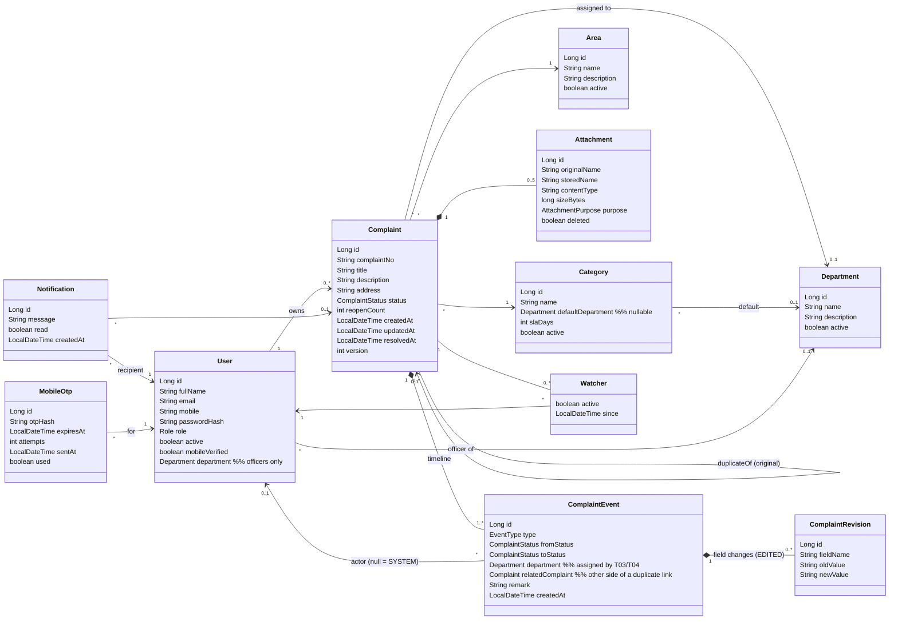
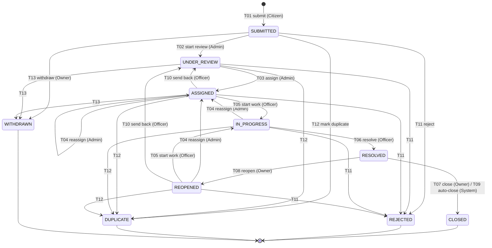

# 05 — Domain Model & Business Rules

| | |
|---|---|
| **Status** | Draft |
| **Depends on** | 02 Glossary, 03 Requirements, 04 Use Cases |

This document is the **single source of truth** for the complaint lifecycle. The service layer implements the transition table in §3 exactly, and the tests in doc 13 cover every row in it.

---

## 1. Domain model

### 1.1 Enumerations

| Enum | Values |
|---|---|
| `Role` | `CITIZEN`, `OFFICER`, `ADMIN` |
| `ComplaintStatus` | `SUBMITTED`, `UNDER_REVIEW`, `ASSIGNED`, `IN_PROGRESS`, `RESOLVED`, `REOPENED`, `CLOSED`, `REJECTED`, `DUPLICATE`, `WITHDRAWN` |
| `EventType` | `CREATED`, `STATUS_CHANGED`, `REASSIGNED`, `REMARK`, `EDITED`, `DUPLICATE_LINKED` (on the duplicate), `DUPLICATE_RECEIVED` (on the original), `AUTO_CLOSED` |
| `AttachmentPurpose` | `COMPLAINT` (from the citizen), `RESOLUTION` (from the officer, FR-48) |

### 1.2 Design notes
- **One timeline:** every visible entry is a `ComplaintEvent`. An edit is one `EDITED` event with one `ComplaintRevision` row per changed field. Attachment add or remove is a revision with `fieldName = "attachment"`, e.g. `old = null, new = "photo1.jpg"`.
- **Status lives on the complaint.** Events are the history, and they are append-only.
- **Watcher** is a link table between Complaint and User with an `active` flag. Unwatch sets the flag to false; the row is never deleted.
- **`version`** is used for optimistic locking (BR-71).

---

## 2. State machine

**Final statuses:** `CLOSED`, `REJECTED`, `DUPLICATE`, `WITHDRAWN`. Nothing moves out of them, and the complaint becomes read-only.
**Open statuses:** `SUBMITTED`, `UNDER_REVIEW`, `ASSIGNED`, `IN_PROGRESS`, `REOPENED`. `RESOLVED` is "awaiting citizen review" and counts as neither open nor final.

## 3. Transition table

"Officer" always means an officer **of the complaint's current department**. "Admin may also" corresponds to FR-36 (Should).

| ID | Action | From | To | Allowed actor | Guards (all must hold) | Required input | Side effects |
|---|---|---|---|---|---|---|---|
| T01 | Submit | — | `SUBMITTED` | Verified citizen (BR-86) | Valid fields and files (BR-20 to BR-27); daily limit (BR-88) | form | Generate `complaintNo` (BR-10). Event `CREATED`. Notify owner and admins. |
| T02 | Start review | `SUBMITTED` | `UNDER_REVIEW` | Admin | — | — | Event. Notify owner. |
| T03 | Assign | `UNDER_REVIEW` | `ASSIGNED` | Admin | Department active | department, remark (optional) | Set `department`. Event. Notify owner, watchers, department officers. |
| T04 | Reassign | `ASSIGNED`, `IN_PROGRESS`, `REOPENED` | `ASSIGNED` | Admin | New department ≠ current, and active | department, **remark** | Event `REASSIGNED`. Notify owner, watchers, new department officers. |
| T05 | Start work | `ASSIGNED`, `REOPENED` | `IN_PROGRESS` | Officer (Admin may also) | — | **remark** | Event. Notify owner and watchers. |
| — | Progress remark | `IN_PROGRESS` | (no change) | Officer (Admin may also) | — | **remark** | Event `REMARK`. Notify owner and watchers. |
| T06 | Resolve | `IN_PROGRESS` | `RESOLVED` | Officer (Admin may also) | Resolution files valid (FR-48) | **remark** | `resolvedAt = now`. Event. Notify owner and watchers with the review deadline. |
| T07 | Close | `RESOLVED` | `CLOSED` | Owner | `now ≤ resolvedAt + reviewWindow` | feedback (optional) | Event. Notify department officers. |
| T08 | Reopen | `RESOLVED` | `REOPENED` | Owner | Within the window; `reopenCount < maxReopens` | **reason** | `reopenCount++`, `resolvedAt = null`. Event. Notify department officers and admins. |
| T09 | Auto-close | `RESOLVED` | `CLOSED` | System | `now > resolvedAt + reviewWindow` | — | Event `AUTO_CLOSED` (actor null). Notify owner and department officers. |
| T10 | Send back | `ASSIGNED`, `REOPENED` | `UNDER_REVIEW` | Officer | — | **remark** | `department = null`. Event. Notify admins. |
| T11 | Reject | `SUBMITTED`, `UNDER_REVIEW`, `ASSIGNED`, `IN_PROGRESS`, `REOPENED` | `REJECTED` | Admin: any of these. Officer: `ASSIGNED`, `IN_PROGRESS`, `REOPENED` | — | **reason** | Event. Notify owner and watchers. |
| T12 | Mark duplicate | same as T11 | `DUPLICATE` | Admin: any of these. Officer: `ASSIGNED`, `IN_PROGRESS`, `REOPENED` | BR-40 to BR-46 | original number, **note** | See BR-44. |
| T13 | Withdraw | `SUBMITTED`, `UNDER_REVIEW`, `ASSIGNED` | `WITHDRAWN` | Owner | No duplicates linked to it (BR-47) | **reason** | Event. Notify admins, and department officers if assigned. |
| — | Edit | `SUBMITTED`, `UNDER_REVIEW` | (no change) | Owner | At least one field changed; files valid | form, reason (optional) | Event `EDITED` with revisions. Notify admins. |
| — | Unwatch / Watch again | any | (no change) | Watcher / linked-duplicate owner | BR-50 to BR-52 | — | Toggle `Watcher.active`. No event, because it is a personal setting. |

Any action not listed for a given status and actor is **refused** (FR-83). If the actor cannot even view the complaint, the answer is **404** (BR-60).

Remark, reason and note fields are 10–500 characters when required, and at most 500 when optional.

---

## 4. Business rules

### 4.1 Complaint number
| ID | Rule |
|---|---|
| BR-10 | The format is `GRV-{YYYY}-{NNNNNN}`, e.g. `GRV-2026-000123`. `YYYY` is the submission year in Asia/Kolkata. `NNNNNN` is zero-padded and restarts at 000001 each year. |
| BR-11 | The sequence comes from a `complaint_sequence(seq_year, last_number)` row (doc 08 §5.9), read with `SELECT … FOR UPDATE` in the same transaction as the insert. Two parallel submissions therefore never get the same number, and a rollback never leaves a gap. |
| BR-12 | `complaintNo` is unique (DB constraint) and never changes. The internal numeric `id` is never shown to users. |

### 4.2 Complaint data
| ID | Rule |
|---|---|
| BR-20 | Title 5–100, description 20–2000, address 5–255 characters, trimmed. Must not be empty after trimming. |
| BR-21 | Category and area must be **active** when a complaint is created or edited. An existing complaint keeps an inactive category or area until it is edited. |
| BR-22 | Each attachment: JPG, PNG or PDF, ≤ 5 MB, with the type detected from magic bytes (`FFD8FF`, `89504E47`, `25504446`). |
| BR-23 | At most **5 active `COMPLAINT` attachments** per complaint, counted after the edit has been applied. `RESOLUTION` attachments are limited separately to 3. |
| BR-24 | Files are stored as `{uploadDir}/{yyyy}/{MM}/{uuid}.{ext}`. The original filename is kept only as metadata, cleaned of path characters and limited to 255 characters. |
| BR-25 | A file is written to disk **before** the DB commit. If the transaction rolls back, the files written for it are deleted. |
| BR-26 | Removing an attachment only sets `deleted = true`. The file stays on disk, and only Admins can open deleted attachments. |
| BR-27 | An edit that changes nothing creates no event (UC-11, 5a). |

### 4.3 Resolution review
| ID | Rule |
|---|---|
| BR-30 | Review deadline = `resolvedAt + app.complaint.review-window-days` (default 7). |
| BR-31 | Close and reopen are allowed only for the owner, and only up to the deadline. After that, only the auto-close job can move the complaint. |
| BR-32 | `maxReopens` defaults to 2. When `reopenCount == maxReopens`, Reopen is hidden and refused. |
| BR-33 | Each resolve sets a new `resolvedAt`, so every resolution gets a full review window. |

### 4.4 Duplicates & watchers
| ID | Rule |
|---|---|
| BR-40 | The original **A** must exist and differ from the duplicate **B**. |
| BR-41 | **A** must be actively handled: `ASSIGNED`, `IN_PROGRESS` or `REOPENED`. |
| BR-42 | **A** must not be a duplicate itself, so links are never chained. With BR-41, this also excludes final complaints. |
| BR-43 | **Officer:** both A and B must be in the officer's department (D13). **Admin:** any departments. |
| BR-44 | Effects in one transaction: B becomes `DUPLICATE` with `B.duplicateOf = A`. Event `DUPLICATE_LINKED` on B (note), and event `DUPLICATE_RECEIVED` on A ("GRV-B linked as duplicate"). B's owner and all active watchers of B become **active watchers of A**, skipping A's owner and anyone already active. A previously inactive watcher row is reactivated. Notify B's owner and B's watchers. |
| BR-45 | B's watcher rows stay as they are. B is final, so they receive nothing further. |
| BR-46 | A `DUPLICATE` complaint is read-only, and its detail page always links to A. |
| BR-47 | A complaint that has at least one linked duplicate (`exists complaint where duplicateOf = this`) **cannot be withdrawn**. Other citizens depend on it. |
| BR-50 | Watchers receive the same status notifications as the owner, but cannot perform owner actions such as edit, withdraw, close or reopen. |
| BR-51 | Unwatch sets `active = false`. The complaint leaves the Watching list and its notifications stop. |
| BR-52 | The owner of a duplicate B can always **view** A, even after unwatching, and can set `active = true` again (Watch again). |

### 4.5 Access policy (`ComplaintAccessPolicy`)
| ID | Rule |
|---|---|
| BR-60 | **canView(user, c)** is true when: user is `ADMIN`; **or** user is `OFFICER` and `c.department = user.department`; **or** user is `CITIZEN` and (`c.owner = user`, **or** user has an *active* watcher row on c, **or** user owns a complaint d with `d.duplicateOf = c`). Otherwise the answer is **404**. |
| BR-61 | **canAct(user, c, action)** requires canView **and** the actor and status rules of §3. Failing canView gives 404. Failing only the action rules gives the "action not allowed" message (R-STATE). |
| BR-62 | Access to an attachment = canView(parent complaint). Deleted attachments are visible to Admins only. |
| BR-63 | An officer loses access to a complaint once it is reassigned or sent back to another department. Access always follows the **current** department. |
| BR-64 | Lists (My Complaints, Watching, Department Queue, All Complaints) are filtered in SQL with the same rules, so a complaint the user cannot open never appears in a list. |

### 4.6 Overdue
| ID | Rule |
|---|---|
| BR-65 | A complaint is overdue when its status is open (`SUBMITTED`, `UNDER_REVIEW`, `ASSIGNED`, `IN_PROGRESS`, `REOPENED`) **and** `now > createdAt + category.slaDays`. It is calculated in queries, never stored. |
| BR-66 | Days overdue = `floor(now − (createdAt + slaDays))` in days. It is shown to Officers and Admins only. |

### 4.7 Notifications
| ID | Rule |
|---|---|
| BR-67 | Recipients are listed per transition in §3. "Department officers" means the **active** officers of the complaint's current department. "Admins" means all **active** admins. |
| BR-68 | The actor is never notified of their own action, with one deliberate exception: the owner's confirmation of T01 Submit (FR-15, D104). Each recipient gets at most one notification per event, even if they qualify in more than one way. |
| BR-69 | Message templates are fixed, e.g. "`{complaintNo}` is now **In Progress**: {remark}". Each notification links to the complaint detail page. |

### 4.8 Integrity & concurrency
| ID | Rule |
|---|---|
| BR-70 | Each action is **one transaction**: status update, event(s), revisions, watcher changes and notifications are all saved, or none are (NFR-30). |
| BR-71 | **Optimistic locking:** every form carries the complaint `version`. Updates run `… WHERE id = ? AND version = ?` and do `version = version + 1`. If no row is updated, the action fails with the "updated by someone else" message (FR-84). |
| BR-72 | Events and revisions are insert-only. There is no update or delete path in code. |
| BR-73 | Departments, categories, areas and users are never hard-deleted once anything refers to them. They are deactivated instead (FR-50). |
| BR-74 | Timestamps are stored as `DATETIME` in Asia/Kolkata, with the app and the JDBC connection both set to that time zone, and are shown per NFR-23. |

### 4.9 Accounts
| ID | Rule |
|---|---|
| BR-80 | Email is stored lower-cased and is unique across all roles. |
| BR-81 | An `OFFICER` must have a department. `CITIZEN` and `ADMIN` must not have one. |
| BR-82 | The system must always have at least one active Admin, so the last active Admin cannot be deactivated. |
| BR-83 | Deactivating a user ends their access at the next request. Their existing complaints and history stay unchanged. |
| BR-84 | Mobile number: 10 digits starting with 6–9, unique across all users. |
| BR-85 | OTP: 6 digits from `SecureRandom`, stored **hashed** (HMAC-SHA256 with an in-memory key, never in plain text, doc 11 §6.2), valid 5 minutes, at most 3 attempts. An attempt is reserved atomically before the code is compared, so parallel guesses cannot exceed the limit (doc 11 §6.3). A new OTP invalidates earlier unused ones. Resend cooldown is 60 seconds, with at most 5 sends per hour per user. |
| BR-86 | T01 (Submit) additionally requires `owner.mobileVerified = true`. |
| BR-87 | Officers and Admins are created with `mobileVerified = true`. |
| BR-88 | A citizen can submit at most **10 complaints in any 24 hours** (`app.complaint.max-per-day`). The 11th submission is refused with a form error. Protects disk space and staff time (doc 11 §7.4, D68). |
| BR-89 | Every update of a user row increments `app_user.version`; an open session notices the change at its next request (deactivation ends it, other changes refresh it; doc 11 §3.10, D59). |

---

## 5. Worked scenarios (also used as test cases in doc 13)

| # | Scenario | Expected |
|---|---|---|
| S1 | Mahesh submits, the admin reviews and assigns to Water Supply, an officer starts work, then resolves | `GRV-2026-000001`. Timeline: CREATED → UNDER_REVIEW → ASSIGNED → IN_PROGRESS → RESOLVED. Mahesh gets 5 notifications: the registration confirmation and 4 status changes (D104). |
| S2 | Jayesh submits the same leak. The admin assigns it to Water Supply. An officer marks it a duplicate of 000001 | 000002 is `DUPLICATE`. Jayesh is an active watcher of 000001. Event `DUPLICATE_RECEIVED` on 000001. |
| S3 | The officer resolves 000001 | Mahesh and Jayesh are notified. Only Mahesh sees Close and Reopen. |
| S4 | Mahesh reopens, then the officer starts work and resolves it again, then Mahesh closes it | `reopenCount = 1`. Final status `CLOSED`. Jayesh is notified of the new In Progress and Resolved steps; reopen and close go to staff only (FR-70, D104). |
| S5 | Jayesh unwatches 000001, then opens it via 000002 | No more notifications. He can still view it and **Watch again**. |
| S6 | Mahesh tries to withdraw 000001 while it is `ASSIGNED`, with 000002 linked | Refused (BR-47). |
| S7 | An officer of Sanitation opens `/complaints/GRV-2026-000001` | 404. |
| S8 | An officer tries to mark a Sanitation complaint as a duplicate of a Water Supply complaint | Refused (BR-43). Officer uses Send back instead. |
| S9 | A complaint stays `RESOLVED` for 8 days | The hourly job closes it with `AUTO_CLOSED`. |
| S10 | Two officers click Resolve at the same moment | One succeeds. The other sees "updated by someone else". |
| S11 | A citizen edits the title while the complaint is `UNDER_REVIEW` | Event `EDITED` with revision `title: old → new`. Admins notified. |
| S12 | A citizen uploads a `.exe` renamed to `.jpg` | Rejected by the magic-byte check (BR-22). |

## Change log
| Date | Change |
|---|---|
| 2026-11-22 | Initial draft (includes D13, D14) |
| 2026-11-22 | Added MobileOtp, BR-84 to BR-87 (D16) |
| 2026-11-22 | Doc 08 alignment: BR-11 column names `seq_year`, `last_number` (D17); `ComplaintEvent.department` and `relatedComplaint`, `Area.description` (D20) |
| 2026-11-22 | BR-85 hashing and attempt reservation, new BR-88 (daily complaint limit) and BR-89 (user version), from doc 11 (D59, D66, D68) |
| 2026-11-23 | Doc 13 alignment: BR-68 names the T01 owner confirmation as its one exception; expected results of S1 (5 notifications) and S4 (watcher not notified of reopen/close) corrected (D104) |
