# 06 — Flow Diagrams

| | |
|---|---|
| **Status** | Draft |
| **Depends on** | 04 Use Cases, 05 Domain Model & Business Rules |

All diagrams are in **Mermaid**, so GitHub renders them directly. For the project report, export them as PNG (see §6).
Class names in the sequence diagrams (`ComplaintController`, `ComplaintService`, …) are indicative and are fixed in doc 07.

| Section | Diagrams |
|---|---|
| §1 Data Flow Diagrams | DFD-0 (context), DFD-1 |
| §2 End-to-end lifecycle | Swimlane overview |
| §3 Activity diagrams | AD-01 … AD-08 |
| §4 Sequence diagrams | SD-01 … SD-07 |
| §5 Web request pattern | Post/Redirect/Get |

---

## 1. Data Flow Diagrams

Notation: rectangle = external entity, rounded = process, cylinder = data store.

### DFD-0 — Context diagram

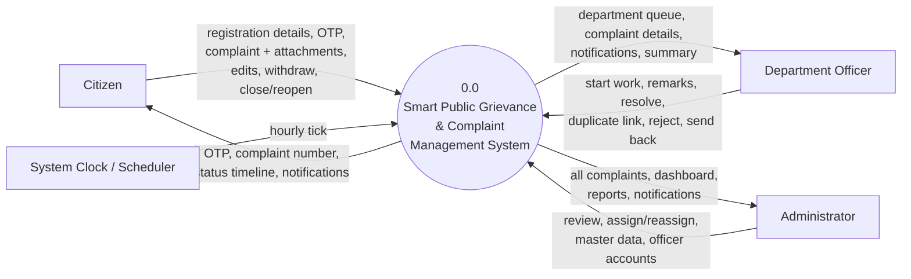

### DFD-1 — Main processes

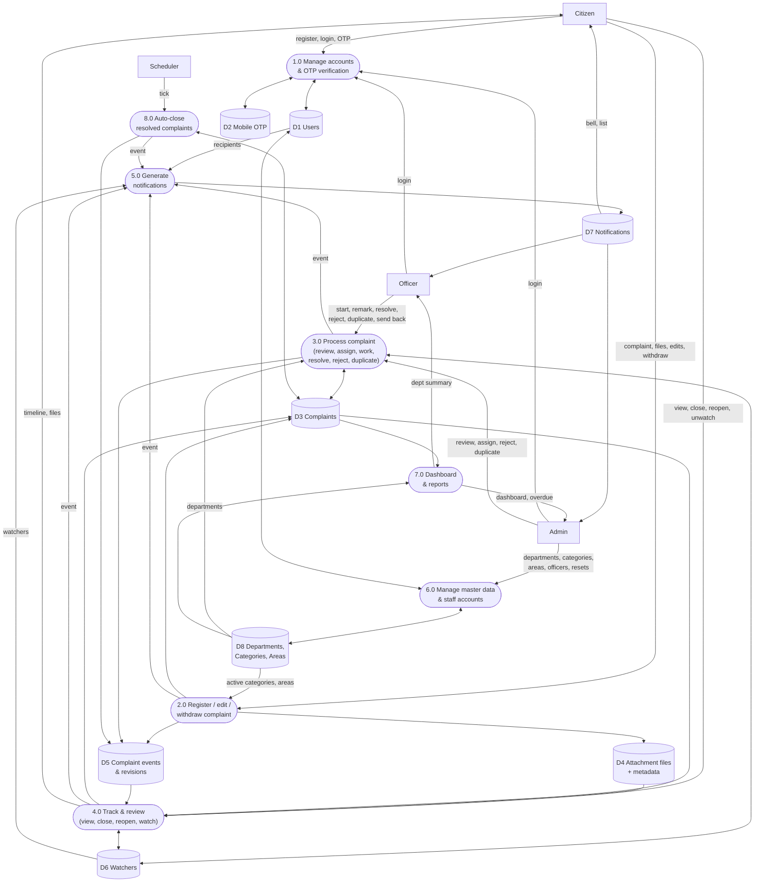

---

## 2. End-to-end lifecycle (swimlane overview)

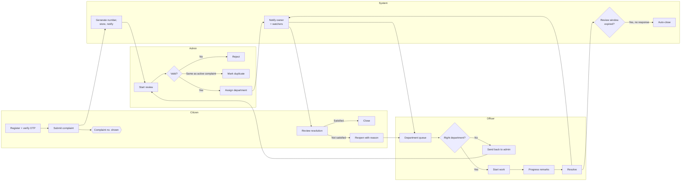

---

## 3. Activity diagrams

### AD-01 Registration & mobile OTP verification (UC-01, UC-04)

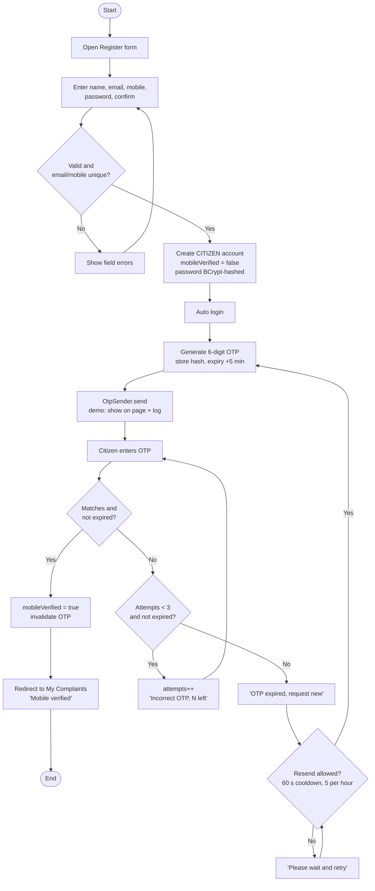

### AD-02 Submit complaint (UC-10)

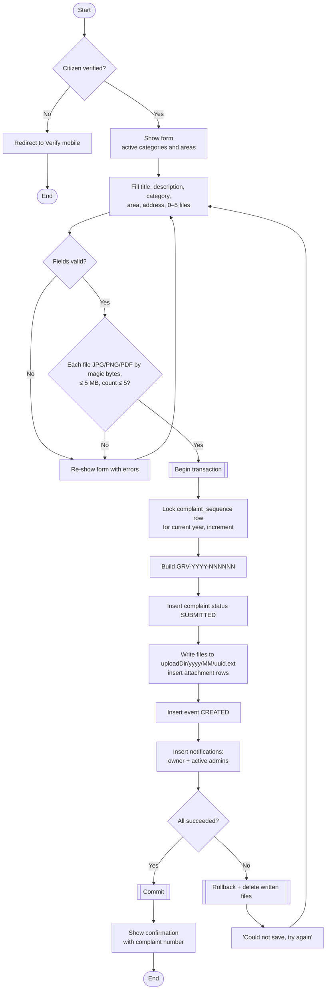

### AD-03 Admin review & assignment (UC-20, UC-21, UC-22)

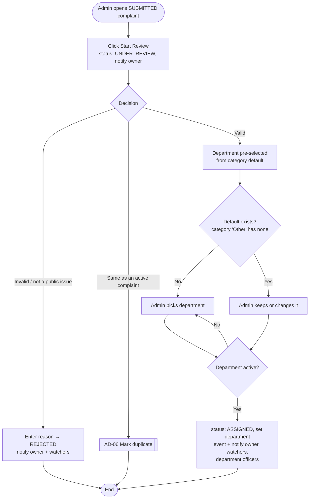

### AD-04 Officer work & resolution (UC-30 to UC-34)

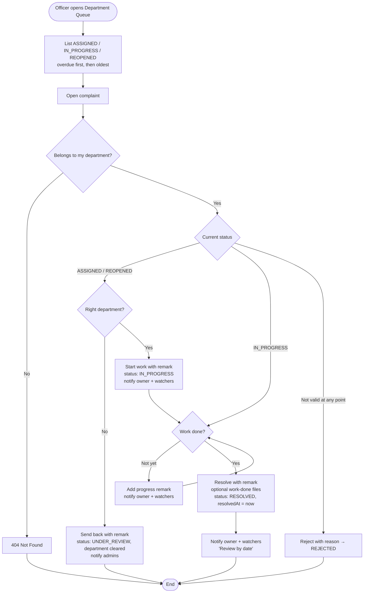

### AD-05 Citizen review of resolution (UC-15)

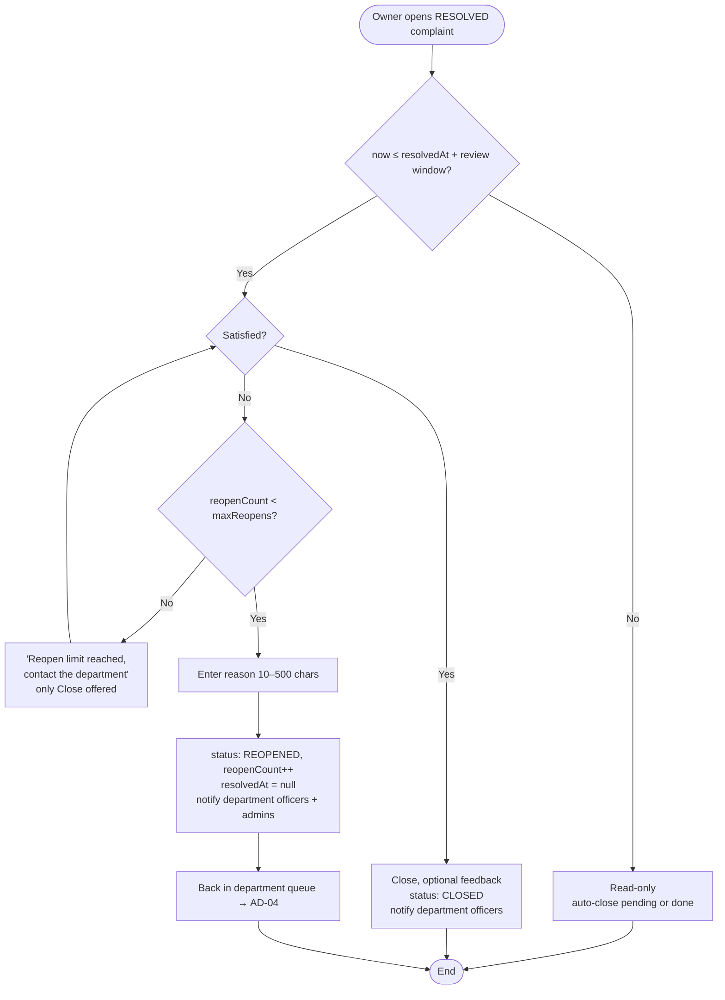

### AD-06 Mark complaint as duplicate (UC-23)

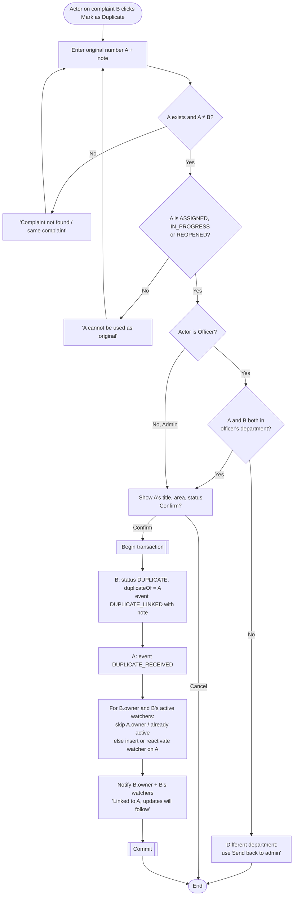

### AD-07 Edit or withdraw complaint (UC-11, UC-12)

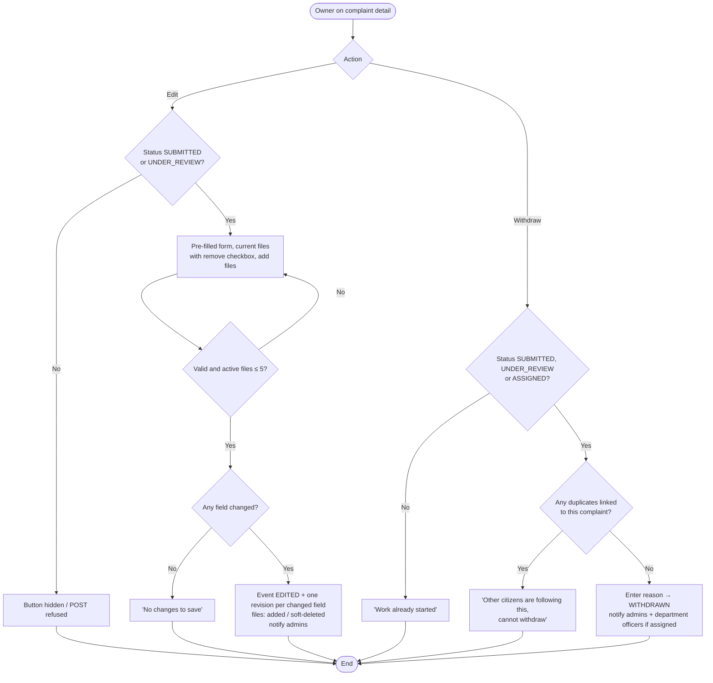

### AD-08 Auto-close job (UC-70)

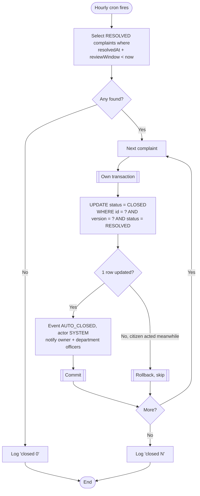

---

## 4. Sequence diagrams

### SD-01 Submit complaint (UC-10)

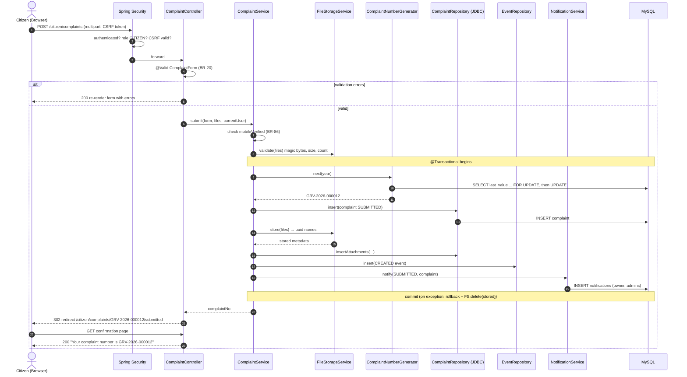

### SD-02 Generic status transition with access check and optimistic lock (T02–T13)

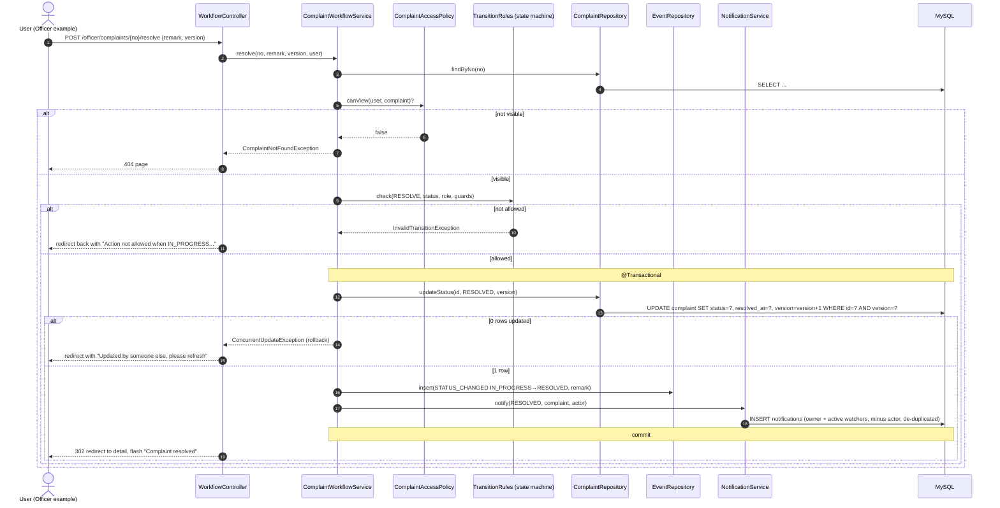

### SD-03 Mark duplicate (UC-23)

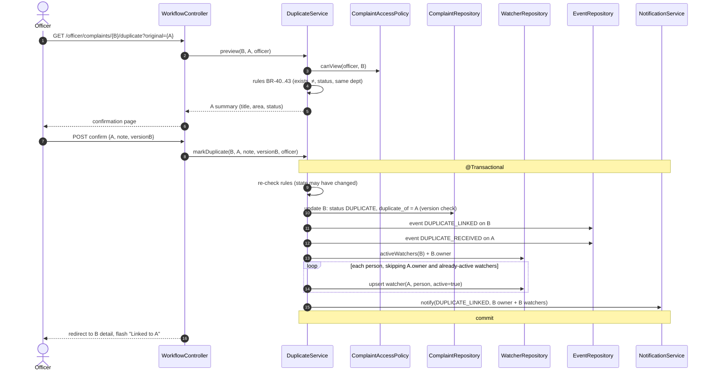

### SD-04 OTP verification (UC-04)

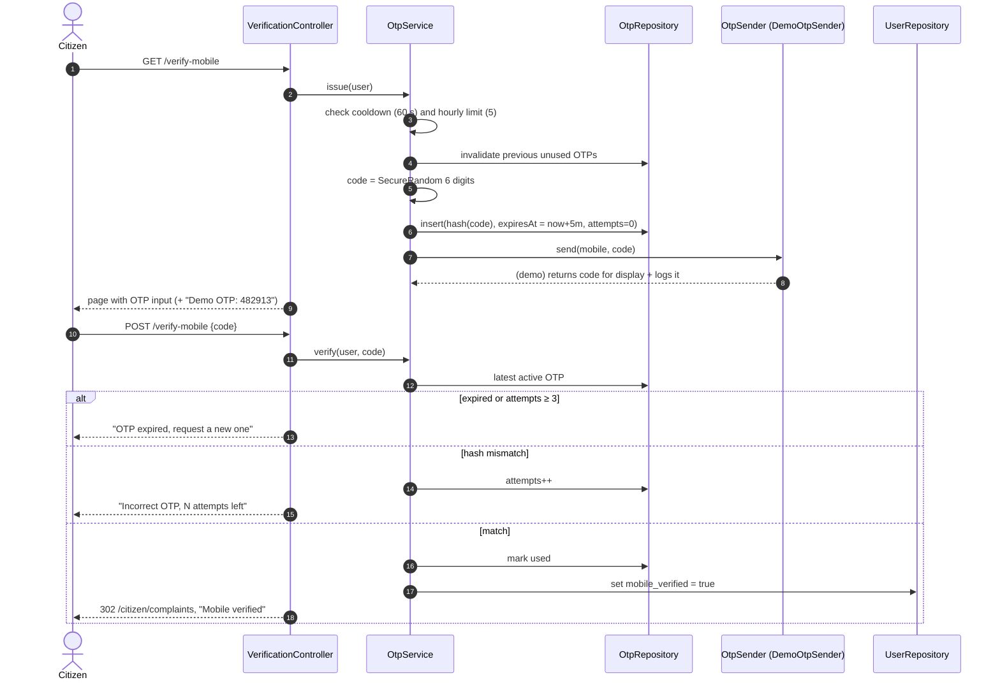

### SD-05 Auto-close job (UC-70)

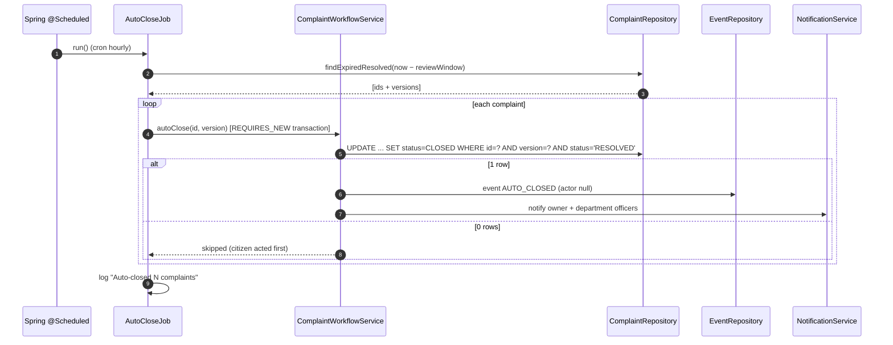

### SD-06 View attachment (UC-16)

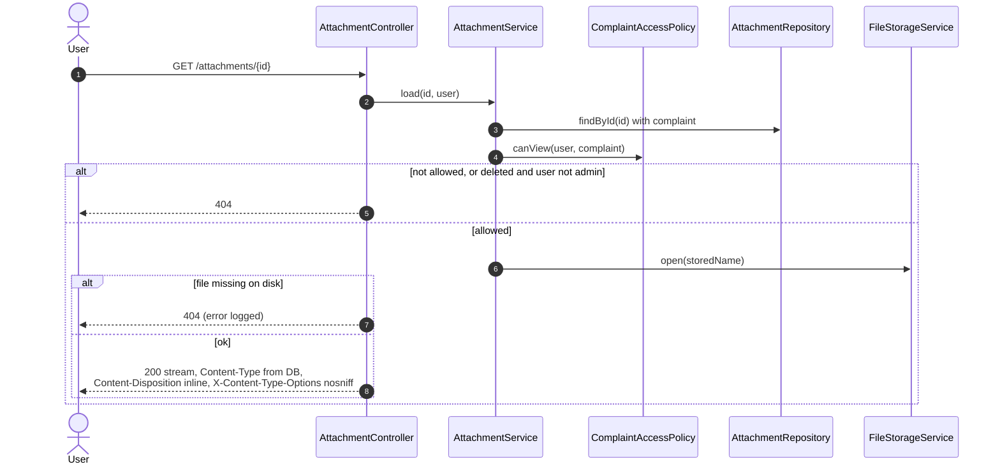

### SD-07 Login and role-based landing (UC-02)

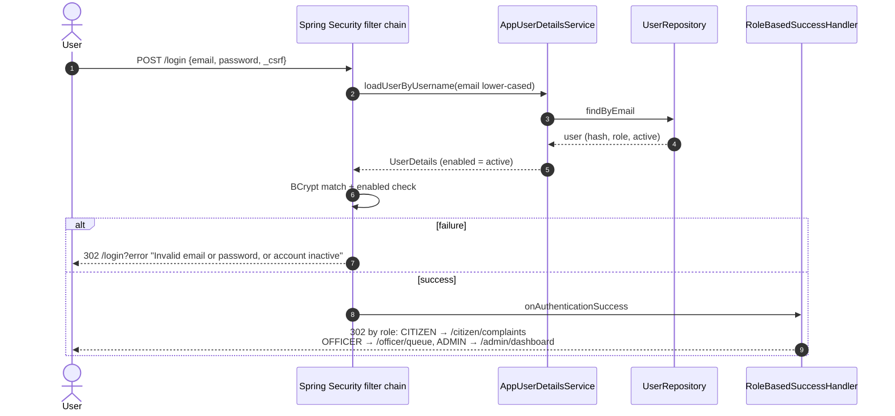

---

## 5. Web request pattern (applies to every form)

All state-changing actions use **Post/Redirect/Get**, so a browser refresh never resubmits a form:

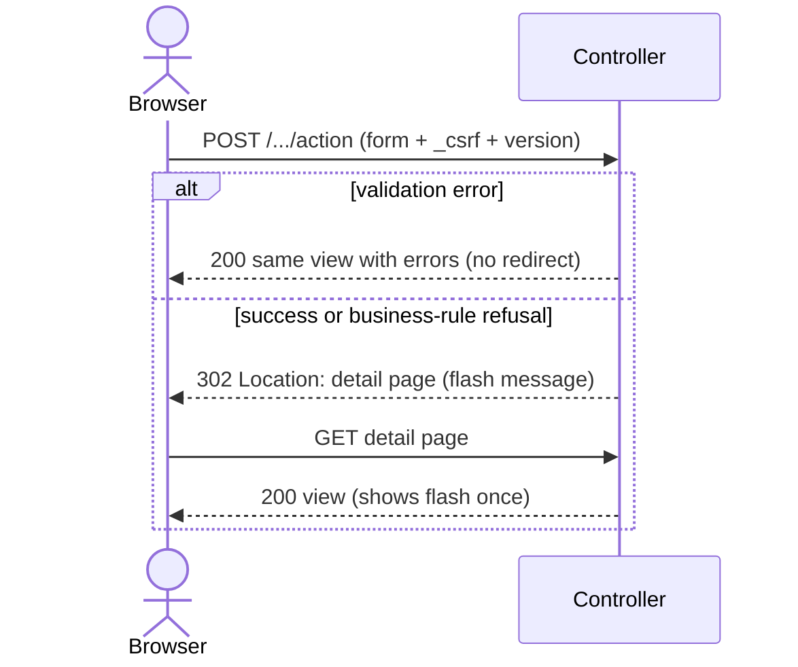

---

## 6. Exporting diagrams for the report

- **GitHub / IntelliJ:** Mermaid renders in the Markdown preview.
- **PNG export:** paste a diagram into <https://mermaid.live> and download PNG/SVG, or use the CLI: `npx -p @mermaid-js/mermaid-cli mmdc -i docs/specs/06-flow-diagrams.md -o docs/diagrams/flow.png`.
- Store exported images in `docs/diagrams/`, named by diagram ID (e.g. `AD-06.png`).

## Change log
| Date | Change |
|---|---|
| 2026-11-22 | Initial draft |
