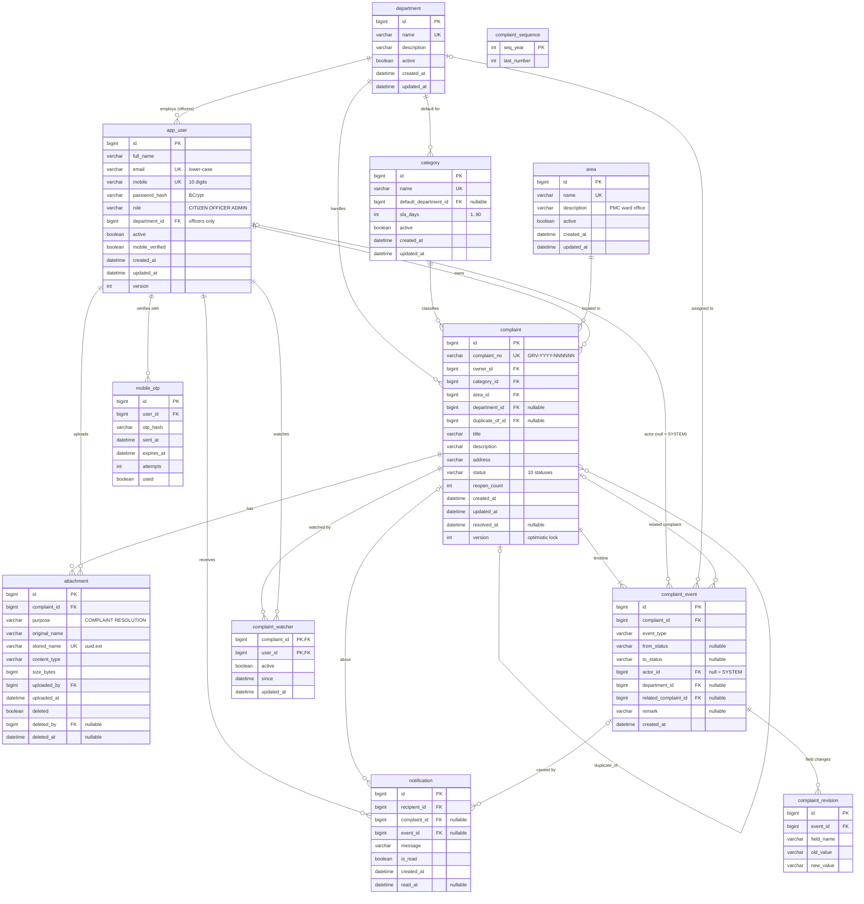

# 08 — Database Design

| | |
|---|---|
| **Status** | Draft |
| **Depends on** | 00 Plan (D1–D16), 03 Requirements, 05 Domain Model & Business Rules, 07 Architecture (ADR-02, ADR-03, ADR-09, ADR-11, ADR-13), Appendix A |

This document defines how the data is stored: the tables, their columns and constraints, the indexes, the Flyway migrations, and the main SQL statements the repositories run. The SQL files themselves are in `docs/db/`:

| File | Purpose |
|---|---|
| `docs/db/migration/V1__schema.sql` | All tables, constraints and indexes |
| `docs/db/migration/V2__reference_data.sql` | Departments, categories and areas (Appendix A §1–3) |
| `docs/db/verify/sample-data.sql` | A few sample rows, used **only** to check the queries in §5 |
| `docs/db/verify/key-queries.sql` | The queries of §5 in runnable form |
| `docs/db/verify/run-verification.py`, `concurrency-test.sh`, `load-10k.sql`, `load-10k-queries.sql` | Verification scripts (§9) |
| `docs/db/verify/verification-output.txt` | Output of the last verification run |

The two migration files are copied unchanged into `app/src/main/resources/db/migration/` when the app is created.

---

## 1. Design principles

| # | Principle | Why |
|---|---|---|
| P1 | **Portable SQL.** The same migrations run on MySQL 8.x and on H2 in MySQL mode. No `ENUM`, no `ON UPDATE CURRENT_TIMESTAMP`, no table options, no stored procedures or triggers. Statuses and roles are `VARCHAR` + `CHECK`. | ADR-13: `mvn test` runs on H2 without installing MySQL. |
| P2 | **No reserved words as names.** The user table is `app_user` (`USER` is reserved in H2). The sequence columns are `seq_year` and `last_number` (`YEAR` is reserved in H2, `LAST_VALUE` in MySQL 8). The notification flag is `is_read`. | Names work in both databases without quoting (D17). |
| P3 | **Time comes from the application.** Every `DATETIME` value is written by the app from the injected `Clock` (Asia/Kolkata). Columns have no time defaults, and queries receive `:now` as a parameter instead of calling `NOW()`. | ADR-11, BR-74. Tests can fix the clock, and both databases behave the same (D18). |
| P4 | **The database guards the invariants.** Foreign keys, unique keys and `CHECK` constraints repeat the most important business rules (one department per officer, `DUPLICATE` ⇔ linked, and so on). Limits that are configurable (file size, OTP attempts, max reopens) stay in code only. | NFR-32. A bug in a service cannot leave a complaint in an impossible state (D21). |
| P5 | **Nothing is hard-deleted** except purgeable notifications and old OTP rows (§7). Master data and users are deactivated, attachments are soft-deleted, and events and revisions are insert-only. | BR-26, BR-72, BR-73, D11. |
| P6 | **Surrogate keys.** Every table has a `BIGINT AUTO_INCREMENT` primary key, except the watcher link table (composite key) and `complaint_sequence` (key = year). The internal `id` is never shown to users. | BR-12. |
| P7 | **Explicit names** for every constraint and index: `pk_`, `fk_`, `uq_`, `ck_`, `ix_` + table + column(s). | Error messages and the viva are easier to read. MySQL needs check names to be unique per schema. |
| P8 | **utf8mb4.** The database is created with `CHARACTER SET utf8mb4 COLLATE utf8mb4_0900_ai_ci` (doc 14), and the tables inherit it. | Marathi and Hindi names and addresses, and emoji in descriptions, are stored correctly (D29). |

---

## 2. ER diagram



### 2.1 Mapping to the domain model (doc 05 §1)

| Domain class | Table | Notes |
|---|---|---|
| `User` | `app_user` | Renamed because `USER` is reserved in H2. |
| `MobileOtp` | `mobile_otp` | |
| `Department`, `Category`, `Area` | `department`, `category`, `area` | `area.description` holds the PMC ward office (D20). |
| `Complaint` | `complaint` | `duplicateOf` → `duplicate_of_id`. |
| `Attachment` | `attachment` | Adds who uploaded and who deleted (audit, FR-17). |
| `ComplaintEvent` | `complaint_event` | Adds `department_id` and `related_complaint_id` (D20). |
| `ComplaintRevision` | `complaint_revision` | |
| `Watcher` | `complaint_watcher` | Composite key (complaint, user). |
| `Notification` | `notification` | Adds `event_id` (D22) and `read_at`. |
| — | `complaint_sequence` | Technical table for BR-11. |

---

## 3. Data dictionary

Column types are the same on both databases. In MySQL, `BOOLEAN` is stored as `TINYINT(1)`. All `VARCHAR` lengths are in characters. "App" in the Default column means the value is always supplied by the application (P3).

### 3.1 `department`

| Column | Type | Null | Default | Constraints | Meaning | Supports |
|---|---|:-:|---|---|---|---|
| `id` | BIGINT | N | auto | PK | Surrogate key | — |
| `name` | VARCHAR(100) | N | | `uq_department_name`; `ck_department_name` (≥ 2 chars after trim) | Department name, e.g. "Water Supply" | FR-50 |
| `description` | VARCHAR(255) | Y | | | Short description | FR-50 |
| `active` | BOOLEAN | N | TRUE | | Inactive departments are hidden in assignment forms | FR-50, FR-56, BR-73 |
| `created_at`, `updated_at` | DATETIME | N | App | | Audit times | — |

### 3.2 `category`

| Column | Type | Null | Default | Constraints | Meaning | Supports |
|---|---|:-:|---|---|---|---|
| `id` | BIGINT | N | auto | PK | | — |
| `name` | VARCHAR(100) | N | | `uq_category_name`; `ck_category_name` | e.g. "Water Leakage" | FR-51 |
| `default_department_id` | BIGINT | Y | | FK → `department` | Pre-selected on the assign form. NULL for "Other" (the admin decides). | FR-32, FR-51 |
| `sla_days` | INT | N | | `ck_category_sla_days` (1–90) | Days allowed before a complaint is overdue | FR-51, BR-65 |
| `active` | BOOLEAN | N | TRUE | | Inactive categories cannot be chosen for new or edited complaints | BR-21, FR-56 |
| `created_at`, `updated_at` | DATETIME | N | App | | | — |

### 3.3 `area`

| Column | Type | Null | Default | Constraints | Meaning | Supports |
|---|---|:-:|---|---|---|---|
| `id` | BIGINT | N | auto | PK | | — |
| `name` | VARCHAR(100) | N | | `uq_area_name`; `ck_area_name` | PMC locality, e.g. "Kothrud" | FR-52, D15 |
| `description` | VARCHAR(255) | Y | | | Ward office, shown only to the admin | Appendix A §1 |
| `active` | BOOLEAN | N | TRUE | | | BR-21, FR-56 |
| `created_at`, `updated_at` | DATETIME | N | App | | | — |

### 3.4 `app_user`

| Column | Type | Null | Default | Constraints | Meaning | Supports |
|---|---|:-:|---|---|---|---|
| `id` | BIGINT | N | auto | PK | | — |
| `full_name` | VARCHAR(100) | N | | | Display name | FR-01 |
| `email` | VARCHAR(254) | N | | `uq_app_user_email`; `ck_app_user_email_lower` (`email = LOWER(email)`) | Login name, always lower-case | FR-02, BR-80 |
| `mobile` | VARCHAR(10) | N | | `uq_app_user_mobile`; `ck_app_user_mobile` (length 10) | Mobile number. The "starts with 6–9, digits only" rule is checked in code. | FR-09, BR-84 |
| `password_hash` | VARCHAR(100) | N | | | BCrypt hash (60 chars today; room for other encoders) | NFR-01 |
| `role` | VARCHAR(10) | N | | `ck_app_user_role` (`CITIZEN`, `OFFICER`, `ADMIN`) | Role | D1 |
| `department_id` | BIGINT | Y | | FK → `department`; `ck_app_user_officer_dept` | Officer's department. Required for officers, forbidden for others. | BR-81, FR-53 |
| `active` | BOOLEAN | N | TRUE | | Inactive users cannot log in | FR-05, BR-83 |
| `mobile_verified` | BOOLEAN | N | FALSE | `ck_app_user_staff_verified` (officers and admins must be TRUE) | Set by OTP verification or by the admin | FR-09, FR-09c, BR-86, BR-87 |
| `created_at`, `updated_at` | DATETIME | N | App | | | — |
| `version` | INT | N | 0 | `ck_app_user_version` (≥ 0) | Optimistic lock for admin edits (department change, activate) | ADR-09 |

### 3.5 `mobile_otp`

| Column | Type | Null | Default | Constraints | Meaning | Supports |
|---|---|:-:|---|---|---|---|
| `id` | BIGINT | N | auto | PK | | — |
| `user_id` | BIGINT | N | | FK → `app_user` | Citizen being verified | FR-09 |
| `otp_hash` | VARCHAR(100) | N | | | Hash of the 6-digit code, never the code itself | BR-85 |
| `sent_at` | DATETIME | N | App | | When it was issued. Used for the 60 s cooldown and the 5-per-hour limit. | BR-85 |
| `expires_at` | DATETIME | N | App | `ck_mobile_otp_expiry` (> `sent_at`) | `sent_at + 5 min` | BR-85 |
| `attempts` | INT | N | 0 | `ck_mobile_otp_attempts` (≥ 0) | Wrong attempts so far. The limit (3) is configurable, so it is checked in code. | BR-85 |
| `used` | BOOLEAN | N | FALSE | | TRUE once the code was accepted **or** replaced by a newer OTP. Only rows with `used = FALSE` can be verified. | BR-85 |

### 3.6 `complaint_sequence`

| Column | Type | Null | Default | Constraints | Meaning | Supports |
|---|---|:-:|---|---|---|---|
| `seq_year` | INT | N | | PK; `ck_complaint_sequence_year` (2000–9999) | Submission year in Asia/Kolkata | BR-10 |
| `last_number` | INT | N | 0 | `ck_complaint_sequence_number` (0–999999) | Last number issued in that year. The check stops a seventh digit from ever being generated. | BR-10, BR-11 |

No rows are created by migrations. The generator creates the row for a year on the first submission of that year (§5.9), and the dev seeder sets it after loading the demo complaints (§4.4).

### 3.7 `complaint`

| Column | Type | Null | Default | Constraints | Meaning | Supports |
|---|---|:-:|---|---|---|---|
| `id` | BIGINT | N | auto | PK | Internal key, never shown | BR-12 |
| `complaint_no` | VARCHAR(20) | N | | `uq_complaint_no`; `ck_complaint_no_format` (15 chars, `GRV-____-______`) | Public number, never changes | FR-12, BR-10, BR-12 |
| `owner_id` | BIGINT | N | | FK → `app_user` | Citizen who submitted it | FR-10, BR-60 |
| `category_id` | BIGINT | N | | FK → `category` | | FR-10, BR-21 |
| `area_id` | BIGINT | N | | FK → `area` | | FR-10, D5 |
| `department_id` | BIGINT | Y | | FK → `department`; `ck_complaint_dept_required`, `ck_complaint_dept_forbidden` | **Current** department. Required in `ASSIGNED`, `IN_PROGRESS`, `RESOLVED`, `REOPENED`; must be NULL in `SUBMITTED`, `UNDER_REVIEW`. Final statuses keep whatever it was. | T03, T04, T10, BR-63 |
| `duplicate_of_id` | BIGINT | Y | | FK → `complaint`; `ck_complaint_duplicate` | The original, set only together with status `DUPLICATE` | D4, BR-44 |
| `title` | VARCHAR(100) | N | | `ck_complaint_title` (≥ 5) | Trimmed title | BR-20 |
| `description` | VARCHAR(2000) | N | | `ck_complaint_description` (≥ 20) | | BR-20 |
| `address` | VARCHAR(255) | N | | `ck_complaint_address` (≥ 5) | Free-text address | BR-20, D5 |
| `status` | VARCHAR(20) | N | | `ck_complaint_status` (the 10 statuses of doc 05 §1.1) | Current status | doc 05 §2 |
| `reopen_count` | INT | N | 0 | `ck_complaint_reopen_count` (≥ 0) | Times reopened. The maximum (2) is configurable, so it is checked in code. | BR-32 |
| `created_at` | DATETIME | N | App | | Submission time. Basis for overdue. | BR-65 |
| `updated_at` | DATETIME | N | App | `ck_complaint_updated` (≥ `created_at`) | Last change of any kind | — |
| `resolved_at` | DATETIME | Y | | `ck_complaint_resolved_at` (required when `RESOLVED`) | Latest resolve time. Set by T06, cleared by T08, kept after close. | BR-30, BR-33 |
| `version` | INT | N | 0 | `ck_complaint_version` (≥ 0) | Optimistic lock counter | BR-71, ADR-09 |

The length *maximums* of BR-20 are enforced by the column sizes. The *minimums* are repeated as `CHECK`s. Note that MySQL measures `CHAR_LENGTH` on the stored value, so the app must trim first (BR-20).

### 3.8 `complaint_event`

| Column | Type | Null | Default | Constraints | Meaning | Supports |
|---|---|:-:|---|---|---|---|
| `id` | BIGINT | N | auto | PK | Also the tie-breaker for ordering events that share a timestamp | FR-81 |
| `complaint_id` | BIGINT | N | | FK → `complaint` | Timeline it belongs to | FR-21 |
| `event_type` | VARCHAR(20) | N | | `ck_event_type` (8 types of doc 05 §1.1) | | FR-81 |
| `from_status`, `to_status` | VARCHAR(20) | Y | | `ck_event_from_status`, `ck_event_to_status`, `ck_event_status_pair` | Status change. `CREATED` has only `to_status = SUBMITTED`. `STATUS_CHANGED`, `REASSIGNED`, `DUPLICATE_LINKED` and `AUTO_CLOSED` have both. `REMARK`, `EDITED` and `DUPLICATE_RECEIVED` have neither. | FR-81 |
| `actor_id` | BIGINT | Y | | FK → `app_user`; `ck_event_actor` | Who did it. NULL **only** for `AUTO_CLOSED` (SYSTEM). | FR-81, FR-82 |
| `department_id` | BIGINT | Y | | FK → `department` | The department assigned by this event (T03, T04), so the timeline can say "Assigned to Water Supply" even after later reassignments | FR-33, D20 |
| `related_complaint_id` | BIGINT | Y | | FK → `complaint`; `ck_event_related` (required for the two duplicate events) | The other side of a duplicate link: the original on `DUPLICATE_LINKED`, the duplicate on `DUPLICATE_RECEIVED` | BR-44, D20 |
| `remark` | VARCHAR(500) | Y | | | Remark, reason, note or close feedback. For `EDITED` it is the optional reason for the change. | doc 05 §3, FR-17 |
| `created_at` | DATETIME | N | App | | | FR-81 |

Insert-only: repositories have no `UPDATE` or `DELETE` for this table (BR-72).

### 3.9 `complaint_revision`

| Column | Type | Null | Default | Constraints | Meaning | Supports |
|---|---|:-:|---|---|---|---|
| `id` | BIGINT | N | auto | PK | Ordering within one edit | — |
| `event_id` | BIGINT | N | | FK → `complaint_event` (an `EDITED` event) | The edit it belongs to | FR-17 |
| `field_name` | VARCHAR(30) | N | | `ck_revision_field` (`category`, `title`, `description`, `area`, `address`, `attachment`) | Changed field | FR-16, FR-17 |
| `old_value`, `new_value` | VARCHAR(2000) | Y | | `ck_revision_changed` (not both NULL) | Values as text. Category and area store the **name** at the time of the edit, so later renames do not rewrite history. Attachments store the original file name: added = `(NULL, name)`, removed = `(name, NULL)`. | FR-17, doc 05 §1.2 |

Insert-only (BR-72).

### 3.10 `attachment`

| Column | Type | Null | Default | Constraints | Meaning | Supports |
|---|---|:-:|---|---|---|---|
| `id` | BIGINT | N | auto | PK | Used in `/attachments/{id}` | UC-16 |
| `complaint_id` | BIGINT | N | | FK → `complaint` | | FR-11 |
| `purpose` | VARCHAR(12) | N | | `ck_attachment_purpose` (`COMPLAINT`, `RESOLUTION`) | From the citizen, or "work done" from the officer | FR-48, BR-23 |
| `original_name` | VARCHAR(255) | N | | | Cleaned original file name, metadata only | BR-24 |
| `stored_name` | VARCHAR(100) | N | | `uq_attachment_stored_name` | Relative path `yyyy/MM/uuid.ext` under `app.upload.dir` | BR-24, NFR-05 |
| `content_type` | VARCHAR(50) | N | | `ck_attachment_type` (`image/jpeg`, `image/png`, `application/pdf`) | Type detected from magic bytes | BR-22, ADR-07 |
| `size_bytes` | BIGINT | N | | `ck_attachment_size` (> 0) | Size. The 5 MB limit is configurable, so it is checked in code. | FR-11 |
| `uploaded_by` | BIGINT | N | | FK → `app_user` | Owner or officer | FR-17 |
| `uploaded_at` | DATETIME | N | App | | | FR-17 |
| `deleted` | BOOLEAN | N | FALSE | `ck_attachment_deleted` (all three delete columns set together) | Soft delete | BR-26 |
| `deleted_by` | BIGINT | Y | | FK → `app_user` | Who removed it | FR-17 |
| `deleted_at` | DATETIME | Y | | | When it was removed ("removed on …") | FR-17 |

The limit of 5 active `COMPLAINT` files (BR-23) is counted in the service inside the edit transaction, after locking the complaint row with the version update (§5.8).

### 3.11 `complaint_watcher`

| Column | Type | Null | Default | Constraints | Meaning | Supports |
|---|---|:-:|---|---|---|---|
| `complaint_id` | BIGINT | N | | PK (part); FK → `complaint` | Watched complaint (always an original) | D4 |
| `user_id` | BIGINT | N | | PK (part); FK → `app_user` | Watching citizen | D4 |
| `active` | BOOLEAN | N | TRUE | | FALSE after Unwatch. The row is never deleted. | D14, BR-51, BR-52 |
| `since` | DATETIME | N | App | | When the row was last (re)activated | FR-22 |
| `updated_at` | DATETIME | N | App | | Last toggle | — |

The composite primary key guarantees one row per (complaint, user), so re-watching reactivates the existing row instead of adding a second one (BR-44).

### 3.12 `notification`

| Column | Type | Null | Default | Constraints | Meaning | Supports |
|---|---|:-:|---|---|---|---|
| `id` | BIGINT | N | auto | PK | | FR-72 |
| `recipient_id` | BIGINT | N | | FK → `app_user` | | FR-70 |
| `complaint_id` | BIGINT | Y | | FK → `complaint` | Target of the link. Nullable for possible future non-complaint messages. | BR-69 |
| `event_id` | BIGINT | Y | | FK → `complaint_event`; `uq_notification_event_recipient` (`event_id`, `recipient_id`) | Event that caused it. The unique key enforces "at most one notification per recipient per event". Several NULLs are allowed. | BR-68, D22 |
| `message` | VARCHAR(300) | N | | | Rendered from a fixed template | BR-69 |
| `is_read` | BOOLEAN | N | FALSE | `ck_notification_read` (`read_at` set exactly when read) | | FR-71, FR-72 |
| `created_at` | DATETIME | N | App | | | FR-72, FR-73 |
| `read_at` | DATETIME | Y | | | When it was marked read | FR-72 |

---

## 4. Constraints, indexes and migrations

### 4.1 Foreign keys

All foreign keys use the default `NO ACTION` / `RESTRICT` behaviour: **no cascades**. Deleting a referenced row fails, which is exactly what BR-73 and P5 want. (It also avoids a MySQL rule that forbids `CHECK` constraints on columns used by cascading foreign keys.)

| FK | From → To | Reason |
|---|---|---|
| `fk_category_default_department` | category → department | Default department must exist |
| `fk_app_user_department` | app_user → department | Officer's department must exist (BR-81) |
| `fk_mobile_otp_user` | mobile_otp → app_user | |
| `fk_complaint_owner`, `_category`, `_area`, `_department` | complaint → … | NFR-32 |
| `fk_complaint_duplicate_of` | complaint → complaint | The original must exist (BR-40) |
| `fk_event_complaint`, `fk_event_actor`, `fk_event_department`, `fk_event_related` | complaint_event → … | History always points to real rows |
| `fk_revision_event` | complaint_revision → complaint_event | |
| `fk_attachment_complaint`, `_uploaded_by`, `_deleted_by` | attachment → … | |
| `fk_watcher_complaint`, `fk_watcher_user` | complaint_watcher → … | |
| `fk_notification_recipient`, `_complaint`, `_event` | notification → … | |

### 4.2 Check constraints that mirror business rules

| Constraint | Rule | Source |
|---|---|---|
| `ck_complaint_status`, `ck_app_user_role`, `ck_event_type`, `ck_attachment_purpose`, `ck_revision_field` | Value lists instead of `ENUM` | ADR-13 |
| `ck_complaint_duplicate` | `DUPLICATE` ⇔ `duplicate_of_id IS NOT NULL` | BR-44, BR-46 |
| `ck_complaint_resolved_at` | `RESOLVED` ⇒ `resolved_at IS NOT NULL` | BR-30 |
| `ck_complaint_dept_required` / `_forbidden` | Work statuses have a department; `SUBMITTED` / `UNDER_REVIEW` do not | T03, T10 |
| `ck_app_user_officer_dept` | Officer ⇔ department | BR-81 |
| `ck_app_user_staff_verified` | Officers and admins are verified | BR-87 |
| `ck_app_user_email_lower` | E-mail stored lower-case | BR-80 |
| `ck_event_status_pair`, `ck_event_actor`, `ck_event_related` | Shape of each event type; only `AUTO_CLOSED` has no actor | FR-81, FR-82 |
| `ck_attachment_deleted`, `ck_notification_read` | Flag and its timestamp move together | BR-26, FR-72 |
| `ck_category_sla_days` | 1–90 days | FR-51 |

**Not** done in the database, on purpose: `duplicate_of_id <> id` (MySQL does not allow checks on `AUTO_INCREMENT` columns; the service checks BR-40), the "no chained duplicates" rule BR-42 (needs a query), and every configurable limit (D21).

### 4.3 Indexes

MySQL needs an index on every foreign key column and creates one automatically if none exists. The table below lists the indexes we define. A composite index whose first column is the FK also serves the FK.

| Index | Columns | Used by | Reason |
|---|---|---|---|
| `uq_complaint_no` | complaint(complaint_no) | Detail page `/complaints/{no}`, duplicate lookup, search | Unique (BR-12) and the main lookup key |
| `ix_complaint_owner_created` | complaint(owner_id, created_at) | My Complaints (§5.1) | Equality on owner, rows already in date order (backward scan, no sort) |
| `ix_complaint_status_created` | complaint(status, created_at) | All Complaints filtered by status, dashboard status counts (covering) | NFR-12 status filter, newest-first without sorting |
| `ix_complaint_status_resolved` | complaint(status, resolved_at) | Auto-close selection (§5.7) | Range on `resolved_at` within `RESOLVED` only |
| `ix_complaint_dept_status_created` | complaint(department_id, status, created_at) | Department Queue, officer dashboard, "by department" counts | NFR-12 department filter |
| `ix_complaint_category_status` | complaint(category_id, status) | Category filter, "by category" counts, overdue (join from category) | NFR-12 category filter; covering for the group-by |
| `ix_complaint_area_status` | complaint(area_id, status) | Area filter, "by area" counts | NFR-12 area filter |
| `ix_complaint_created` | complaint(created_at) | Date-range filter and default sort of All Complaints | NFR-12 created_at |
| `ix_complaint_duplicate_of` | complaint(duplicate_of_id) | BR-47 withdraw guard, BR-60 "owns a duplicate of c" | FK + lookup |
| `ix_event_complaint_created` | complaint_event(complaint_id, created_at, id) | Timeline (§5.10) | Rows of one complaint in display order |
| `ix_event_actor` | complaint_event(actor_id) | FK; "actions by user" reports later | FK |
| `ix_revision_event` | complaint_revision(event_id) | Timeline join | FK |
| `ix_attachment_complaint` | attachment(complaint_id, purpose, deleted) | Detail page, BR-23 count | Count of active files without reading rows |
| `uq_attachment_stored_name` | attachment(stored_name) | — | Two rows can never point to the same file |
| `pk_complaint_watcher` | complaint_watcher(complaint_id, user_id) | Recipients of a complaint, upsert of BR-44 | One row per pair |
| `ix_watcher_user_active` | complaint_watcher(user_id, active, complaint_id) | Watching list, canView facts | Covering for the citizen side |
| `ix_notification_recipient_read` | notification(recipient_id, is_read) | Bell count on **every** page (§5.11) | Covering `COUNT(*)` |
| `ix_notification_recipient_created` | notification(recipient_id, created_at) | Notification list, newest first | No sort needed |
| `ix_notification_created` | notification(created_at) | 90-day purge (§7) | Range delete |
| `uq_notification_event_recipient` | notification(event_id, recipient_id) | — | BR-68 |
| `uq_app_user_email`, `uq_app_user_mobile` | app_user | Login, registration checks | BR-80, BR-84 |
| `ix_app_user_role_active` | app_user(role, active) | "All active admins", "at least one active admin" (BR-82), citizen list | Recipients (BR-67) |
| `ix_app_user_dept_role_active` | app_user(department_id, role, active) | "Active officers of department X" | Recipients (BR-67) |
| `ix_mobile_otp_user_sent` | mobile_otp(user_id, sent_at) | Latest OTP, cooldown, sends in the last hour | BR-85 |
| `uq_department_name`, `uq_category_name`, `uq_area_name` | name | Admin forms | FR-50 to FR-52 |

**Title search** (`LIKE '%word%'`) cannot use a B-tree index and scans the table. At 10,000 complaints this takes about 6 ms of server time (§9.3), so a full-text index is not worth its portability cost (H2 and MySQL full-text syntax differ).

**Case-insensitive names.** With `utf8mb4_0900_ai_ci`, MySQL treats "Kothrud" and "kothrud" as the same for the unique keys. H2 is case-sensitive. To behave the same on both, the services check name uniqueness with `LOWER(name) = LOWER(:name)` before inserting, and the unique key is the final guard (D29).

### 4.4 Flyway migration plan

| Version | File | Content | Profiles |
|---|---|---|---|
| V1 | `V1__schema.sql` | 12 tables, all constraints and indexes of §3–4 | all |
| V2 | `V2__reference_data.sql` | 5 departments, 6 categories (with default department and SLA), 7 areas | all |
| V3+ | `V3__<change>.sql` … | Future changes, one file per change | all |

Rules:

1. Files live in `src/main/resources/db/migration/` (Flyway's default location). Spring Boot runs them on startup, before any `ApplicationRunner` (NFR-31).
2. Dependencies: `spring-boot-starter-flyway` and `flyway-mysql` (doc 07 §2.2). H2 support is in Flyway core.
3. Until doc 08 is **frozen**, V1 and V2 may still be edited. After the first release they are never edited (ADR-03); every change is a new `V<n>` file. Flyway's checksum validation stops the app if an applied file was changed.
4. `spring.flyway.clean-disabled=true` stays at its default, so a database can never be wiped by Flyway.
5. V2 inserts **without explicit ids**: categories find their department with `SELECT … WHERE name = …`. Explicit ids would leave H2's identity counter at 1 and make the next insert fail. The timestamps are a fixed literal (`2026-11-22 00:00:00`) so the script is deterministic.
6. `complaint_sequence` gets **no** rows from Flyway. A row is created by the generator for each new year (§5.9), so the migration never needs a yearly update.
7. Tests (`application-test.properties`) use `jdbc:h2:mem:test;MODE=MySQL;DATABASE_TO_LOWER=TRUE` and run the very same migrations.

### 4.5 Bootstrap admin and dev demo data (not in Flyway)

| What | Component | Profiles | How |
|---|---|---|---|
| **Bootstrap admin** | `seed.AdminBootstrap` (`ApplicationRunner`, `@Order(1)`) | all | If `SELECT COUNT(*) FROM app_user WHERE role = 'ADMIN'` returns 0, insert one admin from `app.admin.email`, `app.admin.password` (BCrypt), `app.admin.name` and `app.admin.mobile`, with `mobile_verified = TRUE` and `department_id = NULL`. It checks for *any* admin row, active or not, so it never creates a second admin behind a deactivated one (FR-07, D26). In `prod`, startup fails if `ADMIN_PASSWORD` is not set (Appendix A §4.1). |
| **Demo data** | `seed.DevDataSeeder` (`ApplicationRunner`, `@Order(2)`, `@Profile("dev")`) | dev only | Runs in **one transaction**. Skips itself if any row exists in `complaint`, so restarting the app does not duplicate data. Inserts the officers and citizens of Appendix A §4 (BCrypt of `Demo@1234`), the 11 sample complaints of §5 with their full event chains, revisions (000008), attachments metadata, watchers (Jayesh → 000001) and notifications, through the normal repositories. All times are relative to `clock.now()` (e.g. 000005 is created 15 days ago, 000011 resolved 8 days ago). Numbers use the **current** year, and finally it inserts `complaint_sequence(current year, 11)`. (D27) |

Why Java and not Flyway for demo data: demo rows must never reach `prod`, their dates must be relative to "now", and passwords must be BCrypt-hashed. Flyway scripts are static and run in every profile.

The demo attachments point to small sample files copied from `classpath:seed/files/` into `app.upload.dir` by the seeder (details in doc 14).

---

## 5. Key queries

The repositories use `JdbcClient` with **named parameters** (`:name`). Values are always bound, never concatenated into SQL (NFR-04). The tested text of each query is in `docs/db/verify/key-queries.sql` (Q-numbers in brackets).

Shared SQL fragments, kept as constants in the repositories:

```sql
-- OPEN statuses (BR-65)
c.status IN ('SUBMITTED', 'UNDER_REVIEW', 'ASSIGNED', 'IN_PROGRESS', 'REOPENED')
-- FINAL statuses (doc 05 §2)
c.status IN ('CLOSED', 'REJECTED', 'DUPLICATE', 'WITHDRAWN')
-- OVERDUE (BR-65): open and past created_at + sla_days
<OPEN> AND TIMESTAMPADD(DAY, cat.sla_days, c.created_at) < :now
```

`TIMESTAMPADD` works the same in both databases. `TIMESTAMPDIFF(DAY, …)` does **not**: H2 counts calendar-day boundaries, MySQL counts whole 24-hour periods (§9.2). So queries return `due_at`, and Java computes "days overdue" = `floor(Duration.between(due_at, now).toDays())` (BR-66, D23).

### 5.1 Access-filtered lists (BR-60 to BR-64)

Each list has its access rule built into the `WHERE` clause, so a complaint the user cannot open never appears (BR-64). Every list also runs a `COUNT(*)` with the same `WHERE` for the pagination total. Page size is capped at 50 (NFR-11).

**My Complaints** (citizen, FR-20) [Q01, Q02]

```sql
SELECT c.complaint_no, c.title, cat.name AS category, c.status, c.created_at
FROM complaint c
JOIN category cat ON cat.id = c.category_id
WHERE c.owner_id = :userId
  AND c.status = :status                 -- only when the status filter is set
ORDER BY c.created_at DESC, c.id DESC
LIMIT :limit OFFSET :offset;
```

**Watching** (citizen, FR-22): active watcher rows only (BR-51) [Q03]

```sql
SELECT c.complaint_no, c.title, cat.name AS category, c.status, c.created_at
FROM complaint_watcher w
JOIN complaint c   ON c.id = w.complaint_id
JOIN category cat  ON cat.id = c.category_id
WHERE w.user_id = :userId AND w.active = TRUE
ORDER BY c.created_at DESC, c.id DESC
LIMIT :limit OFFSET :offset;
```

**Department Queue** (officer, FR-40): overdue first, then oldest first. The default status set is the work statuses plus `RESOLVED` (awaiting the citizen); the officer can pick any single status instead [Q06]

```sql
SELECT c.complaint_no, c.title, c.status, c.created_at, cat.sla_days,
       TIMESTAMPADD(DAY, cat.sla_days, c.created_at) AS due_at,
       CASE WHEN <OPEN> AND TIMESTAMPADD(DAY, cat.sla_days, c.created_at) < :now
            THEN 1 ELSE 0 END AS overdue
FROM complaint c
JOIN category cat ON cat.id = c.category_id
WHERE c.department_id = :departmentId                       -- BR-60, BR-63: current department only
  AND c.status IN ('ASSIGNED', 'IN_PROGRESS', 'REOPENED', 'RESOLVED')   -- or c.status = :status
ORDER BY overdue DESC, c.created_at ASC, c.id ASC
LIMIT :limit OFFSET :offset;
```

**All Complaints** (admin, FR-30): every filter is optional [Q07]

```sql
SELECT c.complaint_no, c.title, c.status, cat.name AS category, a.name AS area,
       d.name AS department, c.created_at
FROM complaint c
JOIN category cat     ON cat.id = c.category_id
JOIN area a           ON a.id = c.area_id
LEFT JOIN department d ON d.id = c.department_id
WHERE 1 = 1
  AND c.status = :status
  AND c.category_id = :categoryId
  AND c.department_id = :departmentId
  AND c.area_id = :areaId
  AND c.created_at >= :fromDate            -- from 00:00 of the "from" day
  AND c.created_at <  :toDateExclusive     -- 00:00 of the day after "to"
  AND (c.complaint_no = :q OR LOWER(c.title) LIKE :qLike ESCAPE '!')
ORDER BY c.created_at DESC, c.id DESC
LIMIT :limit OFFSET :offset;
```

The repository adds each `AND` line only when its filter has a value. The lines are fixed strings in the code (a whitelist), and the values are bound parameters, so NFR-04 still holds (D25). Writing `(:status IS NULL OR c.status = :status)` instead would stop MySQL from using the indexes. For the search, `:q` is the input upper-cased and trimmed, and `:qLike` is `'%' + lower-cased input with %, _ and ! escaped by ! + '%'`.

**canView facts** (detail page, BR-60): the complaint is loaded by number, then `ComplaintAccessPolicy` decides in Java. Admin and officer checks need only the complaint row (`department_id`). For a citizen who is not the owner, one extra query gives the two remaining facts [Q04, Q05]

```sql
SELECT
  (SELECT COUNT(*) FROM complaint_watcher w
    WHERE w.complaint_id = :complaintId AND w.user_id = :userId AND w.active = TRUE) AS is_active_watcher,
  (SELECT COUNT(*) FROM complaint d
    WHERE d.duplicate_of_id = :complaintId AND d.owner_id = :userId) AS owns_linked_duplicate;
```

### 5.2 Dashboard aggregates (FR-60 to FR-63)

Officer versions add `AND c.department_id = :departmentId` (FR-63).

```sql
-- Cards: count per status [Q08]  (covering index ix_complaint_status_created)
SELECT c.status, COUNT(*) AS cnt FROM complaint c GROUP BY c.status;

-- Overdue card [Q09]
SELECT COUNT(*) FROM complaint c JOIN category cat ON cat.id = c.category_id
WHERE <OPEN> AND TIMESTAMPADD(DAY, cat.sla_days, c.created_at) < :now;

-- By category, open vs closed [Q10]  (by area is the same with area / area_id) [Q12]
SELECT cat.name AS category,
       SUM(CASE WHEN c.status IN ('SUBMITTED','UNDER_REVIEW','ASSIGNED','IN_PROGRESS','REOPENED','RESOLVED') THEN 1 ELSE 0 END) AS open_cnt,
       SUM(CASE WHEN <FINAL> THEN 1 ELSE 0 END) AS closed_cnt
FROM category cat
LEFT JOIN complaint c ON c.category_id = cat.id
GROUP BY cat.id, cat.name
ORDER BY cat.name;

-- By department, including a "(Not assigned)" row [Q11]
SELECT d.id AS department_id, COALESCE(d.name, '(Not assigned)') AS department,
       SUM(CASE WHEN c.status IN ('SUBMITTED','UNDER_REVIEW','ASSIGNED','IN_PROGRESS','REOPENED','RESOLVED') THEN 1 ELSE 0 END) AS open_cnt,
       SUM(CASE WHEN <FINAL> THEN 1 ELSE 0 END) AS closed_cnt
FROM complaint c
LEFT JOIN department d ON d.id = c.department_id
GROUP BY d.id, d.name
ORDER BY department;
```

In FR-61, "open" means **not final**, so `RESOLVED` (awaiting the citizen) counts as open, and "closed" means the four final statuses (D24). The service adds zero rows for departments without complaints. The "Pending" card of FR-60 is `SUBMITTED + UNDER_REVIEW`, added up in Java from the per-status counts.

The case lists are written out in full (not `NOT IN (final)`), because `NULL NOT IN (…)` is not true: with the `LEFT JOIN`, a category without complaints would otherwise be counted as one open complaint.

### 5.3 Overdue list (FR-62, BR-65, BR-66) [Q13]

```sql
SELECT c.complaint_no, c.title, c.status, d.name AS department, cat.sla_days, c.created_at,
       TIMESTAMPADD(DAY, cat.sla_days, c.created_at) AS due_at
FROM complaint c
JOIN category cat      ON cat.id = c.category_id
LEFT JOIN department d ON d.id = c.department_id
WHERE <OPEN> AND TIMESTAMPADD(DAY, cat.sla_days, c.created_at) < :now
ORDER BY due_at ASC, c.id ASC
LIMIT :limit;
```

Days elapsed (`now − created_at`) and days overdue (`now − due_at`) are computed in Java (D23).

### 5.4 Notification recipients (BR-67, BR-68) [Q16]

```sql
-- Owner + active watchers (UNION removes duplicates)
SELECT c.owner_id AS user_id FROM complaint c WHERE c.id = :complaintId
UNION
SELECT w.user_id FROM complaint_watcher w WHERE w.complaint_id = :complaintId AND w.active = TRUE;

-- Active officers of the current department
SELECT u.id FROM app_user u
WHERE u.role = 'OFFICER' AND u.department_id = :departmentId AND u.active = TRUE;

-- All active admins
SELECT u.id FROM app_user u WHERE u.role = 'ADMIN' AND u.active = TRUE;
```

`NotificationService` merges the sets in a `LinkedHashSet`, removes the actor (BR-68) and inserts one row per recipient with the `event_id`. `uq_notification_event_recipient` is the safety net.

### 5.5 Guards

```sql
-- BR-47: withdraw refused if anything links to this complaint [Q17]
SELECT COUNT(*) FROM complaint d WHERE d.duplicate_of_id = :complaintId;

-- BR-23: active complaint attachments after the edit
SELECT COUNT(*) FROM attachment
WHERE complaint_id = :complaintId AND purpose = 'COMPLAINT' AND deleted = FALSE;

-- BR-82: at least one other active admin must remain
SELECT COUNT(*) FROM app_user WHERE role = 'ADMIN' AND active = TRUE AND id <> :userId;
```

### 5.6 Watcher changes (BR-44, BR-51, BR-52)

```sql
-- Reactivate an existing inactive row
UPDATE complaint_watcher SET active = TRUE, since = :now, updated_at = :now
WHERE complaint_id = :complaintId AND user_id = :userId AND active = FALSE;
-- If 0 rows were updated and no row exists: insert a new one
INSERT INTO complaint_watcher (complaint_id, user_id, active, since, updated_at)
VALUES (:complaintId, :userId, TRUE, :now, :now);
-- Unwatch
UPDATE complaint_watcher SET active = FALSE, updated_at = :now
WHERE complaint_id = :complaintId AND user_id = :userId AND active = TRUE;
```

For BR-44, `DuplicateService` collects B's owner and B's active watchers, removes A's owner, and runs the two statements above for each person. Rows that are already active are left untouched.

### 5.7 Auto-close (FR-82, T09) [Q18, Q21]

```sql
-- Selection. :cutoff = now − review-window-days, so "resolved_at < cutoff" ⇔ "now > resolved_at + window" (BR-30)
SELECT c.id, c.complaint_no, c.version, c.department_id, c.owner_id
FROM complaint c
WHERE c.status = 'RESOLVED' AND c.resolved_at < :cutoff
ORDER BY c.resolved_at ASC, c.id ASC
LIMIT 500;

-- Per row, in its own REQUIRES_NEW transaction (SD-05)
UPDATE complaint
SET status = 'CLOSED', updated_at = :now, version = version + 1
WHERE id = :id AND version = :version AND status = 'RESOLVED';
```

If the citizen closed or reopened it in between, the update affects 0 rows and the job skips it. The job loops until a batch returns fewer than 500 rows.

### 5.8 Optimistic-lock update (BR-71, ADR-09) [Q19, Q20]

Every state change is one `UPDATE` that checks the version the form was rendered with, and the expected current status:

```sql
UPDATE complaint
SET status = :toStatus,
    department_id = :departmentId,      -- only for T03, T04, T10
    resolved_at = :resolvedAt,          -- only for T06 (now) and T08 (NULL)
    reopen_count = reopen_count + 1,    -- only for T08
    duplicate_of_id = :originalId,      -- only for T12
    updated_at = :now,
    version = version + 1
WHERE id = :id AND version = :version AND status = :fromStatus;
```

0 rows updated → `ConcurrentUpdateException` → "This complaint was updated by someone else, please refresh" (FR-84). Edits (FR-16) use the same `WHERE id = :id AND version = :version` with the changed fields. Because InnoDB keeps the updated row locked until commit, everything else in the same transaction (events, attachments count, watchers, notifications) runs while this complaint is locked against other writers.

### 5.9 Complaint number generation (BR-10, BR-11) [Q22, Q23, concurrency test]

Run by `ComplaintNumberGenerator.next(year)` **inside** the submit transaction, before the complaint insert:

```sql
-- 1. Make sure the year row exists and lock it.
--    New year: inserts (year, 0). Existing year: a no-op update that still takes the row lock.
INSERT INTO complaint_sequence (seq_year, last_number) VALUES (:year, 0)
  ON DUPLICATE KEY UPDATE last_number = last_number;

-- 2. Read the current value under the lock (BR-11)
SELECT last_number FROM complaint_sequence WHERE seq_year = :year FOR UPDATE;

-- 3. Store the next value
UPDATE complaint_sequence SET last_number = :next WHERE seq_year = :year;
```

Java then formats `GRV-%d-%06d`. Why this shape (D19):

- A plain `SELECT … FOR UPDATE` on a **missing** row takes only a gap lock in MySQL, so two first-of-the-year submissions would both see "no row", both insert, and one would fail with a deadlock. Step 1 avoids that: the second transaction waits on the first one's row lock and then continues normally.
- The lock is held until the submit transaction commits, so numbers are issued one at a time. If the submit rolls back, the increment rolls back too, so **no gaps** (BR-11).
- `ON DUPLICATE KEY UPDATE` is supported by H2 in MySQL mode, so tests use the same code.
- `year` is `LocalDate.now(clock).getYear()` in Asia/Kolkata (BR-10).

The lock serialises submissions for the few milliseconds of the transaction. That is fine for the expected load, and the file uploads are written before the transaction starts (BR-25).

### 5.10 Timeline: events merged with revisions (FR-21, FR-17) [Q14]

```sql
SELECT e.id AS event_id, e.event_type, e.from_status, e.to_status, e.remark, e.created_at,
       u.full_name AS actor_name, u.role AS actor_role,
       d.name AS department, rc.complaint_no AS related_no,
       r.field_name, r.old_value, r.new_value
FROM complaint_event e
LEFT JOIN app_user u           ON u.id = e.actor_id
LEFT JOIN department d         ON d.id = e.department_id
LEFT JOIN complaint rc         ON rc.id = e.related_complaint_id
LEFT JOIN complaint_revision r ON r.event_id = e.id
WHERE e.complaint_id = :complaintId
ORDER BY e.created_at ASC, e.id ASC, r.id ASC;
```

`TimelineService` groups consecutive rows with the same `event_id` into one `TimelineEntry` with a list of field changes. `actor_name` NULL means SYSTEM. Which actor details a citizen may see (name or only the role) is decided in doc 11. Attachments of the complaint are loaded separately with `ix_attachment_complaint`.

### 5.11 Notifications (FR-71, FR-72) [Q15, Q24]

```sql
-- Bell count, on every page (covering index ix_notification_recipient_read)
SELECT COUNT(*) FROM notification n WHERE n.recipient_id = :userId AND n.is_read = FALSE;

-- List, newest first
SELECT n.id, n.message, n.is_read, n.created_at, c.complaint_no
FROM notification n LEFT JOIN complaint c ON c.id = n.complaint_id
WHERE n.recipient_id = :userId
ORDER BY n.created_at DESC, n.id DESC
LIMIT :limit OFFSET :offset;

-- Mark one read (the recipient check stops users marking other people's items)
UPDATE notification SET is_read = TRUE, read_at = :now
WHERE id = :id AND recipient_id = :userId AND is_read = FALSE;

-- Mark all read
UPDATE notification SET is_read = TRUE, read_at = :now
WHERE recipient_id = :userId AND is_read = FALSE;
```

### 5.12 OTP (BR-85)

```sql
-- Cooldown and hourly limit
SELECT MAX(sent_at) AS last_sent,
       SUM(CASE WHEN sent_at > :oneHourAgo THEN 1 ELSE 0 END) AS sends_last_hour
FROM mobile_otp WHERE user_id = :userId;
-- Invalidate earlier unused OTPs, then insert the new one
UPDATE mobile_otp SET used = TRUE WHERE user_id = :userId AND used = FALSE;
-- Latest usable OTP for verification
SELECT id, otp_hash, expires_at, attempts FROM mobile_otp
WHERE user_id = :userId AND used = FALSE
ORDER BY sent_at DESC, id DESC LIMIT 1;
-- Wrong code
UPDATE mobile_otp SET attempts = attempts + 1 WHERE id = :id;
```

---

## 6. Portability notes (MySQL ↔ H2)

| Topic | Rule we follow | Checked in §9 |
|---|---|---|
| Types | `BIGINT`, `INT`, `VARCHAR(n)`, `BOOLEAN`, `DATETIME` only | ✅ |
| Auto keys | `AUTO_INCREMENT`, never explicit ids in shared scripts | ✅ |
| Booleans | Compare with `= TRUE` / `= FALSE` | ✅ |
| Dates | `TIMESTAMPADD` allowed; `TIMESTAMPDIFF`, `DATE_ADD`, `INTERVAL`, `NOW()` not used in shared SQL | ✅ (difference found and avoided) |
| Upsert | `INSERT … ON DUPLICATE KEY UPDATE` (both support it in MySQL mode) | ✅ |
| Locking | `SELECT … FOR UPDATE` | ✅ |
| Paging | `LIMIT :n OFFSET :m` | ✅ |
| Transactions | Managed by Spring; no `START TRANSACTION` in SQL files (H2 rejects that statement) | ✅ |
| NULL ordering | Never `ORDER BY` a nullable column (the two databases may place NULLs differently); use `COALESCE` if needed | — |
| Case sensitivity | Searches use `LOWER(…)` on both sides | ✅ |
| Connection | MySQL URL adds `connectionTimeZone=Asia/Kolkata&forceConnectionTimeZoneToSession=true` so that the server session matches the app (doc 14) | — |

---

## 7. Data retention and backup

### 7.1 Retention

| Data | Kept for | How |
|---|---|---|
| Complaints, events, revisions, attachments (rows and files), watchers | **Forever** | Public record and audit trail (FR-81, BR-72). Final complaints are read-only. |
| Users, departments, categories, areas | Forever | Deactivated, never deleted (BR-73). |
| Notifications | **90 days**, then may be purged | Daily `HousekeepingJob` (FR-73, Could): `DELETE FROM notification WHERE created_at < :cutoff` in batches of 1,000. The history itself stays in `complaint_event`. (D28) |
| OTP rows | **30 days** | Same job: `DELETE FROM mobile_otp WHERE sent_at < :cutoff`. They have no value after verification. |
| `complaint_sequence` | Forever | One tiny row per year. |
| `flyway_schema_history` | Forever | Managed by Flyway. |

Because complaints are never deleted, a citizen's personal data stays with their complaints. Anonymising old accounts is outside the project scope and is listed as an open question.

### 7.2 Backup and restore

The database and the `uploads/` folder must be backed up **together** (ADR-06), because attachment rows point to files.

| Step | Command (example) |
|---|---|
| Database dump (consistent, no locks on InnoDB) | `mysqldump --single-transaction --set-gtid-purged=OFF grievance > grievance-YYYYMMDD.sql` |
| Files | `zip -r uploads-YYYYMMDD.zip uploads/` (taken right after the dump) |
| Restore | Create the empty database with utf8mb4 (P8), load the dump (it includes `flyway_schema_history`, so Flyway sees the schema as current), unzip the files to `app.upload.dir`, start the app. |
| Frequency (suggested) | Daily, keep 7 daily and 4 weekly copies. For the college demo, a manual dump before each demo is enough. |

A file written to disk whose transaction later failed is deleted by BR-25. A file whose row exists but the file is missing gives a 404 and an error log (SD-06).

---

## 8. Sizing assumptions (NFR-10)

Target: **10,000 complaints** on the reference laptop (Core i3, 4 GB RAM, MySQL with default settings).

| Table | Rows at 10k complaints (assumption) | Measured / estimated size |
|---|---|---|
| `complaint` | 10,000 | 7.0 MB incl. indexes (measured, §9.3) |
| `complaint_event` | ~60,000 (about 6 per complaint) | 12.6 MB (measured) |
| `complaint_revision` | ~5,000 | < 1 MB |
| `attachment` | ~15,000 (1.5 per complaint) | ~3 MB |
| `notification` | ~30,000 live (older ones purged) | 13.1 MB (measured) |
| `complaint_watcher` | ~2,000 | < 1 MB |
| `app_user` | ~2,000 citizens + ~30 staff | 0.7 MB (measured) |
| `mobile_otp` | < 10,000 (30-day purge) | ~1 MB |
| **Total database** | | **≈ 40 MB**, which fits in the default InnoDB buffer pool (128 MB), so all reads are from memory |
| `uploads/` folder | 15,000 files × ~1.5 MB average | **≈ 20–25 GB** of disk. This, not the database, is the main storage need. |

Growth: about 1 complaint row ≈ 0.7 KB plus about 1.3 KB for its events, so even 100,000 complaints stay well under 1 GB of database.

---

## 9. Verification (2026-11-22)

Environment: MySQL **8.0.46** (Ubuntu package; 8.4 LTS was not available in this container's package source, and the SQL uses nothing that differs between 8.0 and 8.4), H2 **2.5.252** (the version managed by Spring Boot 4.2, doc 07) with `MODE=MySQL;DATABASE_TO_LOWER=TRUE`, OpenJDK 25. Scripts are in `docs/db/verify/`; the full output is in `verification-output.txt`.

### 9.1 Migrations and key queries

| Check | MySQL 8.0 | H2 (MySQL mode) |
|---|---|---|
| `V1__schema.sql` applies on an empty database (12 tables, all constraints and indexes) | ✅ | ✅ |
| `V2__reference_data.sql`: 5 departments, 6 categories with the right default departments (Other → none) and SLA days, 7 areas | ✅ | ✅ |
| Sample rows (`sample-data.sql`: 6 users, 9 complaints, 7 events, 2 revisions, 2 watchers, 6 notifications) insert without constraint errors | ✅ | ✅ |
| Q01–Q03 My Complaints (3 rows, total 3), status filter (2 RESOLVED), Watching (Jayesh → 000001 only; Sneha's inactive row excluded) | ✅ | ✅ identical |
| Q04–Q05 canView facts: Jayesh on 000001 = watcher 1, duplicate owner 1; Sneha on 000005 = 0, 0 (not visible) | ✅ | ✅ identical |
| Q06 Department Queue: 000013 (newer but overdue) comes **before** 000012 (older, within SLA), then 000001 | ✅ | ✅ identical |
| Q07 All Complaints with date range + search "garbage" → 000003, 000007 | ✅ | ✅ identical |
| Q08–Q12 Dashboard: status counts, overdue = 4 (Water Supply = 1), by category / department / area with zero rows and "(Not assigned)" | ✅ | ✅ identical |
| Q13 Overdue list ordered by due date: 000005, 000007, 000013, 000003 | ✅ | ✅ identical |
| Q14 Timeline: 7 rows; the EDITED event appears once per revision (title, address); DUPLICATE_RECEIVED shows the related number | ✅ | ✅ identical |
| Q15 Unread count = 3; Q16 recipients = owner + active watcher (4, 5) | ✅ | ✅ |
| Q17 BR-47 guard: 1 duplicate linked to 000001 | ✅ | ✅ |
| Q18 Auto-close selection with cutoff now − 7 days → only 000011; Q21 closes it (version 4 → 5) | ✅ | ✅ |
| Q19–Q20 Optimistic lock: first update with version 3 → 1 row; second with the same version → **0 rows**; row shows RESOLVED, version 4 | ✅ | ✅ |
| Q22–Q23 Number generator: existing 2026 row 13 → 14; new year 2027 → row created, issued 1 | ✅ | ✅ |
| Q24 Mark one read, then mark all → unread 0 | ✅ | ✅ |
| Q25 Setting `resolved_at = NULL` on a RESOLVED complaint is refused by `ck_complaint_resolved_at` | ✅ error 3819 | ✅ check violation |
| Q26 Search for "50%" with `ESCAPE '!'` matches the one title containing "50%" literally | ✅ | ✅ |
| Q27 Notification list newest first; Q28 Unwatch then Watch again reactivates the same row | ✅ | ✅ |
| Q29 Guards BR-23 / BR-82; Q30 OTP invalidate, insert, cooldown facts, latest usable OTP | ✅ | ✅ |
| Q31 A second notification for the same event and recipient is refused by `uq_notification_event_recipient` | ✅ error 1062 | ✅ unique violation |

### 9.2 Findings that changed the design

| Finding | Consequence |
|---|---|
| `TIMESTAMPDIFF(DAY, '2026-11-21 23:00', '2026-11-22 01:00')` gives **0** on MySQL but **1** on H2 (H2 counts day boundaries). | Days overdue are computed in Java from `due_at` (D23). Only `TIMESTAMPADD` is used in SQL. |
| `START TRANSACTION` is a syntax error in H2. | SQL files contain no transaction statements; Spring's `@Transactional` controls them. |
| `LAST_VALUE` is a reserved word in MySQL 8, and `YEAR` / `USER` are reserved in H2. | Columns `seq_year`, `last_number`, table `app_user` (D17). BR-11 in doc 05 updated. |

### 9.3 Concurrency and load (MySQL)

| Check | Result |
|---|---|
| `concurrency-test.sh`: 8 parallel clients × 50 numbers for a year with **no row yet** (first-insert race) | 400 numbers issued, 400 distinct, 1–400, `last_number = 400`, no deadlock or duplicate-key errors |
| Same with 16 clients × 25, repeated 3 times on new years | 400 / 400 distinct every time, no errors |
| `load-10k.sql`: +10,000 complaints, +60,000 events, +30,000 notifications, +2,000 citizens (loaded in about 2 s) | Database size about 34 MB |
| Query times at 10k (best of 5, including about 5 ms of `mysql` client start-up) | My Complaints 5.8 ms · All Complaints by status, page 20: 6.2 ms · title search (full scan): 11.2 ms · Department Queue: 9.1 ms · status counts: 8.3 ms · overdue count: 15.6 ms · by category: 19.1 ms · auto-close selection: 8.0 ms · unread count: 5.8 ms · timeline: 6.0 ms. All far below the 2 s of NFR-10. |
| `EXPLAIN` | My Complaints uses `ix_complaint_owner_created` (backward scan, no sort); status list `ix_complaint_status_created`; queue `ix_complaint_dept_status_created`; status counts are index-only; by-category uses `ix_complaint_category_status` (index-only); auto-close a range on `ix_complaint_status_resolved`; unread count index-only on `ix_notification_recipient_read`; timeline `ix_event_complaint_created`. Only the title search scans the table, as expected. |

### 9.4 Diagram

The ER diagram in §2 was rendered with `@mermaid-js/mermaid-cli` without errors.

---

## 10. Open questions and notes for later documents

| # | Topic | For doc |
|---|---|---|
| O1 | The Department Queue default filter is proposed as `ASSIGNED`, `IN_PROGRESS`, `REOPENED`, `RESOLVED`. Confirm on the screen spec. | 09, 10 |
| O2 | Whether citizens see the officer's **name** or only "Department officer" in the timeline. The query returns both. | 10, 11 |
| O3 | Anonymising personal data of long-inactive citizens is not covered (complaints are kept forever). | Future scope |
| O4 | `HousekeepingJob` (notification and OTP purge) is a Could item; the cron (e.g. daily 02:30) is to be fixed in doc 14. | 14 |
| O5 | MySQL connection URL options, database creation with utf8mb4, and the demo sample files for attachments. | 14 |

## Change log
| Date | Change |
|---|---|
| 2026-11-22 | Initial draft: ER diagram, data dictionary, constraints and indexes, Flyway V1/V2, key queries, retention, sizing; verified on MySQL 8.0.46 and H2 2.5.252 (D17–D29) |
