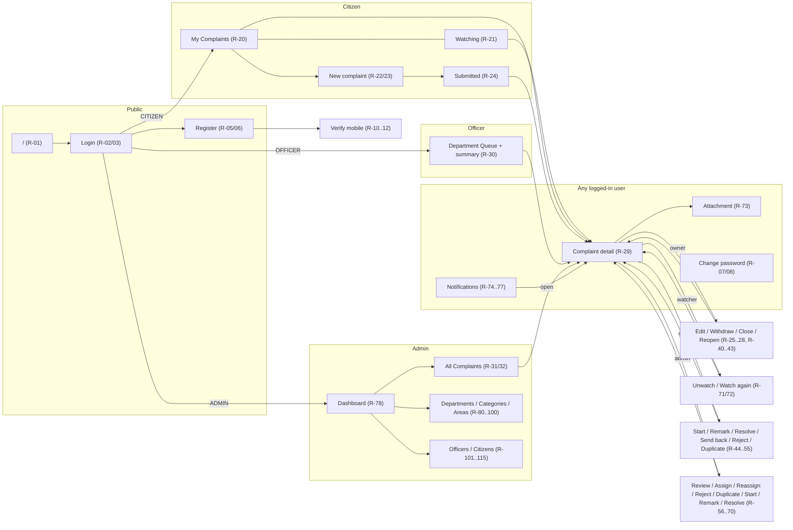

# 09 — Web & API Contracts

| | |
|---|---|
| **Status** | Draft |
| **Depends on** | 00 Plan (D1–D29), 03 Requirements, 04 Use Cases, 05 Domain Model & Business Rules, 06 Flow Diagrams, 07 Architecture (§3 packages, §5 security, §7 views), 08 Database Design |

This document is the contract between the browser and the server. For every URL it says who may call it, what it accepts, which service method it calls, and what comes back. Doc 10 (UI) builds the screens on these routes and model attributes, doc 11 (Security) turns §2 and §9 into the Spring Security configuration, doc 12 (Validation & Errors) writes the messages, and doc 13 (Tests) writes one MockMvc test per route row.

The app is server-rendered (ADR-01), so almost every contract is an **MVC route**: an HTML page (GET) or a form post that ends in a redirect (POST). There is exactly **one JSON endpoint** (§8).

---

## 1. Conventions

### 1.1 URL structure (D30)

| Prefix | Who | What lives there |
|---|---|---|
| `/` , `/login`, `/register` | public | Landing redirect, login, registration |
| `/verify-mobile` | CITIZEN | Mobile OTP verification (UC-04) |
| `/citizen/**` | CITIZEN | My Complaints, Watching, new complaint, owner actions (edit, withdraw, close, reopen), watch / unwatch |
| `/officer/**` | OFFICER | Department Queue and officer workflow actions |
| `/admin/**` | ADMIN | Dashboard, All Complaints, admin workflow actions, master data, user accounts |
| `/complaints/{no}` | any logged-in user | The **shared** complaint detail page (UC-14). What each user sees is decided by `ComplaintAccessPolicy` |
| `/attachments/{id}` | any logged-in user | File view / download (UC-16) |
| `/notifications/**` | any logged-in user | Notification list, open, mark all read, unread count (JSON) |
| `/account/**` | any logged-in user | Change own password (UC-03) |

Rules:

1. **Complaints are always identified by their number** `{no}` (e.g. `GRV-2026-000012`), never by the numeric `id` (BR-12). In controllers the path variable is declared as `{no:GRV-\d{4}-\d{6}}`, so a malformed number simply does not match and gives **404**. Lower-case input is not normalised in paths (links are always generated by the app).
2. Other objects use their numeric `id` in the path: attachments, notifications, departments, categories, areas and users. These are either admin-only (master data, users) or checked against the current user on every request (attachments → parent complaint, notifications → recipient), so guessing an id only ever gives 404.
3. Paths are lower-case, words joined with `-` (`send-back`, `read-all`, `verify-mobile`). Nouns are plural for collections (`/admin/departments`).
4. A workflow action on a complaint is always `/{rolePrefix}/complaints/{no}/{action}`, where `{action}` is the action's path segment from §7.1 (`start`, `resolve`, `reject`, …). The officer and admin variants call the **same** service method; the prefix only selects the URL security rule (D32).
5. Routes are listed with their exact path in §3. Anything not listed returns 404 (unknown path) or 405 (wrong method), rendered with the error page of doc 12.

### 1.2 Post/Redirect/Get (PRG)

Every state-changing request is a `POST` (HTML forms cannot send `PUT`/`DELETE`, and we do not use the hidden-method filter). Every `POST` ends in exactly one of three ways (doc 06 §5):

| Outcome | HTTP | Body |
|---|---|---|
| **Success** | `302` to a GET page (usually `/complaints/{no}`) | Flash `flashSuccess` |
| **Business-rule refusal** (wrong status, concurrent update, rule such as BR-47) | `302` to the page the user came from (usually `/complaints/{no}`) | Flash `flashError`. Nothing was saved. |
| **Validation error** (Bean Validation or a uniqueness check) | `200`, the **same view** is rendered again | Field errors next to the fields; typed values kept, except passwords and files (NFR-22, R-VALIDATION) |

The only `GET` with a side effect is `GET /verify-mobile`, which may issue an OTP when the user has no usable one (D41); it is rate-limited by the OTP rules, so a refresh cannot flood anything. Opening a notification marks it read, so that is a `POST` (D38).

### 1.3 Flash messages

| Attribute | Type | Shown as | Used for |
|---|---|---|---|
| `flashSuccess` | `String` | green alert | "Complaint resolved", "Department saved" |
| `flashError` | `String` | red alert | Business-rule refusals: "This action is not allowed when the complaint is In Progress", "This complaint was updated by someone else, please refresh" |
| `flashInfo` | `String` | blue alert | Neutral outcomes: "No changes to save", "Verify your mobile number to file complaints" |
| `demoOtp` | `String` | yellow box on the verify page | The demo OTP code, only when `app.otp.sender=demo` (FR-09b, D41) |

- Controllers add flash attributes through the `common.Flash` helper (`Flash.success(redirectAttributes, "…")`), never by name in each controller.
- The value is the final, human-readable English text. Doc 12 may move the texts to `messages.properties`; the attribute names stay.
- `layouts/main.html` and `layouts/public.html` render all three alerts at the top of the content area. A flash message is shown once and is gone on refresh.
- User-entered text inside a message (e.g. a complaint number typed into the duplicate form) is escaped like everything else (`th:text`, NFR-07).

### 1.4 Pagination, sorting and filters (D33)

Every list (NFR-11) takes the same paging parameters:

| Param | Type | Default | Rules |
|---|---|---|---|
| `page` | int | `1` | **1-based**. Values `< 1` or not a number become 1. A page beyond the last page shows the **last** page. |
| `size` | int | `10` | Clamped to `1..50` (NFR-11). Not a number → 10. |

- **Sorting is fixed per list** (newest first, or overdue first for the queue, as in doc 08 §5.1). There is no `sort` parameter, so the SQL `ORDER BY` never comes from the request.
- Filters are bound to a filter object (`@ModelAttribute("filter")`). A value that cannot be converted (`status=FOO`, `categoryId=abc`) is **ignored** as if it were not set, and the page still renders; the filter controls then show "All". This keeps bookmarked URLs working after master data changes.
- `q` (search) is trimmed and cut to 100 characters. It matches the exact complaint number or a case-insensitive title substring (D25).
- Dates (`from`, `to`) use ISO `yyyy-MM-dd` (what `<input type="date">` sends), both inclusive. If `from > to`, the list shows the global error "From date must not be after To date" above the table and ignores both dates.
- The status filter `status` takes one value: a status name (`SUBMITTED` … `WITHDRAWN`) or a **group** (D35):

| Group | Expands to | Where |
|---|---|---|
| `PENDING` | `SUBMITTED`, `UNDER_REVIEW` | All Complaints (FR-60 "Pending" card) |
| `ACTIVE` | `ASSIGNED`, `IN_PROGRESS`, `REOPENED`, `RESOLVED` | Department Queue default (§10, decision on O1) |
| `NOT_FINAL` | the five open statuses + `RESOLVED` | All Complaints ("open" in the FR-61 tables, D24) |
| `FINAL` | `CLOSED`, `REJECTED`, `DUPLICATE`, `WITHDRAWN` | All Complaints ("closed" in the FR-61 tables) |
| `ALL` | every status | Department Queue ("All statuses") |

  The service expands the value to a set and the repository uses the whitelisted fragment `c.status IN (:statuses)` (doc 08 §5.1, D25).
- Pagination links keep all current filter values. The `pagination.html` fragment builds them with `@{''(page=${n}, size=${filter.size}, …)}`.
- The model always contains `page` (a `PageResult<T>`, §5.1) and `filter` (the bound filter object, so the form can show the current values).

### 1.5 Optimistic locking: the hidden `version` field

- Every form that changes a **complaint** (edit, withdraw, every workflow action, close, reopen) carries `<input type="hidden" name="version">` with the `version` the page was rendered with (BR-71, ADR-09).
- Every form that changes an **existing user** (edit officer, activate / deactivate, mark verified) also carries the user's `version` (`app_user.version`).
- The service passes it into `UPDATE … WHERE id = ? AND version = ?`. 0 rows updated → `ConcurrentUpdateException` → `302` back with `flashError` "This complaint was updated by someone else, please refresh" (FR-84). For users the text is "This account was changed by someone else, please refresh".
- A missing or non-numeric `version` is a validation error (`@NotNull`). The client cannot skip the check.
- Departments, categories and areas have no version column (doc 08). Their edits are last-write-wins, which is acceptable because only admins edit them and the forms are small.
- Watch / unwatch carry no version: they change the watcher row, not the complaint.

### 1.6 CSRF

- CSRF protection is on for every `POST` (NFR-03). Every form is written with `th:action`, so Thymeleaf adds the hidden `_csrf` field automatically. The logout link is a small `POST` form, not a link.
- Multipart forms (`enctype="multipart/form-data"`) carry `_csrf` as a form field as well. Doc 11 must check with a test that an **over-size** upload still reaches the handler of §9.3 and is not turned into a 403 by a missing token (risk K1 in §13).
- The one JSON endpoint is a `GET` and needs no token. There are no JSON `POST`s.
- A `POST` after the session has expired carries a stale token. Spring Security would answer 403; instead the access-denied handler sends `InvalidCsrfTokenException` / `MissingCsrfTokenException` to `302 /login?expired` (doc 11).

### 1.7 Input binding rules (summary; details in doc 12)

- Text fields are **trimmed**; an optional field that is empty after trimming becomes `null`. Password fields are **never** trimmed.
- `@Valid` runs first. Rules that need the database (uniqueness, status, counts, active master data) run in the service and come back either as a field error (uniqueness, inactive dropdown value, file problems) or as a business-rule refusal (status, BR-47, BR-82).
- Every controller method that re-renders a form after an error must add the same reference data (dropdown lists) as its `GET`. Each controller does this in one private `populate(Model)` method.

---

## 2. Roles and error responses

| Situation | Response | Source |
|---|---|---|
| Not logged in, HTML request to a protected URL | `302 /login` (after login, Spring returns the user to the saved URL) | doc 07 §5 |
| Not logged in, `GET /notifications/unread-count` | `401` with JSON `{"error":"unauthenticated"}` (§8) | D37 |
| Logged in, **wrong role** for the URL prefix (e.g. an officer opening `/admin/dashboard`, a citizen posting to `/officer/…`) | `403` page `error/403` | NFR-02 |
| Complaint number unknown, or the complaint is **not visible** to this user | `404` page `error/404`, the same page in both cases | D10, BR-60, FR-23, FR-47 |
| Attachment / notification id unknown or not visible | `404` | BR-62, doc 08 §5.11 |
| Unknown master-data or user id (admin) | `404` | — |
| Validation error | `200` same view with field errors | §1.2 |
| Business-rule refusal | `302` back + `flashError` | §1.2, R-STATE |
| Concurrent update | `302` back + `flashError` | FR-84 |
| Unexpected exception | `500` page with a reference id, stack trace only in the log | NFR-06 |
| Upload larger than the request limit | `302` back + `flashError` (§9.3) | FR-11 |

"Back" for a complaint action means `/complaints/{no}`; for master data and user actions it means the list page of that entity. The exception carries the target, so `GlobalExceptionHandler` can build the redirect (D40).

---

## 3. Route catalogue

Columns: **ID** · **Method & path** · **Role** · **Input** (path / query params, form fields; validation rules are in §4) · **Service call** · **Success** · **Errors** (V = validation → same view, B = business rule → redirect + `flashError`, 404 / 403 as in §2).

Unless noted otherwise, every complaint route returns **404** when the complaint is not visible (BR-60) and **403** for the wrong role (URL rule), so these two are not repeated in each row.

### 3.1 Package `auth`

**`LoginController`**

| ID | Method & path | Role | Input | Service call | Success | Errors |
|---|---|---|---|---|---|---|
| R-01 | `GET /` | public | — | — | Logged in: `302` to the role home (CITIZEN `/citizen/complaints`, OFFICER `/officer/queue`, ADMIN `/admin/dashboard`). Not logged in: `302 /login` | — |
| R-02 | `GET /login` | public | query `error`, `logout`, `expired` (flags) | — | view `auth/login`; model `form` (`LoginForm`, empty), `loginError` (bool), `loggedOut` (bool), `sessionExpired` (bool) | Already logged in → `302 /` |
| R-03 | `POST /login` | public | `email`, `password`, `_csrf` | Spring Security `UsernamePasswordAuthenticationFilter` → `AppUserDetailsService.loadUserByUsername(email lower-cased)` | `302` by role via `RoleBasedSuccessHandler` (or to the saved request) (FR-03) | Wrong credentials or inactive → `302 /login?error`, one generic message (FR-05) |
| R-04 | `POST /logout` | logged in | `_csrf` | Spring Security `LogoutFilter` (invalidates session) | `302 /login?logout` "You have been logged out" (FR-04) | — |

Session timeout (30 min, FR-04): the next request goes to `302 /login?expired`.

**`RegistrationController`**

| ID | Method & path | Role | Input | Service call | Success | Errors |
|---|---|---|---|---|---|---|
| R-05 | `GET /register` | public | — | — | view `auth/register`; model `form` (`RegistrationForm`) | Logged in → `302 /` |
| R-06 | `POST /register` | public | `RegistrationForm` (§4.1) | `RegistrationService.register(form)` → creates an unverified CITIZEN (FR-01, FR-02, FR-08), then `OtpService.issue(user)` | Logs the new user in (saves the `SecurityContext`, D46) and `302 /verify-mobile`, `flashSuccess` "Account created. Verify your mobile number", `demoOtp` (demo sender only) | V: field errors; "Email already registered" / "Mobile already registered" as field errors on `email` / `mobile` |

**`PasswordController`**

| ID | Method & path | Role | Input | Service call | Success | Errors |
|---|---|---|---|---|---|---|
| R-07 | `GET /account/password` | logged in | — | — | view `auth/change-password`; model `form` (`ChangePasswordForm`) | — |
| R-08 | `POST /account/password` | logged in | `ChangePasswordForm` | `PasswordService.changePassword(currentUser, form)` (FR-06, FR-02) | `302 /account/password`, `flashSuccess` "Password changed" | V: wrong current password → field error on `currentPassword`; new = current → field error on `newPassword` |

### 3.2 Package `otp`

**`VerificationController`** — URL rule `/verify-mobile/**` → CITIZEN (added to doc 07 §5).

| ID | Method & path | Role | Input | Service call | Success | Errors |
|---|---|---|---|---|---|---|
| R-10 | `GET /verify-mobile` | CITIZEN | — | `OtpService.statusOrIssue(user)` → `OtpStatusView`. Issues an OTP only when the user has **no usable** OTP and the cooldown / hourly limit allow (SD-04, D41) | view `auth/verify-mobile`; model `form` (`OtpForm`), `otp` (`OtpStatusView`, §5.6). If an OTP was issued in this request, `otp.demoCode` is set (demo sender) | Already verified → `302 /citizen/complaints`, `flashInfo` "Your mobile number is already verified" |
| R-11 | `POST /verify-mobile` | CITIZEN | `OtpForm` (`code`) | `OtpService.verify(user, code)` (FR-09, BR-85) | Match: marks verified, refreshes the principal, `302 /citizen/complaints`, `flashSuccess` "Mobile verified, you can now file complaints" | V: format error on `code`. Wrong code → `200` same view, field error "Incorrect OTP, N attempts left". Expired or attempts used up → `200` same view, global error "OTP expired, please request a new one" |
| R-12 | `POST /verify-mobile/resend` | CITIZEN | `_csrf` only | `OtpService.resend(user)` (invalidates earlier OTPs; cooldown 60 s, 5 per hour) | `302 /verify-mobile`, `flashSuccess` "A new OTP was sent to ******1234", `demoOtp` (demo sender) | B: cooldown → `302 /verify-mobile` + `flashError` "Please wait N seconds before requesting a new OTP"; hourly limit → "Too many OTP requests, try again after hh:mm a" |

"Skip for now" on the verify page is a plain link to `/citizen/complaints` (UC-04).

### 3.3 Package `complaint`

**`CitizenComplaintController`**

| ID | Method & path | Role | Input | Service call | Success | Errors |
|---|---|---|---|---|---|---|
| R-20 | `GET /citizen/complaints` | CITIZEN | query `status` (status or group, default all), `q`, `page`, `size` | `ComplaintQueryService.myComplaints(user, filter)` (FR-20, BR-64) | view `citizen/my-complaints`; model `page` (`PageResult<ComplaintListItem>`), `filter`, `statusOptions`, `verifyBanner` (bool, FR-09a) | — (bad params ignored, §1.4) |
| R-21 | `GET /citizen/watching` | CITIZEN | query `status`, `page`, `size` | `ComplaintQueryService.watching(user, filter)` (FR-22, BR-51) | view `citizen/watching`; model `page`, `filter`, `statusOptions` | — |
| R-22 | `GET /citizen/complaints/new` | CITIZEN, **verified** | — | `MasterDataService.activeCategories()`, `activeAreas()` (FR-56) | view `citizen/complaint-form`; model `form` (`ComplaintForm`), `categories`, `areas` (`List<LookupOption>`), `mode` = `CREATE`, `maxFiles` (5), `maxFileSizeMb` (5) | Unverified → `VerifiedCitizenInterceptor` `302 /verify-mobile`, `flashInfo` "Verify your mobile number to file complaints" (FR-09a) |
| R-23 | `POST /citizen/complaints` (multipart) | CITIZEN, **verified** | `ComplaintForm` + files part `files` (0–5) | `ComplaintService.submit(form, files, user)` → `complaintNo` (FR-10 … FR-15, T01, BR-86) | `302 /citizen/complaints/{no}/submitted` | V: field errors; file errors on `files` (§9.2); inactive category / area → field error. Unverified → interceptor `302 /verify-mobile`. Storage failure → `200` same view, global error "Could not save your complaint, please try again" (UC-10 6a) |
| R-24 | `GET /citizen/complaints/{no}/submitted` | CITIZEN (owner) | path `no` | `ComplaintQueryService.submittedSummary(no, user)` (owner only) | view `citizen/submitted`; model `complaint` (`ComplaintSummary`) (FR-14) | Not the owner → 404 |
| R-25 | `GET /citizen/complaints/{no}/edit` | CITIZEN (owner) | path `no` | `ComplaintService.editForm(no, user)` → prefilled `ComplaintEditForm`; `ComplaintQueryService.attachments(no, user)`; active lookups + the complaint's current category/area even if inactive (BR-21) | view `citizen/complaint-form`; model `form` (`ComplaintEditForm`), `complaint` (`ComplaintSummary`), `currentAttachments` (`List<AttachmentView>`), `categories`, `areas`, `mode` = `EDIT`, `maxFiles`, `maxFileSizeMb` | B: status not `SUBMITTED`/`UNDER_REVIEW`, or not owner but visible (watcher) → `302 /complaints/{no}` + `flashError` (FR-19) |
| R-26 | `POST /citizen/complaints/{no}/edit` (multipart) | CITIZEN (owner) | `ComplaintEditForm` (incl. `version`, `removeAttachmentIds`, `changeReason`) + files part `files` | `ComplaintService.edit(no, form, files, user)` → `EditResult(changed)` (FR-16, FR-17, BR-23, BR-27) | Changed: `302 /complaints/{no}`, `flashSuccess` "Complaint updated". Nothing changed: `302 /complaints/{no}`, `flashInfo` "No changes to save" | V: field / file errors; more than 5 active files after the change → error on `files`. B: wrong status (FR-19), concurrent update (FR-84) |
| R-27 | `GET /citizen/complaints/{no}/withdraw` | CITIZEN (owner) | path `no` | `ComplaintQueryService.actionPage(no, user, WITHDRAW)` | view `complaint/action-form`; model §5.4 with `action` = `WITHDRAW` | B: not allowed (status, BR-47) → `302 /complaints/{no}` + `flashError` with the specific text of UC-12 |
| R-28 | `POST /citizen/complaints/{no}/withdraw` | CITIZEN (owner) | `RemarkForm` (`version`, `remark` = reason, required) | `ComplaintService.withdraw(no, version, reason, user)` (FR-18, T13, BR-47) | `302 /complaints/{no}`, `flashSuccess` "Complaint withdrawn" | V: reason length. B: wrong status ("Work has already started; it can no longer be withdrawn."), BR-47 ("Other citizens are following this complaint; it cannot be withdrawn."), concurrent update |

**`ComplaintDetailController`**

| ID | Method & path | Role | Input | Service call | Success | Errors |
|---|---|---|---|---|---|---|
| R-29 | `GET /complaints/{no}` | any logged in | path `no` | `ComplaintQueryService.detail(no, user)` → `ComplaintDetailView` incl. `timeline`, attachments and `actions` (§7) (FR-21, FR-23, FR-24, FR-28, FR-47, BR-60) | view `complaint/detail`; model `c` (`ComplaintDetailView`, §5.3), `actionLinks` (`List<ActionLink>`, §7.3) | 404 if unknown or not visible (same page) |

**`OfficerQueueController`** (new in doc 07 §3)

| ID | Method & path | Role | Input | Service call | Success | Errors |
|---|---|---|---|---|---|---|
| R-30 | `GET /officer/queue` | OFFICER | query `status` (default `ACTIVE`; any status; `ALL`), `categoryId`, `areaId`, `q`, `page`, `size` | `ComplaintQueryService.departmentQueue(officer, filter)` (FR-40, FR-47, BR-63, BR-65) and `DashboardService.officerSummary(officer)` (FR-63, UC-51) | view `officer/queue`; model `page` (`PageResult<ComplaintListItem>` with `overdue`, `daysOverdue`, `dueAt`, `reviewDeadline`), `filter`, `summary` (`SummaryCards`), `statusOptions`, `categories`, `areas` (all, incl. inactive, for filtering) | Officer without department (data error) → `200` same view with global error "Your account has no department; contact the admin" and an empty list (UC-30) |

**`AdminComplaintController`** (new in doc 07 §3)

| ID | Method & path | Role | Input | Service call | Success | Errors |
|---|---|---|---|---|---|---|
| R-31 | `GET /admin/complaints` | ADMIN | query `status` (status or group), `categoryId`, `departmentId` (or `NONE` = not assigned), `areaId`, `from`, `to`, `q`, `overdue` (bool), `page`, `size` | `ComplaintQueryService.allComplaints(filter)` (FR-30, doc 08 Q07) | view `admin/complaints`; model `page`, `filter`, `statusOptions`, `categories`, `departments`, `areas` (all, incl. inactive), `exportUrl` (current filter as CSV link) | `from > to` → global error on the page, dates ignored (§1.4) |
| R-32 | `GET /admin/complaints/export.csv` | ADMIN | same filters as R-31 (no `page`/`size`) | `ComplaintQueryService.exportCsv(filter, writer)` (FR-65, Could) | `200`, `Content-Type: text/csv; charset=UTF-8`, `Content-Disposition: attachment; filename="complaints-YYYYMMDD-HHmm.csv"`, UTF-8 BOM, at most 5,000 rows (D43) | More than 5,000 matching rows → `302 /admin/complaints?…` + `flashError` "Too many rows (N). Narrow the filter to 5,000 or fewer." |

### 3.4 Package `workflow`

All rows: the `GET` shows the action form page `complaint/action-form` (§5.4) for that action; the `POST` performs it. Before rendering, the `GET` calls `ComplaintQueryService.actionPage(no, user, action)`, which checks `canView` (404) and the action rule (B → `302 /complaints/{no}` + `flashError`). Every `POST` re-checks both inside the service transaction (FR-19, FR-83), so a hand-made `POST` gets exactly the same answer as a hidden button.

**`CitizenWorkflowController`** (new in doc 07 §3) — owner actions T07, T08

| ID | Method & path | Role | Input | Service call | Success | Errors |
|---|---|---|---|---|---|---|
| R-40 | `GET /citizen/complaints/{no}/close` | CITIZEN (owner) | path `no` | `actionPage(no, user, CLOSE)` | `complaint/action-form`, `action` = `CLOSE`, `form` (`OptionalRemarkForm`) | B: not `RESOLVED`, window expired, watcher (FR-28) |
| R-41 | `POST /citizen/complaints/{no}/close` | CITIZEN (owner) | `OptionalRemarkForm` (`version`, `remark` = feedback, optional ≤ 500) | `ComplaintWorkflowService.close(no, version, feedback, user)` (FR-25, FR-26, T07, BR-31) | `302 /complaints/{no}`, `flashSuccess` "Thank you. The complaint is closed" | V: feedback > 500. B: wrong status / window expired / auto-closed meanwhile, concurrent update |
| R-42 | `GET /citizen/complaints/{no}/reopen` | CITIZEN (owner) | path `no` | `actionPage(no, user, REOPEN)` | `complaint/action-form`, `action` = `REOPEN`, `form` (`RemarkForm`), `reopensLeft` | B: as R-40, plus reopen limit reached (FR-27) "Reopen limit reached; please contact the department" |
| R-43 | `POST /citizen/complaints/{no}/reopen` | CITIZEN (owner) | `RemarkForm` (`version`, `remark` = reason, required 10–500) | `ComplaintWorkflowService.reopen(no, version, reason, user)` (FR-25, FR-26, FR-27, T08, BR-32) | `302 /complaints/{no}`, `flashSuccess` "Complaint reopened and sent back to the department" | V: reason length. B: as R-42, concurrent update |

**`OfficerWorkflowController`** — prefix `/officer/complaints/{no}`, role OFFICER; the complaint must be in the officer's **current** department, otherwise 404 (FR-47, BR-63).

| ID | Method & path | Input (POST) | Service call | Success (POST) | Errors |
|---|---|---|---|---|---|
| R-44 | `GET …/start` | — | `actionPage(no, user, START_WORK)` | `complaint/action-form`, `action` = `START_WORK` | B: not `ASSIGNED`/`REOPENED` |
| R-45 | `POST …/start` | `RemarkForm` (required) | `ComplaintWorkflowService.startWork(no, version, remark, user)` (FR-41, T05) | `302 /complaints/{no}`, "Work started" | V, B (status, concurrency) |
| R-46 | `GET …/remark` | — | `actionPage(no, user, ADD_REMARK)` | `action` = `ADD_REMARK` | B: not `IN_PROGRESS` |
| R-47 | `POST …/remark` | `RemarkForm` (required) | `ComplaintWorkflowService.addRemark(no, version, remark, user)` (FR-43) | `302 /complaints/{no}`, "Update added" | V, B |
| R-48 | `GET …/resolve` | — | `actionPage(no, user, RESOLVE)` | `action` = `RESOLVE`, `form` (`ResolveForm`), `maxFiles` (3) | B: not `IN_PROGRESS` |
| R-49 | `POST …/resolve` (multipart) | `ResolveForm` (`version`, `remark` required) + optional files part `files` (0–3, FR-48 Could) | `ComplaintWorkflowService.resolve(no, version, remark, files, user)` (FR-42, T06, BR-33) | `302 /complaints/{no}`, "Complaint resolved. The citizen has until dd-MMM-yyyy to review it" | V: remark, file errors on `files`. B: status, concurrency |
| R-50 | `GET …/send-back` | — | `actionPage(no, user, SEND_BACK)` | `action` = `SEND_BACK` | B: not `ASSIGNED`/`REOPENED` |
| R-51 | `POST …/send-back` | `RemarkForm` (required; may mention a department or a GRV number) | `ComplaintWorkflowService.sendBack(no, version, remark, user)` (FR-46, T10) | **`302 /officer/queue`** (the officer can no longer see it, BR-63), "GRV-… sent back to the admin" | V, B |
| R-52 | `GET …/reject` | — | `actionPage(no, user, REJECT)` | `action` = `REJECT` | B: not `ASSIGNED`/`IN_PROGRESS`/`REOPENED` |
| R-53 | `POST …/reject` | `RemarkForm` (reason, required) | `ComplaintWorkflowService.reject(no, version, reason, user)` (FR-45, T11) | `302 /complaints/{no}`, "Complaint rejected" | V, B |
| R-54 | `GET …/duplicate` | query `original` (optional complaint number) | Without `original`: `actionPage(no, user, MARK_DUPLICATE)`. With `original`: `DuplicateService.preview(no, original, user)` (BR-40 … BR-43, SD-03) | Step 1 (no `original`): `action-form` with only the `originalNo` field (a `GET` form). Step 2: same view with `original` (`ComplaintSummary` of A: title, area, status, department) and the `remark` (note) field + confirm button | Rule failure in step 2 (A unknown, A = B, A not `ASSIGNED`/`IN_PROGRESS`/`REOPENED`, A is a duplicate, other department) → `200` same view, step 1, error on `originalNo` with the specific reason (UC-23 3a). B: B itself not allowed → `302 /complaints/{no}` |
| R-55 | `POST …/duplicate` | `DuplicateForm` (`version`, `originalNo`, `remark` = note, required) | `DuplicateService.markDuplicate(no, originalNo, version, note, user)` (FR-44, T12, BR-44) | `302 /complaints/{no}`, "Linked to GRV-A as a duplicate" | V: note → same view step 2. B: rules re-checked; any failure (state changed meanwhile) or concurrency → `302 /complaints/{no}` + `flashError` |

Note for officers and A unknown vs. not visible: when the officer types a number of a complaint outside their department, the message is "GRV-… is not in your department. Use Send back and mention it in the remark" (BR-43). This reveals that the number exists, which is acceptable for staff (D2/D10 protect citizens' complaints from other **citizens**; officers are trusted staff). Doc 11 confirms.

**`AdminWorkflowController`** — prefix `/admin/complaints/{no}`, role ADMIN (sees every complaint).

| ID | Method & path | Input (POST) | Service call | Success (POST) | Errors |
|---|---|---|---|---|---|
| R-56 | `POST …/review` | `VersionForm` (`version` only; button "Start Review" with a confirm dialog) | `ComplaintWorkflowService.startReview(no, version, admin)` (FR-31, T02) | `302 /complaints/{no}`, "Review started" | B: not `SUBMITTED`, concurrency |
| R-57 | `GET …/assign` | — | `actionPage(no, admin, ASSIGN)`; `MasterDataService.activeDepartments()` | `action` = `ASSIGN`, `form` (`AssignForm`) with `departmentId` = category default if active (FR-32), `departments` | B: not `UNDER_REVIEW` |
| R-58 | `POST …/assign` | `AssignForm` (`version`, `departmentId` required, `remark` optional) | `ComplaintWorkflowService.assign(no, version, departmentId, remark, admin)` (FR-32, T03) | `302 /complaints/{no}`, "Assigned to Water Supply" | V: no department; inactive department → field error on `departmentId` (UC-21 2a). B: status, concurrency |
| R-59 | `GET …/reassign` | — | `actionPage(no, admin, REASSIGN)`; `activeDepartments()` | `action` = `REASSIGN`, `form` (`ReassignForm`), `departments` without the current one | B: not `ASSIGNED`/`IN_PROGRESS`/`REOPENED` |
| R-60 | `POST …/reassign` | `ReassignForm` (`version`, `departmentId` required, ≠ current, active; `remark` required) | `ComplaintWorkflowService.reassign(no, version, departmentId, remark, admin)` (FR-33, T04) | `302 /complaints/{no}`, "Reassigned to Drainage" | V: same department / inactive → field error. B |
| R-61 | `GET …/reject` | — | `actionPage(no, admin, REJECT)` | `action` = `REJECT` | B: complaint final or `RESOLVED` |
| R-62 | `POST …/reject` | `RemarkForm` (reason, required) | `ComplaintWorkflowService.reject(…)` (FR-34, T11) | `302 /complaints/{no}`, "Complaint rejected" | V, B |
| R-63 | `GET …/duplicate` | query `original` | as R-54, without the same-department rule (BR-43) | as R-54 | as R-54 |
| R-64 | `POST …/duplicate` | `DuplicateForm` | `DuplicateService.markDuplicate(…)` (FR-35, T12) | as R-55 | as R-55 |
| R-65 | `GET …/start` | — | as R-44 | as R-44 | as R-44 |
| R-66 | `POST …/start` | `RemarkForm` | `startWork(…)` (FR-36, Should) | as R-45 | as R-45 |
| R-67 | `GET …/remark` | — | as R-46 | as R-46 | as R-46 |
| R-68 | `POST …/remark` | `RemarkForm` | `addRemark(…)` (FR-36, FR-43) | as R-47 | as R-47 |
| R-69 | `GET …/resolve` | — | as R-48 | as R-48 | as R-48 |
| R-70 | `POST …/resolve` (multipart) | `ResolveForm` + `files` | `resolve(…)` (FR-36, FR-42) | as R-49 | as R-49 |

There is no admin `send-back` (T10 is for officers; the admin uses reassign).

### 3.5 Package `watch`

**`WatchController`** — URL rule CITIZEN (under `/citizen/**`).

| ID | Method & path | Role | Input | Service call | Success | Errors |
|---|---|---|---|---|---|---|
| R-71 | `POST /citizen/complaints/{no}/unwatch` | CITIZEN (active watcher) | `_csrf` | `WatchService.unwatch(no, user)` (FR-29, BR-51) | If the user can still view it (owns a linked duplicate, BR-52): `302 /complaints/{no}`, otherwise `302 /citizen/watching`; `flashSuccess` "You will no longer receive updates" | B: not an active watcher → `302 /complaints/{no}` + `flashError` |
| R-72 | `POST /citizen/complaints/{no}/watch` | CITIZEN (owner of a linked duplicate) | `_csrf` | `WatchService.watch(no, user)` (FR-29, BR-52) | `302 /complaints/{no}`, `flashSuccess` "You are watching this complaint again" | B: already watching, or owner of the complaint itself |

### 3.6 Package `attachment`

**`AttachmentController`**

| ID | Method & path | Role | Input | Service call | Success | Errors |
|---|---|---|---|---|---|---|
| R-73 | `GET /attachments/{id}` | any logged in | path `id` (number); query `download` (`true` → save instead of open) | `AttachmentService.load(id, user)` → `AttachmentContent` (BR-62, SD-06, NFR-05) | `200` file stream with the headers of §9.4 (UC-16, FR-21) | 404: unknown id, parent complaint not visible, deleted and user not ADMIN (BR-26), file missing on disk (logged as ERROR) |

### 3.7 Package `notification`

**`NotificationController`**

| ID | Method & path | Role | Input | Service call | Success | Errors |
|---|---|---|---|---|---|---|
| R-74 | `GET /notifications` | any logged in | query `page`, `size` | `NotificationService.list(user, page)` (FR-72) | view `notification/list`; model `page` (`PageResult<NotificationItem>`) | — |
| R-75 | `POST /notifications/{id}/open` | any logged in | `_csrf` | `NotificationService.open(id, user)` → marks read (recipient-checked SQL), returns `Optional<complaintNo>` (FR-72) | `302 /complaints/{no}`; if the notification has no complaint, `302 /notifications`. The detail page still applies R-ACCESS, so a notification about a complaint the user can no longer see leads to 404 | 404: id unknown or another user's |
| R-76 | `POST /notifications/read-all` | any logged in | `_csrf` | `NotificationService.markAllRead(user)` (FR-72) | `302 /notifications`, `flashSuccess` "All notifications marked as read" | — |
| R-77 | `GET /notifications/unread-count` | any logged in | — | `NotificationService.unreadCount(user)` (FR-71) | `200` JSON, §8 | `401` JSON when not logged in |

### 3.8 Package `dashboard`

**`AdminDashboardController`**

| ID | Method & path | Role | Input | Service call | Success | Errors |
|---|---|---|---|---|---|---|
| R-78 | `GET /admin/dashboard` | ADMIN | — | `DashboardService.adminDashboard()` (FR-60, FR-61, FR-62, FR-64) | view `admin/dashboard`; model `dash` (`DashboardView`, §5.7). Every card and count links to R-31 with the matching filter (UC-50) | — |

Officer summary cards (FR-63, UC-51) are part of R-30.

### 3.9 Package `masterdata`

Three controllers with the same shape: `DepartmentAdminController` (`/admin/departments`), `CategoryAdminController` (`/admin/categories`), `AreaAdminController` (`/admin/areas`). All are ADMIN only. `{id}` is the numeric id; unknown → 404.

| Pattern | Method & path | Input | Service call | Success | Errors |
|---|---|---|---|---|---|
| list | `GET /admin/{type}` | query `page`, `size`, `active` (`true`/`false`/absent = all) | `MasterDataService.list{Type}s(filter)` | view `admin/{type}`; model `page` (`PageResult<{Type}Row>`), `filter` | — |
| new | `GET /admin/{type}/new` | — | — (categories: `activeDepartments()`) | view `admin/{type}-form`, with the **singular** name: `admin/department-form`, `admin/category-form`, `admin/area-form` (D52); model `form`, `mode` = `CREATE` (+ `departments` for categories) | — |
| create | `POST /admin/{type}` | `{Type}Form` | `MasterDataService.create{Type}(form)` | `302 /admin/{type}`, "Department saved" | V: field errors; name already used (case-insensitive, D29) → field error on `name`; inactive default department → field error |
| edit | `GET /admin/{type}/{id}/edit` | path `id` | `MasterDataService.{type}Form(id)` | same view, `mode` = `EDIT`, `id` | 404 |
| update | `POST /admin/{type}/{id}` | `{Type}Form` | `MasterDataService.update{Type}(id, form)` | `302 /admin/{type}`, "… saved" | V as create; 404 |
| activate | `POST /admin/{type}/{id}/activate` | `_csrf` | `MasterDataService.set{Type}Active(id, true)` | `302 /admin/{type}`, "… activated" | 404 |
| deactivate | `POST /admin/{type}/{id}/deactivate` | `_csrf` | `MasterDataService.set{Type}Active(id, false)` (FR-56) | `302 /admin/{type}`, "… deactivated. It is hidden from new complaints" | B: department is the default of an active category (D42) → `flashError` "Sanitation is the default department of Garbage. Change that category first." |

Route IDs:

| Entity | list | new | create | edit | update | activate | deactivate | FR / UC |
|---|---|---|---|---|---|---|---|---|
| Departments | R-80 | R-81 | R-82 | R-83 | R-84 | R-85 | R-86 | FR-50, FR-56, UC-40 |
| Categories | R-87 | R-88 | R-89 | R-90 | R-91 | R-92 | R-93 | FR-51, FR-56, UC-41 |
| Areas | R-94 | R-95 | R-96 | R-97 | R-98 | R-99 | R-100 | FR-52, FR-56, UC-42 |

There is no delete route (FR-50, BR-73).

### 3.10 Package `staff`

**`OfficerAdminController`** — ADMIN only, `{id}` = user id of an OFFICER (any other role → 404).

| ID | Method & path | Input | Service call | Success | Errors |
|---|---|---|---|---|---|
| R-101 | `GET /admin/officers` | query `departmentId`, `active`, `q` (name or email), `page`, `size` | `UserAdminService.listOfficers(filter)` (UC-43) | view `admin/officers`; model `page` (`PageResult<UserRow>`), `filter`, `departments` (all) | — |
| R-102 | `GET /admin/officers/new` | — | `MasterDataService.activeDepartments()` | view `admin/officer-form`; model `form` (`OfficerCreateForm`), `departments`, `mode` = `CREATE` | — |
| R-103 | `POST /admin/officers` | `OfficerCreateForm` | `UserAdminService.createOfficer(form)` (FR-53; verified and active, BR-87) | `302 /admin/officers`, "Officer account created" | V: field errors; email / mobile already registered → field errors; inactive department → field error |
| R-104 | `GET /admin/officers/{id}/edit` | path `id` | `UserAdminService.officerEditForm(id)` | view `admin/officer-form`; model `form` (`OfficerEditForm`), `departments`, `mode` = `EDIT`, `officer` (`UserRow`) | 404 |
| R-105 | `POST /admin/officers/{id}` | `OfficerEditForm` (`version`, name, mobile, department) | `UserAdminService.updateOfficer(id, form)` (FR-53) | `302 /admin/officers`, "Officer updated" | V; B: concurrent update |
| R-106 | `POST /admin/officers/{id}/activate` | `version` | `UserAdminService.setActive(id, true, version, admin)` | `302 /admin/officers`, "Account activated" | B: concurrency |
| R-107 | `POST /admin/officers/{id}/deactivate` | `version` | `UserAdminService.setActive(id, false, version, admin)` (BR-83) | `302 /admin/officers`, "Account deactivated" | B: concurrency |
| R-108 | `GET /admin/officers/{id}/password` | path `id` | `UserAdminService.userRow(id, OFFICER)` | view `admin/reset-password`; model `form` (`PasswordResetForm`), `user` (`UserRow`), `backUrl` | 404 |
| R-109 | `POST /admin/officers/{id}/password` | `PasswordResetForm` | `UserAdminService.resetPassword(id, form, admin)` (FR-55) | `302 /admin/officers`, "Password reset. Give the new password to the user" | V |

**`CitizenAdminController`** — ADMIN only, `{id}` = user id of a CITIZEN.

| ID | Method & path | Input | Service call | Success | Errors |
|---|---|---|---|---|---|
| R-110 | `GET /admin/citizens` | query `q` (name, email or mobile), `active`, `verified`, `page`, `size` | `UserAdminService.listCitizens(filter)` (UC-44) | view `admin/citizens`; model `page` (`PageResult<UserRow>`), `filter` | — |
| R-111 | `POST /admin/citizens/{id}/activate` | `version` | `UserAdminService.setActive(id, true, version, admin)` (FR-54) | `302 /admin/citizens`, "Account activated" | B |
| R-112 | `POST /admin/citizens/{id}/deactivate` | `version` | `UserAdminService.setActive(id, false, version, admin)` (FR-54, BR-83) | `302 /admin/citizens`, "Account deactivated" | B |
| R-113 | `POST /admin/citizens/{id}/verify` | `version` | `UserAdminService.markVerified(id, version, admin)` (FR-09c) | `302 /admin/citizens`, "Mobile marked as verified" | B: already verified |
| R-114 | `GET /admin/citizens/{id}/password` | path `id` | `UserAdminService.userRow(id, CITIZEN)` | view `admin/reset-password` | 404 |
| R-115 | `POST /admin/citizens/{id}/password` | `PasswordResetForm` | `UserAdminService.resetPassword(id, form, admin)` (FR-55) | `302 /admin/citizens`, "Password reset" | V |

There are no routes to create, edit or deactivate **admin** accounts. The only admin is the bootstrap admin (FR-07), who changes their password with R-08 (D45). BR-82 ("at least one active admin") is still enforced in `UserAdminService.setActive`, so it holds if admin management is added later.

### 3.11 Infrastructure routes (no controller of ours)

| Path | Role | Purpose |
|---|---|---|
| `/webjars/**`, `/css/**`, `/js/**`, `/images/**`, `/favicon.ico` | public | Static resources (ADR-12) |
| `/error` | public | Spring Boot error dispatch; renders `error/403`, `error/404`, `error/500`, and `error/4xx` for any other 4xx such as 400 and 405 (doc 10 SCR-90…93, D52; texts in doc 12). Must be public, otherwise an error page for an anonymous user would loop to the login page. |

### 3.12 Route count

| Package | Routes |
|---|---|
| auth | 8 (R-01 … R-08) |
| otp | 3 (R-10 … R-12) |
| complaint | 13 (R-20 … R-32) |
| workflow | 31 (R-40 … R-70) |
| watch | 2 (R-71, R-72) |
| attachment | 1 (R-73) |
| notification | 4 (R-74 … R-77) |
| dashboard | 1 (R-78) |
| masterdata | 21 (R-80 … R-100) |
| staff | 15 (R-101 … R-115) |
| **Total** | **99** |

---

## 4. Form-backing objects

All forms live in the package of their controller, are mutable classes with a no-args constructor (Thymeleaf binding, doc 07 §3.1), and are bound as model attribute **`form`** (one name for every page, so the shared fragments can use `th:object="${form}"`). "Trim" means §1.7.

### 4.1 Account forms (`auth`, `otp`)

**`LoginForm`** (only to render the page; Spring Security reads the parameters)

| Field | Type | Rules |
|---|---|---|
| `email` | String | — (parameter name configured with `usernameParameter("email")`) |
| `password` | String | — |

**`RegistrationForm`** (R-06)

| Field | Type | Rules | Ref |
|---|---|---|---|
| `fullName` | String | required, trim, 2–100 chars | FR-01 |
| `email` | String | required, trim, lower-cased, `@Email`, ≤ 254 chars, unique (service) | FR-02, BR-80 |
| `mobile` | String | required, trim, `^[6-9]\d{9}$`, unique (service) | FR-02, BR-84 |
| `password` | String | required, not trimmed, 8–64 chars, at least one letter and one digit | FR-02 |
| `confirmPassword` | String | must equal `password` (class-level `@FieldsMatch`, error shown on `confirmPassword`) | FR-01 |

**`ChangePasswordForm`** (R-08)

| Field | Type | Rules |
|---|---|---|
| `currentPassword` | String | required; must match the stored hash (service) |
| `newPassword` | String | FR-02 password rule; must differ from the current password |
| `confirmPassword` | String | must equal `newPassword` |

**`PasswordResetForm`** (R-109, R-115): `newPassword`, `confirmPassword` with the FR-02 rule.

**`OtpForm`** (R-11): `code` — String, required, trim, `^\d{6}$` (BR-85).

### 4.2 Complaint forms (`complaint`)

**`ComplaintForm`** (R-22, R-23)

| Field | Type | Rules | Ref |
|---|---|---|---|
| `categoryId` | Long | required; must be an active category (service) | FR-10, BR-21 |
| `areaId` | Long | required; must be an active area (service) | FR-10, BR-21 |
| `title` | String | required, trim, 5–100 chars | BR-20 |
| `description` | String | required, trim, 20–2000 chars | BR-20 |
| `address` | String | required, trim, 5–255 chars | BR-20 |
| *(multipart part)* `files` | `List<MultipartFile>` | **not** a form field: a separate `@RequestParam(name = "files", required = false)` so that a failed re-render never tries to bind files back. 0–5 non-empty parts, each JPG/PNG/PDF by magic bytes, ≤ 5 MB (§9) | FR-11, BR-22, BR-23 |

**`ComplaintEditForm`** extends `ComplaintForm` (R-25, R-26)

| Field | Type | Rules | Ref |
|---|---|---|---|
| `version` | Integer | required (hidden) | BR-71 |
| `removeAttachmentIds` | `List<Long>` | optional (checkboxes); each id must be an active `COMPLAINT` attachment of this complaint, otherwise ignored and logged | FR-16, BR-26 |
| `changeReason` | String | optional, trim, ≤ 500 chars | FR-16 |
| *(part)* `files` | as above | active attachments − removed + new ≤ 5 | BR-23 |

For an edit, the category and area may stay at an inactive value the complaint already has (BR-21); choosing a **different** inactive value is a field error.

### 4.3 Workflow forms (`workflow`)

The reason / note / feedback text is always the field **`remark`**, so one template handles every action; the label changes with the action (§7.1).

| Form | Fields and rules | Used by |
|---|---|---|
| `VersionForm` | `version` Integer required | R-56 start review |
| `RemarkForm` | `version` required; `remark` required, trim, 10–500 chars | R-28 withdraw, R-43 reopen, R-45/R-66 start, R-47/R-68 remark, R-51 send back, R-53/R-62 reject |
| `OptionalRemarkForm` | `version` required; `remark` optional, trim, ≤ 500 | R-41 close (feedback) |
| `AssignForm` | `version` required; `departmentId` Long required, active (service); `remark` optional ≤ 500 | R-58 assign |
| `ReassignForm` | `version` required; `departmentId` required, active, ≠ current (service); `remark` required 10–500 | R-60 reassign |
| `ResolveForm` | `version` required; `remark` required 10–500; part `files` 0–3 (`RESOLUTION`, BR-23) | R-49, R-70 resolve |
| `DuplicateForm` | `version` required; `originalNo` required, trim, upper-cased, `^GRV-\d{4}-\d{6}$`; `remark` (note to the citizen) required 10–500 | R-54/R-55, R-63/R-64 |

The 10–500 rule for required remarks and ≤ 500 for optional ones comes from doc 05 §3.

### 4.4 Master data and staff forms

| Form | Field | Type | Rules | Ref |
|---|---|---|---|---|
| `DepartmentForm` | `name` | String | required, trim, 2–100, unique case-insensitive (service) | FR-50, D29 |
| | `description` | String | optional, trim, ≤ 255 | |
| `CategoryForm` | `name` | String | as above | FR-51 |
| | `defaultDepartmentId` | Long | optional ("— admin decides —"); if set, must be active | UC-41 |
| | `slaDays` | Integer | required, 1–90 | FR-51 |
| `AreaForm` | `name` | String | as above | FR-52 |
| | `description` | String | optional, ≤ 255 (PMC ward office) | D20 |
| `OfficerCreateForm` | `fullName`, `email`, `mobile` | String | as `RegistrationForm` | FR-53 |
| | `departmentId` | Long | required, active | BR-81 |
| | `password`, `confirmPassword` | String | FR-02 rule, must match | FR-53 |
| `OfficerEditForm` | `version` | Integer | required | BR-71 |
| | `fullName`, `mobile` | String | as above (mobile unique except itself) | FR-53 |
| | `departmentId` | Long | required, active | FR-53 |

The officer's email is not editable (it is the login name); the edit page shows it read-only.

### 4.5 Filter objects (query parameters, never validated with errors; see §1.4)

| Filter | Fields | Used by |
|---|---|---|
| `CitizenListFilter` | `status` (String: status or group), `q`, `page`, `size` | R-20, R-21 (Watching ignores `q`) |
| `QueueFilter` | `status` (default `ACTIVE`), `categoryId`, `areaId`, `q`, `page`, `size` | R-30 |
| `AdminComplaintFilter` | `status`, `categoryId`, `departmentId` (Long or `NONE`), `areaId`, `from`, `to` (`LocalDate`), `q`, `overdue` (Boolean), `page`, `size` | R-31, R-32 |
| `MasterDataFilter` | `active` (Boolean), `page`, `size` | R-80, R-87, R-94 |
| `UserFilter` | `q`, `departmentId`, `active`, `verified`, `page`, `size` | R-101, R-110 |
| `PageRequest` (inside each filter) | `page`, `size` after clamping; `offset()` = `(page − 1) × size` | all lists |

Each filter has a method `toQueryParams()` used by the pagination fragment and by `exportUrl`, so links never drop a filter.

---

## 5. View models and model attributes

View models are Java **records** built for one screen (doc 07 §3.1). Templates only read them.

### 5.1 Global attributes (every page, from `GlobalModelAdvice`)

| Attribute | Type | Content |
|---|---|---|
| `currentUser` | `CurrentUserView` (`id`, `fullName`, `role`, `mobileVerified`, `departmentName`) or `null` | Navbar name, role menus, verify banner |
| `unreadCount` | `long` | Bell badge (FR-71). One indexed `COUNT(*)` (doc 08 §5.11). Not added for anonymous users or on `/error` |
| `homeUrl` | String | Role home (R-01 targets) for the logo link |
| `activeMenu` | String | Navbar item to highlight, derived from the request path (`my`, `watching`, `new`, `queue`, `dashboard`, `complaints`, `masterdata`, `users`, `notifications`; on `/complaints/{no}` the role's list). Doc 10 §3.2, D53 |
| `flashSuccess`, `flashError`, `flashInfo` | String | §1.3 (present only after a redirect) |

**`PageResult<T>`** (`common`): `items` (List<T>), `page`, `size`, `totalItems`, `totalPages`, `hasPrevious`, `hasNext`, `firstItemNumber`, `lastItemNumber` (for "Showing 11–20 of 57").

**`LookupOption`**: `id`, `name`, `active`. Dropdowns on create/assign forms get active entries only (FR-56); filter dropdowns get all entries, inactive ones labelled "(inactive)".

**`StatusOption`**: `value` (status name or group), `label` ("In Progress", "Pending (new + under review)"), `badgeClass`. Model attribute `statusOptions` lists exactly the values allowed for that list.

### 5.2 Lists

**`ComplaintListItem`** (R-20, R-21, R-30, R-31)

| Field | Type | Shown on |
|---|---|---|
| `complaintNo` | String | all (link to `/complaints/{no}`) |
| `title` | String | all |
| `categoryName` | String | all |
| `areaName` | String | queue, admin |
| `departmentName` | String (nullable → "Not assigned") | admin |
| `status` | `ComplaintStatus` | all (badge, NFR-21) |
| `createdAt` | `LocalDateTime` | all (NFR-23 format) |
| `overdue` | boolean | queue, admin (staff only, BR-66) |
| `dueAt` | `LocalDateTime` | queue, admin |
| `daysOverdue` | int (computed in Java, D23) | queue, admin |
| `reviewDeadline` | `LocalDateTime` (only when `RESOLVED`) | queue ("awaiting citizen until …"), citizen lists |

Fields not shown to citizens are left `null`/`false` by the citizen queries.

**`NotificationItem`** (R-74): `id`, `message`, `read`, `createdAt`, `complaintNo` (nullable).

**`DepartmentRow`**: `id`, `name`, `description`, `active`. **`CategoryRow`**: `id`, `name`, `defaultDepartmentName` (nullable → "Admin decides"), `defaultDepartmentActive`, `slaDays`, `active`. **`AreaRow`**: `id`, `name`, `description`, `active`.

**`UserRow`**: `id`, `fullName`, `email`, `mobile`, `role`, `departmentName`, `active`, `mobileVerified`, `createdAt`, `version`.

### 5.3 Complaint detail (`complaint/detail`, R-29)

Model attribute **`c`** = `ComplaintDetailView`:

| Field | Type | Notes |
|---|---|---|
| `complaintNo`, `title`, `description`, `address` | String | |
| `status` | `ComplaintStatus` | badge |
| `categoryName`, `areaName` | String | even if inactive (FR-56) |
| `departmentName` | String or null | |
| `ownerName` | String | staff only; `null` for citizens other than the owner |
| `createdAt`, `updatedAt`, `resolvedAt` | `LocalDateTime` | |
| `reviewDeadline` | `LocalDateTime` or null | `resolvedAt + review window` while `RESOLVED` (FR-25, BR-30) |
| `reopenCount`, `maxReopens` | int | FR-27 |
| `version` | int | copied into every action form on the page (hidden field) |
| `overdue`, `dueAt`, `daysOverdue` | boolean, `LocalDateTime`, int | staff only (UC-14 step 3) |
| `duplicateOf` | `ComplaintRef` (`complaintNo`, `title`, `status`) or null | banner "Linked to GRV-… which is already being handled" (FR-24, BR-46) |
| `linkedDuplicateCount` | int | staff only; "2 duplicates linked" |
| `viewerRelation` | enum `OWNER`, `WATCHER`, `DUPLICATE_OWNER`, `DEPARTMENT`, `ADMIN` | label "You are watching this complaint" (UC-14 3b) |
| `attachments` | `List<AttachmentView>` | `COMPLAINT` files; deleted ones included **only** for ADMIN (BR-26) |
| `resolutionAttachments` | `List<AttachmentView>` | `RESOLUTION` files (FR-48) |
| `timeline` | `List<TimelineEntry>` | oldest first (UC-14, FR-81) |
| `actions` | `Set<Action>` | allowed actions for this viewer (§7) |
| `notices` | `List<String>` | explanations for actions that are not offered, e.g. "Reopen limit reached; please contact the department" (FR-27) |

Methods for templates: `can(String actionName)` → boolean, `isFinal()`, `isResolved()`.

**`AttachmentView`**: `id`, `originalName`, `contentType`, `image` (bool → thumbnail with ``), `sizeLabel` ("1.2 MB"), `purpose`, `uploadedAt`, `deleted`, `deletedAt`.

**`TimelineEntry`**: `type` (`EventType`), `fromStatus`, `toStatus`, `actorLabel` (computed per viewer by `TimelineService`: staff see "{name} (Officer, {Department})"; citizens see "You", "The complainant", "{Department} Dept." or "Grievance Cell" — never a staff name; "System" when null. Doc 10 §7.3, D48), `actorRole`, `departmentName` (T03/T04), `relatedNo` (duplicate link), `remark`, `createdAt`, `changes` (`List<FieldChange>` with `field`, `oldValue`, `newValue` for `EDITED`, FR-17).

### 5.4 Action form page (`complaint/action-form`, R-27, R-40 … R-70)

One template for every workflow action with input (D31):

| Attribute | Type | Content |
|---|---|---|
| `complaint` | `ComplaintSummary` (`complaintNo`, `title`, `status`, `categoryName`, `areaName`, `departmentName`, `version`, `reviewDeadline`) | header box |
| `action` | `Action` | title, button label, field label (§7.1) |
| `form` | the action's form (§4.3), `version` pre-filled | |
| `postUrl` | String | `/{prefix}/complaints/{no}/{segment}` |
| `cancelUrl` | String | `/complaints/{no}` |
| `departments` | `List<LookupOption>` | ASSIGN, REASSIGN only |
| `original` | `ComplaintSummary` | MARK_DUPLICATE step 2 only |
| `reopensLeft` | int | REOPEN only |
| `maxFiles` | int | RESOLVE only (3) |

### 5.5 Complaint form page (`citizen/complaint-form`) and confirmation (`citizen/submitted`)

See R-22 / R-25. `mode` (`CREATE`/`EDIT`) switches the title, the post URL (`/citizen/complaints` or `/citizen/complaints/{no}/edit`) and the extra edit fields. `citizen/submitted` gets `complaint` (`ComplaintSummary`) and shows the number large with links to `/complaints/{no}` and `/citizen/complaints`.

### 5.6 OTP page (`auth/verify-mobile`)

**`OtpStatusView`**: `maskedMobile` ("******1234"), `sentAt`, `expiresAt`, `attemptsLeft`, `resendAllowedAt`, `resendAllowed` (bool), `hourlyLimitReached` (bool), `demoCode` (String or null; set only in the response that issued the code, or from the `demoOtp` flash).

### 5.7 Dashboard (`admin/dashboard`, R-78) and officer summary (R-30)

**`DashboardView`**:

| Field | Type | Content |
|---|---|---|
| `cards` | `List<SummaryCard>` | FR-60: Total, Pending, Assigned, In Progress, Reopened, Resolved, Closed, Rejected, Duplicate, Withdrawn, Overdue |
| `byCategory`, `byDepartment`, `byArea` | `List<CountRow>` | FR-61; `CountRow(id, name, openCount, closedCount, openUrl, closedUrl)`. `byDepartment` has a "(Not assigned)" row with `id = null` |
| `overdue` | `List<OverdueItem>` | FR-62, top 10 by due date; `OverdueItem(complaintNo, title, status, departmentName, slaDays, daysElapsed, daysOverdue)`; "View all" → `/admin/complaints?overdue=true` |
| `chartJson` | String | FR-64 (Could): the same counts serialised once by the controller with Jackson and written with `th:inline="javascript"`; no extra JSON endpoint |

**`SummaryCard`**: `label`, `count`, `url` (R-31 with filter), `style`. Card links: Total → `/admin/complaints`; Pending → `?status=PENDING`; each status card → `?status=<STATUS>`; Overdue → `?overdue=true`. Count rows: open → `?categoryId=3&status=NOT_FINAL`, closed → `?categoryId=3&status=FINAL` (same for `departmentId` — `NONE` for the not-assigned row — and `areaId`).

**`SummaryCards`** (officer, FR-63): the same `List<SummaryCard>` for the officer's department; links go to `/officer/queue?status=…`. Cards for statuses an officer never sees in the queue (Pending) are left out.

---

## 6. Site map



Every action page returns to the detail page (R-29) after success, except send back (R-51 → queue) and unwatch without remaining access (R-71 → Watching).

---

## 7. Allowed-actions contract

The detail page must show only the buttons the viewer may use (FR-19, UC-14 step 4), and a `POST` must be refused by exactly the same rules. Doc 07 §7 requires the rules to live in one place. This section fixes how (D39).

### 7.1 The `Action` enum (`workflow` package)

| Action | Transition | Path segment | Prefix | Form | Field label | Who and when (doc 05 §3) |
|---|---|---|---|---|---|---|
| `EDIT` | — | `edit` | `/citizen` | `ComplaintEditForm` | — | Owner; `SUBMITTED`, `UNDER_REVIEW` |
| `WITHDRAW` | T13 | `withdraw` | `/citizen` | `RemarkForm` | Reason | Owner; `SUBMITTED`, `UNDER_REVIEW`, `ASSIGNED`; no linked duplicates (BR-47) |
| `CLOSE` | T07 | `close` | `/citizen` | `OptionalRemarkForm` | Feedback (optional) | Owner; `RESOLVED`; `now ≤ reviewDeadline` |
| `REOPEN` | T08 | `reopen` | `/citizen` | `RemarkForm` | Reason | Owner; `RESOLVED`; `now ≤ reviewDeadline`; `reopenCount < maxReopens` |
| `UNWATCH` | — | `unwatch` | `/citizen` | none (POST button) | — | Citizen with an active watcher row (not the owner) |
| `WATCH` | — | `watch` | `/citizen` | none (POST button) | — | Citizen who owns a linked duplicate and has no active watcher row (BR-52) |
| `START_REVIEW` | T02 | `review` | `/admin` | `VersionForm` (POST button) | — | Admin; `SUBMITTED` |
| `ASSIGN` | T03 | `assign` | `/admin` | `AssignForm` | Remark (optional) | Admin; `UNDER_REVIEW` |
| `REASSIGN` | T04 | `reassign` | `/admin` | `ReassignForm` | Remark | Admin; `ASSIGNED`, `IN_PROGRESS`, `REOPENED` |
| `START_WORK` | T05 | `start` | `/officer` or `/admin` | `RemarkForm` | Remark | Department officer or admin; `ASSIGNED`, `REOPENED` |
| `ADD_REMARK` | — | `remark` | `/officer` or `/admin` | `RemarkForm` | Progress update | Department officer or admin; `IN_PROGRESS` |
| `RESOLVE` | T06 | `resolve` | `/officer` or `/admin` | `ResolveForm` | Resolution remark | Department officer or admin; `IN_PROGRESS` |
| `SEND_BACK` | T10 | `send-back` | `/officer` | `RemarkForm` | Remark | Department officer; `ASSIGNED`, `REOPENED` |
| `REJECT` | T11 | `reject` | `/officer` or `/admin` | `RemarkForm` | Reason | Admin: the five open statuses. Department officer: `ASSIGNED`, `IN_PROGRESS`, `REOPENED` |
| `MARK_DUPLICATE` | T12 | `duplicate` | `/officer` or `/admin` | `DuplicateForm` | Note to the citizen | Same as `REJECT`; BR-40 … BR-43 are checked on the original in R-54/R-55 |

T01 (submit) and T09 (auto-close) are not actions on the detail page.

### 7.2 How the service computes `Set<Action>`

```text
record ActorContext(long userId, Role role, Long departmentId)
record ComplaintFacts(ComplaintStatus status, long ownerId, Long departmentId,
                      int reopenCount, LocalDateTime resolvedAt,
                      boolean hasLinkedDuplicates,        // BR-47, only loaded when needed
                      boolean viewerIsActiveWatcher,      // BR-51
                      boolean viewerOwnsLinkedDuplicate)  // BR-52
record Decision(boolean allowed, String refusal, boolean showNotice)

TransitionRules.decide(Action a, ActorContext actor, ComplaintFacts f, LocalDateTime now) → Decision
TransitionRules.allowedActions(actor, f, now) → EnumSet of every a with decide(a, …).allowed()
TransitionRules.require(a, actor, f, now)    → throws InvalidTransitionException(decision.refusal)
```

1. `ComplaintQueryService.detail(no, user)` loads the complaint, calls `ComplaintAccessPolicy.canView` (404 if false), builds `ComplaintFacts` (the watcher and duplicate facts come from the one query of doc 08 §5.1 "canView facts"; `hasLinkedDuplicates` from Q17, only for the owner in a withdrawable status) and calls `allowedActions`.
2. `decide` is a pure function implementing the table in doc 05 §3 and §7.1 above: first the role/relation (owner, department officer, admin), then the status, then the guards (deadline, reopen count, BR-47). It reads the clock only through the `now` argument (ADR-11), so it is unit-tested row by row (doc 13).
3. When an action fails **only** on a guard that the viewer should understand, `decide` returns `showNotice = true` and the refusal text. These texts go into `c.notices`: "Reopen limit reached; please contact the department" (FR-27, UC-15 2c), "Other citizens are following this complaint; it cannot be withdrawn" (BR-47), "The review period ended on dd-MMM-yyyy; the complaint will be closed automatically".
4. Every service method for a `POST` calls `require(action, …)` **inside** its transaction, after loading the complaint again, and before the `UPDATE … AND version = ?`. The refusal text becomes the `flashError` (R-STATE).
5. `ComplaintQueryService.actionPage(no, user, action)` (the action `GET` pages) uses the same `decide` call, so an action page can never be opened for an action the detail page would not show.

Because steps 1, 4 and 5 call the same function, a button can never be visible for a refused action, or hidden for an allowed one. Doc 13 tests this with one parameterised test per row of §7.1 against both `allowedActions` and a MockMvc `POST`.

### 7.3 How the templates use it

The controller turns the set into links with a small web helper `complaint.web.ActionLinks` (URLs belong to the web layer, not to the service):

```text
record ActionLink(Action action, String label, String url, HttpMethod method, boolean confirm, String style)
// style: primary | success | secondary | danger (mapping per action in doc 10 §5.2, D54)
// GET for actions with a form page (url = /{prefix}/complaints/{no}/{segment}),
// POST for START_REVIEW, UNWATCH, WATCH (rendered as a small form with _csrf and version)
```

- The prefix for `START_WORK`, `ADD_REMARK`, `RESOLVE`, `REJECT`, `MARK_DUPLICATE` is `/admin` when the viewer is ADMIN, otherwise `/officer`.
- The `complaint-actions.html` fragment loops over `actionLinks` and renders one button per entry, in the order of §7.1. It contains no status or role logic.
- Other parts of the page that depend on an action use `c.can('…')`, e.g. `th:if="${c.can('CLOSE') or c.can('REOPEN')}"` for the "Please review by …" box. Templates must not test `c.status` or the role to decide whether an **action** is possible; they may test the status only for display (badge, banners).
- `c.notices` are rendered as small grey notes under the buttons.

---

## 8. JSON endpoint

Only one JSON endpoint is needed (D37). Everything else is rendered on the server:

| Considered | Decision | Why |
|---|---|---|
| Unread notification count | **JSON endpoint R-77** | The bell must be correct after the back button: a page restored from the browser's back-forward cache still shows the old count after "Mark all as read". |
| Dashboard chart data (FR-64) | No endpoint | The data is already in the dashboard model; it is written into the page as inline JSON (§5.7). |
| Duplicate lookup (UC-23 step 4) | No endpoint | Done by the `GET …/duplicate?original=` page (R-54), which works without JavaScript. |
| Category → default department | No endpoint | The assign page is rendered with the default already selected (R-57). |
| Live search / autocomplete | No endpoint | Not required; lists use normal `GET` filters. |

### R-77 `GET /notifications/unread-count`

| | |
|---|---|
| Request | `GET /notifications/unread-count`, header `Accept: application/json`, session cookie. No parameters, no body, no CSRF token. |
| Controller | `NotificationController.unreadCount(@AuthenticationPrincipal CurrentUser)` with `@ResponseBody`, `produces = "application/json"` |
| Service | `NotificationService.unreadCount(userId)` (doc 08 §5.11 count query) |
| Headers | `Content-Type: application/json`, `Cache-Control: no-store` (Spring Security default), `X-Content-Type-Options: nosniff` |

Responses:

```http
HTTP/1.1 200 OK
Content-Type: application/json

{"unread": 3}
```

```http
HTTP/1.1 401 Unauthorized
Content-Type: application/json

{"error": "unauthenticated"}
```

| Status | When |
|---|---|
| `200` | Logged in (any role). `unread` is an integer ≥ 0. |
| `401` | No session, or the session has expired. Doc 11 registers an `HttpStatusEntryPoint`-style entry point for this path only, so it does not redirect to the HTML login page. |
| `500` | Unexpected error; body `{"error": "server_error", "reference": "<id>"}` |

**Client behaviour** (`static/js/app.js`): the count is fetched only on `pageshow` when `event.persisted` is true (page restored from cache) and on `visibilitychange` when the tab becomes visible again. It is **not** polled on a timer: a request every minute would keep the session alive forever and defeat the 30-minute idle timeout (FR-04). On `401` the script reloads the page, which sends the user to the login page. If JavaScript is off, the server-rendered count (`unreadCount`, §5.1) is still shown on every page.

---

## 9. File upload and download contract

### 9.1 Multipart fields

| Route | Form | File part name | Count | Purpose |
|---|---|---|---|---|
| R-23 submit | `ComplaintForm` | `files` (`<input type="file" name="files" multiple accept=".jpg,.jpeg,.png,.pdf">`) | 0–5 | `COMPLAINT` |
| R-26 edit | `ComplaintEditForm` | `files` | active − removed + new ≤ 5 | `COMPLAINT` |
| R-49, R-70 resolve | `ResolveForm` | `files` | 0–3 (FR-48, Could) | `RESOLUTION` |

The forms use `enctype="multipart/form-data"` and `method="post"`. Parts with an empty filename and size 0 (an empty file input) are ignored.

### 9.2 Limits and validation

| Rule | Where checked | Error |
|---|---|---|
| Each file ≤ `app.upload.max-file-size` (5 MB) | `FileStorageService.validate` | Field error on `files`: "photo.jpg is larger than 5 MB" |
| Type JPG, PNG or PDF by **magic bytes** (`FFD8FF`, `89504E47`, `25504446`); the stored `content_type` comes from the detected type, not from the browser | `FileTypeDetector` (ADR-07, BR-22) | "report.docx: only JPG, PNG or PDF files are allowed" |
| Count ≤ 5 active `COMPLAINT` (≤ 3 `RESOLUTION`) | `FileStorageService.validate` + count query (BR-23) | "A complaint can have at most 5 files (you selected 6)" |
| Whole request ≤ `spring.servlet.multipart.max-request-size` (26 MB) | Servlet container | §9.3 |
| Original filename: path characters removed, ≤ 255 chars | `FileStorageService` (BR-24) | — (cleaned silently) |

- One bad file rejects the whole submission (FR-11); the page lists **one message per bad file**.
- After any error the form is re-rendered and the user must choose the files again (browsers cannot refill file inputs). The page says so above the file field. For an edit, the existing attachments and the remove checkboxes are kept.
- `spring.servlet.multipart.max-file-size` is set **equal to** the request limit (26 MB), not 5 MB (D36). So a 6 MB photo reaches the controller and gets a normal field error with the typed text kept, instead of an exception before the controller. The 5 MB rule is enforced by `FileStorageService` from `app.upload.max-file-size`.
- Files are validated **before** the transaction and written to disk before commit; on rollback they are deleted (BR-25, SD-01).
- `static/js/app.js` pre-checks count, size and extension in the browser for a quick message. The server always re-checks.

### 9.3 Over-size requests

A request above 26 MB is refused by the container with `MaxUploadSizeExceededException`. `GlobalExceptionHandler` answers `302` to the page the form belongs to (`/citizen/complaints/new`, `/citizen/complaints/{no}/edit` or the resolve page, taken from the request URI, not from the `Referer` header), with `flashError` "The files are too large together. Each file can be at most 5 MB and all files together at most 25 MB." Typed text is lost in this case only. To let Tomcat read the rest of an over-size request and send this redirect instead of resetting the connection, `server.tomcat.max-swallow-size` is raised to at least the request limit (doc 14, risk K1).

### 9.4 Download (R-73)

| Header | Value |
|---|---|
| `Content-Type` | The stored `content_type` (`image/jpeg`, `image/png`, `application/pdf`), never guessed from the filename |
| `Content-Length` | `size_bytes` |
| `Content-Disposition` | `inline` by default (images and PDFs open in the browser, UC-16); `attachment` when `?download=true`. Always with both filename forms: `inline; filename="photo_1.jpg"; filename*=UTF-8''%E0%A4%AB%E0%A5%8B%E0%A4%9F%E0%A5%8B.jpg` (RFC 6266 / RFC 5987). The ASCII `filename` replaces non-ASCII characters, quotes and backslashes with `_`. |
| `X-Content-Type-Options` | `nosniff` (also a Spring Security default; set explicitly so it holds if the defaults change) |
| `Cache-Control` | Spring Security default `no-cache, no-store, max-age=0, must-revalidate`. Files are private, so no browser or proxy caching. |

- The body is streamed from disk (`InputStreamResource`), not loaded into memory.
- Range requests are not supported (not needed for files ≤ 5 MB).
- Thumbnails on the detail page use the same URL in ``; there are no resized copies. The CSS limits their display size.
- The download link of a deleted attachment is shown only to admins, labelled "removed on dd-MMM-yyyy" (FR-17).

---

## 10. Decision on open question O1: Department Queue default filter

**Decision (D34):** the Department Queue (R-30) shows by default the statuses **`ASSIGNED`, `IN_PROGRESS`, `REOPENED` and `RESOLVED`** (the `ACTIVE` group).

| Option | For | Against |
|---|---|---|
| Work statuses only (`ASSIGNED`, `IN_PROGRESS`, `REOPENED`) | Pure to-do list | A resolved complaint vanishes from the officer's view for up to 7 days and can come back as `REOPENED` without warning; the officer cannot see what is waiting for the citizen |
| **+ `RESOLVED`** (chosen) | The officer sees everything the department is still responsible for until the citizen closes it, which matches "open = not final" on the dashboard (D24) | Rows that need no action are mixed in |

To keep the list useful:

- Sorting stays as verified in doc 08 Q06: overdue first, then oldest first. `RESOLVED` complaints are never overdue (BR-65), so they never push work items off the top.
- `RESOLVED` rows show a grey badge "Awaiting citizen until dd-MMM-yyyy" (`reviewDeadline`) and no action button.
- The status filter offers: "Active (default)", each single status (`ASSIGNED`, `IN_PROGRESS`, `REOPENED`, `RESOLVED`, `CLOSED`, `REJECTED`, `DUPLICATE`, `WITHDRAWN`) and "All statuses" (`ALL`). Final complaints that stayed in the department remain visible to its officers (BR-60), so the officer can look them up.

This is the query of doc 08 §5.1 as already written and verified, so doc 08 needs no SQL change for O1. UC-30 in doc 04 is updated to match.

---

## 11. Traceability

### 11.1 Use cases → routes

| UC | Title | Routes |
|---|---|---|
| UC-01 | Register as citizen | R-05, R-06 |
| UC-02 | Log in / log out | R-01, R-02, R-03, R-04 |
| UC-03 | Change own password | R-07, R-08 |
| UC-04 | Verify mobile with OTP | R-10, R-11, R-12, R-22 (redirect when unverified) |
| UC-10 | Submit complaint | R-22, R-23, R-24 |
| UC-11 | Edit complaint | R-25, R-26 |
| UC-12 | Withdraw complaint | R-27, R-28 |
| UC-13 | View My Complaints / Watching | R-20, R-21 |
| UC-14 | View complaint detail & timeline | R-29 |
| UC-15 | Review resolution (close or reopen) | R-40, R-41, R-42, R-43 |
| UC-16 | View / download attachment | R-73 |
| UC-17 | Unwatch / watch again | R-71, R-72 |
| UC-20 | Review new complaint | R-31, R-56 |
| UC-21 | Assign / reassign department | R-57, R-58, R-59, R-60 |
| UC-22 | Reject complaint | R-52, R-53, R-61, R-62 |
| UC-23 | Mark complaint as duplicate | R-54, R-55, R-63, R-64 |
| UC-30 | View department queue | R-30 |
| UC-31 | Start work on complaint | R-44, R-45, R-65, R-66 |
| UC-32 | Add progress remark | R-46, R-47, R-67, R-68 |
| UC-33 | Resolve complaint | R-48, R-49, R-69, R-70 |
| UC-34 | Send complaint back to admin | R-50, R-51 |
| UC-40 | Manage departments | R-80, R-81, R-82, R-83, R-84, R-85, R-86 |
| UC-41 | Manage categories | R-87, R-88, R-89, R-90, R-91, R-92, R-93 |
| UC-42 | Manage areas | R-94, R-95, R-96, R-97, R-98, R-99, R-100 |
| UC-43 | Manage officer accounts | R-101, R-102, R-103, R-104, R-105, R-106, R-107, R-108, R-109 |
| UC-44 | Manage citizen accounts | R-110, R-111, R-112, R-113, R-114, R-115 |
| UC-50 | View admin dashboard & reports | R-78, R-31, R-32 |
| UC-51 | View officer summary | R-30 |
| UC-60 | View and read notifications | R-74, R-75, R-76, R-77 |
| UC-70 | Auto-close expired resolved complaints | No HTTP trigger (scheduler, SD-05). Its result is visible through R-29 (timeline entry `AUTO_CLOSED`) and R-74 (notifications) |

### 11.2 Must requirements → routes

| FR | Requirement (short) | Routes |
|---|---|---|
| FR-01 | Register as citizen | R-05, R-06 |
| FR-02 | Email / mobile / password rules | R-06, R-08, R-103, R-109, R-115 |
| FR-03 | Login, role landing page | R-01, R-02, R-03 |
| FR-04 | Logout, 30-min timeout | R-04, R-02 (`?expired`) |
| FR-05 | Inactive users cannot log in | R-03 |
| FR-07 | Bootstrap admin | R-03 (the admin logs in; created at startup, doc 14) |
| FR-08 | Registration creates only citizens | R-06 |
| FR-09 | OTP verification | R-10, R-11, R-12 |
| FR-09a | Unverified banner, New Complaint redirect | R-20, R-22, R-23 |
| FR-09b | Pluggable `OtpSender`, demo display | R-10, R-12 |
| FR-10 | Complaint fields | R-22, R-23 |
| FR-11 | Attachment rules | R-23, R-26 |
| FR-12 | Complaint number | R-23, R-24 |
| FR-13 | Starts as `SUBMITTED` + history | R-23, R-29 |
| FR-14 | Confirmation page | R-24 |
| FR-15 | Submission notifications | R-23, R-74 |
| FR-16 | Owner edit | R-25, R-26 |
| FR-17 | Revisions in timeline | R-26, R-29, R-73 |
| FR-18 | Withdraw | R-27, R-28 |
| FR-19 | Buttons only when allowed; direct POST refused | R-29, R-25, R-26, R-27, R-28 |
| FR-20 | My Complaints | R-20 |
| FR-21 | Detail page, attachments, timeline | R-29, R-73 |
| FR-22 | Watching list | R-21 |
| FR-23 | Citizen 404 for others' complaints | R-29, R-73 |
| FR-24 | Duplicate banner | R-29 |
| FR-25 | Close / reopen buttons and review date | R-29, R-40, R-41, R-42, R-43 |
| FR-26 | Close / reopen effects | R-41, R-43 |
| FR-28 | Watchers view only | R-29 |
| FR-29 | Unwatch / watch again | R-71, R-72 |
| FR-30 | All complaints with filters | R-31 |
| FR-31 | Start review | R-56 |
| FR-32 | Assign with default department | R-57, R-58 |
| FR-34 | Admin reject | R-61, R-62 |
| FR-35 | Admin mark duplicate | R-63, R-64 |
| FR-40 | Department queue | R-30 |
| FR-41 | Start work | R-44, R-45 |
| FR-42 | Resolve | R-48, R-49 |
| FR-44 | Officer mark duplicate | R-54, R-55 |
| FR-45 | Officer reject | R-52, R-53 |
| FR-47 | Officer limited to own department | R-30, R-29, R-44, R-45, R-46, R-47, R-48, R-49, R-50, R-51, R-52, R-53, R-54, R-55 |
| FR-50 | Departments | R-80, R-81, R-82, R-83, R-84, R-85, R-86 |
| FR-51 | Categories | R-87, R-88, R-89, R-90, R-91, R-92, R-93 |
| FR-52 | Areas | R-94, R-95, R-96, R-97, R-98, R-99, R-100 |
| FR-53 | Officer accounts | R-101, R-102, R-103, R-104, R-105, R-106, R-107 |
| FR-56 | Inactive master data hidden from forms | R-22, R-25, R-57, R-59, R-86, R-93, R-100 |
| FR-60 | Dashboard cards | R-78 |
| FR-61 | Count tables | R-78, R-31 |
| FR-62 | Overdue list | R-78, R-31 (`overdue=true`) |
| FR-70 | Notification events | R-74 (and every POST of §3.4 that creates them) |
| FR-71 | Bell with unread count | R-77 (+ `unreadCount` on every page) |
| FR-72 | Notification list, open, mark all | R-74, R-75, R-76 |
| FR-80 | Overdue | R-30, R-31, R-78, R-29 |
| FR-81 | History | R-29 |
| FR-82 | Auto-close job | R-29 (result in timeline), R-74 |
| FR-83 | State machine enforced | R-28, R-41, R-43, R-45, R-47, R-49, R-51, R-53, R-55, R-56, R-58, R-60, R-62, R-64, R-66, R-68, R-70 |

Should and Could requirements are covered as well: FR-06 → R-07/R-08; FR-09c → R-113; FR-27 → R-42/R-43; FR-33 → R-59/R-60; FR-36 → R-65 … R-70; FR-43 → R-46/R-47; FR-46 → R-50/R-51; FR-48 → R-49/R-70; FR-54 → R-110 … R-112; FR-55 → R-108/R-109, R-114/R-115; FR-63 → R-30; FR-64 → R-78; FR-65 → R-32; FR-84 → every form with `version` (§1.5). FR-73 (purge) has no route.

---

## 12. Verification

Run on 2026-11-22 with the script `docs/specs/verify/check-09-traceability.sh` (kept with the specs so it can be re-run after any change). It:

1. extracts every `UC-xx` ID from the catalogue table in doc 04 §1;
2. extracts every requirement ID with priority **M** from the tables in doc 03 §1;
3. checks that each ID has a row in §11.1 / §11.2 of this document that names at least one route `R-nn`, or (UC-70 only) an explicit "No HTTP trigger" note plus a route that shows the result;
4. checks that every route ID used in §11 is defined in §3 (catalogue rows and the master-data ID table), and that every route defined in §3 appears at least once in §11.

Result:

| Check | Result |
|---|---|
| Use cases in doc 04 | 30 found; **30 / 30** mapped to routes (UC-70 via "No HTTP trigger" + R-29, R-74) |
| Must FRs in doc 03 | 55 found (FR-01 … FR-83 with priority M, incl. FR-09a, FR-09b); **55 / 55** mapped to routes |
| Route IDs used in §11 that are not defined in §3 | **0** |
| Routes defined in §3 that do not appear in §11 | **0** (99 defined) |
| Mermaid site map (§6) | Rendered with `@mermaid-js/mermaid-cli` 12.2.0 (Chromium headless) **without errors** |

---

## 13. Open questions and risks for later documents

| # | Topic | For doc |
|---|---|---|
| K1 | **Over-size multipart and CSRF.** With an upload above 26 MB the container may fail to parse the body before `CsrfFilter` reads `_csrf`, which would give 403 instead of the friendly redirect of §9.3. Doc 11 must test it and, if needed, raise `server.tomcat.max-swallow-size` and/or map the CSRF failure on multipart requests to the same redirect. | 11, 13, 14 |
| K2 | Auto-login after registration (D46) needs the `SecurityContext` saved explicitly through `SecurityContextRepository` in Spring Security 7, plus a new session id (session fixation). | 11 |
| K3 | After `POST /verify-mobile` succeeds, the principal in the session still says `mobileVerified = false` until it is refreshed. The controller replaces the `Authentication` with a refreshed `CurrentUser`. | 11 |
| K4 | `GET /notifications/unread-count` needs its own `AuthenticationEntryPoint` (401 JSON, not a redirect). | 11 |
| K5 | Expired-session `POST` → stale CSRF token → must go to `/login?expired`, not 403 (§1.6). | 11, 12 |
| K6 | ~~O2: officer name or role label for citizens.~~ **Decided in doc 10 §7.3 (D48):** citizens see the department / "Grievance Cell", staff see names. Doc 11 tests that no staff name reaches a citizen view. | 11 |
| K7 | Officers learn that a complaint number exists in another department through the duplicate error message (R-54). Accepted for staff; doc 11 to confirm. | 11 |
| K8 | Message texts in this document are the English defaults. Doc 12 decides whether they move to `messages.properties` and fixes the exact wording. | 12 |
| K9 | ~~Status badge colours and labels.~~ **Decided in doc 10 §5.1 (D47).** | — |
| K10 | Admin accounts other than the bootstrap admin have no UI (D45). If the examiners ask for it, it is a new UC with routes `/admin/admins/**`. | future |
| K11 | Every route row is one MockMvc test (happy path + each error column); workflow rows are also run as each wrong role (403) and as a user who cannot view (404). | 13 |
| K12 | Properties introduced here: `spring.servlet.multipart.max-file-size=26MB` (D36), `server.tomcat.max-swallow-size` ≥ 26MB, CSV export limit 5,000 (`app.export.max-rows`). | 14 |

## Change log
| Date | Change |
|---|---|
| 2026-11-22 | Initial draft: 99 routes, forms, view models, allowed-actions contract, JSON endpoint, upload/download contract, traceability; decisions D30–D46; O1 decided (D34) |
| 2026-11-22 | Doc 10 alignment: `error/4xx` view, singular master-data form view names (D52), global `activeMenu` (D53), `ActionLink.style` values (D54), `actorLabel` rule (D48); K6 and K9 resolved |
