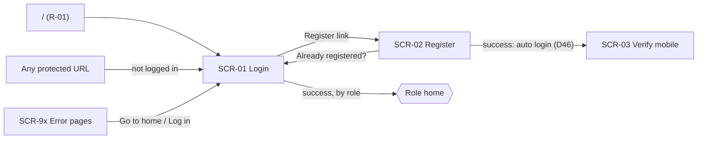
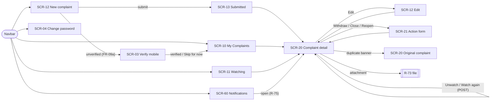
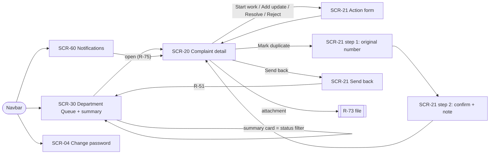
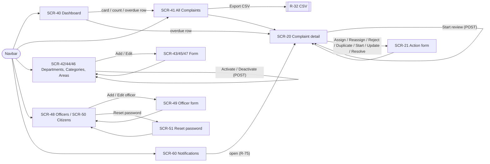
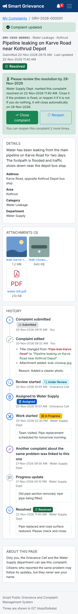
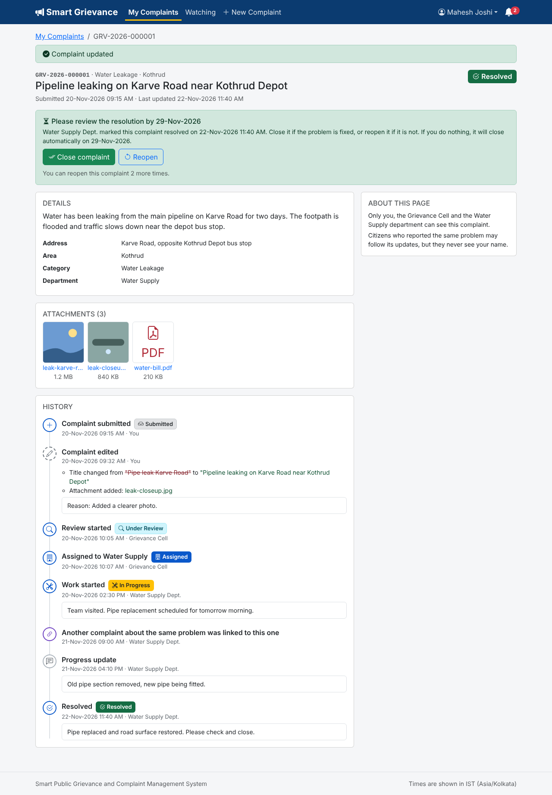
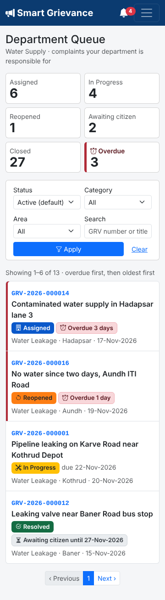
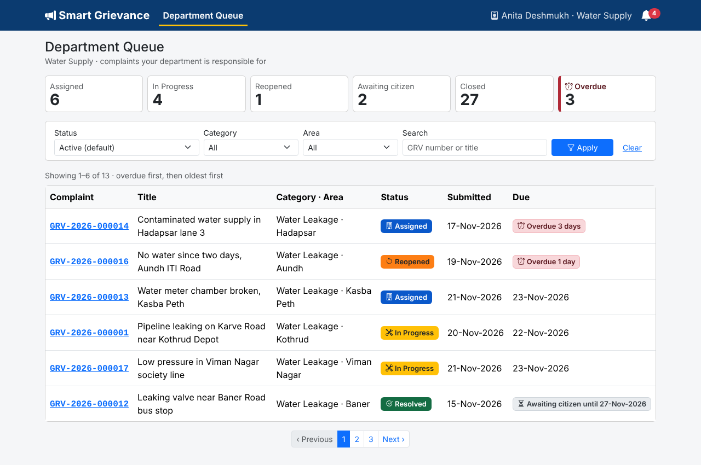
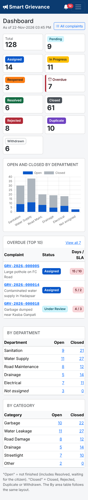
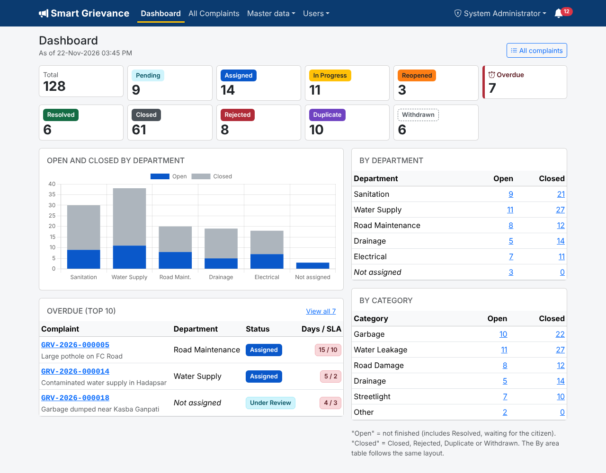

# 10 — UI / Screen Specification

| | |
|---|---|
| **Status** | Draft |
| **Depends on** | 00 Plan (D1–D46), 03 Requirements (FR-xx, NFR-20…23), 04 Use Cases, 05 Domain Model & Business Rules, 07 Architecture (§7 view layer), 08 Database Design (O2), 09 Web & API Contracts (routes, view names, model attributes, §7 allowed actions, K6, K9) |

This document says what every user sees. It builds only on the routes, view names and model attributes of doc 09: every screen here is one Thymeleaf view of doc 09, and every view of doc 09 is a screen here (§11 checks this with a script). It adds no routes.

| Section | Content |
|---|---|
| §1 | Design principles (responsive, Bootstrap only, no-JS baseline, accessibility, language and dates) |
| §2 | Screen inventory (SCR-xx → template, role, routes, model attributes) |
| §3 | Layouts, navigation, navbar per role, bell, breadcrumbs, navigation maps |
| §4 | Wireframes |
| §5 | Visual system (status badges, alerts, buttons, icons, empty states, pagination, filter bar) |
| §6 | Fragment catalogue |
| §7 | Timeline presentation and the O2 decision (who a citizen sees as the actor) |
| §8 | Content guidelines and UI copy |
| §9 | Traceability |
| §10 | Static HTML mock-ups |
| §11 | Verification |
| §12 | Open questions and risks for later documents |

---

## 1. Design principles

### 1.1 Responsive, mobile first (NFR-20)

| Rule | How |
|---|---|
| Works from **360 px** wide to desktop | Bootstrap 5.3.8 grid, `container-lg`, breakpoints `sm` 576, `md` 768, `lg` 992. Every page is designed for 360 px first, then widened. |
| No horizontal page scroll at 360 px | Long values (`overflow-wrap: anywhere` on titles and remarks), complaint numbers and dates kept on one line. Wide admin tables sit in `.table-responsive`, so only the table scrolls, never the page. Checked on the mock-ups (§10). |
| Complaint lists | **Stacked list** (`list-group`) below `md`, **table** from `md` up, both rendered by the same fragment loop (D51). |
| Touch targets | Buttons and links in lists at least 44 × 44 px on phones (`.btn` default size; the whole list item is the link). Action buttons wrap two per row on phones (`.action-bar`). |
| Navbar | `navbar-expand-md`: collapsed behind a toggler on phones. The bell stays visible next to the toggler at every width. |

### 1.2 Server-rendered Bootstrap only

- Bootstrap **5.3.8** CSS and JS bundle from WebJars, Bootstrap Icons 1.x and (dashboard only) Chart.js 4.x from `static/vendor/` (ADR-12, no CDN in the app). One own stylesheet `static/css/app.css` and one script `static/js/app.js`.
- No SPA, no front-end build, no jQuery. Templates are plain Thymeleaf with the Layout Dialect.
- Custom CSS is limited to the status colours, the timeline, thumbnails and small layout helpers. The reference copy is `docs/ui-mockups/css/app.css` (§10), which becomes `static/css/app.css`.

### 1.3 Works without JavaScript (D49)

Every core flow (register, verify, submit with files, edit, every workflow action, filters, pagination, notifications, master data) works with JavaScript **switched off**. This follows from D31 (every action with input has its own GET form page, which is also its confirmation step) and D37 (the bell count is rendered on the server).

JavaScript is only **progressive enhancement**:

| Enhancement (`static/js/app.js`) | Without JS |
|---|---|
| `<html class="no-js">` is switched to `js` by the one-line file `static/js/early.js`, loaded synchronously in `<head>` (no inline scripts: strict CSP, doc 11 §4.7, D64) | `.no-js` CSS rules apply (below) |
| Navbar collapse and dropdowns (Bootstrap bundle) | Rules under `.no-js` in `app.css` (not a `<noscript><style>` block, which the CSP would block) show the collapsed menu expanded and dropdown menus as plain indented lists; the toggler (`.js-only`) is hidden (verified in doc 11 §13) |
| Session warning 5 minutes before the 30-minute timeout, with a "Stay logged in" button that sends one `GET` to R-77 (`<body data-session-timeout>`, U11, D72) | No warning; after a timeout the next POST goes to `/login?expired` |
| `confirm()` on the three POST-only buttons: Start Review, Unwatch, Watch again (`data-confirm` attribute) | The POST runs directly. All three are harmless to repeat or undo (Watch again undoes Unwatch). |
| Submit buttons disabled and labelled "Saving…" / "Uploading…" after the first click (`form.is-submitting`), so a double click cannot post twice | Server protection still holds: PRG (§1.2 of doc 09) and the `version` check (BR-71) refuse a second post |
| File picker pre-check: count, size, extension; lists the chosen files with sizes | Server validation (doc 09 §9.2) shows the same messages after submit |
| Character counter under remark and description fields ("123 / 500") | `maxlength` stops overlong input; length errors come from the server |
| Bell count refresh on `pageshow` (bfcache) and `visibilitychange` (R-77, D37) | The server-rendered `unreadCount` is shown on every page |
| Dashboard charts (Chart.js, FR-64 Could) | The count tables carry the same numbers |
| Dismiss button (×) on flash alerts | Alerts simply stay until the next page |

HTML form validation: inputs carry `required`, `maxlength` and the right `type` (`email`, `tel`, `date`, `number`) and `inputmode="numeric"` for OTP and mobile, but **not** `minlength` or `pattern`, so that the server's specific messages (doc 12) are the ones users read and the server path is exercised in demos.

### 1.4 Accessibility basics

Target: WCAG 2.1 AA for the items below. This is a checklist for templates and for doc 13 (manual check plus an automated check of the mock-ups).

| Area | Rule |
|---|---|
| Structure | `<html lang="en">`; one `<h1>` per page; landmarks `<nav aria-label="Main">`, `<main id="main">`, `<footer>`; a "Skip to main content" link as the first focusable element |
| Page title | `<title>` = page name + " · Smart Grievance" (`layout:title-pattern="$CONTENT_TITLE · $LAYOUT_TITLE"`); the detail page title starts with the complaint number |
| Labels | Every input has a visible `<label for>`. Placeholders are examples only, never the label. Required fields have `required` and a visible "*" explained once at the top of the form ("* required") |
| Errors | Field error text is in `.invalid-feedback` and linked with `aria-describedby`; the input gets `is-invalid` and `aria-invalid="true"`. A form with errors also shows an error summary at the top (`role="alert"`), each line linking to its field (`fragments/form :: errorSummary`). Focus goes to the summary when JS is on |
| Colour | Status is never shown by colour alone: every badge has its text label and an icon (§5.1). All badge colour pairs have contrast ≥ 4.5:1 (checked, §11) |
| Focus | Visible focus ring on every interactive element (`:focus-visible`, 3 px, `#0a58ca`); no `outline: none` anywhere |
| Images | Thumbnails: `alt="Photo: {originalName}"`. Decorative icons: `aria-hidden="true"`. Icon-only controls have `aria-label` or `.visually-hidden` text |
| Bell | `<a href="/notifications" aria-label="Notifications, 3 unread">` (or "Notifications, no unread"); the number badge itself is `aria-hidden` so the count is read once. JS updates the label together with the badge |
| Live messages | Flash alerts: success/info `role="status"`, error `role="alert"`. List result line ("Showing 11–20 of 57") is `aria-live="polite"` |
| Tables | `<caption>` (may be `visually-hidden`), `<th scope="col">`; count tables use `<th scope="row">` for the row name |
| Current item | Active navbar link and current page in pagination carry `aria-current="page"` |
| Motion | No animations other than Bootstrap's collapse; Chart.js animation off |

### 1.5 Language, numbers and dates (NFR-23, D50)

| Item | Rule | Example |
|---|---|---|
| Language | English only (vision §5.2). UI copy in §8; doc 12 decides where texts live (K8 of doc 09) | |
| Date and time | `dd-MMM-yyyy hh:mm a`, Asia/Kolkata, formatted with **`Locale.ENGLISH`** | `22-Nov-2026 03:45 PM` |
| Date only | `dd-MMM-yyyy` for deadlines, due dates and list columns | `29-Nov-2026` |
| Time zone note | Footer: "Times are shown in IST (Asia/Kolkata)" | |
| Durations | whole days, singular/plural | "Overdue 1 day", "Overdue 3 days" |
| File size | `AttachmentView.sizeLabel` | "840 KB", "1.2 MB" |
| Counts | plain integers; bell shows "99+" above 99 | |
| Complaint number | always in full, monospace, never wrapped | `GRV-2026-000001` |
| Mobile number (OTP page) | masked `******1234` | |

`Locale.ENGLISH` is required: tested on JDK 25, `en-IN` and `en-GB` format the same value as `22-Nov-2026 03:45 pm` (lower-case marker), `Locale.ENGLISH` gives `03:45 PM` as NFR-23 shows. Templates never format dates themselves; they call one helper bean, `@fmt` (`common.web.DisplayFormat`, `@Component("fmt")`): `${@fmt.dateTime(x)}`, `${@fmt.date(x)}`, `${@fmt.days(n)}`. `null` gives an empty string.

---

## 2. Screen inventory

Screen IDs: `SCR-0x` account, `SCR-1x` citizen, `SCR-2x` shared complaint pages, `SCR-3x` officer, `SCR-4x`/`SCR-5x` admin, `SCR-6x` notifications, `SCR-9x` errors. Template paths are under `src/main/resources/templates/`. "Layout" is the layout the page decorates (§3.1).

Global model attributes on every page (doc 09 §5.1): `currentUser`, `unreadCount`, `homeUrl`, `activeMenu` (added by D53), `flashSuccess`, `flashError`, `flashInfo`. They are not repeated below.

### 2.1 Screens

| Screen | Template | Layout | Role | Routes (doc 09) | Purpose | Model attributes (besides global) | Wireframe |
|---|---|---|---|---|---|---|---|
| SCR-01 | `auth/login.html` | public | anonymous | R-02 | Log in (the form posts to R-03) | `form` (`LoginForm`), `loginError`, `loggedOut`, `sessionExpired` | §4.1 |
| SCR-02 | `auth/register.html` | public | anonymous | R-05, R-06 (re-render on error) | Citizen self-registration | `form` (`RegistrationForm`) | §4.2 |
| SCR-03 | `auth/verify-mobile.html` | public | CITIZEN (unverified) | R-10, R-11 (re-render on error) | Enter OTP, resend (posts to R-12), skip | `form` (`OtpForm`), `otp` (`OtpStatusView`), flash `demoOtp` | §4.3 |
| SCR-04 | `auth/change-password.html` | main | any logged in | R-07, R-08 | Change own password | `form` (`ChangePasswordForm`) | §4.20 |
| SCR-10 | `citizen/my-complaints.html` | main | CITIZEN | R-20 | Own complaints, status filter, search | `page` (`PageResult<ComplaintListItem>`), `filter`, `statusOptions`, `verifyBanner` | §4.4 |
| SCR-11 | `citizen/watching.html` | main | CITIZEN | R-21 | Complaints the citizen watches | `page`, `filter`, `statusOptions` | §4.5 |
| SCR-12 | `citizen/complaint-form.html` | main | CITIZEN (verified; owner for edit) | R-22, R-23, R-25, R-26 | New complaint and edit complaint (`mode`) with attachment picker | `form` (`ComplaintForm` / `ComplaintEditForm`), `categories`, `areas`, `mode`, `maxFiles`, `maxFileSizeMb`; edit only: `complaint` (`ComplaintSummary`), `currentAttachments` | §4.6 |
| SCR-13 | `citizen/submitted.html` | main | CITIZEN (owner) | R-24 | Confirmation with the complaint number | `complaint` (`ComplaintSummary`) | §4.7 |
| SCR-20 | `complaint/detail.html` | main | any logged in (access-checked) | R-29 | Complaint detail: header, banners, actions, attachments, timeline | `c` (`ComplaintDetailView`), `actionLinks` (`List<ActionLink>`) | §4.8 |
| SCR-21 | `complaint/action-form.html` | main | per action (doc 09 §7.1) | R-27, R-28, R-40 … R-55, R-57 … R-70 (GET pages and POST re-render on error) | One form page for every workflow action with input (D31); duplicate step 1 and 2 | `complaint` (`ComplaintSummary`), `action`, `form`, `postUrl`, `cancelUrl`; per action: `departments`, `original`, `reopensLeft`, `maxFiles` | §4.9 |
| SCR-30 | `officer/queue.html` | main | OFFICER | R-30 | Department Queue with summary cards (FR-40, FR-63) | `page`, `filter`, `summary` (`SummaryCards`), `statusOptions`, `categories`, `areas` | §4.10 |
| SCR-40 | `admin/dashboard.html` | main | ADMIN | R-78 | Cards, count tables, overdue list, optional charts | `dash` (`DashboardView`) | §4.11 |
| SCR-41 | `admin/complaints.html` | main | ADMIN | R-31 | All Complaints with filters and CSV export (link to R-32) | `page`, `filter`, `statusOptions`, `categories`, `departments`, `areas`, `exportUrl` | §4.12 |
| SCR-42 | `admin/departments.html` | main | ADMIN | R-80 | Department list | `page` (`PageResult<DepartmentRow>`), `filter` | §4.13 |
| SCR-43 | `admin/department-form.html` | main | ADMIN | R-81, R-82, R-83, R-84 | Add / edit department | `form` (`DepartmentForm`), `mode`, `id` (edit) | §4.14 |
| SCR-44 | `admin/categories.html` | main | ADMIN | R-87 | Category list | `page` (`PageResult<CategoryRow>`), `filter` | §4.13 |
| SCR-45 | `admin/category-form.html` | main | ADMIN | R-88, R-89, R-90, R-91 | Add / edit category | `form` (`CategoryForm`), `mode`, `id`, `departments` | §4.14 |
| SCR-46 | `admin/areas.html` | main | ADMIN | R-94 | Area list | `page` (`PageResult<AreaRow>`), `filter` | §4.13 |
| SCR-47 | `admin/area-form.html` | main | ADMIN | R-95, R-96, R-97, R-98 | Add / edit area | `form` (`AreaForm`), `mode`, `id` | §4.14 |
| SCR-48 | `admin/officers.html` | main | ADMIN | R-101 | Officer list with filters | `page` (`PageResult<UserRow>`), `filter`, `departments` | §4.15 |
| SCR-49 | `admin/officer-form.html` | main | ADMIN | R-102, R-103, R-104, R-105 | Add / edit officer | `form` (`OfficerCreateForm` / `OfficerEditForm`), `departments`, `mode`, `officer` (edit) | §4.16 |
| SCR-50 | `admin/citizens.html` | main | ADMIN | R-110 | Citizen list: activate, deactivate, mark verified, reset password | `page` (`PageResult<UserRow>`), `filter` | §4.17 |
| SCR-51 | `admin/reset-password.html` | main | ADMIN | R-108, R-109, R-114, R-115 | Set a new password for an officer or citizen | `form` (`PasswordResetForm`), `user` (`UserRow`), `backUrl` | §4.18 |
| SCR-60 | `notification/list.html` | main | any logged in | R-74 | Notifications, open one, mark all read | `page` (`PageResult<NotificationItem>`) | §4.19 |
| SCR-90 | `error/403.html` | public | any | `/error` (status 403) | Wrong role | `status`, `path` (Spring Boot error attributes) | §4.21 |
| SCR-91 | `error/404.html` | public | any | `/error` (status 404) | Unknown or not visible (same page, D10) | `status`, `path` | §4.21 |
| SCR-92 | `error/500.html` | public | any | `/error` (status 500) | Unexpected error with reference id | `status`, `reference` (doc 12) | §4.21 |
| SCR-93 | `error/4xx.html` | public | any | `/error` (other 4xx: 400, 405) | Generic "request could not be processed" | `status`, `path` | §4.21 |

Notes:

- `complaint/duplicate-confirm` from doc 07 §7 is **not** a separate template: doc 09 R-54/R-63 render the confirmation as step 2 of `complaint/action-form` (D52; doc 07 updated).
- The master-data views of doc 09 §3.9 (`admin/{type}`, `admin/{type}-form`) are named with the plural list and the **singular** form: `admin/departments` + `admin/department-form`, `admin/categories` + `admin/category-form`, `admin/areas` + `admin/area-form` (D52; doc 09 updated).
- `error/4xx.html` is new (D52): Spring Boot's error view resolver uses it for any 4xx without its own template (400, 405). 401 does not occur as a page (only R-77 answers 401, as JSON). Doc 09 §3.11 updated.
- Error pages decorate `layouts/public` (no bell, no role menu) because `unreadCount` is not added on `/error` (doc 09 §5.1). They show the user's name and a "Go to my home page" link when `currentUser` is present.

### 2.2 Routes that render no screen of their own

These routes end in a redirect, a file, CSV or JSON. They are listed so that every one of the 99 routes of doc 09 is accounted for (§11).

| Route | Result | Where the user ends up |
|---|---|---|
| R-01 `GET /` | redirect | role home or SCR-01 |
| R-03 `POST /login` | redirect | role home, saved URL, or SCR-01 `?error` |
| R-04 `POST /logout` | redirect | SCR-01 "You have been logged out" |
| R-12 `POST /verify-mobile/resend` | redirect | SCR-03 |
| R-32 `GET /admin/complaints/export.csv` | CSV download | stays on SCR-41 (or back with `flashError`) |
| R-56 `POST …/review` | redirect | SCR-20 |
| R-71, R-72 unwatch / watch | redirect | SCR-20 or SCR-11 |
| R-73 `GET /attachments/{id}` | file (inline or download) | browser viewer, new tab for PDFs |
| R-75 `POST /notifications/{id}/open` | redirect | SCR-20 (or SCR-60) |
| R-76 `POST /notifications/read-all` | redirect | SCR-60 |
| R-77 `GET /notifications/unread-count` | JSON | updates the bell |
| R-85, R-86, R-92, R-93, R-99, R-100 activate / deactivate master data | redirect | SCR-42 / 44 / 46 |
| R-106, R-107 officer activate / deactivate | redirect | SCR-48 |
| R-111, R-112, R-113 citizen activate / deactivate / mark verified | redirect | SCR-50 |

### 2.3 Non-screen templates

| Template | Kind | Used by |
|---|---|---|
| `layouts/main.html` | layout | every logged-in page |
| `layouts/public.html` | layout | SCR-01…03, error pages |
| `fragments/*.html` | fragments | §6 |

---

## 3. Layouts and navigation

### 3.1 Layouts

**`layouts/main.html`** (logged-in pages):

```text
<html lang="en" class="no-js" xmlns:layout xmlns:sec xmlns:th>
<head>  meta viewport · title pattern · bootstrap.min.css · bootstrap-icons.css · app.css
        js/early.js (sync): document.documentElement.classList.replace('no-js','js')
        (no inline <script> or <style>, no style="" attributes: strict CSP, doc 11 §4.7, D64;
         the no-JS rules are `.no-js …` selectors in app.css)
        layout:fragment="head"        (page extras, rarely used)
<body>
  a.skip-link → #main
  fragments/navbar :: navbar                      (§3.2, role menus with sec:authorize)
  fragments/alerts :: verifyBanner                (citizen with currentUser.mobileVerified = false,
                                                   not on SCR-03)
  <main id="main" class="container-lg py-3">
    layout:fragment="breadcrumb"                  (optional, §3.4)
    fragments/alerts :: flash                     (flashSuccess / flashError / flashInfo)
    layout:fragment="content"                     (the page)
  </main>
  footer (system name · "Times are shown in IST (Asia/Kolkata)")
  bootstrap.bundle.min.js · app.js (defer)
  layout:fragment="scripts"                       (dashboard: chart.umd.min.js; data comes from the
                                                   data-chart attribute of #chart-data, read by app.js)
```

**`layouts/public.html`**: same head and footer; navbar with the brand only (and, when logged in, the user's name and a Log out button); a centred `col-sm-10 col-md-6 col-lg-5` card for the content; flash alerts.

A page declares `layout:decorate="~{layouts/main}"` and fills `content` (and optionally `breadcrumb`, `scripts`). `<title>` in the page is just the page name.

### 3.2 Navbar per role (D53)

Common to all roles: brand "Smart Grievance" (links to `homeUrl`), bell (§3.3), user menu. The left menu depends on the role (`sec:authorize="hasRole('…')"`, display only).

| Role | Left menu (in order) | User menu (dropdown under the name) |
|---|---|---|
| Anonymous | — (public layout; links "Log in" / "Register" inside the pages) | — |
| CITIZEN | **My Complaints** (`/citizen/complaints`) · **Watching** (`/citizen/watching`) · **+ New Complaint** (`/citizen/complaints/new`) | Verify mobile (only when unverified) · Change password · Log out |
| OFFICER | **Department Queue** (`/officer/queue`) | name shown with department ("Anita Deshmukh · Water Supply") · Change password · Log out |
| ADMIN | **Dashboard** (`/admin/dashboard`) · **All Complaints** (`/admin/complaints`) · **Master data ▾** (Departments, Categories, Areas) · **Users ▾** (Officers, Citizens) | Change password · Log out |

- The active item is marked with `aria-current="page"` and `.active` by comparing the global attribute `activeMenu` (added to doc 09 §5.1 by this document, D53). `GlobalModelAdvice` derives it from the request path: `/citizen/complaints…` → `my`, `/citizen/watching` → `watching`, `/citizen/complaints/new` → `new`, `/officer/**` → `queue`, `/admin/dashboard` → `dashboard`, `/admin/complaints…` → `complaints`, `/admin/departments|categories|areas…` → `masterdata`, `/admin/officers|citizens…` → `users`, `/notifications` → `notifications`. On the shared detail page `/complaints/{no}` it is the role's list (citizen `my`, officer `queue`, admin `complaints`). Thymeleaf 3.1 has no `#request` object, so templates cannot read the path themselves.
- "Log out" is a `POST /logout` form styled as a dropdown item (doc 09 §1.6).
- "New Complaint" is always shown to citizens; for an unverified citizen it leads (via the interceptor) to SCR-03 with the info flash (FR-09a).

### 3.3 Bell

```text
<a class="nav-link position-relative" th:href="@{/notifications}"
   th:attr="aria-label=${unreadCount > 0} ? |Notifications, ${unreadCount} unread| : 'Notifications, no unread'">
  <i class="bi bi-bell-fill" aria-hidden="true"></i>
  <span id="bell-count" class="badge rounded-pill text-bg-danger" aria-hidden="true"
        th:if="${unreadCount > 0}" th:text="${unreadCount > 99} ? '99+' : ${unreadCount}">3</span>
</a>
```

- Placed outside the collapsible part, so it is visible at 360 px without opening the menu.
- `app.js` refreshes it from R-77 on `pageshow` (persisted) and `visibilitychange` only (D37, never polled); it rewrites the badge text and the `aria-label`, hides the badge at 0, and reloads the page on 401.
- No dropdown preview of notifications: the bell is a plain link to SCR-60 (works without JS, one place to read and open notifications).

### 3.4 Breadcrumbs

Shown on pages that are at least two levels deep; not on the role home pages, lists or public pages. Each page fills `layout:fragment="breadcrumb"` with `<li>` items; the layout wraps them in `<nav aria-label="breadcrumb"><ol class="breadcrumb">`. The last item is `aria-current="page"`.

| Page | Breadcrumb |
|---|---|
| SCR-20 detail | *{list}* › GRV-2026-000001, where *{list}* is My Complaints (citizen), Department Queue (officer), All Complaints (admin) |
| SCR-21 action form | *{list}* › GRV-… › *{action title}* (e.g. "Reopen complaint") |
| SCR-12 edit | My Complaints › GRV-… › Edit |
| SCR-12 new, SCR-13 | My Complaints › New complaint |
| SCR-43/45/47 | Departments / Categories / Areas › Add *or* Edit "{name}" |
| SCR-49 | Officers › Add officer *or* Edit "{name}" |
| SCR-51 | Officers *or* Citizens (from `backUrl`) › Reset password |
| SCR-04 | *{home}* › Change password |

### 3.5 Banners in the layout

| Banner | Condition | Text | Style |
|---|---|---|---|
| Verify mobile | `currentUser.role == CITIZEN and !currentUser.mobileVerified`, every page except SCR-03 | "Verify your mobile number to file complaints." [Verify now] | `alert-warning`, icon `bi-phone` |
| Flash | `flashSuccess` / `flashError` / `flashInfo` present | the flash text (§8.2) | §5.3 |

SCR-10 additionally uses `verifyBanner` to replace its empty state with a "Verify your mobile number first" call to action (§4.4).

### 3.6 Navigation maps

**Anonymous**



**Citizen**



**Officer**



**Admin**



---

## 4. Wireframes

Low-fidelity, desktop width unless marked **[phone]**. `[Button]` = button, `[Link]` = link styled as a button, `( )` = radio, `[x]` = checkbox, `[▾]` = select, `____` = text input, `{…}` = model value, `‹badge›` = status badge (§5.1); emoji such as 🔔 📢 ⏰ stand for the Bootstrap Icons of §5.4 (the UI itself uses no emoji). The navbar (§3.2) is drawn once in §4.4 and left out elsewhere.

### 4.1 SCR-01 Login

```text
┌──────────────────────────────────────────────┐
│ 📢 Smart Grievance                           │
├──────────────────────────────────────────────┤
│  ┌────────────────────────────────────────┐  │
│  │ Log in                                 │  │
│  │ ┌ alert (one of) ────────────────────┐ │  │
│  │ │ loginError: Invalid email or       │ │  │
│  │ │   password, or account inactive.   │ │  │
│  │ │ loggedOut: You have been logged out│ │  │
│  │ │ sessionExpired: Your session ended │ │  │
│  │ │   after 30 minutes of inactivity…  │ │  │
│  │ └────────────────────────────────────┘ │  │
│  │ Email *     [______________________]   │  │
│  │ Password *  [______________________]   │  │
│  │ [        Log in        ]               │  │
│  │ New citizen? [Register]                │  │
│  │ Forgot your password? Contact the      │  │
│  │ Grievance Cell office to reset it.     │  │
│  └────────────────────────────────────────┘  │
└──────────────────────────────────────────────┘
```

`autocomplete="username"` / `"current-password"`. After `?error` or `?locked` the email field shows the email typed in the failed attempt, once (U6, doc 11 §3.11, D71); the password is always empty. Further alerts: `accountLocked` "Too many failed attempts. Please wait 15 minutes and try again.", `accountInactive` "Your account has been deactivated. Contact the Grievance Cell." (doc 11 §3.4, §3.10).

### 4.2 SCR-02 Register

```text
┌ Create a citizen account ───────────────────────────┐
│ * required                                           │
│ Full name *        [________________________]        │
│ Email *            [________________________]        │
│                    ! Email already registered        │
│ Mobile number *    [__________]  10 digits, starts   │
│                                  with 6–9            │
│ Password *         [________]  At least 8 characters │
│                                with a letter and a   │
│                                digit                 │
│ Confirm password * [________]                        │
│ [   Create account   ]                               │
│ After registering you will verify your mobile number │
│ with a one-time password (OTP).                      │
│ Already registered? [Log in]                         │
└──────────────────────────────────────────────────────┘
```

Passwords are never sent back after an error (R-VALIDATION). `autocomplete="name" / "email" / "tel-national" / "new-password"`. Below the button, a short privacy notice (§8.4, doc 11 §10.2, D76).

### 4.3 SCR-03 Verify mobile

```text
┌ Verify your mobile number ──────────────────────────┐
│ We sent a 6-digit code to ******1234.                │
│ ┌ demo box (only when otp.demoCode / demoOtp) ──────┐│
│ │ 🛈 Demo mode: no SMS is sent. Your OTP is 482913. ││
│ └───────────────────────────────────────────────────┘│
│ OTP *  [______]   (inputmode=numeric, one field)     │
│        ! Incorrect OTP, 2 attempts left              │
│ Code valid until 03:50 PM · 2 attempts left          │
│ [   Verify   ]                                       │
│ ─────────────────────────────────────────────────────│
│ Didn't get it?  [Send a new code]  (POST R-12)       │
│   disabled + "You can request a new code at 03:46 PM"│
│   while !otp.resendAllowed; hourly limit text when   │
│   otp.hourlyLimitReached                             │
│ [Skip for now] → My Complaints (you can browse, but  │
│                  not file complaints)                │
└──────────────────────────────────────────────────────┘
```

The "Send a new code" button is a real `disabled` button while the cooldown runs; the time is shown as text, so no JS countdown is needed (a JS countdown may enable it in place, progressive).

### 4.4 SCR-10 My Complaints (desktop and phone)

```text
┌──────────────────────────────────────────────────────────────────────────────┐
│ 📢 Smart Grievance  My Complaints  Watching  + New Complaint   👤 Mahesh ▾  🔔2│
├──────────────────────────────────────────────────────────────────────────────┤
│ ┌ verify banner (unverified only) ─────────────────────────────────────────┐ │
│ │ 📱 Verify your mobile number to file complaints.          [Verify now]  │ │
│ └──────────────────────────────────────────────────────────────────────────┘ │
│ My Complaints                                          [+ New Complaint]    │
│ ┌ filter bar ─────────────────────────────────────────────────────────────┐ │
│ │ Status [All ▾]   Search [GRV number or title____]   [Apply]  Clear      │ │
│ └─────────────────────────────────────────────────────────────────────────┘ │
│ Showing 1–10 of 14                                                           │
│ ┌──────────────┬──────────────────────────────┬─────────────┬──────────┬───────────┐
│ │ Complaint    │ Title                        │ Category    │ Status   │ Submitted │
│ ├──────────────┼──────────────────────────────┼─────────────┼──────────┼───────────┤
│ │ GRV-…-000011 │ Streetlight not working …    │ Streetlight │‹Resolved›│ 10-Nov-26 │
│ │              │ Review by 29-Nov-2026        │             │          │           │
│ │ GRV-…-000004 │ Streetlight flickering …     │ Streetlight │‹Resolved›│ 08-Nov-26 │
│ │ GRV-…-000001 │ Pipeline leaking on Karve …  │ Water Leak. │‹In Prog.›│ 20-Nov-26 │
│ └──────────────┴──────────────────────────────┴─────────────┴──────────┴───────────┘
│                    ‹ Previous  1  [2]  Next ›                                │
└──────────────────────────────────────────────────────────────────────────────┘

[phone]                                 Empty state (page.items empty):
┌──────────────────────────────────┐    ┌──────────────────────────────────┐
│ 📢 Smart Grievance      🔔2  [≡] │    │            📥                     │
├──────────────────────────────────┤    │      No complaints yet            │
│ My Complaints    [+ New]         │    │ Report a problem in your area and │
│ Status [All ▾]  Search [____]    │    │ track it here.                    │
│ [Apply]  Clear                   │    │       [+ New Complaint]           │
│ ┌──────────────────────────────┐ │    └──────────────────────────────────┘
│ │ GRV-2026-000011              │ │    With a filter active: "No complaints
│ │ Streetlight not working …    │ │    match this filter. [Clear filter]"
│ │ ‹Resolved› Review by 29-Nov  │ │    Unverified (verifyBanner): "Verify
│ │ Streetlight · 10-Nov-2026    │ │    your mobile number first, then you
│ ├──────────────────────────────┤ │    can file complaints. [Verify now]"
│ │ GRV-2026-000001              │ │
│ │ Pipeline leaking on Karve …  │ │
│ │ ‹In Progress›                │ │
│ │ Water Leakage · 20-Nov-2026  │ │
│ └──────────────────────────────┘ │
│        ‹ Prev   Next ›           │
└──────────────────────────────────┘
```

Rows link to SCR-20 (the whole row on phones via `stretched-link`). A `RESOLVED` row shows "Review by {reviewDeadline}" so the owner sees it needs their action. Status filter options (`statusOptions`): All, each of the 10 statuses.

### 4.5 SCR-11 Watching

Same layout as SCR-10 with the title "Watching", a one-line explanation and no search box (R-21 ignores `q`).

```text
│ Watching                                                                     │
│ Complaints you follow because your own complaint was linked to them as a    │
│ duplicate. You get their updates. Only the person who filed them can close   │
│ or reopen them.                                                              │
│ Status [All ▾] [Apply]                                                       │
│ ┌ list as SCR-10 (no "Review by" hint: watchers cannot review) ──────────┐   │
│ Empty: 👁  "You are not watching any complaints. When an officer links your │
│        complaint to an existing one, it appears here."                       │
```

### 4.6 SCR-12 New / Edit complaint (attachment picker)

```text
┌ New complaint  ─────────────── (Edit: "Edit GRV-2026-000008" + ‹Under Review›) ┐
│ * required                                                                       │
│ ┌ error summary (when errors) ─────────────────────────────────────────────────┐ │
│ │ ⚠ Please correct 2 problems: · Title is too short · water.docx: only JPG, … │ │
│ └──────────────────────────────────────────────────────────────────────────────┘ │
│ Category *  [Select a category ▾]        Area *  [Select an area ▾]               │
│ Title *     [______________________________________________]   5–100 characters  │
│ Description *                                                                    │
│ [                                                              ]                │
│ [                                                              ]  123 / 2000    │
│ What is the problem, since when, and how it affects people (20–2000 characters) │
│ Address *   [______________________________________________]                    │
│             Street, landmark or building, e.g. "FC Road, near Fergusson College" │
│ ┌ Edit only: Current attachments (3 of 5) ──────────────────────────────────────┐│
│ │ [img] leak.jpg 1.2 MB      [x] Remove                                          ││
│ │ [pdf] bill.pdf 210 KB      [ ] Remove                                          ││
│ └────────────────────────────────────────────────────────────────────────────────┘│
│ Photos or documents (optional)                                                   │
│ [ Choose files… ]  ← <input type=file name=files multiple accept=".jpg,.jpeg,   │
│                       .png,.pdf">                                                │
│ Up to 5 files in total · JPG, PNG or PDF · max 5 MB each                         │
│ (after an error) ⚠ Please choose your files again. For security, browsers do    │
│                    not keep selected files when a form is shown again.          │
│ (JS) Selected: photo1.jpg 1.1 MB ✓ · scan.pdf 6.2 MB ✗ larger than 5 MB         │
│ Edit only: Reason for change (optional) [__________________________] ≤ 500      │
│ [ Submit complaint ]  (Edit: [ Save changes ])      [Cancel]                     │
│  JS: becomes "Uploading…" + disabled after click                                 │
└──────────────────────────────────────────────────────────────────────────────────┘
```

- `enctype="multipart/form-data"`. Dropdowns start with an empty "Select a category" option; inactive values appear only in edit mode for the complaint's current value, labelled "(no longer offered)" (BR-21).
- No `capture` attribute: on phones the picker offers camera **and** gallery.
- Above Description, a one-line privacy hint (§8.4 "Complaint privacy hint", doc 11 §10.2, D76).
- Cancel goes to SCR-10 (new) or SCR-20 (edit).
- Edit: the remaining-slots text is "You can add {maxFiles − active + removed} more" (computed in the template from `currentAttachments.size()` and `maxFiles`, display only; the server enforces BR-23).

### 4.7 SCR-13 Submitted

```text
┌───────────────────────────────────────────────────────┐
│                   ✅                                   │
│        Your complaint has been registered              │
│        Complaint number                                │
│        ┏━━━━━━━━━━━━━━━━━━━━━┓                         │
│        ┃  GRV-2026-000012    ┃  (large, monospace)     │
│        ┗━━━━━━━━━━━━━━━━━━━━━┛                         │
│  "Garbage not collected near Magarpatta gate"          │
│  Garbage · Hadapsar · ‹Submitted›                      │
│  Note this number. You will get a notification each    │
│  time the status changes.                              │
│  [ View complaint ]   [ My Complaints ]                │
└───────────────────────────────────────────────────────┘
```

### 4.8 SCR-20 Complaint detail

The page is assembled from blocks; each block's condition is listed below the wireframe. Real rendering: mock-up §10 (`complaint-detail.html`).

```text
│ My Complaints › GRV-2026-000001                                                    │
│ [flash]                                                                            │
│ GRV-2026-000001 · Water Leakage · Kothrud                           ‹Resolved›     │ A header
│ Pipeline leaking on Karve Road near Kothrud Depot                   ‹Overdue 3 d›  │   (overdue: staff)
│ Submitted 20-Nov-2026 09:15 AM · Last updated 22-Nov-2026 11:40 AM                 │
│ Staff only: Filed by Mahesh Joshi · 2 duplicates linked                            │
│ ┌ B duplicate banner ──────────────────────────────────────────────────────────┐   │
│ │ 🔗 This complaint is linked to GRV-2026-000001 "Pipeline leaking on Karve…" │   │
│ │    ‹In Progress›, which is already being handled. Updates are posted there. │   │
│ │    [Open GRV-2026-000001]                                                    │   │
│ └──────────────────────────────────────────────────────────────────────────────┘   │
│ ┌ C review-window banner ───────────────────────────────────────────────────────┐  │
│ │ ⌛ Please review the resolution by 29-Nov-2026                                │  │
│ │ Water Supply Dept. marked this complaint resolved on 22-Nov-2026 11:40 AM.   │  │
│ │ Close it if the problem is fixed, or reopen it if it is not. If you do       │  │
│ │ nothing, it will close automatically on 29-Nov-2026.                          │  │
│ │ [✔ Close complaint]  [↺ Reopen]                                               │  │
│ │ You can reopen this complaint 2 more times.                                   │  │
│ └───────────────────────────────────────────────────────────────────────────────┘  │
│ ┌ D watcher banner ──────────────────────────────────────────────────────────────┐ │
│ │ 👁 You are watching this complaint. You get its updates, but only the person  │ │
│ │    who filed it can close or reopen it.                         [Unwatch]     │ │
│ └────────────────────────────────────────────────────────────────────────────────┘ │
│ ┌ E final banner ────────────────────────────────────────────────────────────────┐ │
│ │ 🔒 Withdrawn on 12-Nov-2026 05:10 PM: "Light started working again".           │ │
│ │    This complaint is finished; no further action is possible.                 │ │
│ └────────────────────────────────────────────────────────────────────────────────┘ │
│ F action bar: [Edit] [Withdraw]  /  [Start work] [Mark duplicate] [Send back] [Reject] │
│   notices: · Other citizens are following this complaint; it cannot be withdrawn.  │
│ ┌ G Details ────────────────────────────────┐ ┌ I About this page (citizen) ─────┐ │
│ │ {description}                              │ │ Who can see this complaint …     │ │
│ │ Address     Karve Road, opposite …         │ │ Staff: Due 22-Nov-2026 (SLA 2 d) │ │
│ │ Area        Kothrud                        │ └──────────────────────────────────┘ │
│ │ Category    Water Leakage                  │                                      │
│ │ Department  Water Supply / Not assigned yet│                                      │
│ ├ H Attachments (3) ─────────────────────────┤                                      │
│ │ [img][img][pdf]  name · size               │                                      │
│ │ Admin: [img] old.jpg · Removed 20-Nov-2026 │                                      │
│ │ Work done (2): [img][img]                  │                                      │
│ ├ J History (timeline, oldest first, §7) ────┤                                      │
│ │ ○ Complaint submitted ‹Submitted›          │                                      │
│ │   20-Nov-2026 09:15 AM · You               │                                      │
│ │ ◌ Complaint edited                         │                                      │
│ │   · Title changed from "…" to "…"          │                                      │
│ │ ○ Assigned to Water Supply ‹Assigned›      │                                      │
│ │ ○ Work started ‹In Progress› "Team …"      │                                      │
│ │ ○ Resolved ‹Resolved› "Pipe replaced …"    │                                      │
│ └────────────────────────────────────────────┘                                      │
```

| Block | Shown when | Content source |
|---|---|---|
| A header | always | `c.complaintNo`, `categoryName`, `areaName`, `title`, `createdAt`, `updatedAt`, status badge; overdue badge `th:if="${c.overdue}"` (only set for staff); "Filed by {ownerName}" `th:if="${c.ownerName != null}"` together with staff role; `linkedDuplicateCount > 0` |
| B duplicate banner | `c.duplicateOf != null` (FR-24, BR-46) | `duplicateOf.complaintNo`, `title`, `status`; link to `/complaints/{no}` |
| C review banner | `c.can('CLOSE') or c.can('REOPEN')` (FR-25) | `resolvedAt`, `reviewDeadline`, the department actor label of the last RESOLVED entry; buttons CLOSE / REOPEN taken from `actionLinks`; "You can reopen this complaint {maxReopens − reopenCount} more time(s)" when `c.can('REOPEN')` |
| C′ resolved, not reviewer | `c.isResolved()` and not C: citizen watcher → "Resolved on {resolvedAt}. The person who filed it has until {reviewDeadline} to review it."; staff → `badge-awaiting` "Awaiting citizen review until {reviewDeadline}"; owner with only notices (window over) → notice text | status display only |
| D watcher banner | `c.viewerRelation == WATCHER` → text above + Unwatch button; `DUPLICATE_OWNER` → "You stopped watching this complaint. Watch again to get its updates." + Watch again button | buttons from `actionLinks` (UNWATCH / WATCH) |
| E final banner | `c.isFinal()` | last timeline entry: "{Status label} on {createdAt}: "{remark}"" (for CLOSED by the system: "Closed automatically on …"); for DUPLICATE the banner B replaces it |
| F action bar | `actionLinks` not empty, except CLOSE/REOPEN (inside C) and UNWATCH/WATCH (inside D) | `fragments/complaint-actions :: bar(actionLinks, exclude)`; `c.notices` as grey notes below |
| G details | always | `description` (`white-space: pre-line`), `address`, `areaName`, `categoryName`, `departmentName` (or "Not assigned yet") |
| H attachments | always (empty text "No attachments") | `c.attachments`, `c.resolutionAttachments` (heading "Work done") |
| I side box | always | citizen: privacy note (§8.4); staff: due date `dueAt`, SLA, days overdue |
| J timeline | always | `c.timeline` (§7) |

Order on phones: A, B, C, D, E, F, G, H, J, I (single column; the side box moves to the end). Desktop: G/H/J in `col-lg-8`, I in `col-lg-4`.

**Viewer variants** (same template; the differences come only from `actionLinks`, `viewerRelation`, staff-only fields and the actor labels of §7):

| Viewer | Typical buttons | Banners |
|---|---|---|
| Owner, SUBMITTED / UNDER_REVIEW | Edit, Withdraw | — |
| Owner, ASSIGNED | Withdraw (or notice BR-47) | — |
| Owner, RESOLVED in window | Close, Reopen (in C) | C |
| Watcher | Unwatch (in D) | D |
| Owner of a DUPLICATE | — | B, E |
| Officer, ASSIGNED / REOPENED | Start work, Mark duplicate, Send back, Reject | — |
| Officer, IN_PROGRESS | Add update, Resolve, Mark duplicate, Reject | — |
| Admin, SUBMITTED | Start review, Mark duplicate, Reject | — |
| Admin, UNDER_REVIEW | Assign, Mark duplicate, Reject | — |
| Admin, ASSIGNED / IN_PROGRESS / REOPENED | Reassign, Start work / Add update / Resolve, Mark duplicate, Reject | — |

### 4.9 SCR-21 Action form (one template, D31)

Generic shape (REOPEN shown):

```text
│ My Complaints › GRV-2026-000004 › Reopen complaint                         │
│ ┌ complaint summary (fragments/complaint-summary) ──────────────────────┐  │
│ │ GRV-2026-000004 ‹Resolved›  Streetlight flickering near ITI Road      │  │
│ │ Streetlight · Aundh · Electrical · Review by 29-Nov-2026              │  │
│ └───────────────────────────────────────────────────────────────────────┘  │
│ Reopen complaint                                         (h1 = action title)│
│ Tell the department what is still wrong. The complaint goes back to       │
│ Electrical. You can reopen it 2 more times.                    (intro §8.3)│
│ Reason *                                                                   │
│ [                                                                  ]       │
│ [                                                                  ] 0/500 │
│ 10–500 characters. The department will see this.                           │
│ <input type=hidden name=version value={form.version}>                      │
│ [ Reopen complaint ]    [Cancel]  (→ cancelUrl)                            │
```

Per action (labels and copy in §8.3):

| Action | Fields | Extra block | Submit style |
|---|---|---|---|
| WITHDRAW | Reason * | warning "This cannot be undone." | danger |
| CLOSE | Feedback (optional) | — | success |
| REOPEN | Reason * | `reopensLeft` | primary |
| START_WORK | Remark * | "Visible to the citizen" hint | primary |
| ADD_REMARK | Progress update * | "Visible to the citizen" hint | primary |
| RESOLVE | Resolution remark *; Work done photos (optional, 0–`maxFiles`, multipart) | "Visible to the citizen" hint | success |
| SEND_BACK | Remark * | explanation (§8.3) | secondary |
| REJECT | Reason * | warning "This ends the complaint." | danger |
| ASSIGN | Department * (select, default pre-selected), Remark (optional) | — | primary |
| REASSIGN | New department * (current one excluded), Remark * | current department shown | primary |
| MARK_DUPLICATE | step 1 / step 2 below | | primary |

MARK_DUPLICATE, step 1 (a **GET** form to the same URL, R-54/R-63, no CSRF needed):

```text
│ Mark as duplicate                                                         │
│ Enter the number of the original complaint that is already being handled.│
│ Original complaint number * [GRV-2026-______]                             │
│   ! GRV-2026-000009 is Rejected; it cannot be used as the original.       │
│ [ Find complaint ]   [Cancel]                                             │
```

Step 2 (`original` present):

```text
│ Is this the same problem?                                                 │
│ ┌ This complaint ─────────────────────┐ ┌ Original ─────────────────────┐ │
│ │ GRV-2026-000002 ‹Assigned›          │ │ GRV-2026-000001 ‹In Progress› │ │
│ │ Water leaking on Karve Road         │ │ Pipeline leaking on Karve …   │ │
│ │ Water Leakage · Kothrud             │ │ Water Leakage · Kothrud ·     │ │
│ │                                     │ │ Water Supply                  │ │
│ └─────────────────────────────────────┘ └───────────────────────────────┘ │
│ (hidden originalNo, version)                                              │
│ Note to the citizen *                                                     │
│ [Already being repaired; you will get updates on GRV-2026-000001.  ]      │
│ The citizen who filed GRV-2026-000002 will see this note and will follow  │
│ the original from now on.                                                 │
│ [ Link as duplicate ]   [Choose another complaint]   [Cancel]             │
```

On phones the two summary boxes stack. "Choose another complaint" links to step 1 (`?` without `original`).

### 4.10 SCR-30 Officer queue

Real rendering: mock-up §10 (`officer-queue.html`, screenshots at 360 and 1280 px).

```text
│ Department Queue                                                                │
│ Water Supply · complaints your department is responsible for                    │
│ ┌Assigned┐┌In Progress┐┌Reopened┐┌Awaiting citizen┐┌Closed┐┌⏰ Overdue┐ (summary) │
│ │   6    ││     4     ││   1    ││       2        ││  27  ││    3     │ cards =   │
│ └────────┘└───────────┘└────────┘└────────────────┘└──────┘└──────────┘ links     │
│ Status [Active (default) ▾] Category [All ▾] Area [All ▾] Search [____] [Apply] Clear│
│ Showing 1–10 of 13 · overdue first, then oldest first                           │
│ ┌──────────────┬───────────────────────┬──────────────────┬───────────┬────────┬──────────────────────┐
│ │ Complaint    │ Title                 │ Category · Area  │ Status    │ Submit.│ Due                  │
│ ├──────────────┼───────────────────────┼──────────────────┼───────────┼────────┼──────────────────────┤
│▌│ GRV-…-000014 │ Contaminated water …  │ Water L. · Hadap.│‹Assigned› │17-Nov  │‹⏰ Overdue 3 days›   │
│ │ GRV-…-000001 │ Pipeline leaking …    │ Water L. · Kothr.│‹In Prog.› │20-Nov  │ 22-Nov-2026          │
│ │ GRV-…-000012 │ Leaking valve …       │ Water L. · Baner │‹Resolved› │15-Nov  │‹⌛ Awaiting citizen   │
│ │              │                       │                  │           │        │   until 27-Nov-2026› │
│ └──────────────┴───────────────────────┴──────────────────┴───────────┴────────┴──────────────────────┘
│                               ‹ Previous 1 2 Next ›                             │
```

- Overdue rows have a red left edge (`.row-overdue`) **and** the text badge.
- No action buttons in the list (D51): all work happens on SCR-20, so the rules of doc 09 §7 live in one place.
- Status filter options: Active (default), Assigned, In Progress, Reopened, Resolved, Closed, Rejected, Duplicate, Withdrawn, All statuses (D34).
- No department (UC-30 alternate): the cards and filter are hidden and an `alert-danger` says "Your account has no department; contact the admin".
- Empty (default filter): ✅ "Nothing waiting. Your department has no active complaints." Empty with filter: "No complaints match this filter. [Clear filter]".

### 4.11 SCR-40 Admin dashboard

Real rendering: mock-up §10 (`admin-dashboard.html`).

```text
│ Dashboard                                                     [All complaints] │
│ As of 22-Nov-2026 03:45 PM                                                     │
│ ┌Total┐┌Pending┐┌Assigned┐┌In Progress┐┌Reopened┐┌⏰Overdue┐                     │
│ │ 128 ││   9   ││   14   ││    11     ││   3    ││    7    │  (11 cards, FR-60, │
│ └─────┘└───────┘└────────┘└───────────┘└────────┘└─────────┘   2 per row on     │
│ ┌Resolved┐┌Closed┐┌Rejected┐┌Duplicate┐┌Withdrawn┐             phones)           │
│ └────────┘└──────┘└────────┘└─────────┘└─────────┘                                │
│ ┌ (JS) Open and closed by department ──────┐ ┌ By department ──────────────────┐ │
│ │ ▇▇ ▇▇▇ ▇▇ ▇ ▇▇ ▁  (Chart.js, FR-64)      │ │ Department    Open   Closed     │ │
│ └──────────────────────────────────────────┘ │ Sanitation      9      21       │ │
│ ┌ Overdue (top 10) ─────────── View all 7 ─┐ │ …                               │ │
│ │ Complaint      Department  Status  Days/SLA│ │ Not assigned    3       0       │ │
│ │ GRV-…-000005   Road Maint. ‹Assig.› 15 / 10│ └─────────────────────────────────┘ │
│ │ Large pothole on FC Road                  │ ┌ By category ─┐ ┌ By area ───────┐ │
│ └──────────────────────────────────────────┘ └──────────────┘ └────────────────┘ │
```

- Every card, every Open/Closed number and every overdue row is a link (doc 09 §5.7), so the dashboard works without JS and charts are optional.
- Counts of 0 are shown as "0" without a link (nothing to open).
- Overdue list empty: "No complaints are overdue."
- Charts (FR-64, Could): at most two: "Complaints by status" (bar, status colours of §5.1) and "Open and closed by department" (stacked bar). Each `<canvas>` has `role="img"` and an `aria-label` pointing to the table with the same numbers. Not shown when JS is off (the canvas block has class `js-only`).

### 4.12 SCR-41 Admin all complaints

```text
│ All Complaints                                           [⬇ Export CSV]           │
│ ┌ filters (GET form, collapses to 2 columns on phones) ──────────────────────────┐ │
│ │ Status [All ▾]  Category [All ▾]  Department [All ▾]  Area [All ▾]              │ │
│ │ From [dd-mm-yyyy]  To [dd-mm-yyyy]  Search [GRV number or title____]            │ │
│ │ [x] Overdue only                                     [Apply]  Clear all         │ │
│ └─────────────────────────────────────────────────────────────────────────────────┘ │
│ (from > to) ⚠ From date must not be after To date. The dates were ignored.         │
│ Filtered: ‹Pending› · Water Supply · Overdue only        (active filter summary)   │
│ Showing 1–10 of 23                                                                 │
│ ┌──────────────┬──────────────────┬────────────┬──────────────┬──────────┬─────────┬───────────┐
│ │ Complaint    │ Title            │ Category   │ Department   │ Area     │ Status  │ Submitted │
│ ├──────────────┼──────────────────┼────────────┼──────────────┼──────────┼─────────┼───────────┤
│ │ GRV-…-000008 │ Illegal hoarding │ Other      │ Not assigned │ Baner    │‹Under R›│ 18-Nov-26 │
│ │ GRV-…-000005 │ Large pothole …  │ Road Damage│ Road Maint.  │ Shivaji. │‹Assigned│ 07-Nov-26 │
│ │              │ ‹⏰ Overdue 5 days›                                                         │
│ └──────────────┴──────────────────┴────────────┴──────────────┴──────────┴─────────┴───────────┘
│                               ‹ Previous 1 2 3 Next ›                              │
```

- Status options: All, Pending (new + under review), Open (not finished), Finished, then each status (D35). Department options: All, Not assigned, each department ("(inactive)" suffix for inactive ones).
- The Export CSV link is `exportUrl` (keeps the filter); `download` attribute, no JS.
- Phones: stacked list with number, title, status, department · area, date.

### 4.13 SCR-42 / 44 / 46 Master-data lists

```text
│ Departments                                               [+ Add department]  │
│ Show [All ▾ / Active / Inactive]  [Apply]                                     │
│ ┌──────────────────┬──────────────────────────────────┬──────────┬───────────────────────┐
│ │ Name             │ Description                      │ Status   │ Actions               │
│ ├──────────────────┼──────────────────────────────────┼──────────┼───────────────────────┤
│ │ Sanitation       │ Garbage collection and street …  │ Active   │ [Edit] [Deactivate]   │
│ │ Old Roads Cell   │ —                                │ Inactive │ [Edit] [Activate]     │
│ └──────────────────┴──────────────────────────────────┴──────────┴───────────────────────┘
```

| List | Columns |
|---|---|
| Departments | Name, Description, Status, Actions |
| Categories | Name, Default department ("Admin decides" when none; "(inactive)" warning badge when `defaultDepartmentActive` is false), SLA days, Status, Actions |
| Areas | Name, Ward office (description), Status, Actions |

- Status is a plain text badge (`text-bg-success` "Active" / `text-bg-secondary` "Inactive"), not a complaint status colour.
- Activate / Deactivate are small POST forms (`btn-sm`); Deactivate is `btn-outline-danger` with JS confirm "Deactivate {name}? It will be hidden from new complaints." There is no Delete button (BR-73).
- Empty: "No departments yet. [+ Add department]".

### 4.14 SCR-43 / 45 / 47 Master-data forms

```text
│ Departments › Add department          (Edit: Departments › Edit "Sanitation")  │
│ Name *         [______________________]   must be unique                       │
│ Description    [______________________]   optional, up to 255 characters      │
│   Category form instead: Default department [— Admin decides — ▾]              │
│                          SLA days * [ 3 ]  1–90 days before a complaint is    │
│                          overdue                                               │
│   Area form: Ward office (description)                                         │
│ [ Save ]  [Cancel]                                                             │
```

### 4.15 SCR-48 Officers

```text
│ Officers                                                       [+ Add officer] │
│ Department [All ▾]  Status [All ▾]  Search [name or email___]  [Apply] Clear    │
│ ┌──────────────────┬───────────────────────────┬────────────┬──────────────┬────────┬──────────────────────────────────┐
│ │ Name             │ Email                     │ Mobile     │ Department   │ Status │ Actions                          │
│ ├──────────────────┼───────────────────────────┼────────────┼──────────────┼────────┼──────────────────────────────────┤
│ │ Anita Deshmukh   │ anita.deshmukh@example.com│ 9000000201 │ Water Supply │ Active │ [Edit] [Reset password] [Deact.] │
│ │ Kiran More       │ kiran.more@example.com    │ 9000000502 │ Electrical   │Inactive│ [Edit] [Reset password] [Activ.] │
│ └──────────────────┴───────────────────────────┴────────────┴──────────────┴────────┴──────────────────────────────────┘
```

Activate / Deactivate forms carry the row's `version` (doc 09 §1.5).

### 4.16 SCR-49 Officer form

```text
│ Officers › Add officer                    (Edit: Officers › Edit "Anita Deshmukh") │
│ Full name *        [______________________]                                       │
│ Email *            [______________________]   (Edit: shown read-only, it is the   │
│                                                 login name)                       │
│ Mobile number *    [__________]                                                   │
│ Department *       [Select a department ▾]                                        │
│ Create only: Initial password * [______]  Confirm * [______]                      │
│   Give this password to the officer. They can change it after logging in.        │
│ Edit only: hidden version                                                         │
│ [ Save ]  [Cancel]                                                                │
```

### 4.17 SCR-50 Citizens

```text
│ Citizens                                                                           │
│ Search [name, email or mobile___]  Status [All ▾]  Mobile [All / Verified / Not] [Apply]│
│ ┌──────────────┬────────────────────┬────────────┬──────────────┬────────┬──────────────────────────────────────┐
│ │ Name         │ Email              │ Mobile     │ Registered   │ Status │ Actions                              │
│ ├──────────────┼────────────────────┼────────────┼──────────────┼────────┼──────────────────────────────────────┤
│ │ Rahul Bhosale│ rahul@example.com  │ 9800000004 │ 12-Nov-2026  │ Active │ [Mark verified] [Reset password]     │
│ │              │                    │ Not verified badge         │        │ [Deactivate]                         │
│ └──────────────┴────────────────────┴────────────┴──────────────┴────────┴──────────────────────────────────────┘
```

"Mark verified" appears only when `mobileVerified` is false (FR-09c), with JS confirm "Mark {name}'s mobile number as verified? Do this only after checking it in person."

### 4.18 SCR-51 Reset password

```text
│ Officers › Reset password                                    (or Citizens ›)  │
│ Set a new password for Anita Deshmukh (anita.deshmukh@example.com).           │
│ New password *     [________]  At least 8 characters with a letter and a digit│
│ Confirm password * [________]                                                 │
│ Give the new password to the user in person. They can change it after login. │
│ [ Reset password ]  [Cancel] (→ backUrl)                                      │
```

### 4.19 SCR-60 Notifications

```text
│ Notifications                                            [✓ Mark all as read]  │
│ ┌──────────────────────────────────────────────────────────────────────────────┐ │
│ │ ● GRV-2026-000001 is now Resolved: "Pipe replaced and road …"      New     │ │ ← unread: bold,
│ │   22-Nov-2026 11:40 AM                                                       │ │   blue dot,
│ ├──────────────────────────────────────────────────────────────────────────────┤ │   "New" (sr text
│ │   GRV-2026-000001 is now In Progress: "Team visited …"                       │ │   "Unread")
│ │   20-Nov-2026 02:30 PM                                                       │ │
│ └──────────────────────────────────────────────────────────────────────────────┘ │
│                              ‹ Previous 1 2 Next ›                              │
```

- Each item is a `<form method="post" th:action="@{/notifications/{id}/open(id=…)}">` whose whole body is one `<button class="list-group-item list-group-item-action text-start">` (R-75): opening marks it read and goes to the complaint, without JS.
- "Mark all as read" is a POST form, shown only when `unreadCount > 0`.
- Empty: 🔔 "No notifications yet. You will be notified here when something changes on your complaints."

### 4.20 SCR-04 Change password

```text
│ Change password                                                                │
│ Current password *  [________]                                                 │
│ New password *      [________]  At least 8 characters with a letter and a digit│
│ Confirm new password * [________]                                              │
│ [ Change password ]  [Cancel] (→ home)                                         │
```

### 4.21 SCR-90 … 93 Error pages

```text
┌───────────────────────────────────────────────────────────┐
│ 📢 Smart Grievance                          (Mahesh Joshi) │
├───────────────────────────────────────────────────────────┤
│              404                                           │
│        Page not found                                      │
│  The page or complaint you asked for does not exist, or    │
│  you do not have access to it.                             │
│  [ Go to my home page ]   (anonymous: [ Log in ])          │
└───────────────────────────────────────────────────────────┘
```

| Page | Heading | Text | Extra |
|---|---|---|---|
| 403 | Access denied | "Your account cannot open this page." | home link |
| 404 | Page not found | as above (one text for unknown and not visible, D10) | home link |
| 500 | Something went wrong | "We could not complete your request. Please try again. If it happens again, give this reference to the Grievance Cell: {reference}." | reference in monospace; never a stack trace (NFR-06) |
| 4xx | Request not accepted | "The request could not be processed. Go back and try again." | home link |

---

## 5. Visual system

### 5.1 Status badges (NFR-21, decision D47, resolves K9)

One CSS class per status, `status-{kebab-case}` (`status-in-progress`), applied with `class="badge-status"` plus `th:classappend`. Every badge shows **icon + label**; colour is never the only signal. The same badge is used in every list, the detail header, the timeline, the dashboard cards and the action-form summary.

| Status | Label | Class | Background / text | Icon (Bootstrap Icons) | Group |
|---|---|---|---|---|---|
| `SUBMITTED` | Submitted | `status-submitted` | `#e2e3e5` / `#2b2f32` | `bi-inbox` | Pending |
| `UNDER_REVIEW` | Under Review | `status-under-review` | `#cff4fc` / `#055160` | `bi-search` | Pending |
| `ASSIGNED` | Assigned | `status-assigned` | `#0a58ca` / `#ffffff` | `bi-building` | Active |
| `IN_PROGRESS` | In Progress | `status-in-progress` | `#ffc107` / `#212529` | `bi-tools` | Active |
| `REOPENED` | Reopened | `status-reopened` | `#fd7e14` / `#212529` | `bi-arrow-counterclockwise` | Active |
| `RESOLVED` | Resolved | `status-resolved` | `#146c43` / `#ffffff` | `bi-check2-circle` | Active (awaiting citizen) |
| `CLOSED` | Closed | `status-closed` | `#495057` / `#ffffff` | `bi-lock` | Final |
| `REJECTED` | Rejected | `status-rejected` | `#b02a37` / `#ffffff` | `bi-x-circle` | Final |
| `DUPLICATE` | Duplicate | `status-duplicate` | `#6f42c1` / `#ffffff` | `bi-files` | Final |
| `WITHDRAWN` | Withdrawn | `status-withdrawn` | `#ffffff` / `#495057`, dashed grey border | `bi-arrow-return-left` | Final |

Design logic: **pending** statuses are pale (nothing has happened yet), **active** statuses are strong colours (work is going on), **final** statuses are dark or muted (red only for Rejected, purple for Duplicate because it points elsewhere). Yellow and orange use dark text.

Groups (used in filter options, the active-filter summary and dashboard card headings):

| Group (D35) | Label | Class | Colours |
|---|---|---|---|
| `PENDING` | Pending (new + under review) | `status-group-pending` | `#cff4fc` / `#055160` |
| `ACTIVE` | Active | `status-group-active` | `#cfe2ff` / `#052c65` |
| `NOT_FINAL` | Open (not finished) | `status-group-not-final` | `#e7f1ff` / `#052c65`, blue border |
| `FINAL` | Finished | `status-group-final` | `#e2e3e5` / `#2b2f32` |
| `ALL` | All statuses | `status-group-all` | `#f8f9fa` / `#212529`, grey border |

`StatusOption.badgeClass` (doc 09 §5.1) holds exactly these class names. The labels and classes live in one place in Java: `ComplaintStatus.label()` / `badgeClass()` and `StatusGroup.label()` / `badgeClass()`; templates call `${s.label}` / `${s.badgeClass}` (via `StatusOption`) or the fragment of §6, never spell them.

Other badges:

| Badge | Class | Colours | Icon | Text | Who sees it |
|---|---|---|---|---|---|
| Overdue | `badge-overdue` | `#f8d7da` / `#58151c` | `bi-alarm` | "Overdue {n} day(s)" (lists); on the dashboard "{elapsed} / {sla}" | staff only (BR-66) |
| Awaiting citizen | `badge-awaiting` | `#e9ecef` / `#343a40` | `bi-hourglass-split` | "Awaiting citizen until {date}" | staff (queue, detail) |
| Active / Inactive (master data, users) | `text-bg-success` / `text-bg-secondary` | Bootstrap | — | "Active" / "Inactive" | admin |
| Not verified (citizens list) | `text-bg-warning` | Bootstrap | `bi-phone` | "Not verified" | admin |
| Unread (notifications) | blue dot + `fw-semibold` | Bootstrap primary | `bi-circle-fill` | visually hidden "Unread" | all |

All pairs above have a contrast ratio between 6.0:1 and 14.6:1 (≥ 4.5:1 required, §11).

### 5.2 Buttons

| Style | Bootstrap class | Used for |
|---|---|---|
| Primary | `btn-primary` | The main forward step: Submit complaint, Save, Start review, Assign, Reassign, Start work, Add update, Reopen, Link as duplicate, Verify, Log in, Apply (filters) |
| Success | `btn-success` | Accepting / finishing: Close complaint, Mark as resolved |
| Secondary | `btn-outline-secondary` | Edit, Send back, Unwatch, Watch again, Mark duplicate (on the detail page), Find complaint, Export CSV, Mark all as read |
| Danger | `btn-outline-danger` on the detail page, `btn-danger` on the confirming form | Withdraw, Reject, Deactivate |
| Link | `btn-link` | Cancel, Clear, Skip for now, Choose another complaint |

- `ActionLink.style` (doc 09 §7.3) takes the values `primary`, `success`, `secondary`, `danger`; `ActionLinks` maps each `Action` as in this table (D54). The detail page renders `btn-{style}` for primary/success and `btn-outline-{style}` for secondary/danger, so destructive actions are never the most prominent button.
- One primary button per form. Cancel is always last and is a link.
- Every button has an icon (`aria-hidden`) **and** text, except the navbar toggler and the bell (which have `aria-label`).
- Order on the detail page follows doc 09 §7.1; danger actions are last.

### 5.3 Alerts and flash messages

| Kind | Class | Icon | Role | Source |
|---|---|---|---|---|
| Success | `alert-success` | `bi-check-circle-fill` | `status` | `flashSuccess` |
| Error | `alert-danger` | `bi-exclamation-triangle-fill` | `alert` | `flashError`, global form errors, OTP expired |
| Info | `alert-info` | `bi-info-circle-fill` | `status` | `flashInfo` |
| Warning (banners) | `alert-warning` | `bi-phone` / `bi-exclamation-circle` | `region` with `aria-label` | verify banner, "please choose your files again" |
| Demo OTP | `alert-warning` with dashed border | `bi-key` | `status` | `otp.demoCode` / `demoOtp` |

Flash alerts are dismissible with JS (`alert-dismissible` + close button rendered only in `.js`), and simply disappear on the next page without JS. They are rendered above the page content, below the breadcrumb.

### 5.4 Icons

Bootstrap Icons 1.x (WebJar or `static/vendor`), always `<i class="bi bi-…" aria-hidden="true">`. Fixed set:

| Meaning | Icon | Meaning | Icon |
|---|---|---|---|
| Brand | `bi-megaphone-fill` | Notifications | `bi-bell-fill` |
| New complaint | `bi-plus-lg` | Edit | `bi-pencil` |
| Withdraw | `bi-arrow-return-left` | Close (accept) | `bi-check2-all` |
| Reopen | `bi-arrow-counterclockwise` | Start review | `bi-search` |
| Assign / Reassign | `bi-building` / `bi-arrow-left-right` | Start work | `bi-tools` |
| Progress update | `bi-chat-left-text` | Resolve | `bi-check2-circle` |
| Send back | `bi-reply` | Reject | `bi-x-circle` |
| Duplicate link | `bi-link-45deg` | Watch / Unwatch | `bi-eye` / `bi-eye-slash` |
| Attachment (PDF) | `bi-file-earmark-pdf` | Download | `bi-download` |
| Overdue | `bi-alarm` | Awaiting | `bi-hourglass-split` |
| System actor | `bi-gear` | Filter | `bi-funnel` |
| Export | `bi-filetype-csv` | User | `bi-person-circle` |

### 5.5 Empty states

`fragments/ui :: emptyState(icon, title, text, actionUrl, actionLabel)`: centred icon, one-line title, one sentence, optional button. Two variants per list: **no data** and **no match for the filter** (with a "Clear filter" link). Texts in §8.5.

### 5.6 Loading and submit-disabled behaviour

- There are no spinners for page loads (full page reloads; the browser shows progress).
- On submit, `app.js` adds `is-submitting` to the form, disables its submit buttons and swaps the label to "Saving…" (or "Uploading…" for multipart forms) with a small `spinner-border-sm`. If the browser returns to the page from the bfcache (`pageshow` persisted), the state is reset.
- GET filter forms are not disabled (repeating them is harmless).

### 5.7 Pagination component

`fragments/pagination :: pager(page, filter)`:

- Line above the list: "Showing {firstItemNumber}–{lastItemNumber} of {totalItems}" (`aria-live="polite"`); hidden when `totalItems = 0`.
- Below the list: `‹ Previous`, a window of up to 5 page numbers (current ±2), `Next ›`. On phones only Previous / current / Next (`d-none d-sm-block` on the numbers).
- Hidden entirely when `totalPages <= 1`.
- Links keep every filter value via `filter.toQueryParams()` (doc 09 §4.5) plus `page` and `size`; the current page is `aria-current="page"` and not a link; disabled ends are `<span>`s.

### 5.8 Filter bar

`fragments/filters`:

- A `GET` form (`role="search"`, `aria-label`) inside a light card above the list; labels always visible (small), not placeholders.
- Grid: 2 columns on phones (`col-6`), one row on desktop. Buttons: **Apply** (primary, `bi-funnel`) and **Clear** (link to the list URL without parameters).
- Dropdowns show the bound value from `filter` (`th:selected`), with an "All" option first; inactive master data is listed with "(inactive)" (doc 09 §5.1).
- Unknown values in the URL are ignored by the server (D33); the controls then show "All".
- An **active-filter summary** line ("Filtered: ‹Pending› · Water Supply · Overdue only") appears on SCR-41 when any filter is set, because dashboard links land there with filters the user did not type.

### 5.9 Forms

- Labels above inputs on all widths (`form-label`), help text below (`form-text`), errors below that (`invalid-feedback d-block`).
- Two columns only for short pairs on desktop (Category + Area; From + To).
- Textareas: description 6 rows, remarks 4 rows; `maxlength` set; counter in `.js`.
- Hidden `version` field in every complaint and user form (doc 09 §1.5).
- After a validation error, the page keeps typed values except passwords and files (NFR-22) and shows the error summary (§1.4).

---

## 6. Fragment catalogue

All fragments are in `templates/fragments/`. Parameters are Thymeleaf fragment parameters (`th:fragment="name(a, b)"`); callers use `th:replace="~{fragments/file :: name(${x}, …)}"`. Fragments contain **no** status or role rules for actions (doc 09 §7.3); they may test the status for display.

| Fragment | Parameters | Renders | Used by |
|---|---|---|---|
| `navbar :: navbar` | — (reads `currentUser`, `unreadCount`, `homeUrl`, `activeMenu`) | Brand, role menu (`sec:authorize="hasRole('CITIZEN')"` …), bell, user menu with logout form | `layouts/main`, `layouts/public` (brand-only variant `navbar :: brand`) |
| `alerts :: flash` | — (reads `flashSuccess`, `flashError`, `flashInfo`) | 0–3 alerts (§5.3) | both layouts |
| `alerts :: verifyBanner` | — (reads `currentUser`) | verify banner (§3.5) | `layouts/main` |
| `status-badge :: badge(status)` | `ComplaintStatus` | `<span class="badge-status" th:classappend="${status.badgeClass}"><i th:class="|bi ${status.icon}|"></i> <span th:text="${status.label}"></span></span>` | lists, detail, timeline, summaries, dashboard |
| `status-badge :: group(option)` | `StatusOption` | group/status chip for filter summaries | SCR-41, SCR-30 |
| `status-badge :: overdue(item)` | object with `overdue`, `daysOverdue`, `dueAt` | overdue badge, or plain due date when not overdue | SCR-30, SCR-41, SCR-20 |
| `status-badge :: awaiting(deadline)` | `LocalDateTime` | "Awaiting citizen until …" | SCR-30, SCR-20 |
| `complaint-list :: list(page, variant)` | `PageResult<ComplaintListItem>`, `'CITIZEN'`\|`'WATCHING'`\|`'QUEUE'`\|`'ADMIN'` | stacked list (< md) + table (≥ md); columns per variant (§4.4, §4.10, §4.12) | SCR-10, 11, 30, 41 |
| `complaint-summary :: box(complaint)` | `ComplaintSummary` | small header box (number, badge, title, category · area · department, review deadline) | SCR-21, SCR-13, SCR-12 (edit) |
| `complaint-actions :: bar(links, exclude)` | `List<ActionLink>`, `Set<Action>` to skip | one button per link in order: GET → `<a class="btn">`; POST → `<form method="post">` with `_csrf` (automatic), hidden `version` (`c.version`) and `data-confirm` when `link.confirm` | SCR-20 (blocks C, D, F) |
| `complaint-actions :: notices(notices)` | `List<String>` | grey notes (`small text-body-secondary`, `bi-info-circle`) | SCR-20 |
| `timeline :: timeline(entries)` | `List<TimelineEntry>` | §7 | SCR-20 |
| `attachments :: gallery(items, showDeleted)` | `List<AttachmentView>`, boolean | thumbnails (images) and PDF tiles linking to `/attachments/{id}` (new tab for PDFs: `target="_blank" rel="noopener"`), name, size; deleted ones (admin) faded with "Removed on …" | SCR-20 |
| `attachments :: removeList(items)` | `List<AttachmentView>` | current files with "Remove" checkboxes `name="removeAttachmentIds"` | SCR-12 (edit) |
| `attachments :: picker(maxFiles, maxFileSizeMb, hadErrors)` | ints, boolean | file input, help text, "choose again" warning, JS file list target | SCR-12, SCR-21 (RESOLVE) |
| `form :: errorSummary` | — (inside `th:object`) | alert listing global + field errors with links `#field-id` | every form page |
| `form :: text(field, label, type, help, required)` | strings, boolean | label, input with `th:field`, `th:errorclass="is-invalid"`, `aria-describedby`, help, error | every form page |
| `form :: textarea(field, label, rows, max, help, required)` | | same, with counter target | SCR-12, SCR-21 |
| `form :: select(field, label, options, emptyLabel, required)` | `List<LookupOption>` | select with "(inactive)" suffix | SCR-12, SCR-21, SCR-45, SCR-49 |
| `form :: password(field, label, help, autocomplete)` | | password input (never refilled) | SCR-02, 04, 49, 51 |
| `pagination :: pager(page, filter)` | `PageResult`, filter | §5.7 | every list |
| `pagination :: count(page)` | `PageResult` | "Showing a–b of n" line | every list |
| `filters :: status(options, selected)` | `List<StatusOption>`, String | status select | SCR-10, 11, 30, 41 |
| `filters :: lookup(name, label, options, selected, allLabel)` | | category / area / department select | SCR-30, 41, 48 |
| `filters :: search(value, placeholder)` | | search input `q` | SCR-10, 30, 41, 48, 50 |
| `filters :: buttons(clearUrl)` | | Apply + Clear | all filter bars |
| `summary-cards :: cards(cards)` | `List<SummaryCard>` | linked cards; style `overdue` gets `.card-overdue`; status cards show the status badge as their label | SCR-40, SCR-30 |
| `dashboard :: countTable(title, rows, firstColumn)` | `List<CountRow>` | Open / Closed table with links | SCR-40 |
| `ui :: emptyState(icon, title, text, url, label)` | | §5.5 | every list |
| `ui :: masterStatus(active)` | boolean | Active / Inactive badge | SCR-42…50 |
| `ui :: rowToggle(url, active, name, version)` | | Activate / Deactivate POST form (with `version` for users) | SCR-42, 44, 46, 48, 50 |

Usage patterns:

```html
<!-- a page -->
<html layout:decorate="~{layouts/main}">
<head><title>Department Queue</title></head>
<body>
<section layout:fragment="content"> … </section>
</body></html>

<!-- status badge with th:classappend -->
<span class="badge-status" th:classappend="${item.status.badgeClass}">
  <i class="bi" th:classappend="${item.status.icon}" aria-hidden="true"></i>
  <span th:text="${item.status.label}">In Progress</span></span>

<!-- role-dependent display (never for actions) -->
<li sec:authorize="hasRole('ADMIN')"><a th:href="@{/admin/complaints}">All Complaints</a></li>

<!-- actions come only from actionLinks / c.can (doc 09 §7.3) -->
<div th:if="${c.can('CLOSE') or c.can('REOPEN')}" th:replace="~{:: reviewBanner}"></div>
```

`ComplaintStatus.icon()` holds the icon names of §5.1 next to `label()` and `badgeClass()`, so a new status needs one Java change and one CSS rule.

---

## 7. Timeline presentation

### 7.1 Rendering rules

The timeline (`fragments/timeline :: timeline(c.timeline)`) is an ordered list, **oldest first** (UC-14), one item per `TimelineEntry`. Each item has an icon circle, a **headline**, a meta line "{date time} · {actor label}", and optionally a remark box and a list of changes. The headline is chosen in the template with `th:switch` on `type` and `toStatus` (display only):

| `type` | Condition | Headline | Icon / item class | Extra |
|---|---|---|---|---|
| `CREATED` | | Complaint submitted ‹Submitted› | `bi-plus-lg` / `is-status` | — |
| `STATUS_CHANGED` | to `UNDER_REVIEW` from `SUBMITTED` | Review started ‹Under Review› | `bi-search` / `is-status` | |
| `STATUS_CHANGED` | to `UNDER_REVIEW` from `ASSIGNED`/`REOPENED` (T10) | Sent back to the Grievance Cell ‹Under Review› | `bi-reply` / `is-status` | remark |
| `STATUS_CHANGED` | to `ASSIGNED` (T03) | Assigned to {departmentName} ‹Assigned› | `bi-building` / `is-status` | remark (optional) |
| `REASSIGNED` | (T04) | Reassigned to {departmentName} ‹Assigned› | `bi-arrow-left-right` / `is-status` | remark |
| `STATUS_CHANGED` | to `IN_PROGRESS` | Work started ‹In Progress› | `bi-tools` / `is-status` | remark |
| `REMARK` | | Progress update | `bi-chat-left-text` | remark |
| `STATUS_CHANGED` | to `RESOLVED` | Resolved ‹Resolved› | `bi-check2-circle` / `is-status` | remark; "Review by {resolvedAt + window}" only on the latest one while `RESOLVED` (from `c.reviewDeadline`) |
| `STATUS_CHANGED` | to `REOPENED` | Reopened by the citizen ‹Reopened› | `bi-arrow-counterclockwise` / `is-status` | reason |
| `STATUS_CHANGED` | to `CLOSED` | Closed by the citizen ‹Closed› | `bi-lock` / `is-status` | feedback (if any) |
| `AUTO_CLOSED` | | Closed automatically ‹Closed› | `bi-gear` / `is-system` | remark "Auto-closed: no response within N days" |
| `STATUS_CHANGED` | to `REJECTED` | Rejected ‹Rejected› | `bi-x-circle` / `is-status` | reason |
| `STATUS_CHANGED` | to `WITHDRAWN` | Withdrawn by the citizen ‹Withdrawn› | `bi-arrow-return-left` / `is-status` | reason |
| `DUPLICATE_LINKED` | on B | Marked as a duplicate of {relatedNo} ‹Duplicate› | `bi-link-45deg` / `is-link` | note; `relatedNo` is a link to `/complaints/{relatedNo}` |
| `DUPLICATE_RECEIVED` | on A, **staff** viewer | {relatedNo} linked as a duplicate | `bi-link-45deg` / `is-link` | link to B only when `relatedLinkable` (the viewer can open B); otherwise the number as plain text (U2, D69) |
| `DUPLICATE_RECEIVED` | on A, **citizen** viewer | Another complaint about the same problem was linked to this one | `bi-link-45deg` / `is-link` | no number (D55) |
| `EDITED` | | Complaint edited | `bi-pencil` / `is-edit` (dashed) | list of `changes` (§7.2); reason as remark "Reason: …" |

- Remarks are rendered with `th:text` inside a box with `white-space: pre-line` (line breaks kept, no HTML, NFR-07).
- The status badge in a headline is the **new** status (`toStatus`) and uses the same badge as everywhere else.
- No filters or collapsing of the timeline: a complaint has a few dozen entries at most.

### 7.2 Revisions (EDITED) and attachment add / remove

| `field` | Rendering |
|---|---|
| `title`, `address`, `category`, `area` | "Title changed from <del>"old"</del> to <ins>"new"</ins>" (category and area values are the names stored at edit time, doc 08 §3.9) |
| `description` | "Description changed" + `<details><summary>Show old and new text</summary>` with both texts in two boxes. `<details>` works without JS |
| `attachment`, old = null | "Attachment added: <ins>name</ins>" |
| `attachment`, new = null | "Attachment removed: <del>name</del>" |

`<del>`/`<ins>` are styled red/green **and** keep their semantic meaning; the words "from" / "to", "added" / "removed" carry the meaning without colour.

The attachments panel (block H) lists the current files. Removed files are not in the panel for citizens and officers (the timeline records the removal); admins see them faded with "Removed on {deletedAt}" and can open them (BR-26).

### 7.3 Actor labels (decision on O2 / K6, D48)

Question: does a citizen see the officer's name, or only a role label?

**Decision:** citizens see the **department or office**, never a staff member's personal name; staff see full names. Actor labels are computed in `TimelineService` for the current viewer and arrive in `TimelineEntry.actorLabel` (doc 09 §5.3), so the template only prints them.

| Actor of the event | Viewer = owner | Viewer = watcher / duplicate owner | Viewer = officer or admin |
|---|---|---|---|
| The owner (citizen) | "You" | "The complainant" | "{full name} (Citizen)" |
| An officer | "{Department} Dept.", e.g. "Water Supply Dept." | same | "{full name} (Officer, {Department})" |
| An admin | "Grievance Cell" | same | "{full name} (Admin)" |
| System (`actor_id` null) | "System" | "System" | "System" |

- "{Department}" is the department **in charge at the time of the event**: `TimelineService` walks the entries oldest first and remembers the department of the latest assign / reassign entry (`departmentName` of T03/T04); a send-back event still carries the department that sent it back. No SQL change is needed (doc 08 §5.10 already returns `department` per event). Fallback when none is known: "Department officer".
- Why: (1) **privacy and safety of staff** — field officers should not be personally targeted (social media, phone calls) for a department decision; (2) **accountability is kept** — the department is the unit a citizen can escalate to, every event still stores `actor_id`, and admins and officers see the names on the same page (FR-81); (3) **privacy of citizens** — a watcher never sees the owner's name ("The complainant"), consistent with `ownerName` being null for non-owners (doc 09 §5.3); (4) it matches how municipal offices usually communicate ("Water Supply Department, PMC").
- Notifications use the same rule: notification texts (BR-69) name departments, not officers.
- Doc 11 checks that no citizen-facing view model (detail, notifications, action-form summary) carries a staff name (test: render SCR-20 as owner and watcher, assert no officer name in the HTML).

---

## 8. Content guidelines

### 8.1 Voice and wording

- Plain, polite English; short sentences; second person ("your complaint"). No jargon ("SLA" appears only on staff screens), no blame ("We could not …", not "You failed …").
- Use the same names everywhere: **complaint** (never ticket/grievance in body text), **complaint number** (GRV-…), **Grievance Cell** (the admin office as citizens see it), **department**, **review period**, **watching**.
- Status names are the labels of §5.1, in Title Case inside sentences: "This action is not allowed when the complaint is In Progress".
- Buttons start with a verb and name the object when it is not obvious: "Close complaint", "Reopen", "Mark as resolved", "Send back", "Link as duplicate".
- No emoji, no exclamation marks in system text.
- Texts produced by the server (flashes, errors, notices, confirm prompts, login alerts, error pages) live in `messages.properties` (doc 12 §8, D77) and doc 12 fixes their final wording; static template copy (labels, headings, help, buttons, banners, empty states) stays in the templates.

### 8.2 Flash and inline messages (collected from docs 04 and 09, plus new ones)

| Situation | Text | Kind |
|---|---|---|
| Logged out | You have been logged out. | info (login page) |
| Session expired | Your session ended after 30 minutes of inactivity. Please log in again. | info (login page) |
| Login failed | Invalid email or password, or account inactive. | error (login page) |
| Registered | Account created. Verify your mobile number. | success |
| OTP sent again | A new OTP was sent to ******1234. | success |
| OTP wrong | Incorrect OTP, N attempts left. | field error |
| OTP expired | OTP expired, please request a new one. | error |
| OTP cooldown | Please wait N seconds before requesting a new OTP. | error |
| OTP hourly limit | Too many OTP requests, try again after hh:mm a. | error |
| Verified | Mobile verified, you can now file complaints. | success |
| Already verified | Your mobile number is already verified. | info |
| Must verify | Verify your mobile number to file complaints. | info |
| Password changed | Password changed. | success |
| Complaint updated / no change | Complaint updated. / No changes to save. | success / info |
| Withdrawn | Complaint withdrawn. | success |
| Closed / reopened | Thank you. The complaint is closed. / Complaint reopened and sent back to the department. | success |
| Review started / assigned / reassigned | Review started. / Assigned to {Department}. / Reassigned to {Department}. | success |
| Work started / update / resolved | Work started. / Update added. / Complaint resolved. The citizen has until dd-MMM-yyyy to review it. | success |
| Sent back / rejected / duplicate | GRV-… sent back to the admin. / Complaint rejected. / Linked to GRV-… as a duplicate. | success |
| Unwatch / watch | You will no longer receive updates. / You are watching this complaint again. | success |
| Wrong status | This action is not allowed when the complaint is {Status}. | error |
| Concurrent change | This complaint was updated by someone else, please refresh. (users: This account was changed by someone else, please refresh.) | error |
| Withdraw too late / BR-47 | Work has already started; it can no longer be withdrawn. / Other citizens are following this complaint; it cannot be withdrawn. | error / notice |
| Reopen limit | Reopen limit reached; please contact the department. | notice |
| Review over | The review period ended on dd-MMM-yyyy; the complaint will be closed automatically. | notice |
| Upload too large | The files are too large together. Each file can be at most 5 MB and all files together at most 25 MB. | error |
| Save failed | Could not save your complaint, please try again. | error (form) |
| Master data saved / toggled | Department saved. / Department activated. / Department deactivated. It is hidden from new complaints. | success |
| D42 | Sanitation is the default department of Garbage. Change that category first. | error |
| Users | Officer account created. / Officer updated. / Account activated. / Account deactivated. / Mobile marked as verified. / Password reset. Give the new password to the user. | success |
| Export too big | Too many rows (N). Narrow the filter to 5,000 or fewer. | error |
| All read | All notifications marked as read. | success |

### 8.3 Action pages: titles, intros, labels (SCR-21)

| Action | Page title (h1) | Intro | Field label / help | Submit |
|---|---|---|---|---|
| WITHDRAW | Withdraw complaint | Withdrawing cancels your complaint. This cannot be undone. | Reason * — "Why are you withdrawing it? (10–500 characters)" | Withdraw complaint |
| CLOSE | Close complaint | Closing confirms that the problem has been fixed. Thank you for checking. | Feedback (optional) — "Anything you want the department to know (up to 500 characters)" | Close complaint |
| REOPEN | Reopen complaint | Tell the department what is still wrong. The complaint goes back to {Department}. You can reopen it {reopensLeft} more time(s). | Reason * — "10–500 characters. The department will see this." | Reopen complaint |
| START_WORK | Start work | Let the citizen know what will happen next. | Remark * — "e.g. Team scheduled for tomorrow morning. Visible to the citizen." | Start work |
| ADD_REMARK | Add progress update | Post an update without changing the status. | Progress update * — "Visible to the citizen and watchers." | Add update |
| RESOLVE | Resolve complaint | Describe what was done. The citizen can then close or reopen the complaint during the review period. | Resolution remark * — "Visible to the citizen." · Work done photos (optional, up to 3) | Mark as resolved |
| SEND_BACK | Send back to the Grievance Cell | Use this when the complaint belongs to another department. It will leave your queue. | Remark * — "Which department should handle it? If it duplicates a complaint in another department, mention its GRV number." | Send back |
| REJECT | Reject complaint | Rejecting ends the complaint. The citizen will see your reason. | Reason * — "e.g. Not a public issue: private society premises." | Reject complaint |
| ASSIGN | Assign to a department | The category's default department is selected. | Department * · Remark (optional) | Assign |
| REASSIGN | Reassign to another department | Currently with {Department}. | New department * · Remark * — "Why is it moving?" | Reassign |
| MARK_DUPLICATE step 1 | Mark as duplicate | Enter the number of the original complaint that is already being handled. | Original complaint number * — "e.g. GRV-2026-000001" | Find complaint |
| MARK_DUPLICATE step 2 | Is this the same problem? | Check that both complaints describe the same problem. | Note to the citizen * — "The citizen who filed {no} will see this note and will follow the original from now on." | Link as duplicate |

JS confirm prompts (POST-only buttons, `data-confirm`):

| Button | Prompt |
|---|---|
| Start review | Start reviewing GRV-…? The citizen will be told that the review has started. |
| Unwatch | Stop receiving updates on GRV-…? You can watch it again from your own complaint. |
| Watch again | Watch GRV-… again and receive its updates? |
| Deactivate (master data) | Deactivate {name}? It will be hidden from new complaints. |
| Deactivate (user) | Deactivate {name}'s account? They will not be able to log in. |
| Mark verified | Mark {name}'s mobile number as verified? Do this only after checking it in person. |

### 8.4 Banners

| Banner | Text |
|---|---|
| Verify mobile | Verify your mobile number to file complaints. [Verify now] |
| Duplicate (FR-24) | This complaint is linked to {no} "{title}", which is already being handled. Updates are posted there. [Open {no}] |
| Review window (owner) | **Please review the resolution by {deadline}.** {Dept} marked this complaint resolved on {resolvedAt}. Close it if the problem is fixed, or reopen it if it is not. If you do nothing, it will close automatically on {deadline}. |
| Resolved (watcher) | Resolved on {resolvedAt}. The person who filed it has until {deadline} to review it. |
| Resolved (staff) | Awaiting citizen review until {deadline}. |
| Watcher | You are watching this complaint. You get its updates, but only the person who filed it can close or reopen it. |
| Duplicate owner, not watching | You stopped watching this complaint. Watch again to get its updates. |
| Final | {Status} on {date}: "{remark}". This complaint is finished; no further action is possible. (Auto-closed: Closed automatically on {date} because there was no response within the review period.) |
| Privacy box (citizen detail) | Only you, the Grievance Cell and the department handling it can see this complaint. Citizens who reported the same problem may follow its updates, but they never see your name. |
| Demo OTP | Demo mode: no SMS is sent. Your OTP is {code}. |
| Choose files again | Please choose your files again. For security, browsers do not keep selected files when a form is shown again. |
| Registration privacy notice (SCR-02) | We use your name, email and mobile number only to handle your complaints. Department officers see your name; your email and mobile number are visible only to the Grievance Cell. Accounts are for adults (18+). |
| Complaint privacy hint (SCR-12) | Do not include personal details you do not want to share. If other citizens report the same problem, they may see this complaint, its address and photos (but not your name). |
| Session warning (JS) | Your session will end in 5 minutes because of inactivity. [Stay logged in] |

### 8.5 Empty states

| Screen | No data | Filter active, no match |
|---|---|---|
| SCR-10 | No complaints yet. Report a problem in your area and track it here. [+ New Complaint] (unverified: Verify your mobile number first, then you can file complaints. [Verify now]) | No complaints match this filter. [Clear filter] |
| SCR-11 | You are not watching any complaints. When an officer links your complaint to an existing one, it appears here. | same as above |
| SCR-30 | Nothing waiting. Your department has no active complaints. | same |
| SCR-41 | No complaints have been filed yet. | same |
| SCR-40 overdue | No complaints are overdue. | — |
| SCR-42/44/46 | No departments / categories / areas yet. [+ Add …] | No inactive entries. |
| SCR-48 | No officers yet. [+ Add officer] | No officers match this filter. |
| SCR-50 | No citizens have registered yet. | No citizens match this filter. |
| SCR-60 | No notifications yet. You will be notified here when something changes on your complaints. | — |
| SCR-20 attachments | No attachments. | — |

---

## 9. Traceability

### 9.1 Use cases → screens

| UC | Screens |
|---|---|
| UC-01 Register | SCR-02, SCR-03 |
| UC-02 Log in / out | SCR-01, navbar (logout) |
| UC-03 Change password | SCR-04 |
| UC-04 Verify mobile | SCR-03, SCR-10 (banner), SCR-12 (redirect) |
| UC-10 Submit complaint | SCR-12, SCR-13 |
| UC-11 Edit complaint | SCR-20, SCR-12 |
| UC-12 Withdraw | SCR-20, SCR-21 |
| UC-13 My Complaints / Watching | SCR-10, SCR-11 |
| UC-14 Detail & timeline | SCR-20 |
| UC-15 Close / reopen | SCR-20, SCR-21 |
| UC-16 Attachment | SCR-20 (links to R-73) |
| UC-17 Unwatch / watch again | SCR-20, SCR-11 |
| UC-20 Review new complaint | SCR-41, SCR-20 |
| UC-21 Assign / reassign | SCR-20, SCR-21 |
| UC-22 Reject | SCR-20, SCR-21 |
| UC-23 Mark duplicate | SCR-20, SCR-21 |
| UC-30 Department queue | SCR-30 |
| UC-31 Start work | SCR-20, SCR-21 |
| UC-32 Progress remark | SCR-20, SCR-21 |
| UC-33 Resolve | SCR-20, SCR-21 |
| UC-34 Send back | SCR-20, SCR-21, SCR-30 |
| UC-40 Departments | SCR-42, SCR-43 |
| UC-41 Categories | SCR-44, SCR-45 |
| UC-42 Areas | SCR-46, SCR-47 |
| UC-43 Officers | SCR-48, SCR-49, SCR-51 |
| UC-44 Citizens | SCR-50, SCR-51 |
| UC-50 Dashboard & reports | SCR-40, SCR-41 |
| UC-51 Officer summary | SCR-30 |
| UC-60 Notifications | SCR-60, navbar bell |
| UC-70 Auto-close | SCR-20 (timeline `AUTO_CLOSED`, final banner), SCR-60 |

### 9.2 Requirements → screens

| Requirement | Screens / section |
|---|---|
| FR-01, FR-02, FR-08 | SCR-02 |
| FR-03, FR-04, FR-05 | SCR-01, navbar |
| FR-06 | SCR-04 |
| FR-09, FR-09a, FR-09b | SCR-03, verify banner (§3.5), SCR-10 |
| FR-09c, FR-54, FR-55 | SCR-50, SCR-51 |
| FR-10, FR-11, FR-16 | SCR-12 (§4.6) |
| FR-12, FR-14 | SCR-13 |
| FR-17, FR-81 | SCR-20 timeline (§7) |
| FR-18, FR-19 | SCR-20 (action bar), SCR-21 |
| FR-20, FR-22 | SCR-10, SCR-11 |
| FR-21, FR-23 | SCR-20, SCR-91 |
| FR-24 | SCR-20 banner B |
| FR-25, FR-26, FR-27 | SCR-20 banner C, SCR-21 |
| FR-28, FR-29 | SCR-20 banner D, SCR-11 |
| FR-30, FR-65 | SCR-41 |
| FR-31 … FR-36 | SCR-20, SCR-21 |
| FR-40, FR-47, FR-63 | SCR-30 |
| FR-41 … FR-46, FR-48 | SCR-20, SCR-21 |
| FR-50 … FR-53, FR-56 | SCR-42 … SCR-49 |
| FR-60, FR-61, FR-62, FR-64 | SCR-40 |
| FR-70, FR-71, FR-72 | SCR-60, bell (§3.3) |
| FR-80 | overdue badge (§5.1) on SCR-20, 30, 40, 41 |
| FR-84 | hidden `version` in every form (§5.9), flash error |
| **NFR-20** responsive ≥ 360 px | §1.1, §4 phone wireframes, mock-up screenshots (§10) |
| **NFR-21** status colours | §5.1, `status-badge` fragment |
| **NFR-22** errors next to fields, values kept | §1.4, §5.9, `form` fragments |
| **NFR-23** date format | §1.5, `@fmt` |
| NFR-06 no stack traces | SCR-92 |
| NFR-07 escaped output | §7.1 (remarks with `th:text`), §6 (no `th:utext`) |

---

## 10. Static HTML mock-ups

Three key screens were built as static Bootstrap 5.3.8 pages to check that the layout, colours and responsive behaviour work before any template is written. They are **not** application code.

| File | Screen | Shows |
|---|---|---|
| `docs/ui-mockups/complaint-detail.html` | SCR-20 (owner, `RESOLVED`) | header + badge, flash, review-window banner with Close / Reopen, details, attachments (2 images, 1 PDF), timeline with submit, edit (title change + attachment added), review, assign, start, duplicate received (citizen wording), progress update, resolve |
| `docs/ui-mockups/officer-queue.html` | SCR-30 | summary cards, filter bar, overdue rows first, `RESOLVED` row "Awaiting citizen until …", stacked list on phones, table on desktop, pagination |
| `docs/ui-mockups/admin-dashboard.html` | SCR-40 | 11 cards with status badges, Chart.js stacked bar (progressive), overdue top list, By department / By category tables |
| `docs/ui-mockups/css/app.css` | — | reference copy of `static/css/app.css` (status colours, timeline, thumbnails, no-JS rules) |
| `docs/ui-mockups/render-screenshots.js` | — | Playwright script that renders the pages at 360 px and 1280 px and reports horizontal scrolling and JS errors |

Screenshots (`docs/ui-mockups/screenshots/`, rendered with Chromium via Playwright, device scale 1):

| Screen | 360 px (phone) | 1280 px (desktop) |
|---|---|---|
| Complaint detail |  |  |
| Officer queue |  |  |
| Admin dashboard |  |  |

What the review of the screenshots changed: complaint numbers and dates were wrapping in the queue table at 1280 px (now `white-space: nowrap`); on phones the attachments were placed after the long timeline (moved directly below the details); the dashboard overdue table needed sideways scrolling at 360 px (the Department column is hidden below `sm`).

The mock-ups load Bootstrap, Bootstrap Icons and Chart.js from jsDelivr so they open directly in a browser, and use a few inline `style` attributes and one inline chart script; the application itself serves the libraries locally (ADR-12) and has no inline scripts or styles (CSP, doc 11 §4.7): those attributes become the classes `.pre-line`, `.thumb-name` and `.chart-box`. The render script answers those requests from local npm packages, so it needs no network.

---

## 11. Verification

Run on 2026-11-22. All scripts are kept under `docs/specs/verify/` so they can be re-run after any change.

| # | Check | Tool | Result |
|---|---|---|---|
| V1 | Every view name / template referenced in doc 09 has a screen in §2.1, and every screen template in §2.1 is a view in doc 09 (master-data `{type}` patterns expanded; error views from doc 09 §3.11) | `verify/check-10-screens.sh` | **28 / 28** doc 09 views (incl. `error/4xx`, added to doc 09 §3.11 by D52) have a screen; **28 / 28** screen templates are views in doc 09; 0 missing either way |
| V2 | Every one of the 99 routes of doc 09 §3 is accounted for in doc 10 §2.1 (renders a screen) or §2.2 (no screen of its own), and no other route IDs are used | same script | **99 / 99** routes (76 in §2.1, 23 in §2.2, none in both), 0 unknown IDs |
| V3 | Every use case of doc 04 has a row in §9.1 naming at least one screen; NFR-20…23 have a row in §9.2 | same script | **30 / 30** UCs, **4 / 4** usability NFRs |
| V4 | Every screen ID used anywhere in doc 10 is defined in §2.1 | same script | 0 undefined |
| V5 | Status badge colour pairs meet WCAG AA contrast (≥ 4.5:1) | `verify/check-10-contrast.py` (reads `docs/ui-mockups/css/app.css`) | **17 / 17** pairs pass (lowest 6.00:1, Reopened) |
| V6 | Mermaid diagrams render | `@mermaid-js/mermaid-cli` 12.2.0 with the pre-installed Chromium | **4 / 4** navigation maps render without errors |
| V7 | Mock-ups render at 360 px and 1280 px without horizontal page scroll or JS errors | `docs/ui-mockups/render-screenshots.js` (Playwright, Chromium) | 6 / 6 screenshots, `horizontal-scroll=false`, `js-errors=0`; screenshots inspected (§10) |
| V8 | `Locale.ENGLISH` needed for NFR-23 | small Java program on JDK 25 | `en` → `22-Nov-2026 03:45 PM`; `en-IN`, `en-GB` → `03:45 pm` (§1.5) |

---

## 12. Open questions and risks for later documents

| # | Topic | For doc |
|---|---|---|
| U1 | ~~Staff names.~~ **Decided in doc 11 §10.3 (D70), test SEC-49.** **Actor labels must not leak staff names to citizens** (D48): doc 11 adds a test that renders SCR-20 and SCR-60 as owner and as watcher and asserts no officer or admin name appears; notification templates (BR-69) must use department names. | 11, 13 |
| U2 | ~~Link to B.~~ **Changed in doc 11 §5.5 (D69):** the number is a link only when the viewer can open B. `DUPLICATE_RECEIVED` shows B's number only to staff (D55). The link to B gives 404 to an officer of another department; acceptable (BR-63), doc 11 confirms. | 11 |
| U3 | ~~Error pages.~~ **Decided in doc 12 §5.2, §6 (D83, D85).** `error/4xx.html` (new) must be reachable for anonymous users (`/error` is public) and must not need `unreadCount`. Doc 12 defines `reference` for SCR-92 and which exceptions map to 400 / 405. | 11, 12 |
| U4 | ~~Texts.~~ **Decided in doc 12 §8 (D77).** Message texts of §8 are the English reference; doc 12 decides `messages.properties` vs. constants and keeps the wording (K8 of doc 09). The JS confirm texts live in `data-confirm` attributes rendered by the server, so they follow the same choice. | 12 |
| U5 | ~~Field ids.~~ **Decided in doc 12 §7.4 (D87).** Form error summary with links to fields (§1.4) needs stable field ids; doc 12 fixes the id scheme (`th:field` produces `id` = field name, except list fields such as `files`). | 12 |
| U6 | ~~Typed email.~~ **Decided in doc 11 §3.11 (D71): kept once.** Login page: the typed email is not kept after a failed login by default in Spring Security (§4.1). Doc 11 decides whether to keep it (e.g. a failure handler that redirects with the email in the session). | 11 |
| U7 | `app.js` behaviours (submit disable, confirm, file pre-check, counter, bell refresh) and the no-JS fallback need tests: MockMvc covers no-JS by nature; doc 13 adds a small Playwright smoke test with JS on and off for the submit and duplicate flows. | 13 |
| U8 | Accessibility checks: doc 13 runs an automated checker (e.g. axe-core through Playwright) on the main screens in addition to the contrast script. | 13 |
| U9 | Bootstrap Icons and Chart.js versions: pin exact versions (Bootstrap Icons 1.13.1, Chart.js 4.4.7 were used for the mock-ups) and decide WebJar vs. copying into `static/vendor/`. | 14 |
| U10 | `@fmt` (`DisplayFormat` bean) and `ComplaintStatus.label()/badgeClass()/icon()` are small web-layer additions to the packages of doc 07 §3 (`common.web`, `complaint`). | 07 (updated), 13 |
| U11 | ~~Timeout while typing.~~ **Decided in doc 11 §3.12 (D72):** JS warning with "Stay logged in"; no drafts. Session timeout while typing a long complaint: the POST goes to `/login?expired` and the typed text is lost (doc 09 §1.6). Acceptable for this project; the login page says why. | 11 |

## Change log
| Date | Change |
|---|---|
| 2026-11-22 | Initial draft: 28 screens, layouts and navigation per role, wireframes, visual system (K9 resolved, D47), fragment catalogue, timeline with actor-label decision (O2/K6 resolved, D48), UI copy, traceability, static mock-ups with screenshots, verification; decisions D47–D55 |
| 2026-11-22 | Doc 11 alignment: no inline script/style (`early.js`, `.no-js` CSS, `data-chart`), session warning, login email kept and new login alerts, privacy notices, `relatedLinkable`; U1, U2, U6, U11 decided (D64, D69–D72, D76) |
| 2026-11-23 | Doc 12 alignment: U3, U4, U5 decided (D77, D83, D85, D87); where texts live (§8.1) |
