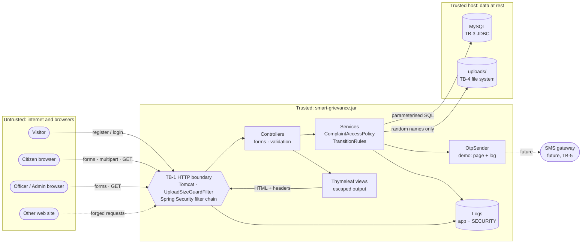

# 11 — Security Specification

| | |
|---|---|
| **Status** | Draft |
| **Depends on** | 00 Plan (D1–D55), 03 Requirements (NFR-01…07, FR-02…09c), 04 Use Cases, 05 Domain Model & Business Rules (BR-60…64, BR-80…87), 06 Flow Diagrams (SD-04, SD-06, SD-07), 07 Architecture (§5 security summary), 08 Database Design, 09 Web & API Contracts (99 routes, §2, §9, K1–K7), 10 UI / Screen Spec (D48, U1, U2, U6, U11) |

This document turns the security requirements of docs 03–10 into one concrete design: who can reach what, how users log in, how the Spring Security filter chain is configured, and how uploads, OTPs, personal data and logs are protected. It closes the open items K1–K5 and K7 of doc 09 and U1, U2, U6 and U11 of doc 10. Section 12 lists the security test cases (`SEC-xx`) that doc 13 takes over. The risky parts of the configuration were built and tested in a throwaway Spring Boot 4.2 project (§13); the Java sketches below are the versions that passed those tests.

| Section | Content |
|---|---|
| §1 | Scope, security goals, assumptions |
| §2 | Threat model: assets, actors, trust boundaries, STRIDE, OWASP Top 10 |
| §3 | Authentication: login, passwords, account states, brute force, sessions, registration auto-login |
| §4 | The `SecurityFilterChain`: rule list, login and logout, entry points, CSRF, over-size uploads, headers, cookies, Java sketch |
| §5 | Authorization: role matrix, object-level checks, 404 vs 403 |
| §6 | OTP security |
| §7 | File upload and download security |
| §8 | Input and output security |
| §9 | Secrets, configuration and logging rules |
| §10 | Privacy and data protection |
| §11 | Audit and security logging |
| §12 | Security test plan (`SEC-01` … `SEC-56`) |
| §13 | Verification |
| §14 | Open questions and risks for later documents |

---

## 1. Scope, goals and assumptions

### 1.1 Security goals

| ID | Goal | Main controls |
|---|---|---|
| SG-1 | A user sees only the complaints, files and notifications they are entitled to (D2, D10). | URL rules (§4.2) + `ComplaintAccessPolicy` (§5.2), 404 for anything not visible |
| SG-2 | Only the right role can perform an action. | URL prefix rules, `TransitionRules` (D39) |
| SG-3 | Passwords and OTPs cannot be read back, even from a database copy. | BCrypt (§3.3), HMAC-SHA256 for OTPs (§6.2) |
| SG-4 | Accounts cannot be taken over by guessing. | Login throttling (§3.5), OTP attempt limits (§6.3) |
| SG-5 | Another web site cannot act in a logged-in user's name. | CSRF tokens (§4.5), SameSite cookies (§4.8), CSP `form-action` and `frame-ancestors` (§4.7) |
| SG-6 | User-entered text and files can never run as code in another user's browser. | Escaped output (§8.2), strict CSP (§4.7), file type checks and safe serving headers (§7) |
| SG-7 | Citizens never learn staff names or other citizens' identities (D48). | View models built per viewer (§10.3), scan test SEC-49 |
| SG-8 | Security-relevant events can be reconstructed afterwards. | Security log (§11), complaint history (FR-81) |

### 1.2 Assumptions

| ID | Assumption | Consequence |
|---|---|---|
| A-S1 | **One application instance** (doc 07 §8). | Login throttling and rate limits live in memory (§3.5). Restarting the app clears them; this is acceptable. |
| A-S2 | In `prod` the app is reached over **HTTPS**, either directly or behind a reverse proxy (doc 14). A local `dev` run uses plain HTTP. | `Secure` cookie and HSTS only in `prod` (§4.7, §4.8). |
| A-S3 | The database and the `uploads/` folder are on the same trusted machine and are not reachable from the internet. | DB and file-system hardening is limited to credentials and folder permissions (§7.5, §9). |
| A-S4 | Officers and admins are trusted employees of the municipal body; citizens and anonymous visitors are not trusted. | Some staff-only conveniences are accepted (K7, §5.5). |
| A-S5 | There is no real SMS gateway in this release (FR-09b). | In the demo, mobile verification proves nothing about the number (§6.6). |

---

## 2. Threat model

### 2.1 Assets

| ID | Asset | Where it lives | Why it matters | Classification |
|---|---|---|---|---|
| AS-1 | User accounts and password hashes | `app_user` | Account takeover, especially of the admin | Secret (hash), confidential |
| AS-2 | Citizens' personal data: name, email, mobile | `app_user` | Privacy (DPDP Act, §10.5) | Personal data |
| AS-3 | Complaint content: title, description, address | `complaint`, `complaint_revision` | May describe a person's home or neighbours | Personal data / confidential |
| AS-4 | Attachments (photos, PDFs) | `uploads/` + `attachment` | Photos can show faces, number plates, homes | Personal data |
| AS-5 | Complaint history and remarks | `complaint_event` | Public accountability record (FR-81); must not be altered | Integrity-critical |
| AS-6 | OTP codes | `mobile_otp` (hash only) | Fake verification of a mobile number | Secret, short-lived |
| AS-7 | Session cookie and CSRF token | Browser, server memory | Whoever holds them acts as the user | Secret |
| AS-8 | Configuration secrets: DB password, bootstrap admin password | Environment variables | Full data access | Secret |
| AS-9 | Staff identity (officer names) | `app_user`, shown to staff only | Staff safety (D48) | Confidential |
| AS-10 | Availability of the service and disk space | Server | Citizens must be able to file complaints | — |
| AS-11 | Security and application logs | Log files | Evidence after an incident; may contain personal data if careless | Confidential |

### 2.2 Actors (who might attack)

| ID | Actor | Capabilities | Typical goal |
|---|---|---|---|
| TA-1 | Anonymous internet user | Any HTTP request; scripts; their own web site | Guess passwords, enumerate accounts, abuse registration, CSRF a logged-in victim |
| TA-2 | Registered citizen (malicious or curious) | A valid citizen session | Read other citizens' complaints (IDOR), upload malicious files, store XSS, fill the disk |
| TA-3 | Officer acting outside their duty | A valid officer session | Read or change complaints of other departments, act as admin |
| TA-4 | Admin account in the wrong hands | Full application access | Mass data export, deactivate everyone. Limited by logs and the last-admin rule (BR-82) |
| TA-5 | Someone with access to a copy of the database or a backup | Offline reading | Crack passwords or OTPs, read personal data |
| TA-6 | Someone at a shared or public computer after the user left | The open browser | Use a still-open session |

### 2.3 Trust boundaries and data flows



| Boundary | Between | What crosses it | Main controls |
|---|---|---|---|
| **TB-1** | Browser ↔ application | Every HTTP request and response | TLS in prod, Spring Security (authentication, URL rules, CSRF, headers), firewall (`StrictHttpFirewall`), size limits, validation |
| **TB-2** | Controller ↔ service (logical) | The current user and form data | Services re-check access (`ComplaintAccessPolicy`) and rules (`TransitionRules`) for every call; controllers are never trusted to have checked |
| **TB-3** | Application ↔ MySQL | SQL with bound parameters | `JdbcClient` named parameters only (§8.1), a DB account with rights on one schema only (doc 14) |
| **TB-4** | Application ↔ file system | File bytes and generated names | Random names, canonical path check, folder outside static resources (§7.5) |
| **TB-5** | Application ↔ SMS gateway (future) | Mobile number and OTP | Out of scope; the interface is ready (`OtpSender`) |

### 2.4 STRIDE analysis

Each row names a threat, where it applies and how it is handled. "Test" points to §12.

| # | STRIDE | Threat | Target | Mitigation | Test |
|---|---|---|---|---|---|
| T-01 | **S**poofing | Password guessing / credential stuffing on `POST /login` | AS-1 | BCrypt (slow), per-email and per-IP throttling with 15-minute locks (§3.5), one generic error message | SEC-07, SEC-08 |
| T-02 | Spoofing | Session hijacking by stealing the cookie | AS-7 | `HttpOnly`, `Secure` (prod), `SameSite=Lax`, cookie-only tracking (no `;jsessionid` in URLs), CSP against XSS, 30-minute idle timeout | SEC-15, SEC-31 |
| T-03 | Spoofing | Session fixation (attacker plants a session id before login) | AS-7 | New session id on login, registration and password change (§3.6, §3.9) | SEC-12, SEC-13 |
| T-04 | Spoofing | Faking mobile verification by guessing the OTP | AS-6 | 10⁶ codes, 3 attempts per code (strictly enforced, §6.3), 5 codes per hour | SEC-36, SEC-37 |
| T-05 | Spoofing | Using a still-open session on a shared computer | AS-7 | 30-minute idle timeout, no remember-me, POST logout that deletes the cookie, `no-store` caching | SEC-14, SEC-31 |
| T-06 | **T**ampering | Cross-site request forgery: another site makes the browser post a form | AS-3, AS-5 | Synchronizer CSRF token on every POST (incl. login and logout), `SameSite=Lax`, CSP `form-action 'self'` | SEC-10, SEC-11 |
| T-07 | Tampering | Mass assignment: posting `role=ADMIN`, `mobileVerified=true`, `ownerId=…` | AS-1, AS-3 | Dedicated form classes with only editable fields; role, owner, status and flags are set by services (§8.5) | SEC-46 |
| T-08 | Tampering | Changing a complaint that is not yours by editing ids in the URL or form (IDOR) | AS-3, AS-5 | URL role rules + `ComplaintAccessPolicy` inside the service transaction; `version` check (§5.2) | SEC-20 … SEC-26 |
| T-09 | Tampering | SQL injection through filters or search | AS-1…5 | Bound parameters only; whitelisted SQL fragments; fixed `ORDER BY` (§8.1) | SEC-43 |
| T-10 | Tampering | Editing or deleting history | AS-5 | No update or delete path for events and revisions (BR-72); final complaints are read-only | (doc 13 service tests) |
| T-11 | **R**epudiation | A user denies having changed a complaint or an account | AS-5 | `complaint_event.actor_id` + timestamp for every change (FR-81); admin account actions in the security log (§11) | SEC-54 |
| T-12 | **I**nformation disclosure | Reading other citizens' complaints by guessing numbers (`GRV-2026-000123` is sequential) | AS-3, AS-4 | `ComplaintAccessPolicy` → **404**, same page for "unknown" and "not visible" (BR-60) | SEC-20, SEC-21 |
| T-13 | Information disclosure | Account enumeration through login, registration or OTP | AS-2 | Generic login message, same BCrypt time for unknown and inactive accounts (§3.4), lock also for unknown emails; registration says "already registered" (FR-02, accepted) but is rate-limited (§3.5) | SEC-06, SEC-09 |
| T-14 | Information disclosure | Stored XSS in titles, remarks, file names, category names | AS-7 and everything the victim can see | `th:text` only, no `th:utext`, strict CSP without `'unsafe-inline'` (§4.7, §8.2) | SEC-44, SEC-30 |
| T-15 | Information disclosure | A malicious upload (HTML/SVG/script disguised as an image) runs in our origin | AS-7 | Only JPG/PNG/PDF by magic bytes; served with the stored type, `nosniff`, CSP; SVG never accepted (§7) | SEC-39 … SEC-41 |
| T-16 | Information disclosure | Staff names reach citizens (timeline, notifications) | AS-9 | Actor labels built per viewer; notification texts use department names (§10.3) | SEC-49 |
| T-17 | Information disclosure | Stack traces, SQL or versions in error pages | AS-1…8 | `server.error.include-*` off, own error templates, reference id only (NFR-06) | SEC-32 |
| T-18 | Information disclosure | Secrets or OTPs in logs | AS-6, AS-8 | Logging rules (§9.4); OTP logged only by the demo sender | SEC-55 |
| T-19 | Information disclosure | Clickjacking (our page framed by another site) | all | `X-Frame-Options: DENY` + CSP `frame-ancestors 'none'` | SEC-30 |
| T-20 | Information disclosure | Complaint numbers leaking in the `Referer` header to other sites | AS-3 | `Referrer-Policy: same-origin`; no external links or resources | SEC-30 |
| T-21 | **D**enial of service | Very large uploads or many uploads fill the disk | AS-10 | 5 MB per file, 26 MB per request, 5 files per complaint, 10 complaints per citizen per day (BR-88), verified citizens only (§7.4) | SEC-38, SEC-42 |
| T-22 | Denial of service | Mass registration or OTP sending (SMS cost in future) | AS-10 | Registration limit per IP (§3.5), OTP cooldown and hourly limit (BR-85) | SEC-09, SEC-37 |
| T-23 | Denial of service | Locking a known user out on purpose by failing their login | AS-10 | Lock lasts only 15 minutes, never permanent; the admin's password reset clears it; IP lock limits the attacker | SEC-07 |
| T-24 | Denial of service | Memory exhaustion of the in-memory throttling maps | AS-10 | At most 10,000 keys; expired keys removed (§3.5) | (unit test, doc 13) |
| T-25 | **E**levation of privilege | Citizen calls an officer or admin URL directly | all | URL rule by prefix → 403, checked before any lookup (§4.2) | SEC-16 … SEC-19 |
| T-26 | Elevation of privilege | Officer acts on another department's complaint | AS-3, AS-5 | Policy uses the officer's **current** department (BR-63), refreshed on every request (§3.10) | SEC-22, SEC-27 |
| T-27 | Elevation of privilege | A deactivated user keeps working in an open session | all | `UserStateFilter` ends the session at the next request (BR-83, §3.10) | SEC-26 |
| T-28 | Elevation of privilege | A new controller is added outside the role prefixes and becomes reachable by any logged-in user | all | Route-inventory test: every handler path must sit under a known prefix (§5.3) | SEC-19 |
| T-29 | Elevation of privilege | Default or weak bootstrap admin password in production | AS-1 | `ProdSafetyCheck` refuses to start (§9.2) | SEC-53 |

### 2.5 OWASP Top 10 mapping

The latest edition is **OWASP Top 10:2025**. The 2021 ID is given for readers who know that list.

| 2025 | 2021 | Category | How this project addresses it | Sections |
|---|---|---|---|---|
| A01 | A01 | Broken Access Control | URL prefix rules, `ComplaintAccessPolicy` with 404, object checks for attachments and notifications, SQL-filtered lists (BR-64), deny-by-prefix route inventory test, CSRF | §4.2, §5, §4.5 |
| A02 | A05 | Security Misconfiguration | Explicit security headers and CSP, error details off, no actuator, cookie flags, prod safety check, no default secrets | §4.7, §4.8, §9 |
| A03 | A06 | Software Supply Chain Failures | All versions pinned by the Spring Boot BOM and doc 07; front-end libraries from WebJars or copied, never a CDN (ADR-12); dependency check in the build (doc 14) | §14 (K-S5) |
| A04 | A02 | Cryptographic Failures | BCrypt(12) for passwords, HMAC-SHA256 for OTPs, `SecureRandom`, HTTPS + `Secure` cookies + HSTS in prod | §3.3, §6.2, §4.7 |
| A05 | A03 | Injection (incl. XSS) | Parameterised `JdbcClient`, whitelisted fragments (D25), Thymeleaf escaping, no `th:utext`, CSV-injection prefix (D43, D75) | §8 |
| A06 | A04 | Insecure Design | Threat model (§2), state machine (D39) as the only path for status changes, limits on files, OTPs and complaints, 404-not-403 design | §2, §6, §7 |
| A07 | A07 | Authentication Failures | Password policy, throttling, session fixation protection, idle timeout, generic messages, no remember-me | §3 |
| A08 | A08 | Software or Data Integrity Failures | Insert-only history (BR-72), optimistic locking (BR-71), Flyway-managed schema, no deserialisation of user data | §2.4 T-10 |
| A09 | A09 | Security Logging and Alerting Failures | `SECURITY` log with defined events and an hourly summary of 403/404/login failures | §11 |
| A10 | — (new) | Mishandling of Exceptional Conditions | Every exception maps to a defined response (doc 09 §2); over-size uploads, CSRF failures and expired sessions handled explicitly; transactions roll back and delete written files (BR-25) | §4.4, §4.6 |

---

## 3. Authentication

### 3.1 Login

| Item | Decision |
|---|---|
| Mechanism | Spring Security **form login**. `GET /login` is our own page (R-02); `POST /login` is handled by `UsernamePasswordAuthenticationFilter` (R-03). |
| Parameters | `email` (`usernameParameter("email")`) and `password`, plus `_csrf`. |
| Username | The email, trimmed and lower-cased by `AppUserDetailsService` before the lookup (BR-80), so `Mahesh@Example.com` logs in as `mahesh@example.com`. |
| Success | `RoleBasedSuccessHandler` (§3.1.1). |
| Failure | `LoginFailureHandler`: `302 /login?error` (or `/login?locked`, §3.5), keeps the typed email (§3.11). |
| Already logged in | `GET /login` and `GET /register` redirect to `/` (R-02, R-05). |
| Authentication manager | One explicit `ProviderManager` with one `ThrottledAuthenticationProvider` (§3.5); no other provider, no HTTP Basic, no default login page. |

#### 3.1.1 Where the user lands (`RoleBasedSuccessHandler`)

1. If Spring Security saved a request before sending the user to the login page (a `GET` to a protected page), and the user's role **may open that path** (same prefix rules as §4.2), go there. Only the path and query of the saved request are used, never a host name, so this is never an open redirect.
2. Otherwise go to the role home: CITIZEN `/citizen/complaints`, OFFICER `/officer/queue`, ADMIN `/admin/dashboard` (FR-03).
3. No request parameter (`redirect`, `returnUrl`, `continue`, …) is ever used as a target (§8.4).

Spring Security 7 adds `?continue` to the URL it returns to after login (the marker its request cache looks for), e.g. `/complaints/GRV-2026-000001?continue`. This is expected and harmless.

The request cache saves only `GET` requests for HTML pages. It never saves `GET /notifications/unread-count`, `/error` or `/favicon.ico`, so a background bell refresh cannot become the page the user lands on (verified, SEC-03).

### 3.2 `AppUserDetailsService` and the principal

- `loadUserByUsername(email)` reads `app_user` by lower-cased email and returns a **`CurrentUser`** (package `user`), which implements `UserDetails` and `CredentialsContainer`.
- `CurrentUser` fields: `id`, `email`, `fullName`, `role`, `departmentId` (officers), `active`, `mobileVerified`, `version`, a **password fingerprint** (first 8 bytes of SHA-256 of the stored hash, §3.10), and the password hash only until authentication ends. `ProviderManager` calls `eraseCredentials()` after login, so the hash is **not** kept in the session.
- Authorities: exactly one, `ROLE_CITIZEN`, `ROLE_OFFICER` or `ROLE_ADMIN`.
- `isEnabled()` = `active`. `isAccountNonLocked()`, `isAccountNonExpired()`, `isCredentialsNonExpired()` are always `true` (temporary locks are handled by the provider, §3.5).
- Controllers get it with `@AuthenticationPrincipal CurrentUser user`. Services receive it as an argument; they never read `SecurityContextHolder` themselves (easier to test, layer rule of doc 07 §1.1).
- `CurrentUser.toString()` prints only `id` and `role` (no email or name in logs by accident).

### 3.3 Password hashing and policy

| Item | Decision |
|---|---|
| Algorithm | **BCrypt**, `BCryptPasswordEncoder` (NFR-01). Hashes are stored as plain BCrypt strings (`$2a$12$…`, 60 characters) in `app_user.password_hash`, without a `{bcrypt}` prefix. |
| Strength | **12** (`app.security.bcrypt-strength`, default 12). Measured: about **0.3 s** per hash on the test machine, so a login stays fast for users but an offline attack is slow. Tests use 4 to stay fast. The seeder hashes `Demo@1234` once and reuses the hash for all demo users. |
| Upgrade | (Should) `AppUserDetailsService` also implements `UserDetailsPasswordService`, so a hash made with a lower strength is re-hashed with the current one at the next successful login. |
| Length rule | FR-02: 8–64 characters, at least one letter and one digit. **New:** at most **72 bytes in UTF-8** (D67). BCrypt only uses the first 72 bytes; Spring Security 7 throws `IllegalArgumentException` when encoding more, and `matches()` silently compares only the first 72 bytes (both verified, §13). 64 ASCII characters always fit; 64 Devanagari characters do not (a 32-character Hindi password is already 88 bytes), so the extra byte rule gives a clear field error ("Password is too long") instead of a 500. |
| Weak passwords | (Should) A small built-in list of very common passwords that pass the FR-02 rule (`password1`, `abc12345`, `qwerty123`, `12345678a`, `welcome1`, `admin123`, `india123`, `pune1234`, …, about 30 entries in `common-passwords.txt`) is refused: "This password is too common". The password must also not contain the user's email name part or mobile number. |
| Where checked | Bean Validation annotation `@StrongPassword` on `RegistrationForm.password`, `ChangePasswordForm.newPassword`, `PasswordResetForm.newPassword` and `OfficerCreateForm.password` (doc 12 writes the messages). The bootstrap admin password is checked by `ProdSafetyCheck` (§9.2). |
| Never | Passwords are never trimmed, logged, put in a flash attribute or sent back to a form (R-VALIDATION). |

### 3.4 Account states

| State | Stored as | Can log in? | What they can do | Message on login |
|---|---|---|---|---|
| Active, verified | `active = TRUE`, `mobile_verified = TRUE` | Yes | Everything their role allows | — |
| Active citizen, **unverified** | `active = TRUE`, `mobile_verified = FALSE` | Yes (FR-09a) | Browse, verify; cannot open New Complaint or submit (`VerifiedCitizenInterceptor` + BR-86 in the service) | — |
| **Inactive** | `active = FALSE` | No | Nothing; an open session ends at its next request (BR-83, §3.10) | Generic "Invalid email or password, or account inactive." (FR-05) |
| **Temporarily locked** (in memory) | not stored | No, for 15 minutes | — | "Too many failed attempts. Please wait 15 minutes and try again." (`/login?locked`) |

**Order of checks (D57).** Spring's default provider checks "enabled" **before** the password. That would let anyone learn that an inactive account exists (it answers faster, without a BCrypt check). Our provider moves the account-status checks **after** the password check (`setPreAuthenticationChecks(none)`, `setPostAuthenticationChecks(new AccountStatusUserDetailsChecker())`). So an unknown email, a wrong password and an inactive account all cost one BCrypt check (Spring's provider already hashes a dummy password for unknown users) and all give the same `/login?error` (verified, SEC-06).

### 3.5 Brute-force and abuse protection (D56)

An in-memory `LoginAttemptService` (package `security`) counts failures in fixed 15-minute windows. It works without a database table because one instance is assumed (A-S1).

| Key | Limit | Effect | Why |
|---|---|---|---|
| Email (lower-cased, **whether or not the account exists**) | 5 failures in 15 min | That email is locked for 15 min, even with the right password → `/login?locked` | Stops guessing one account. Locking unknown emails too means the "locked" message reveals nothing about existence. |
| Client IP (`request.getRemoteAddr()`) | 20 failures in 15 min | Every login from that IP is refused for 15 min → `/login?locked` | Stops one machine trying many accounts (credential stuffing). |
| Registration per IP | 10 `POST /register` in 60 min | `200` same view with global error "Too many registrations from this network. Try again later." | Limits mass account creation and use of "Email already registered" for enumeration (T-13, T-22). |

- Only **bad credentials** count as failures. A locked attempt is refused **before** any database or BCrypt work.
- A successful login clears the email counter. The admin's password reset (R-109, R-115) also clears the lock for that email, so the Grievance Cell can help a locked-out user at once.
- Locks are never permanent (T-23). They are not stored in the database and vanish on restart.
- At most 10,000 keys are kept; expired windows are removed when the map is full and by a small `@Scheduled` clean-up every 15 minutes (T-24).
- Behind a reverse proxy the remote address is the proxy's. Doc 14 then sets `server.forward-headers-strategy=native` **only** for a proxy it controls (otherwise clients could fake `X-Forwarded-For`).
- Limits are settings: `app.security.login.max-failures-per-account=5`, `app.security.login.max-failures-per-ip=20`, `app.security.login.window=15m`, `app.security.login.lock=15m`, `app.security.register.max-per-ip-per-hour=10`.

### 3.6 Sessions (D58)

| Item | Decision | Setting |
|---|---|---|
| Storage | Server-side HTTP session in Tomcat memory; the session holds the `SecurityContext` and the CSRF token | (default) |
| Idle timeout | **30 minutes** (FR-04) | `server.servlet.session.timeout=30m` |
| Absolute timeout | None (out of scope; idle timeout + logout are enough for this project) | — |
| Tracking | **Cookie only**. No `;jsessionid=` in URLs, which could leak into logs and `Referer` headers | `server.servlet.session.tracking-modes=cookie` |
| Session fixation | The session id changes on login (`changeSessionId`, Spring default), on the automatic login after registration (§3.9) and on the user's own password change | `sessionFixation(changeSessionId)` |
| Concurrent sessions | **Not limited.** A citizen may use a phone and a laptop at the same time. Deactivation and password changes still end every session at its next request (§3.10) | — |
| Remember-me | **No.** Citizens may use shared or cyber-café computers, and FR-04 asks for a 30-minute timeout; a long-lived login cookie would defeat both | not configured |
| Expiry warning (U11) | §3.12 | — |

### 3.7 Logout

- `POST /logout` with `_csrf` only (R-04). With CSRF on, Spring Security refuses `GET /logout` (it is a 404 here), so a link or image on another site cannot log users out.
- Logout invalidates the session, clears the `SecurityContext`, deletes the `JSESSIONID` cookie (`deleteCookies`) and redirects to `/login?logout` ("You have been logged out").
- Pages are sent with `Cache-Control: no-cache, no-store` (Spring Security default), so the Back button after logout does not show private pages from the cache.

### 3.8 Registration and enumeration

Registration (UC-01) must tell the user "Email already registered" or "Mobile already registered" (FR-02). This lets an attacker test whether an email or mobile has an account. It is **accepted** for this project because the alternative (sending an email "you already have an account") needs email, which is out of scope. It is limited by the per-IP registration limit (§3.5), CSRF on the form, and the security log (§11). Self-registration always creates a `CITIZEN` (FR-08): `RegistrationForm` has no role field, and any extra request parameter is ignored (SEC-46).

### 3.9 Automatic login after registration (K2, D60)

D46 logs the new citizen in at once. With Spring Security 6 and 7 a programmatic login is **not** saved automatically: the code must save the `SecurityContext` through the `SecurityContextRepository`, and must itself do what the login filter does for session fixation and CSRF. One helper does it, `AuthSessionService.login(user, request, response)` (package `security`):

1. Build `CurrentUser` from the new row (credentials erased) and an authenticated `UsernamePasswordAuthenticationToken` with `WebAuthenticationDetails`.
2. Run a `CompositeSessionAuthenticationStrategy` of `ChangeSessionIdAuthenticationStrategy` (new session id) and `CsrfAuthenticationStrategy` (new CSRF token; the token of the registration form stops working).
3. Create a new `SecurityContext`, put it into the `SecurityContextHolderStrategy` and **save it** with the same `SecurityContextRepository` bean that the filter chain uses (`DelegatingSecurityContextRepository(RequestAttribute…, HttpSession…)`).
4. Log `REGISTERED` and `LOGIN_SUCCESS method=registration` (§11).

The registration service commits the user row first; the controller then calls `AuthSessionService.login` and redirects to `/verify-mobile`. Verified: the session id changes, the next request is authenticated as the new citizen, the old CSRF token gets 403 and the new one works (SEC-13).

### 3.10 Keeping the principal current (K3, BR-83, D59)

The principal in the session is a copy of the user row taken at login. Three things can make it wrong while the session is open: the citizen verifies the mobile (K3), the admin changes the account (deactivates it, moves an officer to another department, marks a citizen verified, resets the password), or the user changes their own password.

**Rule (BR-89):** every `UPDATE app_user` increments `version` (doc 08 §3.4, updated). A small filter checks the row on every authenticated request:

`UserStateFilter` (package `security`, a `OncePerRequestFilter` placed after `AnonymousAuthenticationFilter` and before `ExceptionTranslationFilter`, skipped for static resources):

| Database row compared with the principal | Action |
|---|---|
| Missing or `active = FALSE` | Invalidate the session, clear the context, `302 /login?inactive` ("Your account has been deactivated. Contact the Grievance Cell."). For R-77: `401` JSON. Logged as `SESSION_ENDED reason=inactive`. |
| Password fingerprint differs (password changed or reset elsewhere) | Invalidate the session, `302 /login?expired`. Logged as `SESSION_ENDED reason=password_changed`. |
| `version` differs (verified, department changed, name changed) | Replace the principal through `AuthSessionService.refresh(userId, …)` (same session, saved through the repository) and continue. |
| Same `version` | Continue. |

- Cost: one primary-key query (`SELECT active, version, password_hash, … FROM app_user WHERE id = ?`) per authenticated page request. That is negligible next to the page's own queries (NFR-10).
- K3 is additionally handled **explicitly**: after `OtpService.verify` succeeds, `VerificationController` calls `AuthSessionService.refresh` before redirecting, so the very next page already shows the citizen as verified. The filter is the safety net for changes made by someone else.
- The user's own password change (R-08) calls `AuthSessionService.refresh` (new fingerprint) and `request.changeSessionId()`, so the current session continues and all **other** sessions of that user end at their next request.
- `ComplaintAccessPolicy` therefore always sees the officer's **current** department (BR-63).

Verified: deactivation ends the session at the next request; a department change is visible at the next request; a password reset ends the old session; OTP verification shows `mobileVerified = true` without logging in again (SEC-25 … SEC-28).

### 3.11 Keeping the typed email after a failed login (U6, D71)

**Decision: yes.** `LoginFailureHandler` stores the trimmed, lower-cased email (at most 254 characters) in the session attribute `app.loginEmail` and redirects to `/login?error`. `LoginController` reads the attribute **once**, removes it, and puts it in `LoginForm.email`, so the field is filled after the error and empty on the next visit. The password is never kept. This shows the user only what they typed themselves, so it reveals nothing. `RoleBasedSuccessHandler` removes the attribute after a successful login. Verified (SEC-05).

### 3.12 Session timeout while typing (U11, D72)

The 30-minute timer runs on the server and is reset only by requests. Typing a long complaint makes no requests, so the next POST can arrive after the session has ended; it then goes to `/login?expired` (§4.5) and the typed text is lost.

**Decision:** a progressive warning, no draft storage.

- `layouts/main.html` renders `data-session-timeout="1800"` on `<body>` (from `server.servlet.session.timeout`).
- `app.js` starts a timer on every page load. After 25 minutes it shows a fixed alert: "Your session will end in 5 minutes because of inactivity. [Stay logged in]". The button sends **one** `GET /notifications/unread-count`, which counts as activity and resets the server timer; the alert hides and the bell count updates. If the request returns 401 the page reloads (login page).
- This is a single request triggered by the user, so it does not break D37 ("never polled"): an unattended browser still times out.
- We do **not** keep drafts in `localStorage`/`sessionStorage`: complaint text would stay on shared computers after logout.
- Without JavaScript nothing changes: the text is lost, and the login page explains why (`/login?expired`). Accepted.

---

## 4. The `SecurityFilterChain`

### 4.1 Filter order

The order below is the one printed by the prototype (Spring Security 7.2.0, §13). Filters we add are in **bold**.

| # | Filter | Job here |
|---|---|---|
| 0 | **`UploadSizeGuardFilter`** (servlet filter, order −110, **before** Spring Security) | Over-size multipart on the three upload routes → `302` to the form page (§4.6) |
| 1 | `DisableEncodeUrlFilter` | Never put the session id into URLs |
| 2 | `WebAsyncManagerIntegrationFilter` | (framework) |
| 3 | `SecurityContextHolderFilter` | Loads the `SecurityContext` from the session (lazily) |
| 4 | `ContentSecurityPolicyNonceGeneratingFilter` | New in 7.2; unused because our CSP needs no nonces |
| 5 | `HeaderWriterFilter` | Security headers (§4.7) |
| 6 | `CsrfFilter` | Token check for every `POST` (§4.5) |
| 7 | `LogoutFilter` | `POST /logout` |
| 8 | `UsernamePasswordAuthenticationFilter` | `POST /login` |
| 9 | `RequestCacheAwareFilter` | Restores the saved request after login |
| 10 | `SecurityContextHolderAwareRequestFilter` | `request.getUserPrincipal()` etc. |
| 11 | `AnonymousAuthenticationFilter` | Anonymous token for visitors |
| 12 | **`UserStateFilter`** | Deactivation, password change, principal refresh (§3.10) |
| 13 | `ExceptionTranslationFilter` | Entry points and access-denied handler (§4.4) |
| 14 | `AuthorizationFilter` | URL rules (§4.2) |

Spring Security's `StrictHttpFirewall` (default) runs before all of these and rejects paths with `;`, `//`, encoded `.`/`/` or `..` with **400** (verified on four such paths, SEC-33).

### 4.2 URL rules (ordered)

Rules are evaluated top to bottom; the first match wins. Patterns are Spring `PathPattern`s (`/x/**` also matches `/x`). The route column covers all **99** routes of doc 09 §3 exactly once.

| # | Pattern(s) | Method | Rule | Routes (doc 09) | Count |
|---|---|---|---|---|---|
| 1 | `/webjars/**`, `/css/**`, `/js/**`, `/images/**`, `/vendor/**`, `/favicon.ico` | any | `permitAll` | static resources (§3.11) | — |
| 2 | `/error` | any | `permitAll` (otherwise an error page for an anonymous user would loop to the login page, U3) | infrastructure | — |
| 3 | `/`, `/login`, `/register` | any | `permitAll` | R-01, R-02, R-03, R-05, R-06 | 5 |
| — | `/logout` | POST | handled by `LogoutFilter` before the rules (any user with a valid CSRF token) | R-04 | 1 |
| 4 | `/verify-mobile/**`, `/citizen/**` | any | `hasRole('CITIZEN')` | R-10…R-12; R-20…R-28, R-40…R-43, R-71, R-72 | 3 + 15 |
| 5 | `/officer/**` | any | `hasRole('OFFICER')` | R-30, R-44…R-55 | 13 |
| 6 | `/admin/**` | any | `hasRole('ADMIN')` | R-31, R-32, R-56…R-70, R-78, R-80…R-100, R-101…R-115 | 54 |
| 7 | `/complaints/**`, `/attachments/**`, `/notifications/**`, `/account/**` | any | `authenticated()` (object checks in the service, §5.2) | R-29; R-73; R-74…R-77; R-07, R-08 | 8 |
| 8 | anything else | any | `authenticated()` → unknown path gives **404** to a logged-in user and the login page to a visitor (doc 09 §1.1 rule 5) | — | — |
| | | | | **Total** | **99** |

- `/` must stay public because R-01 redirects visitors to `/login`.
- `/verify-mobile` is CITIZEN-only: staff are always verified (BR-87), so an officer opening it gets 403.
- Rule 8 is `authenticated()` rather than `denyAll()` so that unknown URLs give 404, as doc 09 promises. The risk that a future controller outside the prefixes would then be open to every logged-in user is covered by the **route-inventory test** SEC-19 (§5.3).
- Roles are never mixed: an admin cannot open `/citizen/**` or `/officer/**`. The admin does officer work through the `/admin/complaints/{no}/…` routes (D32).

### 4.3 Form login and logout configuration

| Setting | Value |
|---|---|
| `loginPage` | `/login` (our template, no default generated page) |
| `usernameParameter` / `passwordParameter` | `email` / `password` |
| `successHandler` | `RoleBasedSuccessHandler(requestCache)` (§3.1.1) |
| `failureHandler` | `LoginFailureHandler` → `/login?error` or `/login?locked` (§3.5, §3.11) |
| `logoutUrl` | `/logout` (POST only, CSRF-protected) |
| `logoutSuccessUrl` | `/login?logout` |
| `deleteCookies` | `JSESSIONID` |
| `requestCache` | `HttpSessionRequestCache` with a matcher: `GET` only, not `/notifications/unread-count`, not `/error`, not `/favicon.ico` |

Login page flags (R-02, extended): `error`, `locked`, `logout`, `expired`, `inactive`. Doc 12 fixes the texts; the reference texts are in §3.4, §3.10 and doc 10 §4.1.

### 4.4 Exception handling and entry points (K4, K5)

| Situation | Detected by | Response | Verified |
|---|---|---|---|
| Visitor (no session) opens a protected page | `ExceptionTranslationFilter` → `SessionAwareLoginEntryPoint` | `302 /login` | SEC-01 |
| Request with a session id that is no longer valid (session timed out, or app restarted) opens a protected page | same entry point: `request.getRequestedSessionId() != null && !request.isRequestedSessionIdValid()` | `302 /login?expired` | SEC-14 |
| Not logged in, `GET /notifications/unread-count` (K4) | `JsonAuthenticationEntryPoint`, registered with `defaultAuthenticationEntryPointFor(…, GET /notifications/unread-count)` **before** the HTML entry point | `401`, `Content-Type: application/json`, `{"error":"unauthenticated"}`. No session is created and nothing is saved in the request cache. Works with or without an `Accept` header. | SEC-02, SEC-03 |
| Logged in, wrong role for the URL | `AuthorizationFilter` → `AppAccessDeniedHandler` | `403` page `error/403` | SEC-16 … SEC-18 |
| `POST` with a missing or wrong CSRF token **and the session has expired** (K5) | `CsrfFilter` → `AppAccessDeniedHandler` (`CsrfException` + invalid requested session id) | `302 /login?expired` | SEC-11 |
| `POST` without a valid token by a visitor who has no session at all | same handler, no session / anonymous | `302 /login` | SEC-11 |
| `POST` with a stale token **while logged in** (for example, a form left open in one tab while the user logged out and in again in another tab) | same handler, authenticated | `403` page with the variant text "This form has expired. Go back, reload the page and try again." (request attribute `app.errorReason = "csrf"`, doc 12 owns the text) | SEC-10 |
| Deactivated user, any request | `UserStateFilter` | `302 /login?inactive` (R-77: `401` JSON) | SEC-26 |
| Multipart request above 26 MB to an upload route (K1) | `UploadSizeGuardFilter` | `302` to the form page + `flashError` (§4.6) | SEC-38 |
| Multipart request above 26 MB to any other route | Tomcat while `CsrfFilter` reads the parameters | `413` → `error/4xx` page | SEC-38 |
| Object not visible / unknown | `ComplaintAccessPolicy` → `NotFoundException` → `GlobalExceptionHandler` | `404` page | SEC-20 … SEC-24 |

Why the expired-session check uses the **requested session id**: after a timeout the browser still sends the old `JSESSIONID`, which the server no longer knows. After a logout the cookie is deleted, so "expired" is not shown wrongly. After an app restart all sessions are gone and the message "Your session ended…" is also accurate.

### 4.5 CSRF

| Item | Decision |
|---|---|
| Protection | On for every `POST`, including `/login`, `/logout`, `/register` and every multipart form (NFR-03). There are no `PUT`/`PATCH`/`DELETE` requests and no JSON `POST`s. |
| Token store | `HttpSessionCsrfTokenRepository` (session, not a cookie: no JavaScript needs to read it). Declared as a bean so `AuthSessionService` uses the same repository (§3.9). |
| Request handler | Spring Security default `XorCsrfTokenRequestAttributeHandler` (masked token, BREACH-safe), deferred loading. |
| In templates | Every form uses `th:action`, so Thymeleaf's `CsrfRequestDataValueProcessor` adds the hidden `_csrf` field. A form written with a plain `action="…"` gets no token; doc 13 adds a template scan (SEC-45) that fails on `<form` without `th:action`. |
| Token rotation | On login and on the automatic login after registration (§3.9). |
| GET requests | Never change data (D38), except `GET /verify-mobile` issuing an OTP (D41), which is rate-limited by BR-85; `SameSite=Lax` stops other sites from sending the cookie with cross-site sub-requests. |
| Failure handling | §4.4 (K5). |

### 4.6 Over-size uploads (K1, D63)

**What the prototype showed.** Doc 09 §9.3 assumed that a request above `spring.servlet.multipart.max-request-size` (26 MB) reaches Spring MVC as `MaxUploadSizeExceededException`. On Spring Boot 4.2 / Tomcat 11 it does **not**: `CsrfFilter` reads the `_csrf` parameter first, which makes Tomcat parse the multipart body; Tomcat detects the size limit and fails the request with **413** before Spring MVC or our exception handler runs (verified). The user would see a bare error page and lose the form.

**Decision.** A small servlet filter `UploadSizeGuardFilter` (package `attachment`) runs **before** Spring Security (order −110; Spring Security is −100):

1. It acts only on `POST` requests with `Content-Type: multipart/form-data` whose `Content-Length` is larger than `spring.servlet.multipart.max-request-size`.
2. It acts only on the three upload routes, matched on the request path (never the `Referer`): `POST /citizen/complaints` → form page `/citizen/complaints/new`; `POST /citizen/complaints/{no}/edit` and `POST /{officer|admin}/complaints/{no}/resolve` → the same path (their GET form pages).
3. It does **not** read the body. If the request has a session it stores `flashError` "The files are too large together. Each file can be at most 5 MB and all files together at most 25 MB." with `SessionFlashMapManager` (the same store Spring MVC uses), then answers `302` to the form page. A request without a session gets the same redirect without a message (the form page then sends a visitor to the login page).
4. This happens before the CSRF check on purpose: the filter changes nothing except a flash message in the requester's own session, so a forged request gains nothing.

Tomcat must then read and discard the unread body so the browser receives the redirect. It does that up to `server.tomcat.max-swallow-size`; beyond it Tomcat closes the connection and the browser shows "connection reset". Measured in Chromium (§13): with the default 2 MB a 27 MB upload ends in `ERR_CONNECTION_RESET`; with **64 MB** the browser follows the redirect and shows the message. **Setting: `server.tomcat.max-swallow-size=64MB`** (doc 07 §6 said 30 MB; changed). Uploads above 64 MB still end in a connection reset, which is acceptable: the browser pre-check of `app.js` stops such files first, and nobody can attach that much through the normal form.

- Requests within 26 MB are unaffected: a 6 MB file reaches the controller and gets the normal field error (doc 09 §9.2, verified).
- Over-size multipart posts to other paths, and chunked uploads without `Content-Length` (browsers always send it for forms), get Tomcat's `413`, rendered by `error/4xx` (doc 12).
- `GlobalExceptionHandler` keeps its `MaxUploadSizeExceededException` mapping (doc 09 §9.3) as a fallback, but it is not the main path any more.
- `spring.servlet.multipart.max-file-size` stays equal to the request limit (26 MB, D36).

### 4.7 Security headers and CSP (D64)

| Header | Value | Why | Default or ours |
|---|---|---|---|
| `Content-Security-Policy` | see below | Blocks injected scripts and styles, framing, foreign form targets | ours |
| `X-Frame-Options` | `DENY` | Clickjacking (older browsers; CSP `frame-ancestors` for new ones) | default (explicit) |
| `X-Content-Type-Options` | `nosniff` | Browsers must not guess types (uploads, JSON) | default |
| `Cache-Control` / `Pragma` / `Expires` | `no-cache, no-store, max-age=0, must-revalidate` / `no-cache` / `0` | Private pages and files are not cached (T-05). Static resources set their own `Cache-Control` through Spring MVC resource handling (doc 14), which Spring Security does not overwrite. | default |
| `X-XSS-Protection` | `0` | The old browser filter is turned off (modern advice); CSP replaces it | default |
| `Referrer-Policy` | `same-origin` | Complaint numbers in URLs never reach other sites (T-20) | ours |
| `Permissions-Policy` | `camera=(), microphone=(), geolocation=(), payment=(), usb=(), interest-cohort=()` | The app uses none of these | ours |
| `Cross-Origin-Opener-Policy` | `same-origin` | Isolates our window from pages that open it | ours |
| `Cross-Origin-Resource-Policy` | `same-origin` | Other sites cannot embed our images or files | ours |
| `Strict-Transport-Security` | `max-age=31536000 ; includeSubDomains` — **only on HTTPS requests** | Forces HTTPS once the browser has seen the site over HTTPS. Spring Security writes it only when `request.isSecure()`, so local HTTP runs are unaffected (verified). Behind a TLS proxy doc 14 must make `isSecure()` true (forwarded headers). | default |

**Content-Security-Policy:**

```text
default-src 'self'; script-src 'self'; style-src 'self'; img-src 'self' data:;
font-src 'self'; connect-src 'self'; object-src 'none'; base-uri 'none';
form-action 'self'; frame-ancestors 'none'
```

| Directive | Reason |
|---|---|
| `script-src 'self'` | Only our own files: Bootstrap bundle (WebJar), `app.js`, `early.js`, Chart.js from `static/vendor/`. **No inline scripts, no `eval`, no CDN** (ADR-12). |
| `style-src 'self'` | Bootstrap CSS, Bootstrap Icons CSS and `app.css`. **No `style="…"` attributes and no `<style>` blocks** in templates. Bootstrap's and Chart.js's JavaScript set styles through the DOM (`element.style`), which CSP allows. |
| `img-src 'self' data:` | Our images and attachments; `data:` is needed because Bootstrap's CSS draws the select arrow, check marks, close button and navbar toggler as `data:image/svg+xml` images. |
| `font-src 'self'` | Bootstrap Icons font from the WebJar or `static/vendor/` |
| `connect-src 'self'` | `app.js` fetches R-77 only |
| `object-src 'none'`, `base-uri 'none'`, `frame-ancestors 'none'`, `form-action 'self'` | No plugins, no `<base>` tricks, no framing, forms post only to us |

Consequences for templates and docs 07/10 (applied there):

1. The one-line inline script in `<head>` that switches `no-js` to `js` (doc 10 §3.1) moves to a file **`static/js/early.js`**, loaded synchronously in `<head>`: `<script th:src="@{/js/early.js}"></script>`.
2. The `<noscript><style>…</style></noscript>` block becomes ordinary rules in `app.css` under the `.no-js` class (`.no-js .navbar-collapse {display:block!important}`, `.no-js .js-only {display:none!important}` …). `<html>` starts with `class="no-js"`, so they apply exactly when JavaScript is off.
3. Inline `style` attributes from the mock-ups (`white-space:pre-line`, `max-width:96px`, the chart box height) become classes in `app.css` (`.pre-line`, `.thumb-name`, `.chart-box`).
4. Dashboard chart data (FR-64) is **not** an inline script: it is a JSON string in a data attribute, `<div id="chart-data" th:attr="data-chart=${dash.chartJson}">`, read by `app.js` with `JSON.parse(el.dataset.chart)`. Attribute escaping is safe even if a category name contains `</script>` (verified).
5. `app.js` only writes text with `textContent`, never `innerHTML` with server data.

Verified in Chromium with Bootstrap 5.3.8 and Bootstrap Icons 1.13.1 from WebJars: navbar dropdown, icon font, select arrow, check box, close button and the data-attribute chart text all work with **zero CSP violations**; a deliberate inline `style` attribute is reported and blocked (proves the check works); with JavaScript off the `.no-js` rules show the menu. A PDF attachment opens in Chromium's built-in viewer under this CSP (`object-src 'none'` does not block a top-level PDF) (§13).

Spring Security 7.2 also supports CSP nonces (`ContentSecurityPolicyNonceGeneratingFilter`); they are not needed because nothing is inline.

### 4.8 Cookies and session properties

| Property | dev | prod | Reason |
|---|---|---|---|
| `server.servlet.session.cookie.http-only` | `true` | `true` | JavaScript cannot read the session cookie (T-02) |
| `server.servlet.session.cookie.same-site` | `lax` | `lax` | Other sites' forms and sub-requests do not carry the cookie; normal links into the app still work. `strict` would also break the first click from, e.g., a link in a chat message. |
| `server.servlet.session.cookie.secure` | `false` | `${COOKIE_SECURE:true}` | Cookie only over HTTPS in prod (A-S2). A prod demo on plain HTTP in a lab must set `COOKIE_SECURE=false`; `ProdSafetyCheck` then logs a warning (§9.2). |
| `server.servlet.session.tracking-modes` | `cookie` | `cookie` | No session id in URLs |
| `server.servlet.session.timeout` | `30m` | `30m` | FR-04 |
| Cookie name | `JSESSIONID` | `JSESSIONID` | Default; renaming adds nothing here |

Verified `Set-Cookie: JSESSIONID=…; Path=/; HttpOnly; SameSite=Lax` and no `jsessionid` in page links (SEC-31).

### 4.9 Java configuration sketch

This is the configuration that passed the prototype tests (§13), cut down to what the app needs. Class names are the ones of §4.10.

```java
@Configuration
public class SecurityConfig {

  static final String CSP = "default-src 'self'; script-src 'self'; style-src 'self'; img-src 'self' data:; "
      + "font-src 'self'; connect-src 'self'; object-src 'none'; base-uri 'none'; form-action 'self'; frame-ancestors 'none'";
  static final String PERMISSIONS = "camera=(), microphone=(), geolocation=(), payment=(), usb=(), interest-cohort=()";

  @Bean PasswordEncoder passwordEncoder(AppProperties app) {
    return new BCryptPasswordEncoder(app.security().bcryptStrength());          // 12; tests 4
  }
  @Bean SecurityContextRepository securityContextRepository() {                  // shared with AuthSessionService (K2, K3)
    return new DelegatingSecurityContextRepository(
        new RequestAttributeSecurityContextRepository(), new HttpSessionSecurityContextRepository());
  }
  @Bean CsrfTokenRepository csrfTokenRepository() { return new HttpSessionCsrfTokenRepository(); }

  @Bean SecurityFilterChain filterChain(HttpSecurity http, AppUserDetailsService uds, PasswordEncoder enc,
      LoginAttemptService attempts, UserStateFilter userStateFilter, SecurityEvents events,
      SecurityContextRepository contextRepo, CsrfTokenRepository csrfRepo) throws Exception {

    RequestMatcher unreadCount = pathPattern(HttpMethod.GET, "/notifications/unread-count");
    HttpSessionRequestCache requestCache = new HttpSessionRequestCache();      // GET pages only
    requestCache.setRequestMatcher(new AndRequestMatcher(pathPattern(HttpMethod.GET, "/**"),
        new NegatedRequestMatcher(new OrRequestMatcher(unreadCount, pathPattern("/error"), pathPattern("/favicon.ico")))));

    http
      .authenticationManager(new ProviderManager(new ThrottledAuthenticationProvider(uds, enc, attempts)))
      .securityContext(sc -> sc.securityContextRepository(contextRepo))
      .requestCache(rc -> rc.requestCache(requestCache))
      .authorizeHttpRequests(auth -> auth
        .requestMatchers("/webjars/**", "/css/**", "/js/**", "/images/**", "/vendor/**", "/favicon.ico").permitAll()
        .requestMatchers("/error").permitAll()
        .requestMatchers("/", "/login", "/register").permitAll()
        .requestMatchers("/verify-mobile/**", "/citizen/**").hasRole("CITIZEN")
        .requestMatchers("/officer/**").hasRole("OFFICER")
        .requestMatchers("/admin/**").hasRole("ADMIN")
        .requestMatchers("/complaints/**", "/attachments/**", "/notifications/**", "/account/**").authenticated()
        .anyRequest().authenticated())                                           // unknown path → 404 (SEC-19 guards new routes)
      .formLogin(f -> f.loginPage("/login").usernameParameter("email").passwordParameter("password")
        .successHandler(new RoleBasedSuccessHandler(requestCache, events))
        .failureHandler(new LoginFailureHandler(events)).permitAll())
      .logout(l -> l.logoutUrl("/logout").logoutSuccessUrl("/login?logout").deleteCookies("JSESSIONID")
        .addLogoutHandler(events::logout))
      .exceptionHandling(e -> e
        .defaultAuthenticationEntryPointFor(new JsonAuthenticationEntryPoint(), unreadCount)        // K4 (first!)
        .defaultAuthenticationEntryPointFor(new SessionAwareLoginEntryPoint(), AnyRequestMatcher.INSTANCE)
        .accessDeniedHandler(new AppAccessDeniedHandler(events)))                                   // K5 + 403
      .csrf(c -> c.csrfTokenRepository(csrfRepo))
      .sessionManagement(s -> s.sessionFixation(f -> f.changeSessionId()))
      .headers(h -> h
        .contentSecurityPolicy(csp -> csp.policyDirectives(CSP))
        .referrerPolicy(r -> r.policy(ReferrerPolicy.SAME_ORIGIN))
        .permissionsPolicyHeader(p -> p.policy(PERMISSIONS))
        .frameOptions(fo -> fo.deny())
        .crossOriginOpenerPolicy(c -> c.policy(CrossOriginOpenerPolicy.SAME_ORIGIN))
        .crossOriginResourcePolicy(c -> c.policy(CrossOriginResourcePolicy.SAME_ORIGIN)))
      .addFilterBefore(userStateFilter, ExceptionTranslationFilter.class);
    return http.build();
  }

  @Bean FilterRegistrationBean<UploadSizeGuardFilter> uploadSizeGuard(                          // K1
      @Value("${spring.servlet.multipart.max-request-size}") DataSize maxRequest) {
    var reg = new FilterRegistrationBean<>(new UploadSizeGuardFilter(maxRequest));
    reg.setOrder(-110);                                                        // Spring Security is −100
    return reg;
  }
}
```

```java
/** Lock check first; account-status checks AFTER the password (D57). */
public class ThrottledAuthenticationProvider extends DaoAuthenticationProvider {
  public ThrottledAuthenticationProvider(UserDetailsService uds, PasswordEncoder enc, LoginAttemptService attempts) {
    super(uds);
    setPasswordEncoder(enc);
    setPreAuthenticationChecks(user -> { });
    setPostAuthenticationChecks(new AccountStatusUserDetailsChecker());
    this.attempts = attempts;
  }
  @Override public Authentication authenticate(Authentication auth) {
    String email = auth.getName().trim().toLowerCase(Locale.ROOT);
    String ip = auth.getDetails() instanceof WebAuthenticationDetails d ? d.getRemoteAddress() : "unknown";
    if (attempts.isLocked(email, ip)) throw new LockedException("locked");
    try { Authentication ok = super.authenticate(auth); attempts.success(email); return ok; }
    catch (BadCredentialsException e) { attempts.failure(email, ip); throw e; }
  }
}
```

```java
/** K5 and 403 handling. */
public class AppAccessDeniedHandler implements AccessDeniedHandler {
  public void handle(HttpServletRequest req, HttpServletResponse resp, AccessDeniedException ex) throws IOException {
    if (ex instanceof CsrfException) {
      if (req.getRequestedSessionId() != null && !req.isRequestedSessionIdValid()) { resp.sendRedirect("/login?expired"); return; }
      if (req.getSession(false) == null || !loggedIn()) { resp.sendRedirect("/login"); return; }
      req.setAttribute("app.errorReason", "csrf");                    // error/403 shows "This form has expired …"
    }
    events.accessDenied(req, ex);                                     // SECURITY log + counter (§11)
    resp.sendError(HttpServletResponse.SC_FORBIDDEN);
  }
  private static boolean loggedIn() {          // NOT request.getUserPrincipal(): CsrfFilter runs before the wrapper that provides it
    Authentication a = SecurityContextHolder.getContext().getAuthentication();
    return a != null && a.isAuthenticated() && !(a instanceof AnonymousAuthenticationToken);
  }
}
```

```java
/** K2 / K3: programmatic login and principal refresh. */
public void login(AppUser user, HttpServletRequest req, HttpServletResponse resp) {
  Authentication auth = token(CurrentUser.from(user), req);
  new CompositeSessionAuthenticationStrategy(List.of(new ChangeSessionIdAuthenticationStrategy(),
      new CsrfAuthenticationStrategy(csrfTokenRepository))).onAuthentication(auth, req, resp);
  save(auth, req, resp);
}
public void refresh(long userId, HttpServletRequest req, HttpServletResponse resp) {
  userRepository.findById(userId).ifPresent(u -> save(token(CurrentUser.from(u), req), req, resp));
}
private void save(Authentication auth, HttpServletRequest req, HttpServletResponse resp) {
  SecurityContext ctx = holder.createEmptyContext();
  ctx.setAuthentication(auth);
  holder.setContext(ctx);
  securityContextRepository.saveContext(ctx, req, resp);   // required since Spring Security 6
}
```

Spring Security 7 API notes found while building the prototype: `AntPathRequestMatcher` and `MvcRequestMatcher` are gone, use `PathPatternRequestMatcher.pathPattern(…)`; `DaoAuthenticationProvider` takes the `UserDetailsService` in its constructor; `permissionsPolicyHeader(…)` replaces the deprecated `permissionsPolicy(…)`.

### 4.10 Classes (additions to doc 07 §3)

| Class | Package | Role |
|---|---|---|
| `SecurityConfig` | `config` | §4.9 |
| `ProdSafetyCheck` | `config` | §9.2 |
| `ThrottledAuthenticationProvider`, `LoginAttemptService`, `RateLimiter` | `security` | §3.5 |
| `RoleBasedSuccessHandler`, `LoginFailureHandler` | `security` (moved from `auth`) | §3.1, §3.11 |
| `SessionAwareLoginEntryPoint`, `JsonAuthenticationEntryPoint`, `AppAccessDeniedHandler` | `security` | §4.4 |
| `AuthSessionService` | `security` | §3.9, §3.10 |
| `UserStateFilter` | `security` | §3.10 |
| `SecurityEvents` | `security` | §11 |
| `UploadSizeGuardFilter` | `attachment` | §4.6 |
| `OtpHasher` | `otp` | §6.2 |
| `StrongPassword` (annotation + validator), `common-passwords.txt` | `common.validation` | §3.3 |

---

## 5. Authorization

### 5.1 Role matrix per route group

✔ = allowed by the URL rule; "obj" = an object-level check follows (§5.2); ✘ = `403`; → login = redirect to the login page.

| Route group | Routes | Visitor | Citizen | Officer | Admin |
|---|---|:-:|:-:|:-:|:-:|
| Landing, login, register | R-01…R-03, R-05, R-06 | ✔ | ✔ (→ home) | ✔ (→ home) | ✔ (→ home) |
| Logout | R-04 | ✔ (no effect) | ✔ | ✔ | ✔ |
| Change own password | R-07, R-08 | → login | ✔ | ✔ | ✔ |
| Mobile verification | R-10…R-12 | → login | ✔ | ✘ | ✘ |
| Citizen lists, new complaint | R-20…R-23 | → login | ✔ (R-22/R-23: verified only, else → `/verify-mobile`) | ✘ | ✘ |
| Citizen owner actions (submitted page, edit, withdraw, close, reopen) | R-24…R-28, R-40…R-43 | → login | obj (owner) | ✘ | ✘ |
| Watch / unwatch | R-71, R-72 | → login | obj (watcher / duplicate owner) | ✘ | ✘ |
| Complaint detail | R-29 | → login | obj | obj | obj |
| Attachment | R-73 | → login | obj | obj | obj (+ deleted files) |
| Notifications | R-74…R-76 | → login | obj (recipient) | obj | obj |
| Unread count (JSON) | R-77 | `401` JSON | ✔ | ✔ | ✔ |
| Department queue, officer actions | R-30, R-44…R-55 | → login | ✘ | obj (current department) | ✘ |
| Admin complaints, export, dashboard, admin actions | R-31, R-32, R-56…R-70, R-78 | → login | ✘ | ✘ | ✔ (all complaints) |
| Master data | R-80…R-100 | → login | ✘ | ✘ | ✔ (unknown id → 404) |
| Officer and citizen accounts | R-101…R-115 | → login | ✘ | ✘ | obj (id must be of the right role) |

### 5.2 Object-level checks

All object checks run in the **service**, inside the transaction of the action, after the URL rule has passed. A failed check always throws `NotFoundException` → **404** with the same page as an unknown id (doc 09 §2).

| Object | Rule | Where | Notes |
|---|---|---|---|
| Complaint (view) | `ComplaintAccessPolicy.canView(user, c)` = BR-60: admin; officer of the **current** department; citizen who owns it, actively watches it, or owns a duplicate linked to it | `ComplaintQueryService`, every workflow and owner action | Complaints are looked up by `complaintNo`; the number is sequential and guessable, so the policy is the real control (T-12). |
| Complaint (act) | `canView` **and** `TransitionRules.decide(action, actor, facts, now)` (BR-61, D39) | `ComplaintWorkflowService`, `ComplaintService`, `DuplicateService`, `WatchService` | Failing `canView` → 404; failing only the action rule → `flashError` (R-STATE). |
| Owner-only pages | R-24 (submitted page) and R-25…R-28: owner only. A watcher who can view the complaint gets 404 on R-24 and the `flashError` of R-25/R-27 (doc 09) | `ComplaintQueryService.submittedSummary`, `ComplaintService` | |
| Lists | The same conditions in SQL (BR-64, doc 08 §5.1): `owner_id = :userId`, watcher join, `department_id = :deptId` | repositories | A complaint the user cannot open never appears in a list, a count or the CSV export. |
| Attachment | `canView(parent complaint)`; if `deleted = TRUE`, admin only (BR-26, BR-62) | `AttachmentService.load` | Numeric id, so it is checked on every request. A missing file on disk → 404 + ERROR log (SD-06). |
| `removeAttachmentIds` in an edit | Each id must be an active `COMPLAINT` attachment **of this complaint**; others are ignored and logged at WARN (doc 09 §4.2) | `ComplaintService.edit` | Stops deleting another complaint's file through the edit form (T-08). |
| Duplicate target (`originalNo`) | For officers: the original must be in the officer's department (BR-43); preview details only when it is (§5.5) | `DuplicateService` | |
| Notification | `WHERE id = :id AND recipient_id = :userId` in the `UPDATE`/`SELECT` (doc 08 §5.11) | `NotificationService.open` | Another user's id → 0 rows → 404. "Mark all read" only touches the user's own rows. |
| Notification target | Opening a notification redirects to `/complaints/{no}`, which applies `canView` again (R-75) | detail page | A notification about a complaint the user can no longer see (e.g. officer moved) leads to 404. |
| Officer account `{id}` | The user must have role `OFFICER` (R-104…R-109) | `UserAdminService` | A citizen's or admin's id on an officer route → 404. |
| Citizen account `{id}` | The user must have role `CITIZEN` (R-111…R-115) | `UserAdminService` | |
| Admin accounts | No routes (D45); BR-82 still enforced in `setActive` | — | |
| Master data `{id}` | Exists → admin may edit; unknown → 404 | `MasterDataService` | Admin-only by URL. |

`ComplaintAccessPolicy` gets the user from the controller argument (`CurrentUser`), which `UserStateFilter` keeps current (§3.10). It never trusts a role, owner or department sent by the browser.

### 5.3 Method-level security (decision, D65)

**No `@PreAuthorize` / `@EnableMethodSecurity`.**

- Role rules live in **one** place, the URL rules of §4.2: every route's role is visible from its prefix (D30).
- Object rules live in **one** other place, `ComplaintAccessPolicy` + `TransitionRules`, which need data (status, department, owner) that annotations would have to load again.
- Annotations would duplicate both and make tests and the viva explanation longer.

To make sure nothing slips past the URL rules, doc 13 adds the **route-inventory test** (SEC-19): it reads all handler mappings from `RequestMappingHandlerMapping` and fails if any path is not under `/`, `/login`, `/register`, `/verify-mobile`, `/citizen/`, `/officer/`, `/admin/`, `/complaints/`, `/attachments/`, `/notifications/`, `/account/` or `/error`, or if the number of mappings differs from the route catalogue (99 routes; the `masterdata` routes are three controllers of seven mappings each). A new controller outside the prefixes therefore fails the build instead of silently becoming "any logged-in user".

### 5.4 404 versus 403

| Case | Answer | Reason |
|---|---|---|
| Wrong role for the URL prefix (citizen opens `/admin/…`, officer posts to `/citizen/…`, admin opens `/verify-mobile`) | **403** | The prefixes are public knowledge; 403 reveals nothing about any complaint. The role check happens **before** any lookup, so a wrong-role user cannot use 403/404 to test whether a complaint number exists. |
| Right role, object not visible (other citizen's complaint, other department, other user's notification, deleted attachment for a non-admin) | **404** | D10, BR-60: the system never confirms that the object exists. |
| Unknown object or malformed complaint number | **404** | Same page as "not visible". |
| Unknown URL, logged in | **404** | doc 09 §1.1 rule 5 |
| Unknown URL, visitor | `302 /login` | Rule 8 of §4.2 |
| CSRF failure while logged in | **403** (variant text) | §4.4 |

### 5.5 Staff-only information: K7 and U2 (D69)

**K7 — confirmed, with a limit.** When an officer types the number of a complaint outside their department in the duplicate form (R-54), the message "GRV-… is not in your department. Use Send back and mention it in the remark" confirms that the number exists. This is accepted: officers are trusted staff (A-S4), the number itself carries no personal data, and BR-43 needs the message to guide them. The limit: for a complaint outside the officer's department the preview (step 2) is **not** shown, so title, area, status, owner and department of that complaint are never revealed. Admins see the preview for any complaint. Test SEC-29.

**U2 — changed slightly.** On the original A, staff see the `DUPLICATE_RECEIVED` entry "GRV-B linked as a duplicate" (D55). If an admin linked B from another department, an officer of A's department cannot open B (BR-63), so a link would end in 404. **Decision:** staff always see B's **number** as text; it is a **link only if the viewer can view B**. `TimelineService` sets `TimelineEntry.relatedLinkable = policy.canView(viewer, B)` (one extra lookup per such entry; complaints have very few). Citizens still see the sentence without a number (D55). Doc 09 §5.3 and doc 10 §7.1 are updated.

---

## 6. OTP security

### 6.1 Generation

- 6 digits from a single `SecureRandom` instance: `String.format("%06d", random.nextInt(1_000_000))` (BR-85). Leading zeros are kept.
- A new OTP marks all earlier unused OTPs of the user as `used` in the same transaction (doc 08 §5.12), so only one code is ever valid.
- Issued only after registration, on Resend, and on `GET /verify-mobile` when the user has no usable OTP and the limits allow (D41).

### 6.2 Storage: HMAC-SHA256 (D66)

| Option | Offline guessing of a stolen hash | Speed | Chosen? |
|---|---|---|---|
| Plain SHA-256 | 10⁶ codes → instant | fast | No |
| BCrypt | 10⁶ × ~0.3 s ≈ 3.5 days per code on one core, much less with a GPU; still feasible | slow (adds 0.3 s to each verify) | No |
| **HMAC-SHA256 with a secret key held only in memory** | Impossible without the key, which is not in the database or its backups | fast | **Yes** |

- `OtpHasher` (package `otp`) computes `Base64(HMAC-SHA256(key, userId + ":" + code))` (44 characters; `otp_hash` is `VARCHAR(100)`). Including the user id binds a code to one account.
- The key is **32 random bytes from `SecureRandom`, created at every application start and never stored**. Consequence: OTPs issued before a restart stop working; the user presses Resend. This is acceptable for 5-minute codes and needs no key management. (If the app ever runs on several instances, doc 14 adds `app.otp.hmac-key` from an environment variable.)
- Comparison with `MessageDigest.isEqual` (constant time).

### 6.3 Attempts: reserve first, then compare

The limit of 3 wrong attempts (BR-85) must hold even if an attacker sends many guesses **in parallel**. A naive "read attempts → compare → increment" lets parallel requests all read `attempts = 0`. The service therefore **reserves an attempt before comparing**:

```sql
-- 1. reserve an attempt (atomic); 0 rows → expired, used or no attempts left
UPDATE mobile_otp SET attempts = attempts + 1
 WHERE id = :id AND used = FALSE AND attempts < :maxAttempts AND expires_at > :now;
-- 2. compare HMACs in Java; on a match:
UPDATE mobile_otp SET used = TRUE WHERE id = :id AND used = FALSE;
UPDATE app_user SET mobile_verified = TRUE, version = version + 1, updated_at = :now WHERE id = :userId;
```

- `attempts` counts every try, including the successful one. "N attempts left" = `maxAttempts − attempts`.
- Step 1 returning 0 rows gives "OTP expired, please request a new one" (UC-04 3b).
- All in one transaction (BR-70).

### 6.4 Rate limits (BR-85)

| Limit | Value | Effect |
|---|---|---|
| Attempts per code | 3 | then a new code is needed |
| Code lifetime | 5 minutes | |
| Resend cooldown | 60 seconds | `flashError` "Please wait N seconds…" |
| Codes per user per hour | 5 | `flashError` "Too many OTP requests, try again after hh:mm a" |
| Worst case for a guesser | 5 codes × 3 tries = 15 guesses per hour | chance 15 in 1,000,000 per hour; each try is logged (§11) |

### 6.5 Enumeration and disclosure

- All OTP routes require a logged-in CITIZEN; a user can only ever verify **their own** account. Nothing about other users' OTPs or mobiles can be asked.
- Pages and messages show the mobile masked: `******1234` (doc 10 §1.5).
- The demo code is shown only in the response that issued it (D41) and is not stored in plain text anywhere.

### 6.6 Demo sender and logging rules

| Rule | Detail |
|---|---|
| Only `DemoOtpSender` ever handles the plain code outside `OtpService` | It returns the code for display and logs **one** line at INFO: `DEMO-OTP userId=42 mobile=******1234 code=482913`. |
| No other component logs the code | `OtpService`, controllers and `SecurityEvents` log `OTP_ISSUED`/`OTP_VERIFIED`/`OTP_FAILED` **without** the code (§11). |
| A future SMS sender | Must never log the code; logs only the gateway's message id. |
| Demo sender in prod | Allowed (there is no SMS gateway yet, A-S5), but `ProdSafetyCheck` logs a WARN at startup: "Demo OTP sender is active: mobile numbers are not really verified". The admin's manual verification (FR-09c) remains available. |
| Limitation | With the demo sender, the code is on the screen, so verification proves nothing about the mobile number. This is a known demo limitation, stated in the report. |

---

## 7. File upload and download security

### 7.1 What is accepted

| Check | Rule | Where | On failure |
|---|---|---|---|
| Type by content | First bytes must be JPEG `FF D8 FF`, PNG `89 50 4E 47 0D 0A 1A 0A` (all 8 bytes) or PDF `25 50 44 46 2D` (`%PDF-`) | `FileTypeDetector` (ADR-07, BR-22) | Field error "{name}: only JPG, PNG or PDF files are allowed" |
| Extension and browser type | **Ignored** for the decision; the stored `content_type` and extension come from the detected type | `FileStorageService` | — |
| Size | ≤ 5 MB per file (`app.upload.max-file-size`), ≤ 26 MB per request | `FileStorageService` (D36), `UploadSizeGuardFilter` / Tomcat (§4.6) | Field error / redirect |
| Count | ≤ 5 active `COMPLAINT` files, ≤ 3 `RESOLUTION` files (BR-23) | service, in the transaction | Field error |
| Empty parts | Ignored (empty file input) | `FileStorageService` | — |
| One bad file | Rejects the whole submission (FR-11) | | One message per bad file |

**Not accepted, by design:** SVG (it is XML text that can contain scripts; it never matches the magic bytes), HTML, Office files, archives, executables. Because nothing is unpacked or decoded on the server, **zip bombs and decompression bombs do not apply**. Images are never resized or decoded server-side (no thumbnails, doc 09 §9.4), so malformed-image exploits in Java image libraries do not apply either.

(Could) A dimension check that reads only the image header (`ImageReader.getWidth/getHeight`, no decoding) and refuses images above 40 megapixels, to protect staff browsers from "pixel bombs".

### 7.2 Polyglots and PDF risks

- A file that starts with `%PDF-` but also contains HTML is stored as `application/pdf` and served with `nosniff`, so the browser never treats it as HTML.
- PDFs can contain JavaScript and links. Browsers' built-in PDF viewers run PDF scripts in a sandbox without access to our pages or cookies. The global CSP is sent with the PDF and Chromium still opens it inline (verified). Staff are told in the officer guide (doc 14 appendix) not to open PDFs in external desktop readers with scripting enabled.
- Antivirus scanning is **future work**: `FileStorageService` calls a `FileScanner` interface before writing; the default `NoOpFileScanner` accepts everything, and a ClamAV (`clamd` INSTREAM) implementation can be added without changing callers.

### 7.3 Original file names

- Cleaned before storing as metadata (BR-24): keep the part after the last `/` or `\`, remove control characters and `" * : < > ? |`, collapse spaces, limit to 255 characters; empty → `file`.
- Shown only with `th:text` and in `Content-Disposition` with both an ASCII `filename` (non-ASCII, quotes and backslashes replaced by `_`) and `filename*=UTF-8''…` (doc 09 §9.4), so a name cannot inject headers (CR/LF are removed).

### 7.4 Abuse limits (D68)

| Limit | Value | Setting | Why |
|---|---|---|---|
| Complaints per citizen | **10 per rolling 24 hours** (new **BR-88**) | `app.complaint.max-per-day=10` | With 25 MB per complaint, one account could otherwise fill the disk (T-21). Ten is far above normal use. Refused as a global error on the form: "You have filed 10 complaints in the last 24 hours. Please try again later." (doc 09 R-23). |
| Who can upload | Verified citizens (BR-86), officers and admins | — | Every upload is tied to a verified account. |
| Edit uploads | Within the 5-file limit; removed files stay on disk (BR-26) | — | Repeated add/remove is limited by the 5 active files and logged as revisions. |

### 7.5 Storage

- Files live in `app.upload.dir` (default `./uploads`), **outside** the JAR and outside `static/`, so they are never served directly (NFR-05, ADR-06).
- Stored name `yyyy/MM/{random UUID}.{jpg|png|pdf}` (BR-24), generated by the server. No part of a request (name, id, path) is used to build a path.
- Path traversal guard when reading **and** writing: `Path p = uploadRoot.resolve(storedName).normalize(); if (!p.startsWith(uploadRoot)) throw …` where `uploadRoot` is the real, absolute path resolved at startup. A stored name from the database that fails the check is logged at ERROR and answered with 404.
- On Linux the folder is created with permissions `750` and files with `640`, owned by the service user (doc 14). The application never makes files executable.
- Files are written before commit and deleted on rollback (BR-25).

### 7.6 Serving (R-73)

| Header | Value |
|---|---|
| `Content-Type` | Stored type (`image/jpeg`, `image/png`, `application/pdf`) |
| `Content-Disposition` | `inline` (or `attachment` with `?download=true`) + both filename forms |
| `X-Content-Type-Options` | `nosniff` (set explicitly) |
| `Cache-Control` | `no-cache, no-store, max-age=0, must-revalidate` (private files) |
| `Content-Security-Policy`, `Cross-Origin-Resource-Policy: same-origin` | Global headers (§4.7); other sites cannot embed our files |

Access: §5.2 (BR-62). Deleted attachments: admins only (BR-26).

---

## 8. Input and output security

### 8.1 SQL injection (NFR-04)

- Every statement is in a repository and uses `JdbcClient` **named parameters** (`:status`, `:q`). Values are never concatenated into SQL.
- Optional filters append **fixed** fragments from a whitelist (D25), e.g. `" AND c.category_id = :categoryId"`; only the presence of a value decides whether a fragment is added. Status groups use `c.status IN (:statuses)` with values from the `ComplaintStatus` enum.
- `ORDER BY` is fixed per list (D33); there is no `sort` parameter.
- Search uses `LOWER(c.title) LIKE :pattern ESCAPE '!'`, with `!`, `%` and `_` in the user's text escaped by `TextUtils.likeContains(q)`, so `%` and `_` match literally.
- Path variables are typed (`{no:GRV-\d{4}-\d{6}}`, `{id}` as `long`); a wrong format gives 404 or 400 before any SQL.
- The DB account has rights on the application schema only (no `FILE`, no `SUPER`), doc 14.

### 8.2 Cross-site scripting (NFR-07)

| Rule | Check |
|---|---|
| Templates print data only with `th:text`, `th:value`, `th:attr`/`th:data-*`, `th:href="@{…}"`; Thymeleaf escapes all of them | — |
| **`th:utext` is never used**, not even for application texts | SEC-45: a build-time test scans `templates/**/*.html` and fails on `th:utext`, `th:inline="javascript"`, `style="`, inline `<script>` without `src`, `<form` without `th:action`, and `href="javascript:` |
| Multi-line text (remarks, descriptions) keeps line breaks with CSS `.pre-line`, not with `<br>` inserted into HTML | doc 10 §7.1 |
| User text inside flash messages and `data-confirm` attributes is escaped like everything else | — |
| URLs in links are built from ids and numbers by `@{…}`, never from user text | — |
| `app.js` uses `textContent`, never `innerHTML`, for anything from the server | code review |
| Strict CSP (§4.7) as a second line of defence | SEC-30 |

### 8.3 CSV injection (D43, D75)

The CSV export (R-32) prefixes a cell with `'` when it starts with `=`, `+`, `-`, `@`, **tab (0x09) or carriage return (0x0D)** (the OWASP list; D43 named the first four). Cells are quoted with `"` and inner quotes doubled. The export contains no email or mobile numbers (§10.2).

### 8.4 Open redirects

- No route accepts a redirect target from the request. `redirect`, `returnUrl`, `next` and similar parameters do not exist and are ignored (SEC-34).
- Login success uses the role home or the **path** of the saved request, only if the role may open it (§3.1.1).
- "Back" after a business-rule refusal is built by `GlobalExceptionHandler` from the exception's complaint number or entity type (D40), never from the `Referer` header.
- `UploadSizeGuardFilter` derives the form page from the request path against a fixed pattern list (§4.6).
- Tomcat sends relative `Location` headers, so a forged `Host` header cannot change a redirect target.

### 8.5 Mass assignment

- Every form is a dedicated class with only the fields the user may edit (doc 09 §4). Domain records are never bound from requests.
- Fields that only the system sets are **absent** from all forms: `role`, `active`, `mobileVerified` (citizen side), `ownerId`, `status`, `departmentId` (citizen side), `complaintNo`, `createdAt`, `reopenCount`, `deleted`.
- Officers' `email` cannot be edited (doc 09 §4.4).
- SEC-46 posts extra parameters (`role=ADMIN&mobileVerified=true&active=false&status=CLOSED`) to registration and edit routes and checks that nothing changed.

### 8.6 IDOR summary

| Identifier in the URL | Guessable? | Control |
|---|---|---|
| `complaintNo` | Yes (sequential per year) | `ComplaintAccessPolicy` → 404 |
| Attachment `id` | Yes | parent complaint policy, deleted → admin only |
| Notification `id` | Yes | `recipient_id = :userId` in SQL |
| User `id` (admin routes) | Yes | admin-only URL + role of the target user |
| Master data `id` | Yes | admin-only URL |

### 8.7 Other input rules

- Request size: form posts without files are limited by Tomcat's `max-http-form-post-size` (2 MB default, kept). Bean Validation limits every text field (doc 09 §4).
- `StrictHttpFirewall` rejects suspicious paths and non-printable characters in headers (§4.1).
- HTTP methods: only `GET` and `POST` are mapped; others get 405 (`error/4xx`). Tomcat disables `TRACE` by default.

---

## 9. Secrets, configuration and logging rules

### 9.1 Secrets

| Secret | Source | dev | prod |
|---|---|---|---|
| DB password | `spring.datasource.password=${DB_PASSWORD}` | local value in `application-dev.properties` (developer machine only) | **Environment variable**, required |
| DB user / URL | `DB_USERNAME`, `DB_URL` | local | environment |
| Bootstrap admin password | `app.admin.password=${ADMIN_PASSWORD:Admin@1234}` | default `Admin@1234` allowed | **Environment variable**, required while no admin exists; must pass the password rule (§3.3) and must not be `Admin@1234` |
| Bootstrap admin email | `app.admin.email` (`ADMIN_EMAIL`) | `admin@example.com` | should be a real address (warning otherwise) |
| OTP HMAC key | generated in memory at startup (§6.2) | — | — |
| Session and CSRF tokens | generated by Tomcat / Spring Security | — | — |

Rules: no secret is committed to Git (the repository contains only `dev` defaults and `${…}` placeholders); `.env` files are listed in `.gitignore`; the bootstrap admin changes the password after the first login (UC-03) and the `ADMIN_PASSWORD` variable can then be removed, because it is only read when no admin exists (D26).

### 9.2 `ProdSafetyCheck` (D73)

An `ApplicationRunner` in `config`, active only with the `prod` profile, `@Order(0)` (before `AdminBootstrap`). Failing checks throw an exception, so the application **stops at startup** with a clear message.

| # | Check | Result |
|---|---|---|
| P-1 | Profiles `dev` and `prod` are both active | **Refuse to start** ("dev and prod profiles must not be combined": the dev seeder would load demo users) |
| P-2 | No admin row exists **and** `app.admin.password` is empty, equals `Admin@1234`, or fails the password rule | **Refuse to start** |
| P-3 | `spring.datasource.password` is empty | **Refuse to start** |
| P-4 | `server.servlet.session.cookie.secure` is `false` | WARN "Session cookie is not marked Secure; use HTTPS in production" |
| P-5 | `app.otp.sender=demo` | WARN (§6.6) |
| P-6 | `app.admin.email` ends with `@example.com` | WARN |
| P-7 | `app.security.bcrypt-strength` < 10 | **Refuse to start** |

### 9.3 Configuration that must not be enabled

| Item | Rule |
|---|---|
| Spring Boot Actuator | Not a dependency. If added later, only `health` may be exposed, and only to `ADMIN` or to localhost. |
| `spring.h2.console.enabled` | Never (H2 is test-only) |
| `server.error.include-stacktrace` / `include-message` / `include-binding-errors` / `include-exception` | `never` / `never` / `never` / `false`; `server.error.whitelabel.enabled=false` (NFR-06) |
| `spring.mvc.log-request-details`, `CommonsRequestLoggingFilter` with payload | Never (would log passwords and personal data) |
| `logging.level.org.springframework.security=TRACE/DEBUG` | dev only, never prod |
| DevTools | Not packaged in the prod JAR (optional dependency, excluded by the Boot plugin) |

### 9.4 Logging rules

| Never log | Instead |
|---|---|
| Passwords (plain or hashed), form objects that contain them | Forms holding passwords override `toString()` to omit them |
| OTP codes (except the one `DEMO-OTP` line, §6.6) | `OTP_*` events without the code |
| Session ids, CSRF tokens | — |
| Full email or mobile in security events | Masked: `m***@example.com`, `******1234` |
| Complaint titles, descriptions, addresses, remarks | `complaintNo` and ids only |
| File contents | name length, detected type, size |

Exceptions are logged with their stack trace by `GlobalExceptionHandler` with a reference id (NFR-06); our exception messages contain numbers and ids only.

---

## 10. Privacy and data protection

### 10.1 Personal data inventory

| Data | Of whom | Stored in | Purpose | Required? |
|---|---|---|---|---|
| Full name | Every user | `app_user.full_name` | Identify the complainant to staff; staff names to staff | Yes |
| Email | Every user | `app_user.email` | Login name | Yes |
| Mobile number | Every user | `app_user.mobile` | Verification (OTP), contact by the department | Yes |
| Password hash | Every user | `app_user.password_hash` | Login | Yes |
| Complaint address and description | Citizens (and possibly neighbours named in text) | `complaint`, `complaint_revision` | Locate and understand the problem | Yes |
| Photos and PDFs | Citizens; may show faces, number plates, homes | `uploads/`, `attachment` | Evidence of the problem | Optional |
| Remarks and feedback | Citizens and staff | `complaint_event` | History | Some required |
| IP address | Every visitor | Security log only (§11), in memory for throttling | Security | Yes (legitimate use) |
| Location in photo metadata (EXIF GPS) | Citizens | inside uploaded JPEGs | Not used | Not removed in this release (§14, K-S6) |

### 10.2 Who sees what (D48)

| Data | Owner (citizen) | Watcher / duplicate owner | Officer (own department) | Admin |
|---|---|---|---|---|
| Owner's name | own | **no** ("The complainant") | yes | yes |
| Owner's email, mobile | own (account page) | no | **no** | yes (citizen list R-110) |
| Complaint content, address, photos | yes | yes (of the original they watch) | yes | yes |
| Staff names on timeline and notifications | **no** ("{Department} Dept.", "Grievance Cell") | **no** | yes | yes |
| Deleted attachments | no | no | no | yes |
| Other citizens' complaints | no (404) | no | only own department | all |
| CSV export | — | — | — | complaint fields only, **no** email or mobile |

Two notices tell citizens about this (texts in doc 10 §8, D76):
- **Registration page:** "We use your name, email and mobile number only to handle your complaints. Department officers see your name; your email and mobile number are visible only to the Grievance Cell."
- **New complaint form**, above the description: "Do not include personal details you do not want to share. If other citizens report the same problem, they may see this complaint, its address and photos (but not your name)."

### 10.3 Enforcing "no staff names for citizens" (U1, D70)

| Layer | Rule |
|---|---|
| View models | Citizen-facing view records (`ComplaintDetailView`, `TimelineEntry`, `ComplaintListItem`, `ComplaintSummary`, `NotificationItem`) carry **no staff name field**. The actor appears only as `actorLabel`, computed by `TimelineService` for the current viewer (doc 10 §7.3). `ownerName` is `null` for every citizen who is not the owner. |
| Notification texts | Built by one class, `NotificationMessages`, whose methods take `complaintNo`, status, remark and **department name** — never a user. Texts are stored at creation time, so a later rule change cannot leak old names, and they are the same for every recipient. Messages to staff only (e.g. "New complaint GRV-…") never contain the citizen's contact data either. |
| Free text | Remarks are shown as written. An officer who types their own name in a remark discloses it themselves; the officer guide asks staff not to (doc 14 appendix). |
| Test | **SEC-49**: with the demo data, render every citizen-facing page (R-20, R-21, R-24, R-29, R-40, R-42, R-74) as an owner, as a watcher and as a duplicate owner, and assert that the HTML contains **no** officer or admin full name or email from the database, and that a watcher's HTML contains no owner name, email or mobile. A second check reads all `notification.message` rows of citizen recipients and applies the same assertion. |

### 10.4 Retention (D28)

| Data | Kept | Note |
|---|---|---|
| Complaints, events, revisions, attachments, users | Forever | Public record and audit trail (FR-81, BR-72) |
| Notifications | 90 days | `HousekeepingJob` (Could) |
| OTP rows | 30 days | same job; they hold only an HMAC |
| Security log | **1 year** (log rotation, doc 14) | Needed to investigate incidents (§10.5) |
| Application log | 90 days | |

Anonymising long-inactive citizen accounts remains future work (doc 08 O3).

### 10.5 India's Digital Personal Data Protection Act, 2023 (at mini-project level)

The DPDP Act 2023 applies to digital personal data processed in India. The DPDP Rules, 2025 were notified in November 2025 and phase most obligations in over about 18 months; the exact current text should be checked before any real deployment. A municipal grievance portal is run by (or for) a public authority, so some processing may fall under the Act's "legitimate uses" for State functions, but the obligations below are good practice either way. This table states what the project does, not legal advice.

| Obligation (simplified) | What this project does |
|---|---|
| **Notice** of what is collected and why, in clear language | Registration notice and complaint-form notice (§10.2) |
| **Purpose limitation and data minimisation** | Only name, email, mobile and complaint data; no date of birth, Aadhaar, gender or exact GPS fields (D5); mobile and email hidden from officers and watchers |
| **Reasonable security safeguards** (access control, encryption where appropriate, logging, ability to detect misuse) | This document: access control (§5), hashing (§3.3, §6.2), HTTPS in prod (§4.7), security log kept one year (§10.4, §11) |
| **Accuracy and correction** | Citizens can edit complaints before assignment (FR-16); account name/mobile changes go through the Grievance Cell (no self-service profile edit in this release) |
| **Erasure when the purpose is served** | Complaints are kept as a public record (D28); OTPs and notifications are purged; anonymisation of inactive accounts is future work (doc 08 O3) |
| **Grievance redressal** for data principals | The Grievance Cell contact on the login and error pages also handles privacy requests (doc 14 appendix) |
| **Breach notification** to the Data Protection Board of India and to affected persons | Out of scope for the software; doc 14 adds a one-page incident checklist (what to collect from the security log, whom to inform) |
| **Children's data** (verifiable parental consent) | Not targeted at children; the registration notice says accounts are for adults (18+) |

---

## 11. Audit and security logging (D74)

### 11.1 Where

- Application history (who changed which complaint) is in the database: `complaint_event`, `complaint_revision` (FR-81). It is not repeated in logs except the INFO transition line (NFR-43).
- **Security events** go to a dedicated SLF4J logger named **`SECURITY`**, written by one component, `SecurityEvents`. Format: one line per event, `key=value` pairs, so it is easy to grep. Doc 14 routes the logger to its own rolling file `logs/security.log` (kept 1 year).

### 11.2 Events

| Event | Level | Fields | Written by |
|---|---|---|---|
| `LOGIN_SUCCESS` | INFO | `userId`, `role`, `ip`, `method=form\|registration` | success handler, `AuthSessionService` |
| `LOGIN_FAILURE` | WARN | `email` (masked), `ip`, `reason=bad_credentials\|inactive\|locked` | failure handler |
| `LOCKOUT` | WARN | `key=email\|ip`, `value` (masked), `until` | `LoginAttemptService` |
| `LOGOUT` | INFO | `userId` | logout handler |
| `SESSION_ENDED` | INFO | `userId`, `reason=inactive\|password_changed` | `UserStateFilter` |
| `REGISTERED` | INFO | `userId`, `ip` | `RegistrationService` |
| `REGISTER_LIMIT` | WARN | `ip` | registration rate limiter |
| `PASSWORD_CHANGED` | INFO | `userId` | `PasswordService` |
| `ACCESS_DENIED` (403) | WARN | `userId`, `role`, `method`, `path` | `AppAccessDeniedHandler` |
| `CSRF_REJECTED` | WARN | `userId` or `anonymous`, `path`, `outcome=expired\|login\|403` | `AppAccessDeniedHandler` |
| `NOT_VISIBLE` (policy 404) | INFO | `userId`, `role`, `object=complaint\|attachment\|notification`, `ref` (complaint number or id) | `ComplaintAccessPolicy` callers via `NotFoundException` handler |
| `OTP_ISSUED` | INFO | `userId`, `mobile` (masked), `trigger=register\|resend\|page` | `OtpService` |
| `OTP_VERIFIED` | INFO | `userId` | `OtpService` |
| `OTP_FAILED` | WARN | `userId`, `attemptsLeft` | `OtpService` |
| `OTP_LIMIT` | WARN | `userId`, `reason=cooldown\|hourly\|exhausted` | `OtpService` |
| `UPLOAD_REJECTED` | WARN | `userId`, `reason=type\|size\|count\|request_too_large`, `detected` | `FileStorageService`, `UploadSizeGuardFilter` |
| `ADMIN_ACTION` | INFO | `adminId`, `action=create_officer\|update_officer\|activate\|deactivate\|reset_password\|mark_verified\|masterdata_create\|masterdata_update\|masterdata_activate\|masterdata_deactivate\|export_csv`, `targetType`, `targetId`, `rows` (export) | `UserAdminService`, `MasterDataService`, `ComplaintQueryService.exportCsv` |
| `STARTUP_CHECK` | WARN/ERROR | `check=P-1…P-7`, `result` | `ProdSafetyCheck` |
| `SECURITY_SUMMARY` | INFO | `period=1h`, `loginSuccess`, `loginFailure`, `lockouts`, `denied403`, `notVisible404`, `csrfRejected`, `otpFailed`, `uploadRejected` | hourly `@Scheduled` in `SecurityEvents` |

### 11.3 Counts (403 / 404)

`SecurityEvents` keeps simple in-memory counters (`LongAdder`) for the summary line, reset every hour. A sudden rise of `notVisible404` from one user is the typical sign of someone guessing complaint numbers; `denied403` shows role probing. No dashboard is built for these (no actuator); the hourly line is enough for a mini-project and easy to show in the viva.

---

## 12. Security test plan

These cases go into doc 13. "MVC" = MockMvc with Spring Security (`@SpringBootTest` + `@AutoConfigureMockMvc`); "HTTP" = real embedded Tomcat (`RANDOM_PORT`) with `java.net.http.HttpClient`; "Browser" = Playwright + Chromium; "Unit" = plain JUnit; "Scan" = a test that reads templates or handler mappings. ✅ = already passed in the prototype (§13).

**Testing note (found in the prototype):** when a MockMvc test reuses a `MockHttpSession`, it must also set `requestedSessionId = session.getId()` and `requestedSessionIdValid = true` (a small `RequestPostProcessor`). Otherwise MockMvc reports the requested session as invalid, Spring Security skips session-fixation protection, and session-id tests fail for the wrong reason.

### 12.1 Authentication and sessions

| ID | Test | Expected | Type | |
|---|---|---|---|---|
| SEC-01 | Anonymous `GET /citizen/complaints`, `/officer/queue`, `/admin/dashboard`, `/complaints/GRV-…`, `/attachments/1`, `/notifications`, `/account/password` | `302 /login` | MVC | ✅ |
| SEC-02 | Anonymous `GET /notifications/unread-count`, with and without `Accept: application/json` | `401`, JSON `{"error":"unauthenticated"}`, no session created | MVC | ✅ |
| SEC-03 | Anonymous unread-count, then log in | lands on the role home, not on the JSON URL | MVC | ✅ |
| SEC-04 | Log in as each role (email in upper case) | `302` to the role home | MVC | ✅ |
| SEC-05 | Wrong password with ` Mahesh@Example.com ` | `302 /login?error`; next `GET /login` shows `mahesh@example.com` once; the one after shows nothing | MVC | ✅ |
| SEC-06 | Inactive account with right and wrong password; unknown email | all `302 /login?error` (same message); response times within the same BCrypt range | MVC | ✅ (message) |
| SEC-07 | 5 wrong passwords, then the right one | `302 /login?locked`; other accounts unaffected; same for an unknown email; after 15 min (fixed `Clock`) login works; admin password reset clears the lock | MVC | ✅ (first three) |
| SEC-08 | 20 failures from one IP over different emails | the 21st attempt from that IP is locked, another IP still works | MVC | ✅ |
| SEC-09 | 11 registrations from one IP within an hour | the 11th gets the global error, no user created | MVC | |
| SEC-10 | Logged in, `POST` without `_csrf`; then with a valid token | `403` with reason `csrf`; then `200`/`302` | MVC | ✅ |
| SEC-11 | `POST` with a stale token and an invalid requested session id; `POST` with no session at all | `302 /login?expired`; `302 /login` | MVC | ✅ |
| SEC-12 | Form login | session id changes; the pre-login CSRF token is rejected afterwards | MVC | ✅ |
| SEC-13 | Registration auto-login (K2) | `302 /verify-mobile`; session id changed; next request authenticated as the new citizen; old token → 403, new token works | MVC | ✅ |
| SEC-14 | `GET` a protected page with an invalid requested session id | `302 /login?expired` | MVC | ✅ |
| SEC-15 | Logout: `GET /logout`; `POST /logout` with token | `404`; `302 /login?logout`, session invalid, `JSESSIONID` cookie deleted (`Max-Age=0`) | MVC | ✅ |

### 12.2 Authorization

| ID | Test | Expected | Type | |
|---|---|---|---|---|
| SEC-16 | Every route of doc 09 as **each wrong role** (generated from the catalogue: 85 role-restricted routes × 2 wrong roles) | `403` | MVC | ✅ (sample) |
| SEC-17 | Officer / admin `GET /verify-mobile` | `403` | MVC | ✅ |
| SEC-18 | Admin `POST /citizen/…`, citizen `POST /officer/…` with valid tokens | `403`, nothing changed | MVC | ✅ (sample) |
| SEC-19 | Route inventory: all handler mappings lie under a known prefix and their count matches doc 09 (99) | pass; a test controller under `/x/` makes it fail | Scan | |
| SEC-20 | Citizen B opens citizen A's complaint, its edit / withdraw / close / reopen pages and POSTs | `404` everywhere, nothing changed | MVC | |
| SEC-21 | Unknown but well-formed number vs. existing not-visible number | identical status and body | MVC | |
| SEC-22 | Officer of Water Supply opens / acts on a Road Maintenance complaint | `404` | MVC | |
| SEC-23 | Attachment of a not-visible complaint; deleted attachment as owner, officer, admin | `404`, `404`, `404`, `200` | MVC | |
| SEC-24 | `POST /notifications/{id}/open` with another user's id; "mark all read" | `404`; only own rows changed | MVC | |
| SEC-25 | Watcher opens R-24 (submitted page) and R-25 (edit) of the original | `404`; `302` + `flashError` | MVC | |
| SEC-26 | Admin deactivates a logged-in user | that user's next request → `302 /login?inactive`, session invalid; R-77 → `401` | MVC | ✅ |
| SEC-27 | Admin moves an officer to another department while logged in | next request sees the new department; old department's complaint → `404` | MVC | ✅ (refresh) |
| SEC-28 | OTP verification (K3); admin marks a citizen verified while logged in | next page shows verified without logging in again; New Complaint opens | MVC | ✅ (OTP path) |
| SEC-29 | Officer duplicate form with a number from another department (K7) | message "… is not in your department …", no preview of that complaint's details | MVC | |
| SEC-29a | `DUPLICATE_RECEIVED` entry seen by an officer who cannot view B (U2) | number shown as text, no link | MVC | |
| SEC-29b | Officer `{id}` routes with a citizen's id; citizen routes with an officer's id | `404` | MVC | |

### 12.3 Headers, cookies, errors, firewall

| ID | Test | Expected | Type | |
|---|---|---|---|---|
| SEC-30 | Headers on an HTML page, the JSON endpoint, an attachment and an error page | CSP (exact string), `X-Frame-Options: DENY`, `nosniff`, `Referrer-Policy: same-origin`, `Permissions-Policy`, COOP, CORP, `Cache-Control: no-cache, no-store…`; no HSTS over HTTP; HSTS with `secure(true)` | MVC | ✅ |
| SEC-30a | Main screens in Chromium (dashboard with chart, detail with thumbnails, forms, navbar dropdown) | zero `securitypolicyviolation` events; a test page with an inline style reports one (control) | Browser | ✅ (demo page) |
| SEC-31 | `Set-Cookie` of the session | `HttpOnly; SameSite=Lax` (+ `Secure` in prod profile); no `jsessionid` in any link | HTTP | ✅ |
| SEC-32 | Trigger a 500 (test-only controller throwing) as HTML and as JSON | no stack trace, exception class or SQL in the body; reference id present | MVC | |
| SEC-33 | Paths `/citizen/..;/admin/dashboard`, `/admin;x=1/dashboard`, `/admin/%2e%2e/…`, `/admin//dashboard` | `400` | HTTP | ✅ |
| SEC-34 | Login with `redirect=`/`continue=https://evil.example`; any route with `returnUrl` | `Location` is always a local path | MVC | ✅ (login) |
| SEC-35 | `PUT`, `DELETE`, `TRACE` to a route | `405` / `403` (CSRF) / Tomcat refusal; never 2xx | HTTP | |

### 12.4 OTP

| ID | Test | Expected | Type | |
|---|---|---|---|---|
| SEC-36 | 3 wrong codes, then the right one | "expired" after the third, the right code no longer works | MVC | |
| SEC-37 | 10 parallel wrong guesses on one code (threads against MySQL) | at most 3 rows of attempts used, all others "expired"; resend cooldown and 5-per-hour limit enforced | HTTP/Integration | |
| SEC-37a | `mobile_otp.otp_hash` never equals or contains the code; a code issued before a restart (new HMAC key) is refused | pass | Unit | |

### 12.5 Uploads

| ID | Test | Expected | Type | |
|---|---|---|---|---|
| SEC-38 | (K1) 27 MB and 60 MB multipart to `POST /citizen/complaints` with a valid session and token; 27 MB to a non-upload path; 27 MB with an expired session | `302 /citizen/complaints/new` + `flashError` shown once; `413`; `302` to the form page, then `302 /login` | HTTP | ✅ |
| SEC-38a | 6 MB single file | reaches the controller, normal field error | HTTP | ✅ |
| SEC-38b | 27 MB upload in Chromium (`setInputFiles`, JS off) with `max-swallow-size` 64 MB vs. 2 MB | message page vs. `ERR_CONNECTION_RESET` | Browser | ✅ |
| SEC-39 | Upload `x.jpg` containing HTML, an SVG, a `.pdf` that is a ZIP, a GIF, an empty file | all refused with the type message (empty file ignored) | MVC | |
| SEC-40 | Upload a real PNG named `../../evil.png` and `a"b<c>.png` | stored as `yyyy/MM/uuid.png`; original name cleaned; download headers safe | MVC | |
| SEC-41 | Download headers of R-73 | stored type, `nosniff`, both filename forms, `no-store` | MVC | |
| SEC-42 | 11th complaint within 24 h (BR-88); 6 files; edit to 6 active files | refused with the matching errors | MVC | |

### 12.6 Input and output

| ID | Test | Expected | Type | |
|---|---|---|---|---|
| SEC-43 | Search `q` = `' OR 1=1 --`, `%`, `_`, `!`; filters `status=SUBMITTED' --`, `categoryId=1 OR 1=1` | no error, only literal matches, bad values ignored (D33) | MVC | |
| SEC-44 | A complaint title, remark, category name and file name `<script>alert(1)</script>` / `" onmouseover="x` rendered on every page that shows them | appears escaped (`&lt;script&gt;`) | MVC | |
| SEC-45 | Template scan | no `th:utext`, no `th:inline="javascript"`, no `style="`, no `<script>` without `src`, no `<form` without `th:action`, no `javascript:` URLs | Scan | |
| SEC-46 | Extra parameters `role=ADMIN&mobileVerified=true&active=false&status=CLOSED&ownerId=1` on R-06, R-23, R-26, R-105 | ignored; the new user is an unverified citizen; nothing else changed | MVC | |
| SEC-47 | CSV export with cells starting `=`, `+`, `-`, `@`, tab, CR | each prefixed with `'` | MVC | |
| SEC-48 | Password of 64 Devanagari characters (> 72 bytes); `password1`; password containing the email name | field errors, no 500 | MVC | |

### 12.7 Privacy, secrets, logging

| ID | Test | Expected | Type | |
|---|---|---|---|---|
| SEC-49 | (U1) Citizen pages as owner, watcher, duplicate owner; notification texts | no staff name or email; watchers see no owner name, email or mobile (§10.3) | MVC | |
| SEC-50 | Officer views of the complaint | owner name shown, owner email and mobile absent | MVC | |
| SEC-51 | CSV export columns | no email, no mobile | MVC | |
| SEC-52 | `CurrentUser` in the session after login | `getPassword()` is `null` (credentials erased) | MVC | |
| SEC-53 | `ProdSafetyCheck`: `prod` with default admin password and no admin; empty DB password; `dev`+`prod`; strength 8 | startup fails with the check id | Unit (`ApplicationContextRunner`) | |
| SEC-54 | Security log lines for login success/failure, lockout, 403, CSRF, OTP, admin action | present with the documented keys; emails and mobiles masked | Unit (log capture) | |
| SEC-55 | Run a full OTP flow and a failed login with log capture | no password, no OTP code (except one `DEMO-OTP` line), no session id in any log line | Unit | |
| SEC-56 | BCrypt strength in the context is 12 (prod profile) | pass | Unit | |

---

## 13. Verification

Run on 2026-11-22 in a throwaway Spring Boot **4.2.0** project (JDK 25.0.5, Spring Security **7.2.0**, Tomcat 11, Thymeleaf, Bootstrap 5.3.8 and Bootstrap Icons 1.13.1 WebJars), built from the starters of doc 07 §2.2. It contained the classes of §4.9/§4.10 (with an in-memory user store instead of MySQL) and three test classes. It is **not** in the repository; the validated configuration is copied into §4.9.

### 13.1 Results

| Area | Tests | Result |
|---|---|---|
| MockMvc: entry points, login, saved request, failure handler, generic messages, account and IP lockout, CSRF, K5 expiry, logout, headers, K2, K3, deactivation, department change, password reset, wrong-role 403, unknown path 404, BCrypt facts | 28 | ✅ 28 / 28 passed |
| Real Tomcat (`RANDOM_PORT`): 6 MB upload, 27 MB and 60 MB oversize redirect + flash once, oversize to another path, oversize with expired session, 80 MB, firewall paths, cookie flags | 8 | ✅ 8 / 8 passed |
| Real Tomcat with `max-swallow-size=2MB` (comparison) | 1 | Java `HttpClient` still received the `302` (it reads the response early); see the browser row for the real effect |
| Chromium (Playwright): CSP with Bootstrap, Icons, dropdown, select arrow, close button, data-attribute chart; control inline style; JS off; PDF inline | — | ✅ 0 violations; control blocked (`style-src-attr`); `.no-js` rules apply; PDF opens in the built-in viewer |
| Chromium: 27 MB upload through a real `<input type=file>` | — | ✅ 64 MB swallow: redirected, message shown. 2 MB swallow: `ERR_CONNECTION_RESET` |
| Filter chain printed by Spring Security | — | Order as in §4.1 |

### 13.2 Findings that changed the design

| # | Finding | Change |
|---|---|---|
| V-1 | **K1:** on Spring Boot 4.2 / Tomcat 11 an over-size multipart request never reaches `MaxUploadSizeExceededException`: `CsrfFilter` reads `_csrf`, Tomcat fails parsing and answers **413**. (Doc 09 assumed a 403 or the exception handler.) | New `UploadSizeGuardFilter` before Spring Security (§4.6); doc 09 §9.3 rewritten. |
| V-2 | With Tomcat's default `max-swallow-size` (2 MB), Chromium shows `ERR_CONNECTION_RESET` for a 27 MB upload instead of following the redirect. | `server.tomcat.max-swallow-size=64MB` (doc 07 said 30 MB). |
| V-3 | `request.getUserPrincipal()` is still `null` inside the access-denied handler called by `CsrfFilter` (the wrapper filter comes later), so the first version sent logged-in users with a stale token to `/login`. | The handler reads `SecurityContextHolder` instead (§4.9). |
| V-4 | BCrypt: encoding more than 72 bytes throws; `matches()` with more than 72 bytes silently compares only the first 72 (a 73-byte password matched the hash of its first 72 bytes). | Password rule ≤ 72 UTF-8 bytes (§3.3). |
| V-5 | BCrypt strength 12 costs about 0.3 s per hash on the test machine. | Strength 12 for the app, 4 in tests (§3.3). |
| V-6 | MockMvc treats a reused `MockHttpSession` as an invalid requested session, so Spring Security skips session-fixation protection in tests. | Testing note in §12. |
| V-7 | Spring Security 7.2 adds `ContentSecurityPolicyNonceGeneratingFilter`; `AntPathRequestMatcher`/`MvcRequestMatcher` are gone; `permissionsPolicy(…)` is deprecated. | API notes in §4.9. |
| V-8 | Bootstrap needs `img-src data:` (SVG icons in its CSS) but no inline styles or scripts; a top-level PDF still opens under `object-src 'none'`. | CSP of §4.7 confirmed. |

### 13.3 Diagram

The trust-boundary diagram in §2.3 was rendered with `@mermaid-js/mermaid-cli` (Chromium headless) without errors.

---

## 14. Open questions and risks for later documents

| # | Topic | For doc |
|---|---|---|
| K-S1 | Message texts introduced here (locked, inactive, form expired, too many registrations, complaint limit, too common / too long password, session warning, privacy notices) are English references; doc 12 fixes the final wording and the `error/403` CSRF variant. | 12 |
| K-S2 | `error/4xx` must handle `413` from Tomcat (over-size multipart to a non-upload route) and `400` from the firewall without needing `unreadCount` or a session (U3). | 12 |
| K-S3 | All `SEC-xx` cases go into doc 13; SEC-16 is generated from the route catalogue; SEC-37 needs MySQL (parallel threads); SEC-30a/38b use Playwright, as U7 already plans. | 13 |
| K-S4 | Properties to fix in doc 14: `server.tomcat.max-swallow-size=64MB`, cookie flags (§4.8) with `COOKIE_SECURE`, `server.error.*`, `app.security.*` (§3.3, §3.5), `app.complaint.max-per-day=10`, `server.forward-headers-strategy` only behind a trusted proxy, HTTPS / reverse proxy set-up, `logs/security.log` rotation for one year, folder permissions for `uploads/`. | 14 |
| K-S5 | Supply chain: add a dependency vulnerability check (e.g. OWASP Dependency-Check or `mvn versions:display-dependency-updates`) to the build and pin Bootstrap Icons and Chart.js versions (U9). | 14 |
| K-S6 | EXIF metadata (possibly GPS) is not removed from uploaded JPEGs. A future `ExifStripper` can drop `APP1` segments without re-encoding. | future |
| K-S7 | Antivirus scanning (`FileScanner` + ClamAV) and an image pixel-size check (§7.1) are Could / future. | future |
| K-S8 | With the demo OTP sender, mobile verification is not real (§6.6). A real SMS gateway needs its own rate limits per mobile number and cost alerts. | future |
| K-S9 | The officer guide and the incident checklist (staff should not put their names in remarks; do not open PDFs in desktop readers with scripts; breach steps under DPDP) go into a short appendix of doc 14. | 14 |
| K-S10 | If the app ever runs on more than one instance: login throttling, rate limits and the OTP HMAC key must move to shared storage, and sessions need Spring Session. | future |

## Change log
| Date | Change |
|---|---|
| 2026-11-22 | Initial draft: threat model (STRIDE, OWASP Top 10:2025), authentication, filter chain with all 99 routes, entry points, CSRF, over-size uploads, headers and CSP, authorization, OTP, uploads, input/output, secrets, privacy (DPDP), security logging, 56 security tests; K1–K5, K7, U1, U2, U6, U11 decided (D56–D76); verified with a prototype (§13) |
