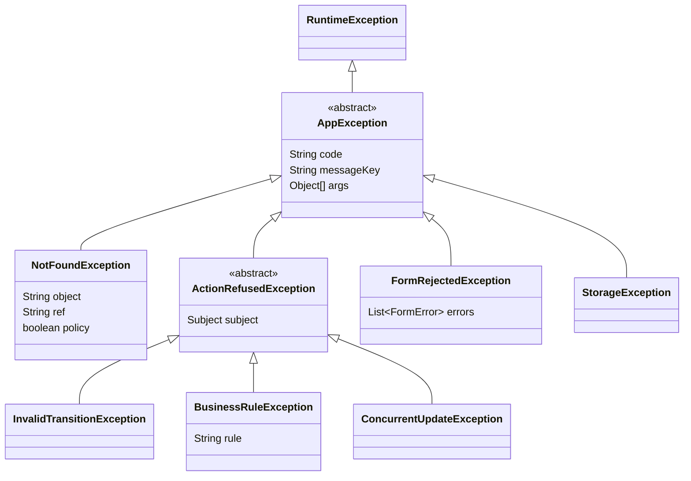
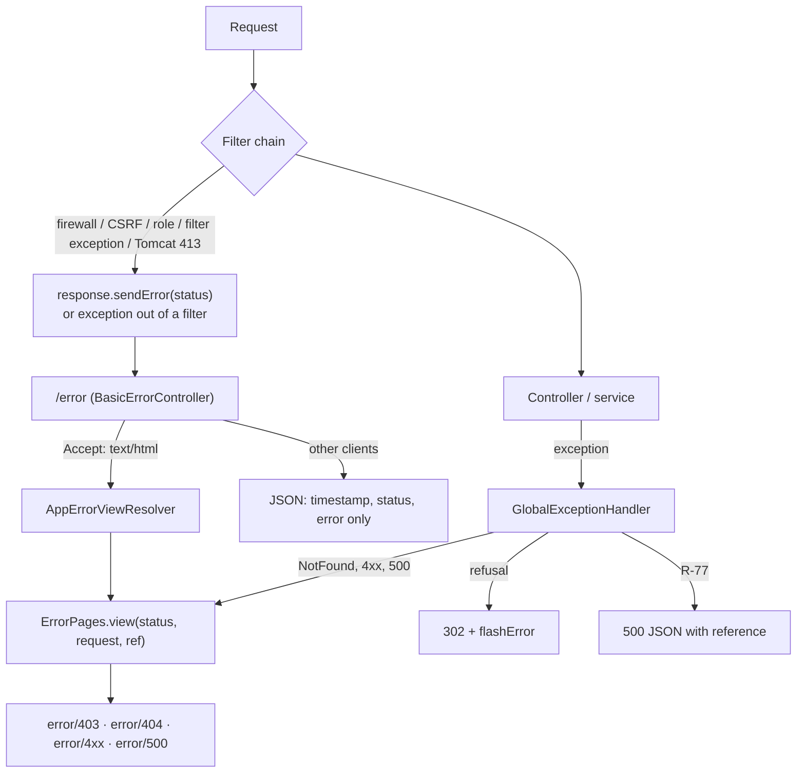

# 12 — Validation & Error Handling

| | |
|---|---|
| **Status** | Draft |
| **Depends on** | 00 Plan (D1–D76), 03 Requirements (FR-02, FR-10, FR-11, NFR-06, NFR-22), 05 Business Rules (BR-20…BR-27, BR-40…BR-47, BR-71, BR-80…BR-89), 07 Architecture (§3 `common`, §6, §8), 08 Database Design (§4 constraints), 09 Web & API Contracts (§1.2 PRG, §1.3 flash, §1.7, §2, §4 forms, §9 files), 10 UI Spec (§1.4, §5.3, §5.9, §8 copy, SCR-90…93), 11 Security Spec (§3.3, §3.5, §4.4, §4.6, §9.3, §9.4, §11) |

This document says how the application checks input and how it answers when something goes wrong. It fixes, for every form of doc 09, the rules, the normalisation and the exact message; it defines the exception classes and the one place that turns them into responses; it defines the error pages and the reference id; and it decides where all message texts live. It adds no routes, screens or features.

| Section | Content |
|---|---|
| §1 | Principles |
| §2 | Validation strategy: the five layers and how a controller uses them |
| §3 | Field validation catalogue for every form, files, cross-field rules, binding errors |
| §4 | Custom validators |
| §5 | Exceptions, `GlobalExceptionHandler` mapping, refusal messages |
| §6 | Error pages, the reference id, error properties |
| §7 | Flash messages, field errors on screen, field id scheme, accessibility |
| §8 | Message catalogue: where texts live, key convention, writing rules, remaining keys |
| §9 | Logging rules for errors |
| §10 | Traceability |
| §11 | Verification |
| §12 | Open questions and risks for later documents |

---

## 1. Principles

1. **Say what to do, next to the problem.** Every validation message names the fix ("Enter a 10-digit mobile number starting with 6, 7, 8 or 9."), is shown under its field and repeated in a summary at the top of the form (NFR-22, doc 10 §1.4).
2. **Keep what the user typed**, except passwords and files (doc 09 §1.2, R-VALIDATION).
3. **One answer per kind of problem** (D40): input the user can fix → `200`, same form with errors; a refused action → `302` back with `flashError`; not visible or unknown → `404`; wrong role → `403`; anything unexpected → `500` with a reference id.
4. **The server decides.** Browser checks are hints only (D49). Every rule is checked on the server, and the most important ones again by the database (D21).
5. **Never leak internals.** No stack trace, exception name, SQL or file path on any page or JSON body (NFR-06); details go to the log with the reference id.
6. **One place each:** normalisation in one binder advice, messages in one `messages.properties`, exception mapping in one `GlobalExceptionHandler`, error pages through one view resolver.

---

## 2. Validation strategy

### 2.1 The five layers (D80)

| # | Layer | Where | Responsible for | On violation |
|---|---|---|---|---|
| L1 | **Browser hints** | Templates | `required`, `maxlength`, input `type` (`email`, `tel`, `number`, `date`), `inputmode="numeric"`, `accept=".jpg,.jpeg,.png,.pdf"` on file inputs. **No** `minlength` or `pattern` (D49). `app.js` pre-checks file count, size and extension (doc 10 §1.3). | The browser blocks the submit with its own bubble. Nothing reaches the server. Never relied on. |
| L2 | **Binding and normalisation** | `FormBindingAdvice` (`@ControllerAdvice` with `@InitBinder`, §3.1) | Trim, empty → `null`, white-space and line-break normalisation, lower-case email, upper-case complaint numbers, mobile format; type conversion of numbers, ids and dates. | A value that cannot be converted (for example `slaDays=abc`) becomes a field error with a `typeMismatch` code (§3.12). Same view, `200`. |
| L3 | **Bean Validation** on the form object | Annotations on the form classes of doc 09 §4, run by `@Valid` | Everything that needs **only the form**: required, length, format, ranges, cross-field rules inside the form (password confirmation, new ≠ current). | Field (or class-level) errors in the `BindingResult`. Same view, `200`. The service is **not** called. |
| L4 | **Service validation** | Services, inside the action's transaction | Everything that needs the **database or the current state**: uniqueness, active master data, current password, file content and counts, BR-88, OTP, access (BR-60), status and guards (`TransitionRules`, D39), BR-47, D42, BR-82, duplicate rules. | Two kinds (§2.3): an input problem → `FormRejectedException` → same view, `200`, field or global error; a refusal → `ActionRefusedException` → `302` back + `flashError`; not visible → `NotFoundException` → `404`. |
| L5 | **Database constraints** | `NOT NULL`, `CHECK`, `UNIQUE`, `FOREIGN KEY` of doc 08 §4 (D21) | The last line of defence for invariants that L3/L4 already guarantee. | Unique keys that two parallel requests can race for are translated into field errors (§5.4). Every other violation is a **bug**: the transaction rolls back and the user gets the `500` page with a reference id (§5.2). |

Services never re-run Bean Validation (no `@Validated` on services): they are called only by controllers that have already validated the form, and by jobs that build their input themselves. A service still checks everything in L4, because a hand-made `POST` can skip L1 but never L2–L5.

### 2.2 Order of checks inside a service method

Every state-changing service method checks in this order, so the user always gets the most important answer first:

| Step | Check | Failure |
|---|---|---|
| 1 | Load the object, `ComplaintAccessPolicy.canView` (BR-60) or the id/role check of doc 11 §5.2 | `NotFoundException` → `404` |
| 2 | `TransitionRules.require(action, …)` (role, status, guards, D39) and other "is this allowed at all" rules (BR-47, D42, BR-82) | `InvalidTransitionException` / `BusinessRuleException` → `302` + `flashError` |
| 3 | Input checks that need the database (uniqueness, active lookups, file content and counts, BR-88, current password) | `FormRejectedException` → same view with errors |
| 4 | Write with `… AND version = :version` (BR-71) | 0 rows → `ConcurrentUpdateException` → `302` + `flashError` |
| 5 | Database constraints during the writes | unique-key race → `FormRejectedException` (§5.4); anything else → `500` |

Example: a watcher who posts an edit form with an empty title gets the Bean Validation error first (L3 runs before the service), but a watcher who posts a **valid** edit form gets "Only the person who filed this complaint can do this." (step 2) and never a field error.

### 2.3 Two kinds of service-level problems

| | Input problem | Refusal |
|---|---|---|
| Meaning | The user can fix it by changing the form | The request is refused whatever the input |
| Examples | "Email already registered.", inactive category, "photo.jpg is larger than 5 MB.", BR-88 daily limit, wrong current password, wrong OTP | wrong status, BR-47, reopen limit, concurrent update, D42, OTP cooldown |
| Exception | `FormRejectedException` with a list of `FormError(field, key, args)`; `field = null` means a global form error | `InvalidTransitionException`, `BusinessRuleException`, `ConcurrentUpdateException` (all `ActionRefusedException`) |
| Handled by | The **controller** (`catch`, then `Forms.apply(ex, bindingResult)` and re-render with `populate(model)`) | `GlobalExceptionHandler` (redirect + flash) |
| Message keys | `validation.*` | `error.*` |
| Response | `200`, same view | `302` to the subject's page (§5.3) |

Two contracts in doc 09 deliberately show a refusal on the form instead of a flash: the duplicate lookup R-54/R-63 (the rule failures of BR-40…BR-43 become a field error on `originalNo`, step 1) and the OTP page R-11 (wrong or expired code). The controller catches the exception there and copies its key into the `BindingResult`; the same exception reaching the advice from R-55/R-64 gives the normal redirect + flash.

### 2.4 Controller pattern

```java
@PostMapping("/citizen/complaints")
public String submit(@Valid @ModelAttribute("form") ComplaintForm form, BindingResult result,
                     @RequestParam(name = "files", required = false) List<MultipartFile> files,
                     @AuthenticationPrincipal CurrentUser user, Model model) {
    if (!result.hasErrors()) {
        try {
            String no = complaintService.submit(form, files, user);
            return "redirect:/citizen/complaints/" + no + "/submitted";
        } catch (FormRejectedException ex) {
            Forms.apply(ex, result);                 // field, files or global errors (§3.10, §7.4)
        }
    }
    populate(model);                                 // categories, areas, maxFiles … (doc 09 §1.7)
    return "citizen/complaint-form";
}
```

Rules:

- The `BindingResult` parameter comes **immediately after** the `@Valid` form. Without it Spring throws `MethodArgumentNotValidException`, which the advice answers with a bare `400` (a bug, logged at WARN, §5.2).
- Every list filter object (`@ModelAttribute("filter")`, doc 09 §4.5) is also followed by a `BindingResult`. Its conversion errors are **not** shown: the controller resets the failed fields to "not set" (D33), so `status=FOO` or `categoryId=abc` still shows the list.
- The form is re-rendered by the same controller method that received it, never by a redirect, so typed values stay (NFR-22). Password inputs are rendered by `th:field` with `type="password"`, which never writes a `value` (verified, §11), so passwords are never sent back.
- No validation **groups** are used. Create and edit forms are separate classes (`ComplaintForm` / `ComplaintEditForm`, `OfficerCreateForm` / `OfficerEditForm`); the only two-step form (duplicate) checks step 1 with a single format check in the controller (§3.6). Groups would add a concept without removing any code.

---

## 3. Field validation catalogue

Every form of doc 09 §4 is listed. Columns: **Normalisation** (§3.1) · **Constraint** (annotation or service check; "svc" = L4) · **Key** and **English text** (the text is the exact value in `messages.properties.draft`; `{min}`/`{max}` are filled from the annotation) · **Ref**. "—" in the field column continues the field above.

### 3.1 Normalisation (D79)

`FormBindingAdvice` registers property editors for **every** `WebDataBinder`, so the same rules apply to forms, filter objects and `@RequestParam` strings. Normalisation happens **before** validation, so lengths are measured on the cleaned value.

| Kind | Applies to | Rule | Example |
|---|---|---|---|
| Single-line text (default) | every `String` property not listed below | CR LF / CR → LF, control characters removed, trimmed, every run of white space collapsed to one space, empty → `null` | `"  Mahesh   Joshi "` → `"Mahesh Joshi"` |
| Multi-line text | `description`, `remark`, `changeReason` | CR LF / CR → LF, control characters except LF and TAB removed, trimmed, empty → `null`; inner spaces and line breaks kept | A textarea line break sent as CR LF counts as **one** character, so a 500-character remark with a line break passes `@Size(max = 500)` (verified, §11) |
| Email | `email` | single-line, spaces removed, lower-cased with `Locale.ROOT` (BR-80) | `" Mahesh.J@Example.COM "` → `"mahesh.j@example.com"` |
| Mobile | `mobile` | single-line, then spaces, `-`, `.`, `(` and `)` removed; a leading `+91` (13 characters) or `91` (12) or `0` (11) is removed | `"+91 98765-43210"` → `"9876543210"`; anything else is left for `@ValidMobile` to refuse |
| Complaint number | `originalNo`, the `original` query parameter of R-54/R-63 | single-line, spaces removed, upper-cased | `"grv-2026-000001"` → `"GRV-2026-000001"` |
| OTP | `code` | single-line, spaces removed | `"482 913"` → `"482913"` |
| Passwords | `password`, `confirmPassword`, `currentPassword`, `newPassword` | **none**: not trimmed, not collapsed, empty stays `""` (doc 11 §3.3) | `"S3cretPass "` keeps its trailing space |
| Search `q` | filters | single-line, then cut to 100 characters (doc 09 §1.4) | — |
| Multipart `files` | — | never bound to a form (`setDisallowedFields("files")`, §7.4) | — |

Notes:

- Path variables are not normalised (doc 09 §1.1); complaint links are always generated by the app.
- `@Size` counts Java `char`s (UTF-16 units); MySQL `VARCHAR(n)` counts characters. An emoji counts 2 in Java and 1 in MySQL, so the Java check is always the stricter one and a value that passes `@Size` always fits the column.
- Unicode is not otherwise normalised (no NFC step); Devanagari and other scripts are stored as typed.

### 3.2 `RegistrationForm` (R-06) and the shared account fields

Class-level: `@FieldsMatch(first = "password", second = "confirmPassword")`.

| Field | Normalisation | Constraint | Key | English text | Ref |
|---|---|---|---|---|---|
| `fullName` | single-line | `@NotBlank` | `validation.fullName.required` | "Enter the full name." | FR-01 |
| — | | `@Size(min = 2, max = 100)` | `validation.fullName.size` | "Full name must be {min}–{max} characters." | doc 09 §4.1 |
| — | | `@Pattern("^[\p{L}\p{M} .'’-]*$")` (letters of any script, marks, space, dot, apostrophe, hyphen) | `validation.fullName.chars` | "Use letters, spaces, dots, hyphens or apostrophes only." | D79 |
| `email` | email | `@NotBlank` | `validation.email.required` | "Enter an email address." | FR-02 |
| — | | `@Size(max = 254)` | `validation.email.size` | "Email must be at most {max} characters." | doc 08 §3.4 |
| — | | `@Email(regexp = "^[^@\s]+@[^@\s]+\.[^@\s]+$")` (also requires a dot in the domain, which plain `@Email` does not) | `validation.email.format` | "Enter a valid email address, for example name@example.com." | FR-02 |
| — | | svc: no user with this email (case-insensitive, D29); race → §5.4 | `validation.email.taken` | "Email already registered." | FR-02, BR-80 |
| `mobile` | mobile | `@NotBlank` | `validation.mobile.required` | "Enter a mobile number." | FR-02 |
| — | | `@ValidMobile` (§4.1) | `validation.mobile.format` | "Enter a 10-digit mobile number starting with 6, 7, 8 or 9." | BR-84 |
| — | | svc: no user with this mobile; race → §5.4 | `validation.mobile.taken` | "Mobile already registered." | FR-09, BR-84 |
| `password` | none | `@NotEmpty` | `validation.password.required` | "Enter a password." | FR-02 |
| — | | `@StrongPassword` (§4.2): reports the **first** failing rule only | `validation.password.tooShort` | "Password must be at least 8 characters." | FR-02 |
| — | | — | `validation.password.tooLong` | "Password is too long. Use at most 64 characters (fewer if you use letters outside A–Z)." | doc 11 §3.3, D67 |
| — | | — | `validation.password.letterAndDigit` | "Password must contain at least one letter and one digit." | FR-02 |
| — | | — | `validation.password.common` | "This password is too common. Choose one that is harder to guess." | D67 (Should) |
| — | | svc: `PasswordPolicy.personalData` (§4.5) | `validation.password.personal` | "Password must not contain your email name or your mobile number." | D67 (Should) |
| `confirmPassword` | none | `@NotEmpty` | `validation.confirmPassword.required` | "Enter the password again." | FR-01 |
| — | | `@FieldsMatch` (error placed on this field) | `validation.confirmPassword.mismatch` | "The passwords do not match." | FR-01 |
| *(global)* | | svc: more than 10 registrations from this IP in 60 min (doc 11 §3.5) | `validation.register.rateLimit` | "Too many registrations from this network. Try again later." | D56 |

### 3.3 Staff and password forms

| Form (route) | Field | Rules |
|---|---|---|
| `OfficerCreateForm` (R-103) | `fullName`, `email`, `mobile`, `password`, `confirmPassword` | exactly as §3.2 (same annotations, same keys), incl. `@FieldsMatch` and the personal-data check |
| — | `departmentId` | `@NotNull` → `validation.departmentId.required`; svc: active → `validation.departmentId.inactive` (texts in §3.7); BR-81 |
| `OfficerEditForm` (R-105) | `version` | `@NotNull` → `validation.version.required` (§3.4) |
| — | `fullName`, `mobile` | as §3.2; mobile unique **except the officer's own row** |
| — | `departmentId` | as in `OfficerCreateForm` |
| `PasswordResetForm` (R-109, R-115) | `newPassword`, `confirmPassword` | `@NotEmpty` → `validation.password.required` / `validation.confirmPassword.required`; `@StrongPassword` and the personal-data check against the target user; `@FieldsMatch(first = "newPassword", second = "confirmPassword")` |

`ChangePasswordForm` (R-08). Class-level: `@FieldsMatch(first = "newPassword", second = "confirmPassword")`, `@FieldsDiffer(first = "currentPassword", second = "newPassword")`.

| Field | Normalisation | Constraint | Key | English text | Ref |
|---|---|---|---|---|---|
| `currentPassword` | none | `@NotEmpty` | `validation.currentPassword.required` | "Enter your current password." | FR-06 |
| — | | svc: BCrypt match with the stored hash | `validation.currentPassword.wrong` | "Current password is incorrect." | FR-06 |
| `newPassword` | none | `@NotEmpty`, `@StrongPassword`, personal-data check | `validation.password.*` keys of §3.2 | | FR-02 |
| — | | `@FieldsDiffer` (error on `newPassword`) | `validation.newPassword.sameAsCurrent` | "The new password must be different from the current password." | doc 09 R-08 |
| `confirmPassword` | none | `@NotEmpty`, `@FieldsMatch` | `validation.confirmPassword.required`, `validation.confirmPassword.mismatch` | | FR-06 |

`OtpForm` (R-11):

| Field | Normalisation | Constraint | Key | English text | Ref |
|---|---|---|---|---|---|
| `code` | OTP | `@NotBlank` | `validation.code.required` | "Enter the 6-digit OTP." | FR-09 |
| — | | `@Pattern("^\d{6}$")` | `validation.code.format` | "The OTP is 6 digits." | BR-85 |
| — | | svc: HMAC differs (attempt reserved first, doc 11 §6.3); `{0}` = attempts left | `validation.code.incorrect` | "Incorrect OTP, {0,choice,1#1 attempt\|1<{0} attempts} left." | BR-85 |
| *(global)* | | svc: no usable OTP (expired, used up, superseded, or never issued) | `validation.otp.expired` | "OTP expired, please request a new one." | BR-85, UC-04 3b |

`LoginForm` (R-02) is never validated by the application: Spring Security reads the parameters (doc 11 §3.1) and the page shows the `login.*` alerts of §8.5.

### 3.4 `ComplaintForm` (R-23) and `ComplaintEditForm` (R-26)

| Field | Normalisation | Constraint | Key | English text | Ref |
|---|---|---|---|---|---|
| `categoryId` | — (Long) | `@NotNull` | `validation.categoryId.required` | "Choose a category." | FR-10 |
| — | | svc: category active (edit: or unchanged, BR-21) | `validation.categoryId.inactive` | "This category is no longer offered. Choose another one." | BR-21, FR-56 |
| `areaId` | — (Long) | `@NotNull` | `validation.areaId.required` | "Choose an area." | FR-10 |
| — | | svc: area active (edit: or unchanged) | `validation.areaId.inactive` | "This area is no longer offered. Choose another one." | BR-21 |
| `title` | single-line | `@NotBlank` | `validation.title.required` | "Enter a title." | BR-20 |
| — | | `@Size(min = 5, max = 100)` | `validation.title.size` | "Title must be {min}–{max} characters." | BR-20 |
| `description` | multi-line | `@NotBlank` | `validation.description.required` | "Describe the problem." | BR-20 |
| — | | `@Size(min = 20, max = 2000)` | `validation.description.size` | "Description must be {min}–{max} characters." | BR-20 |
| `address` | single-line | `@NotBlank` | `validation.address.required` | "Enter the address or a nearby landmark." | BR-20 |
| — | | `@Size(min = 5, max = 255)` | `validation.address.size` | "Address must be {min}–{max} characters." | BR-20 |
| `files` (part) | — | svc, §3.10 | `validation.files.*` | | FR-11 |
| *(global)* | | svc: ≥ 10 complaints by this owner in the last 24 h (submit only); `{0}` = `app.complaint.max-per-day` | `validation.complaint.dailyLimit` | "You have filed {0} complaints in the last 24 hours. Please try again later." | BR-88 |
| *(global)* | | svc: `StorageException` while writing a file; transaction rolled back, written files deleted (BR-25); `{0}` = reference id (§6.3) | `validation.complaint.saveFailed` | "Could not save your complaint, please try again. If it happens again, give this reference to the Grievance Cell: {0}." | UC-10 6a |
| Edit only: `version` | — (Integer) | `@NotNull` (missing or not a number: §3.12) | `validation.version.required` | "This page is out of date. Reload it and try again." | BR-71 |
| — `removeAttachmentIds` | — | svc: ids that are not active `COMPLAINT` attachments of this complaint are **ignored** and logged at WARN (doc 11 §5.2); no message | — | | FR-16 |
| — `changeReason` | multi-line | `@Size(max = 500)` (optional) | `validation.optionalText.size` | "Write at most {max} characters." | FR-16 |

An unverified citizen never reaches these rules: `VerifiedCitizenInterceptor` redirects first (`flash.otp.verifyFirst`, §8.4), and BR-86 is re-checked in the service as a `BusinessRuleException` with the same key. An edit that changes nothing is not an error: `flash.complaint.noChanges` (BR-27). A watcher or a wrong status on R-25/R-26 is a refusal (§5.6).

### 3.5 Workflow forms (R-28, R-41…R-70)

| Form | Field | Normalisation | Constraint | Key | English text | Ref |
|---|---|---|---|---|---|---|
| all | `version` | — (Integer) | `@NotNull` | `validation.version.required` | "This page is out of date. Reload it and try again." | BR-71 |
| `RemarkForm` | `remark` | multi-line | `@NotBlank` | `validation.remark.required` | "Please fill in this field (10–500 characters)." | doc 05 §3 |
| — | — | | `@Size(min = 10, max = 500)` | `validation.remark.size` | "Write between {min} and {max} characters." | doc 05 §3 |
| `OptionalRemarkForm` | `remark` | multi-line | `@Size(max = 500)` | `validation.optionalText.size` | "Write at most {max} characters." | R-41 |
| `AssignForm` | `departmentId` | — (Long) | `@NotNull` | `validation.departmentId.required` | "Choose a department." | FR-32 |
| — | — | | svc: department active | `validation.departmentId.inactive` | "This department is inactive. Choose another one." | T03, UC-21 2a |
| — | `remark` | multi-line | `@Size(max = 500)` → `validation.optionalText.size` | | | |
| `ReassignForm` | `departmentId` | — | `@NotNull`, svc active (as above) | | | T04 |
| — | — | | svc: ≠ current department | `validation.departmentId.same` | "The complaint is already with this department. Choose another one." | T04 |
| — | `remark` | multi-line | as `RemarkForm` | | | FR-33 |
| `ResolveForm` | `remark` | multi-line | as `RemarkForm` | | | FR-42 |
| — | `files` (part) | — | svc, 0–3 `RESOLUTION` files, §3.10 | | | FR-48 |
| `VersionForm` | `version` | — | as above | | | R-56 |

The field label changes per action (Reason, Remark, Note to the citizen …, doc 10 §8.3), so the remark messages do not name the field: the label right above the message does.

### 3.6 `DuplicateForm` (R-54/R-55, R-63/R-64)

| Field | Normalisation | Constraint | Key | English text | Ref |
|---|---|---|---|---|---|
| `version` | — | `@NotNull` | `validation.version.required` | | BR-71 |
| `originalNo` | complaint number | `@NotBlank` | `validation.originalNo.required` | "Enter the original complaint number." | FR-44 |
| — | | `@Pattern("^GRV-\d{4}-\d{6}$")` | `validation.originalNo.format` | "Enter a complaint number like GRV-2026-000001." | BR-10 |
| — | | svc BR-40 … BR-43 (§5.6): `error.duplicate.*` shown as a field error on `originalNo` (step 1) | | | UC-23 3a |
| `remark` | multi-line | as `RemarkForm` | | | FR-44 |

**Step 1 → step 2** is a `GET` with the query parameter `original` (doc 09 R-54). The controller normalises it like `originalNo`; absent → plain step 1 without errors; present but blank → `validation.originalNo.required`; present but not matching the pattern → `validation.originalNo.format`; otherwise `DuplicateService.preview` runs and any `BusinessRuleException` it throws becomes a field error on `originalNo` (step 1 again). In step 2 `originalNo` is a hidden field; if the `POST` (R-55) fails a rule because the state changed meanwhile, the answer is the normal redirect + `flashError` with the same `error.duplicate.*` text.

### 3.7 Master-data forms (R-82/84, R-89/91, R-96/98)

| Form | Field | Normalisation | Constraint | Key | English text | Ref |
|---|---|---|---|---|---|---|
| all three | `name` | single-line | `@NotBlank` | `validation.name.required` | "Enter a name." | FR-50…52 |
| — | — | | `@Size(min = 2, max = 100)` | `validation.name.size` | "Name must be {min}–{max} characters." | doc 08 `ck_*_name` |
| — | — | | svc: no other row of this type with the same name, case-insensitive (D29); race → §5.4 | `validation.name.taken` | "This name is already in use." | FR-50…52 |
| `DepartmentForm`, `AreaForm` | `description` | single-line | `@Size(max = 255)` (optional) | `validation.optionalText.size` | "Write at most {max} characters." | D20 |
| `CategoryForm` | `defaultDepartmentId` | — (Long, optional) | svc: if set, department active | `validation.defaultDepartmentId.inactive` | "This department is inactive. Choose an active one or “Admin decides”." | UC-41 |
| — | `slaDays` | — (Integer) | `@NotNull` | `validation.slaDays.required` | "Enter the number of days." | FR-51 |
| — | — | | `@Min(1)` and `@Max(90)`, both with the same key | `validation.slaDays.range` | "SLA days must be a whole number from 1 to 90." | FR-51, `ck_category_sla_days` |

### 3.8 List filters (R-20, R-21, R-30, R-31, R-80…, R-101, R-110)

Filters never produce field errors (doc 09 §1.4, D33). The single exception is the date range of All Complaints:

| Check | Key | English text | Shown as |
|---|---|---|---|
| `from > to` (R-31, R-32) | `validation.filter.dateRange` | "From date must not be after To date." | global alert above the table; both dates ignored |

### 3.9 Cross-field rules

| Rule | Form(s) | Where | Error on |
|---|---|---|---|
| Confirmation equals password | `RegistrationForm`, `OfficerCreateForm`, `ChangePasswordForm`, `PasswordResetForm` | `@FieldsMatch` (L3) | `confirmPassword` |
| New password ≠ current password | `ChangePasswordForm` | `@FieldsDiffer` (L3) | `newPassword` |
| Password does not contain the email name or mobile | the same four forms | `PasswordPolicy.personalData` (L4; needs the stored user for R-08/R-109/R-115) | `password` / `newPassword` |
| Reassign target ≠ current department | `ReassignForm` | service (needs the complaint) | `departmentId` |
| Active − removed + new files ≤ 5 | `ComplaintEditForm` + `files` | service (needs the current count) | `files` |
| Category/area may stay inactive only if unchanged | `ComplaintEditForm` | service (BR-21) | `categoryId`, `areaId` |
| `from ≤ to` | `AdminComplaintFilter` | controller | global |

### 3.10 File uploads (FR-11, BR-22, BR-23, D36, D63)

Files are a separate `@RequestParam(name = "files") List<MultipartFile>` (doc 09 §4.2). `FileStorageService.validate(files, purpose, activeCount, removedCount)` returns a list of `FormError`s on the field `files` (one per problem), which the service throws as one `FormRejectedException`. Checks, in this order:

| # | Check | Key | English text | Arguments |
|---|---|---|---|---|
| 1 | Parts with an empty file name **and** size 0 are dropped (empty file input) | — | | |
| 2 | Count, new complaint: more than `app.upload.max-files-per-complaint` (5) files | `validation.files.tooMany` | "A complaint can have at most {0} files (you selected {1})." | `{0}` limit, `{1}` selected |
| 2 | Count, edit: active − removed + new > 5 (BR-23, after the edit) | `validation.files.tooManyAfterEdit` | "A complaint can have at most {0} files. It has {1} and you selected {2} more." | `{1}` active − removed |
| 2 | Count, resolve: more than 3 `RESOLUTION` files | `validation.files.tooManyResolution` | "You can add at most {0} work-done files (you selected {1})." | |
| 3 | Each file: size > `app.upload.max-file-size` (5 MB) | `validation.files.tooLarge` | "{0} is larger than {1} MB." | `{0}` cleaned file name, `{1}` 5 |
| 4 | Each file of allowed size: first bytes are not JPEG `FF D8 FF`, PNG `89 50 4E 47 0D 0A 1A 0A` or PDF `25 50 44 46 2D` (`FileTypeDetector`, ADR-07); a 0-byte file with a name also fails here | `validation.files.type` | "{0}: only JPG, PNG or PDF files are allowed." | `{0}` cleaned file name |

- The count check comes first; if it fails, the per-file checks still run so the user sees every problem at once. One bad file rejects the whole submission (FR-11). Each problem is its own message (one line per file) under the file input and in the summary, all linking to `#files` (§7.4).
- `{0}` is the **cleaned** original name (BR-24: path removed, control and `" * : < > ? |` characters removed, at most 255 characters) and is escaped by `th:text` like every other value.
- After any error on a form with files, the page shows `form.files.chooseAgain` above the file input: "Please choose your files again. For security, browsers do not keep selected files when a form is shown again." (doc 10 §8.4).
- Requests above 26 MB never reach this code: `UploadSizeGuardFilter` redirects to the form page with `error.upload.requestTooLarge` (§5.2, D63).
- Each rejection is also a `UPLOAD_REJECTED` security event (doc 11 §11.2) with `reason=type|size|count`.

### 3.11 Hidden fields

`version` (every complaint and user form) and `originalNo` in duplicate step 2 are hidden inputs. Their errors are listed in the error summary **without a link** and are not shown next to any input (§7.3). The text tells the user to reload ("This page is out of date. Reload it and try again."), which is the right advice for a hand-edited or very old page.

### 3.12 Binding (conversion) errors

When a value cannot be converted, Spring adds a field error with the codes `typeMismatch.<form>.<field>`, `typeMismatch.<field>`, `typeMismatch.<type>` and `typeMismatch`; the first code found in `messages.properties` wins. These are the only keys that do not follow the naming convention of §8.2, because Spring fixes their names.

| Key | English text | When |
|---|---|---|
| `typeMismatch.version` | "This page is out of date. Reload it and try again." | `version` is not a number |
| `typeMismatch.slaDays` | "SLA days must be a whole number from 1 to 90." | `slaDays=abc` |
| `typeMismatch.java.lang.Long` | "Choose a value from the list." | an id from a select is not a number (only by hand-made requests) |
| `typeMismatch.java.lang.Integer` | "Enter a whole number." | any other Integer field |
| `typeMismatch` | "Enter a valid value." | fallback for every other type |

A conversion error on a **path variable or query parameter** (not a form field) is a `MethodArgumentTypeMismatchException` → `400` page (§5.2). Numeric path variables are declared as `{id:\d{1,18}}` (like `{no:GRV-\d{4}-\d{6}}`, D30), so `/attachments/abc` and over-long numbers simply do not match and give `404`; a `400` remains only for bad query parameters such as `?download=maybe`.

---

## 4. Custom validators

All live in `common.validation` (doc 11 §4.10). Each returns `true` for `null` / empty so that "required" is reported only by `@NotBlank` / `@NotNull` / `@NotEmpty`, and each field shows at most one message in practice.

### 4.1 `@ValidMobile`

| | |
|---|---|
| Target | `String` field |
| Valid | `null`, or matches `^[6-9]\d{9}$` after normalisation (§3.1) |
| Message | `{validation.mobile.format}` |
| Used on | `RegistrationForm.mobile`, `OfficerCreateForm.mobile`, `OfficerEditForm.mobile` |
| Ref | BR-84 |

### 4.2 `@StrongPassword`

| | |
|---|---|
| Target | `String` field (password, never normalised) |
| Rules, checked in this order; only the **first** failing one is reported | 1. fewer than 8 code points → `tooShort`; 2. more than 64 code points **or** more than 72 bytes in UTF-8 → `tooLong` (BCrypt limit, doc 11 §3.3); 3. no letter or no digit (`Character.isLetter` / `isDigit`, so any script counts) → `letterAndDigit`; 4. in `common-passwords.txt` (case-insensitive) → `common` |
| Message | `validation.password.<rule>` built with `buildConstraintViolationWithTemplate`, default violation disabled |
| Used on | `RegistrationForm.password`, `OfficerCreateForm.password`, `ChangePasswordForm.newPassword`, `PasswordResetForm.newPassword` |
| Not here | the personal-data rule (§4.5), because it needs the stored user for two of the four forms |
| Ref | FR-02, D67 |

### 4.3 `@FieldsMatch(first, second)`

| | |
|---|---|
| Target | class (repeatable is not needed: one per form) |
| Valid | `second` is null or empty (then `@NotEmpty` reports it), or `first.equals(second)` (exact, no trimming) |
| On failure | violation on the property `second` (`addPropertyNode(second)`), so it appears under the confirmation field and links to it |
| Message | `{validation.confirmPassword.mismatch}` |
| Used on | §3.9 |

### 4.4 `@FieldsDiffer(first, second)`

Same shape as `@FieldsMatch`, inverted: invalid when both are non-empty and equal; violation on `second`; message `{validation.newPassword.sameAsCurrent}`. Used only on `ChangePasswordForm`.

### 4.5 Non-annotation checks

| Class | Check | Why not an annotation |
|---|---|---|
| `PasswordPolicy.personalData(password, email, mobile)` | Case-insensitive: contains the email's local part (only if it has at least 4 characters, so `a@x.in` does not block every password with an "a") or the 10-digit mobile → `validation.password.personal` | Needs the stored user for R-08, R-109, R-115 |
| `FileStorageService.validate` + `FileTypeDetector` | §3.10 | Files are not form properties |
| `UniqueKeys.translate` | §5.4 | Only meaningful after a failed insert |

### 4.6 Rules for all constraints

- Every constraint annotation on a form has an explicit `message = "{key}"` with a key from the draft. No form relies on Hibernate Validator's built-in messages, which would follow the server's default locale. Doc 13 adds a scan test over all form classes (§12, T-1).
- Messages of Bean Validation constraints may use only `{min}` / `{max}`; they never use `{0}` (§8.3).
- Custom validators do not query the database. Anything that needs data is L4.

---

## 5. Exceptions and the `GlobalExceptionHandler`

### 5.1 Exception hierarchy (D82)

All application exceptions are unchecked, live in `common.exception`, and carry a stable **code** (for logs and tests), a **message key** (for the user) and arguments. Their Java message is `code + " " + key` only, never user text or personal data, so a logged stack trace leaks nothing (doc 11 §9.4).



| Exception | Code | Message key | Thrown by | Carries | Answer |
|---|---|---|---|---|---|
| `NotFoundException` | `NOT_FOUND` | `page.error.404.text` | services: `ComplaintAccessPolicy` (`policy = true`), unknown ids, wrong role of a target user, deleted attachment for non-admins, missing file on disk | `object` (`complaint`, `attachment`, `notification`, `user`, `department` …), `ref` (number or id) | `404` page |
| `InvalidTransitionException` | `INVALID_TRANSITION` | refusal text from `TransitionRules.decide` (§5.6) | `TransitionRules.require` (D39) | `subject` | `302` + `flashError` |
| `BusinessRuleException` | `BUSINESS_RULE` | rule-specific `error.*` key | services | `subject`, `rule` (`BR-47`, `D42`, `BR-82`, `BR-85`, `BR-86`, `D43`, `BR-51`, `BR-52`, `BR-40`…`BR-43`) | `302` + `flashError` |
| `ConcurrentUpdateException` | `CONCURRENT_UPDATE` | `error.concurrent.complaint` or `error.concurrent.user` | repositories, when `UPDATE … AND version = ?` changes 0 rows (BR-71, FR-84) | `subject` | `302` + `flashError` |
| `FormRejectedException` | `FORM_REJECTED` | first error's key | services (L4 input problems, §2.3), `UniqueKeys.translate` | `List<FormError(field, key, args)>` | caught by the controller → `200` same view; if it ever reaches the advice it is a bug → `500` |
| `StorageException` | `STORAGE_FAILED` | `validation.complaint.saveFailed` | `FileStorageService` (disk full, permission, I/O) | cause | caught by the submit/edit/resolve controllers → global form error with the reference id; elsewhere → `500` |

`Subject` is a small record naming what the refusal is about, so the handler can build a **local** redirect without trusting the `Referer` header (doc 11 §8.4). Services choose the subject; only the web layer knows URLs (doc 07 §1.1).

### 5.2 Mapping table (D83)

One `@ControllerAdvice` (`common.web.GlobalExceptionHandler`). Handlers are listed from specific to general; Spring picks the closest match.

| # | Exception | HTTP | View or redirect | Flash / model | Log (§9) |
|---|---|---|---|---|---|
| X1 | `NotFoundException` | 404 | `error/404` | `titleKey`, `textKey` | INFO `NOT_FOUND`; with `policy = true` also `SECURITY NOT_VISIBLE` (doc 11 §11.2) |
| X2 | `InvalidTransitionException`, `BusinessRuleException`, `ConcurrentUpdateException` | 302 | `redirect:` the subject's page (§5.3) | `flashError` = resolved key | INFO `REFUSED code=… rule=… key=… subject=… user=…` |
| X3 | `FormRejectedException` (not caught by a controller) | 500 | `error/500` | `reference` | ERROR (bug) |
| X4 | `StorageException` (not caught) | 500 | `error/500` | `reference` | ERROR with stack trace |
| X5 | `NoResourceFoundException` (no handler or static file for the path) | 404 | `error/404` | — | DEBUG |
| X6 | `MethodArgumentTypeMismatchException` / `TypeMismatchException`, `MissingServletRequestParameterException`, `MissingServletRequestPartException`, `ServletRequestBindingException`, `HttpMessageNotReadableException`, `HandlerMethodValidationException`, `MultipartException` (other than size) | 400 | `error/4xx` | `page.error.400.*` | DEBUG `CLIENT_ERROR status=400 type=…` |
| X7 | `BindException` / `MethodArgumentNotValidException` (a form without `BindingResult`) | 400 | `error/4xx` | | WARN (bug) |
| X8 | `HttpRequestMethodNotSupportedException` | 405, header `Allow` copied from the exception | `error/4xx` | `page.error.405.*` | DEBUG |
| X9 | `HttpMediaTypeNotSupportedException` / `HttpMediaTypeNotAcceptableException` | 415 / 406 | `error/4xx` | `page.error.4xx.*` | DEBUG |
| X10 | `MaxUploadSizeExceededException` (fallback only; the filter answers first, D63) | 302 on the three upload routes, else 413 | `redirect:` the form page (same mapping as `UploadSizeGuardFilter`) or `error/4xx` | `flashError` = `error.upload.requestTooLarge` / `page.error.413.*` | WARN `SECURITY UPLOAD_REJECTED reason=request_too_large` |
| X11 | `DuplicateKeyException` on one of the five unique keys of §5.4 | — | translated **in the service** into `FormRejectedException` → `200` same view | field error | INFO `UNIQUE_RACE constraint=…` |
| X12 | Any other `DataIntegrityViolationException`, including `DuplicateKeyException` on `uq_notification_event_recipient` (D22), `uq_complaint_no`, `uq_attachment_stored_name`, a `CHECK` or a foreign key | 500 | `error/500` | `reference` | ERROR with stack trace (§5.4) |
| X13 | Other `DataAccessException` (database down, lock wait timeout, deadlock) | 500 | `error/500` | `reference` | ERROR with stack trace |
| X14 | `AccessDeniedException`, `AuthenticationException` | — | **re-thrown**, so `ExceptionTranslationFilter` answers them as in doc 11 §4.4 (none is expected: there is no method security, D65) | | — |
| X15 | Client gone (`AsyncRequestNotUsableException`, Tomcat `ClientAbortException`), e.g. while streaming an attachment | — | no body (the response is already committed) | | DEBUG |
| X16 | `Exception` (anything else) | 500 | `error/500`; **JSON** `{"error":"server_error","reference":"ERR-…"}` for R-77 | `reference` | ERROR `UNEXPECTED ref=…` with stack trace (§6.3) |

Notes:

- The JSON variant is chosen by the request path (`JsonEndpoints.matches`: exactly `GET /notifications/unread-count`, D37), not by the `Accept` header, so a browser page never gets JSON and the bell never gets HTML.
- Every handler that renders a page uses `ErrorPages.view(status, request, reference)`, the same helper as the `/error` resolver (§6.2), so a 404 looks the same whichever way it was produced.
- Refusals on `GET` action pages (doc 09 §3.4) take the same path X2 as refusals on `POST`.
- `@ResponseStatus` annotations are not used on our exceptions: all mapping is in this one table.

### 5.3 Redirect targets of refusals

`common.web.RedirectTargets.of(subject, request)`:

| Subject | Redirect to | Used by |
|---|---|---|
| `COMPLAINT(no)` | `/complaints/{no}` | every workflow and owner action, watch / unwatch, edit, action pages |
| `OTP` | `/verify-mobile` | resend cooldown and hourly limit (R-12) |
| `EXPORT` | `/admin/complaints?` + the current query string (the filter the user had) | CSV row limit (R-32, D43) |
| `DEPARTMENTS`, `CATEGORIES`, `AREAS` | `/admin/departments`, `/admin/categories`, `/admin/areas` | D42 and other master-data refusals |
| `OFFICERS`, `CITIZENS` | `/admin/officers`, `/admin/citizens` | user concurrency, BR-82, "already verified" |

The path is always fixed by the subject type; only the complaint number (validated by the route pattern) and the user's own query string are inserted. No `Referer`, no request parameter.

### 5.4 Database constraint violations (D84)

The service checks uniqueness first (L4). Two parallel requests can still both pass the check; the unique key then stops the second insert. `UniqueKeys.translate(DuplicateKeyException)` looks for the **constraint name** in the driver message (case-insensitive: MySQL reports `app_user.uq_app_user_email`, H2 `UQ_APP_USER_EMAIL_INDEX_…`):

| Constraint | Field | Key |
|---|---|---|
| `uq_app_user_email` | `email` | `validation.email.taken` |
| `uq_app_user_mobile` | `mobile` | `validation.mobile.taken` |
| `uq_department_name`, `uq_category_name`, `uq_area_name` | `name` | `validation.name.taken` |

- The translated error is thrown as `FormRejectedException`, which also rolls the transaction back. The user sees exactly the same field error as with the pre-check (verified, §11).
- The driver message contains the duplicate value (an email or mobile), so only the constraint name is logged (§9).
- **Not translated, on purpose:** `uq_notification_event_recipient` (D22), `uq_complaint_no`, `uq_attachment_stored_name`, primary keys, `CHECK`s and foreign keys. The code already guarantees them (recipients are collected in a `Set`, BR-68; numbers come from the locked sequence, D19; stored names are random UUIDs), so a violation means a bug. Silently dropping a duplicate notification would hide that bug; instead the whole action rolls back (NFR-30) and the user gets the `500` page with a reference id, which makes the problem visible in testing.
- The BR-88 count (10 per 24 h) is checked without a lock; two submissions sent at exactly the same moment as the 10th could both pass. This soft overshoot by one is accepted (the limit protects disk space, not money).

### 5.5 Errors that the advice never sees

These come from the filter chain or the container and are rendered through `/error` by `AppErrorViewResolver` (§6.2). Decided in doc 11 §4.4; repeated here so all answers are in one place.

| Situation | Detected by | Response |
|---|---|---|
| Suspicious path (`;`, `//`, encoded `.` or `/`, `..`) | `StrictHttpFirewall` | `400` → `error/4xx` (`page.error.400.*`), no session created |
| Not logged in, HTML page | `SessionAwareLoginEntryPoint` | `302 /login` or `/login?expired` |
| Not logged in, R-77 | `JsonAuthenticationEntryPoint` | `401` JSON `{"error":"unauthenticated"}` |
| Wrong role | `AppAccessDeniedHandler` | `403` → `error/403` (`page.error.403.*`) |
| CSRF token missing or stale, logged in | `AppAccessDeniedHandler` sets the request attribute `app.errorReason = "csrf"` | `403` → `error/403` with the variant `page.error.403.csrf.*` (§6.1) |
| CSRF token stale, session expired / no session | `AppAccessDeniedHandler` | `302 /login?expired` / `302 /login` |
| Account deactivated during a session | `UserStateFilter` | `302 /login?inactive` (R-77: `401` JSON) |
| Multipart above 26 MB on an upload route | `UploadSizeGuardFilter` | `302` to the form page, `flashError` = `error.upload.requestTooLarge` with `{0}` = 5, `{1}` = 25 |
| Multipart above 26 MB elsewhere | Tomcat while `CsrfFilter` reads `_csrf` | `413` → `error/4xx` (`page.error.413.*`) |
| An exception thrown inside a servlet filter (for example the database is down when `UserStateFilter` reads the user) | Tomcat forwards to `/error` | `500` → `error/500`; `AppErrorViewResolver` creates and logs the reference id (verified, §11) |

### 5.6 Refusal messages (`error.*`)

These texts are the `refusal` of `TransitionRules.Decision` (D39) or the key of a `BusinessRuleException`. Where doc 09 §7.2 shows a guard as a **notice** on the detail page (`c.notices`), the same key is used for the notice and for the `flashError`, so the two can never say different things.

| Key | English text | Arguments | When | Ref |
|---|---|---|---|---|
| `error.state.notAllowed` | "This action is not allowed when the complaint is {0}." | status label | Any action not allowed in the current status, when no more specific key below applies | FR-83, R-STATE |
| `error.concurrent.complaint` | "This complaint was updated by someone else, please refresh." | | Complaint `version` changed | FR-84, BR-71 |
| `error.concurrent.user` | "This account was changed by someone else, please refresh." | | User `version` changed (R-105…R-113) | doc 09 §1.5 |
| `error.owner.only` | "Only the person who filed this complaint can do this." | | A watcher or duplicate owner opens or posts an owner action (R-25…R-28, R-40…R-43) | FR-28, BR-50 |
| `error.edit.notAllowed` | "This complaint can no longer be edited because it is {0}." | status label | Edit outside `SUBMITTED` / `UNDER_REVIEW` | FR-16, FR-19 |
| `error.withdraw.workStarted` | "Work has already started; it can no longer be withdrawn." | | Withdraw while `IN_PROGRESS`, `RESOLVED` or `REOPENED` (final statuses use `error.state.notAllowed`) | FR-18, UC-12 |
| `error.withdraw.linkedDuplicates` | "Other citizens are following this complaint; it cannot be withdrawn." | | BR-47 (also a notice) | BR-47 |
| `error.reopen.limit` | "Reopen limit reached; please contact the department." | | `reopenCount == maxReopens` (also a notice) | FR-27, BR-32 |
| `error.review.ended` | "The review period ended on {0}; the complaint will be closed automatically." | deadline `dd-MMM-yyyy` | Close or reopen after the deadline (also a notice) | BR-31 |
| `error.duplicate.notFound` | "No complaint {0} was found." | typed number | BR-40, original unknown | UC-23 3a |
| `error.duplicate.self` | "A complaint cannot be a duplicate of itself." | | BR-40, A = B | BR-40 |
| `error.duplicate.otherDepartment` | "{0} is not in your department. Use Send back and mention it in the remark." | number of A | BR-43 (officer only; K7, D69) | BR-43 |
| `error.duplicate.isDuplicate` | "{0} is itself a duplicate of {1}. Use {1} as the original instead." | A, A’s original | BR-42 | BR-42 |
| `error.duplicate.notActive` | "{0} is {1}. Only a complaint that is Assigned, In Progress or Reopened can be the original." | A, status label | BR-41 | BR-41 |
| `error.watch.notWatching` | "You are not watching this complaint." | | Unwatch without an active watcher row | BR-51 |
| `error.watch.alreadyWatching` | "You are already watching this complaint." | | Watch again while active | BR-52 |
| `error.watch.ownComplaint` | "You filed this complaint, so you always get its updates." | | The owner tries to watch / unwatch their own complaint | BR-52 |
| `error.department.isDefault` | "{0} is the default department of {1}. Change that category first." | department, category name(s) joined with ", " | Deactivate a department that is the default of an active category | D42 |
| `error.admin.last` | "The last active admin account cannot be deactivated." | | BR-82 | BR-82 |
| `error.account.alreadyVerified` | "This mobile number is already verified." | | R-113 on a verified citizen | FR-09c |
| `error.otp.cooldown` | "Please wait {0,choice,1#1 second\|1<{0} seconds} before requesting a new OTP." | seconds left | Resend within 60 s | BR-85 |
| `error.otp.hourlyLimit` | "Too many OTP requests, try again after {0}." | time `hh:mm a` | 5 codes in the last hour | BR-85 |
| `error.export.tooMany` | "Too many rows ({0}). Narrow the filter to {1} or fewer." | count, limit | CSV export above `app.export.max-rows` | D43 |
| `error.upload.requestTooLarge` | "The files are too large together. Each file can be at most {0} MB and all files together at most {1} MB." | 5, 25 | Request above 26 MB (filter, X10) | D63 |
| `error.officer.noDepartment` | "Your account has no department; contact the admin." | | R-30 for an officer without department (data error); a page-level alert, not a redirect | UC-30 |

Unverified citizens (BR-86) are refused with the info flash `flash.otp.verifyFirst` (§8.4) and a redirect to `/verify-mobile`, by the interceptor or, for a hand-made request, by the service.

Argument values that are labels (statuses, dates) are formatted by the service with `ComplaintStatus.label()` and `DisplayFormat` (D47, D50) before they become arguments, so every message shows "In Progress" and "29-Nov-2026", never `IN_PROGRESS` or an ISO date.

---

## 6. Error pages

### 6.1 The pages

All error templates decorate `layouts/public` (no bell, no role menu, doc 10 §2.1), contain **no `<form>`** (so rendering them never creates a session or a CSRF token), and read only `status`, `titleKey`, `textKey`, `reference` and, when present, `currentUser`.

| Status | Template | Title key → text | Body key → text | Shown | Never shown |
|---|---|---|---|---|---|
| 400 | `error/4xx` | `page.error.400.title` → "Request not accepted" | `page.error.400.text` → "The request could not be processed. Go back and try again." | status number, title, text, home link | the bad value, parameter names, exception |
| 403 | `error/403` | `page.error.403.title` → "Access denied" | `page.error.403.text` → "Your account cannot open this page." | as above | the required role, the path |
| 403 (CSRF, logged in) | `error/403` | `page.error.403.csrf.title` → "This form has expired" | `page.error.403.csrf.text` → "This form has expired. Go back, reload the page and try again." | as above | token values |
| 404 | `error/404` | `page.error.404.title` → "Page not found" | `page.error.404.text` → "The page or complaint you asked for does not exist, or you do not have access to it." | one text for unknown and not visible (D10) | whether the object exists |
| 405 | `error/4xx` | `page.error.405.title` → "Request not accepted" | `page.error.405.text` → "This page cannot be used in this way. Go back and use the buttons and links on the page." | as above; header `Allow` | — |
| 413 | `error/4xx` | `page.error.413.title` → "Request too large" | `page.error.413.text` → "The data you sent is too large. Files can be at most 5 MB each and 25 MB together." | as above | — |
| other 4xx (406, 415, 401 as a page) | `error/4xx` | `page.error.4xx.title` → "Request not accepted" | `page.error.4xx.text` → "The request could not be processed. Go back and try again." | as above | — |
| 500 and every 5xx | `error/500` | `page.error.500.title` → "Something went wrong" | `page.error.500.text` → "We could not complete your request. Please try again. If it happens again, give this reference to the Grievance Cell:" followed by the reference in `<code>` | reference id (§6.3) | stack trace, exception class or message, SQL, file paths (NFR-06) |

The table repeats each key with its text in the form `key → text`; the exact values are in the draft. Links: "Go to my home page" (`homeUrl`) when `currentUser` is present, otherwise "Log in". No "back" button is rendered (it would need inline JavaScript, which the CSP forbids, D64); the text says "Go back".

### 6.2 How an error reaches a page (D85)



- **Inside Spring MVC** the advice renders the page itself with `ErrorPages.view` (§5.2).
- **Outside Spring MVC** (filters, Tomcat) the container forwards to `/error`. Spring Boot's `BasicErrorController` asks every `ErrorViewResolver`; our `AppErrorViewResolver` (`common.web`) maps 403 → `error/403`, 404 → `error/404`, any other 4xx → `error/4xx`, any 5xx → `error/500`, and builds the same model with `ErrorPages.view`. The CSRF variant is chosen from the request attribute `app.errorReason` set by `AppAccessDeniedHandler` (doc 11 §4.9). For a 5xx without a reference yet (an exception thrown inside a filter) it creates one and logs it with the exception taken from `jakarta.servlet.error.exception` (verified, §11).
- `/error` is `permitAll` (doc 11 §4.2). `GlobalModelAdvice` adds nothing on `/error` and never calls `getSession(true)`, so a firewall `400` or a Tomcat `413` for a visitor without a session renders without creating one (verified: no `Set-Cookie`, §11).
- Clients that do not accept `text/html` (scripts, `curl` without a header) get Spring Boot's JSON from `BasicErrorController`, reduced by the properties of §6.4 to `timestamp`, `status` and `error`.

### 6.3 Reference id (U3)

| Item | Decision |
|---|---|
| Format | `ERR-XXXX-XXXX`: 8 characters of Crockford base 32 (`0-9 A-Z` without `I L O U`), 40 random bits from `SecureRandom`, e.g. `ERR-7K3M-Q9TD`. Easy to read aloud over the phone; no date, user id or other data inside. |
| Generated by | `ErrorReference.next()` in `GlobalExceptionHandler` (X3, X4, X12, X13, X16) or in `AppErrorViewResolver` (5xx from filters). Exactly once per failed request: the value is kept in the request attribute `app.errorReference`, so a request that passes through both never gets two. |
| Logged | One ERROR line `UNEXPECTED ref=ERR-7K3M-Q9TD method=POST path=/citizen/complaints user=42` followed by the full stack trace. During that line the reference is also in the MDC key **`ref`**, so the log pattern can print it on every line of the trace (`%X{ref:-}`, doc 14). |
| Shown | On `error/500` in `<code id="error-reference">`; in the JSON body of R-77 (`"reference"`); inside `validation.complaint.saveFailed` for storage failures. |
| Collisions | 2⁴⁰ values; with 1,000 errors a year the chance of any repeat is about 1 in 2 million. Support looks it up together with the time the user gives. |
| Use | The Grievance Cell asks the user for the reference and searches the log for it (`grep ERR-7K3M-Q9TD logs/app.log`). Doc 14 adds this to the support guide. |

### 6.4 Error properties (D86)

**Spring Boot 4 renamed the error properties.** `server.error.*` is deprecated with level *error* and replaced by `spring.web.error.*`; the old keys are **silently ignored** (verified: with `server.error.include-path=never` the JSON still contained `path`, §11). Docs 07 §6 and 11 §9.3 used the old names and are corrected.

```properties
spring.web.error.include-stacktrace=never
spring.web.error.include-message=never
spring.web.error.include-binding-errors=never
spring.web.error.include-exception=false
spring.web.error.include-path=never
spring.web.error.whitelabel.enabled=false
spring.mvc.problemdetails.enabled=false
```

`include-path=never` is new: the path can carry a complaint number and is of no use to the client. `spring.web.error.path` stays at its default `/error`, which the security rules expect.

---

## 7. Flash messages and form errors on screen

### 7.1 Kinds of messages (D88)

| Kind | How it travels | Attribute / source | Look (doc 10 §5.3) | ARIA |
|---|---|---|---|---|
| Success | flash, after a redirect | `flashSuccess` | green, `bi-check-circle-fill` | `role="status"` |
| Info | flash, after a redirect | `flashInfo` | blue, `bi-info-circle-fill` | `role="status"` |
| Error (refusal) | flash, after a redirect | `flashError` | red, `bi-exclamation-triangle-fill` | `role="alert"` |
| Error (form) | same response, `200` | `BindingResult` (field and global errors) | error summary + field messages (§7.3) | summary `role="alert"` |
| Warning | **not a flash**: in-page banners only (verify banner, choose files again, demo OTP, session warning) | the page's model | yellow | `region` with `aria-label`, demo OTP `role="status"` |
| Page-level error without redirect | model attribute `pageError` (key resolved by the controller) | R-30 no department, R-31 date range | red alert above the content | `role="alert"` |

There are exactly three flash attributes (doc 09 §1.3) plus `demoOtp`. A refusal message is always an error, a completed action always a success, and "nothing happened but that is fine" (`flash.complaint.noChanges`, `flash.otp.alreadyVerified`, `flash.otp.verifyFirst`) is info.

### 7.2 One-shot and PRG

- Controllers call `Flash.success(ra, key, args…)`, `Flash.info(…)` or `Flash.error(…)` (`common.web.Flash`). The helper resolves the key with the `MessageSource` **at redirect time** and stores the final English text, so templates, the filter and tests see plain strings (doc 09 §1.3).
- Exception handlers and `UploadSizeGuardFilter`, which have no `RedirectAttributes`, use `Flash.error(request, key, args…)`, which writes into `RequestContextUtils.getOutputFlashMap(request)` (the filter: through `SessionFlashMapManager`). Spring saves the map when the `redirect:` view is rendered (verified, §11).
- Spring's `FlashMap` is bound to the redirect target path and removed when that page is rendered, so a message is shown **once**; a refresh shows nothing (verified). A flash for `/complaints/A` is not shown on another page opened in a second tab meanwhile.
- A flash is never used for validation errors: those stay on the same response so typed values survive.

### 7.3 Error summary and field messages (NFR-22)

Fragment `form :: errorSummary(fields)`, placed first inside every `<form th:object="${form}">`:

```html
<div th:fragment="errorSummary(fields)" th:if="${#fields.hasAnyErrors()}" id="error-summary"
     class="alert alert-danger" role="alert" tabindex="-1" aria-labelledby="error-summary-title">
  <h2 id="error-summary-title" class="h6" th:text="#{form.errors.title(${#fields.allErrors().size()})}"></h2>
  <ul>
    <li th:each="e : ${#fields.globalErrors()}" th:text="${e}"></li>                       <!-- 1. global -->
    <th:block th:each="f : ${fields}">                                                        <!-- 2. in form order -->
      <li th:each="e : ${#fields.errors(f)}"><a th:href="|#${f}|" th:text="${e}"></a></li>
    </th:block>
    <th:block th:each="d : ${#fields.detailedErrors()}">                                      <!-- 3. hidden fields -->
      <li th:if="${!d.global and !#lists.contains(fields, d.fieldName)}" th:text="${d.message}"></li>
    </th:block>
  </ul>
</div>
```

- Heading `form.errors.title` = "Please correct {0,choice,1#1 problem\|1<{0} problems}:" (one problem / 2 problems).
- **Order:** global errors first, then the fields in the order the page passes them (the visual order), then errors of fields that are not in the list (hidden `version`, `originalNo` in step 2) **without** a link. Bean Validation reports violations in no fixed order, so the order comes from the template, never from the `BindingResult`.
- **Field message:** under the input, `<div id="{id}-error" class="invalid-feedback d-block">`; the input gets `is-invalid`, `aria-invalid="true"` and `aria-describedby="{id}-help {id}-error"` (only `{id}-help` when there is no error). Each field shows all its messages; the constraints are designed so that one fires at a time (§4).
- **Page title:** with errors, `<title>` becomes `form.errors.pageTitle` = "Error: {0}" with the page name, so screen-reader users hear the problem first (verified: `<title>Error: Register</title>`). Outside `th:object` the check is `${#fields.hasErrors('${form.*}')}`.
- The summary is rendered only on the form page; the layout's flash area shows flash messages only.

### 7.4 Field id scheme (U5, D87)

| Element | `id` | Example | Notes |
|---|---|---|---|
| Input, select, textarea bound with `th:field="*{x}"` | `x` (Thymeleaf's default: the property path) | `title`, `categoryId`, `confirmPassword` | Never set `id` by hand on these |
| Help text | `x-help` | `title-help` | |
| Error message(s) | `x-error` | `title-error` | |
| Checkbox list `removeAttachmentIds` | `removeAttachmentIds1`, `removeAttachmentIds2` … (Thymeleaf numbering); the group is a `<fieldset id="removeAttachmentIds">` | | never has errors (ignored ids, §3.4) |
| File input | `id="files"`, `name="files"`, written by hand (not `th:field`: files are never bound) | `files`, `files-help`, `files-error` (a `<ul>` with one `<li>` per file problem) | all file messages link to `#files` |
| Hidden inputs (`version`, step-2 `originalNo`) | from `th:field`, but never linked | | §3.11 |
| Summary | `error-summary`, heading `error-summary-title` | | |
| Summary link | `href="#x"` | `<a href="#email">` | the browser moves focus to the input |

The ids are unique on every page: the layout and filter bars contain no bound fields with the same names (filter forms are on list pages, which have no `errorSummary`), and each form page has exactly one bound form.

**`files` is shown as a field although it is not bound** (finding, §11): `#fields.hasErrors('files')` throws when the form has no readable property `files`. Every form that takes files (`ComplaintForm`, `ComplaintEditForm`, `ResolveForm`) therefore has a read-only `public Object getFiles() { return null; }`, and `FormBindingAdvice` calls `binder.setDisallowedFields("files")`, so the multipart parts are never bound to it and always arrive through the `@RequestParam` (doc 09 §4.2).

### 7.5 Accessibility

- `role="alert"` on the summary and on error flashes: screen readers announce them without moving focus. Success and info flashes use `role="status"` (polite).
- With JavaScript on, `app.js` moves focus to `#error-summary` (it has `tabindex="-1"`) on page load, so keyboard users start at the list of problems; without JavaScript the alert is announced and is the first thing in the form.
- Every message is text, never colour alone; icons are `aria-hidden`.
- Messages are short, say what to do, and do not repeat the label (it is already read with the field).
- Doc 13 checks the summary, `aria-describedby` and focus with the axe-core run of doc 10 U8.

---

## 8. Message catalogue

### 8.1 Where texts live (K8, U4, D77)

| Text | Lives in | How it is used |
|---|---|---|
| Field and global form errors | `messages.properties` (`validation.*`, `typeMismatch*`) | Bean Validation `message = "{key}"`; `bindingResult.reject…(key, args)` |
| Refusals and notices from rules | `messages.properties` (`error.*`) | exception key → `Flash.error` or `c.notices` |
| Success / info flashes | `messages.properties` (`flash.*`) | `Flash.success/info(ra, key, args)` |
| Login alerts | `messages.properties` (`login.*`) | `th:text="#{login.locked(15)}"` |
| Server notices (privacy, session warning, demo OTP) | `messages.properties` (`notice.*`) | templates; the session warning is written into `data-session-warning` / `data-session-stay` on `<body>` for `app.js` |
| JavaScript confirm prompts | `messages.properties` (`confirm.*`) | `th:attr="data-confirm=#{confirm.unwatch(${c.complaintNo})}"`; `ActionLink` carries a `confirmKey` |
| Notification texts | `messages.properties` (`notify.*`) | `NotificationMessages` renders them once with `Locale.ENGLISH` and stores the result (BR-69, D70, §8.6) |
| Error pages | `messages.properties` (`page.error.*`) | keys chosen by `ErrorPages` |
| Form frame | `messages.properties` (`form.*`) | error summary, page title, choose files again |
| Labels, headings, help texts, buttons, banners, empty states, action-page intros (doc 10 §8.3–8.5) | **literal English in the templates** | Static copy produced by no Java code. Moving 300 strings would add work without changing behaviour; for a translation they would move to `#{…}` page by page. |
| Status labels, icons, badge classes | `ComplaintStatus` / `StatusGroup` (D47) | unchanged |

Configuration (doc 14 copies it):

```properties
spring.messages.basename=messages
spring.messages.encoding=UTF-8
spring.messages.fallback-to-system-locale=false
spring.messages.use-code-as-default-message=false
spring.messages.always-use-message-format=false
```

and a `LocaleResolver` bean `new FixedLocaleResolver(Locale.ENGLISH)`, so `Accept-Language` is ignored (verified with `de-DE,hi-IN`, §11) and the server's own default locale never selects another bundle or Hibernate Validator's translated defaults. `use-code-as-default-message=false` makes a missing key fail loudly in tests instead of showing the key. `always-use-message-format=false` (the default) keeps Bean Validation's `{min}`/`{max}` working; it is the reason for the apostrophe rule of §8.3.

The complete catalogue is the file **`docs/specs/messages.properties.draft`** (182 keys), copied unchanged to `app/src/main/resources/messages.properties`. Every key appears in this document with its text: `validation.*` and `typeMismatch*` in §3, `error.*` in §5.6, `page.error.*` in §6.1, `form.*` in §3.10 and §7.3, the rest below.

### 8.2 Key convention (D78)

`<kind>.<area>.<detail>`, lower camelCase segments, no spaces:

| Kind | Meaning (decides how the text is shown) | Example |
|---|---|---|
| `validation` | shown **on a form**; the user can fix it by changing the input | `validation.title.size` |
| `typeMismatch` | Spring's fixed conversion codes (the only exception to the pattern) | `typeMismatch.slaDays` |
| `form` | frame of every form | `form.errors.title` |
| `error` | a **refusal**: refused whatever the input (flash, notice, page alert) | `error.withdraw.linkedDuplicates` |
| `flash` | success / info after a redirect | `flash.complaint.resolved` |
| `login` | login page alert for a query flag | `login.locked` |
| `notice` | notices and banners produced by the server | `notice.privacy.complaint` |
| `confirm` | JavaScript confirm prompt | `confirm.unwatch` |
| `notify` | stored notification template | `notify.resolved.owner` |
| `page.error` | error page title / text | `page.error.404.title` |

`<area>` is the field name for field errors (`validation.email.*`, shared by every form with an `email` field), otherwise the feature (`complaint`, `otp`, `duplicate`, `watch` …).

### 8.3 Writing rules

1. Apostrophes are written as **’** (U+2019), never as ASCII `'`. MessageFormat treats `'` as a quote character in messages that have arguments; with ’ the question never arises.
2. Bean Validation messages use only `{min}` / `{max}`; every other message uses MessageFormat arguments `{0}`, `{1}`; a message never mixes both. Plurals use `{0,choice,1#…|1<…}`.
3. No HTML, no exclamation marks, plain English, second person, no blame (doc 10 §8.1). Status names in Title Case as in `ComplaintStatus.label()`.
4. Arguments that are user text (a file name, a typed complaint number) are escaped by `th:text` like everything else (NFR-07).
5. `docs/specs/verify/check-12-messages.py` enforces rules 1–3, the key pattern, and that this document and the draft agree (§11).

### 8.4 Flash messages (`flash.*`)

| Key | English text | Kind | Route |
|---|---|---|---|
| `flash.registered` | "Account created. Verify your mobile number." | success | R-06 |
| `flash.otp.sent` | "A new OTP was sent to {0}." | success | R-12 (`{0}` masked mobile) |
| `flash.otp.verified` | "Mobile verified, you can now file complaints." | success | R-11 |
| `flash.otp.alreadyVerified` | "Your mobile number is already verified." | info | R-10 |
| `flash.otp.verifyFirst` | "Verify your mobile number to file complaints." | info | R-22, R-23 (interceptor), BR-86 |
| `flash.password.changed` | "Password changed." | success | R-08 |
| `flash.complaint.updated` | "Complaint updated." | success | R-26 |
| `flash.complaint.noChanges` | "No changes to save." | info | R-26 (BR-27) |
| `flash.complaint.withdrawn` | "Complaint withdrawn." | success | R-28 |
| `flash.complaint.closed` | "Thank you. The complaint is closed." | success | R-41 |
| `flash.complaint.reopened` | "Complaint reopened and sent back to the department." | success | R-43 |
| `flash.complaint.reviewStarted` | "Review started." | success | R-56 |
| `flash.complaint.assigned` | "Assigned to {0}." | success | R-58 (`{0}` department) |
| `flash.complaint.reassigned` | "Reassigned to {0}." | success | R-60 |
| `flash.complaint.workStarted` | "Work started." | success | R-45, R-66 |
| `flash.complaint.remarkAdded` | "Update added." | success | R-47, R-68 |
| `flash.complaint.resolved` | "Complaint resolved. The citizen has until {0} to review it." | success | R-49, R-70 (`{0}` deadline) |
| `flash.complaint.sentBack` | "{0} sent back to the admin." | success | R-51 (`{0}` number) |
| `flash.complaint.rejected` | "Complaint rejected." | success | R-53, R-62 |
| `flash.complaint.duplicateLinked` | "Linked to {0} as a duplicate." | success | R-55, R-64 |
| `flash.watch.stopped` | "You will no longer receive updates." | success | R-71 |
| `flash.watch.started` | "You are watching this complaint again." | success | R-72 |
| `flash.notifications.allRead` | "All notifications marked as read." | success | R-76 |
| `flash.department.saved` | "Department saved." | success | R-82, R-84 |
| `flash.department.activated` | "Department activated." | success | R-85 |
| `flash.department.deactivated` | "Department deactivated. It can no longer be chosen for assignments." | success | R-86 |
| `flash.category.saved` | "Category saved." | success | R-89, R-91 |
| `flash.category.activated` | "Category activated." | success | R-92 |
| `flash.category.deactivated` | "Category deactivated. It is hidden from new complaints." | success | R-93 |
| `flash.area.saved` | "Area saved." | success | R-96, R-98 |
| `flash.area.activated` | "Area activated." | success | R-99 |
| `flash.area.deactivated` | "Area deactivated. It is hidden from new complaints." | success | R-100 |
| `flash.officer.created` | "Officer account created." | success | R-103 |
| `flash.officer.updated` | "Officer updated." | success | R-105 |
| `flash.account.activated` | "Account activated." | success | R-106, R-111 |
| `flash.account.deactivated` | "Account deactivated." | success | R-107, R-112 |
| `flash.account.verified` | "Mobile marked as verified." | success | R-113 |
| `flash.account.passwordReset` | "Password reset. Give the new password to the user." | success | R-109, R-115 |

### 8.5 Login alerts, notices and confirm prompts (final wording of doc 11 K-S1, D90)

| Key | English text | Where |
|---|---|---|
| `login.error` | "Invalid email or password, or account inactive." | `/login?error` (FR-05, one text for all failures, D57) |
| `login.locked` | "Too many failed attempts. Please wait {0} minutes and try again." | `/login?locked`, `{0}` = `app.security.login.lock` in minutes (15) |
| `login.logout` | "You have been logged out." | `/login?logout` |
| `login.expired` | "Your session has ended, after 30 minutes of inactivity or because your password was changed. Please log in again. Anything you had typed but not saved was not kept." | `/login?expired` (timeout, stale CSRF token after expiry, password changed elsewhere; D59, D62, D72) |
| `login.inactive` | "Your account has been deactivated. Contact the Grievance Cell." | `/login?inactive` (an open session ended by deactivation, D59) |
| `notice.privacy.registration` | "We use your name, email and mobile number only to handle your complaints. Department officers see your name; your email and mobile number are visible only to the Grievance Cell. Accounts are for adults (18+)." | SCR-02 below the button (D76) |
| `notice.privacy.complaint` | "Do not include personal details you do not want to share. If other citizens report the same problem, they may see this complaint, its address and photos (but not your name)." | SCR-12 above the description (D76) |
| `notice.session.warning` | "Your session will end in 5 minutes because of inactivity." | `app.js` alert (D72) |
| `notice.session.stay` | "Stay logged in" | its button |
| `notice.otp.demo` | "Demo mode: no SMS is sent. Your OTP is {0}." | SCR-03 demo box (FR-09b) |
| `confirm.startReview` | "Start reviewing {0}? The citizen will be told that the review has started." | Start review button |
| `confirm.unwatch` | "Stop receiving updates on {0}? You can watch it again from your own complaint." | Unwatch |
| `confirm.watch` | "Watch {0} again and receive its updates?" | Watch again |
| `confirm.deactivate.masterdata` | "Deactivate {0}? It will be hidden from new complaints." | master-data Deactivate |
| `confirm.deactivate.user` | "Deactivate the account of {0}? They will not be able to log in." | user Deactivate |
| `confirm.markVerified` | "Mark the mobile number of {0} as verified? Do this only after checking it in person." | Mark verified |

Other texts newly fixed by this document (compared with docs 09–11): the registration rate limit `validation.register.rateLimit`, the daily complaint limit `validation.complaint.dailyLimit` (BR-88), the password rules `validation.password.tooLong` / `validation.password.common` / `validation.password.personal`, and the CSRF page `page.error.403.csrf.text`.

Wording changes against docs 09/10 (this document and the draft win): `login.expired` now also covers a password change; `flash.department.deactivated` says "chosen for assignments" (departments are not offered on complaint forms); R-115 uses the same `flash.account.passwordReset` as R-109; the confirm prompts avoid "{name}’s"; `error.duplicate.notActive` names the allowed statuses; `error.otp.cooldown` has a proper plural.

### 8.6 Notification templates (`notify.*`, D89)

Rendered once by `NotificationMessages` with `Locale.ENGLISH` and stored in `notification.message` (`VARCHAR(300)`). Only complaint numbers, department names, dates and excerpts are arguments: never a user name (D70). `{remark}` arguments are excerpts of at most 120 characters plus "…", titles at most 100 plus "…" (`NotificationMessages.excerpt`, cut at a word boundary where possible). The check script computes the worst case for every template with these limits and the 100-character department name: the longest is 257 characters (§11).

| Key | English text | Recipients (FR-70) |
|---|---|---|
| `notify.submitted.owner` | "Complaint {0} registered. You will be notified when it is reviewed." | owner |
| `notify.submitted.admin` | "New complaint {0}: {1}" | admins (`{1}` title excerpt) |
| `notify.reviewStarted` | "{0} is now Under Review." | owner |
| `notify.assigned.citizen` | "{0} has been assigned to {1}." | owner, watchers |
| `notify.assigned.officer` | "New complaint {0} assigned to your department." | department officers |
| `notify.reassigned.citizen` | "{0} has been moved to {1}: {2}" | owner, watchers |
| `notify.reassigned.officer` | "Complaint {0} has been moved to your department: {1}" | new department officers |
| `notify.workStarted` | "{0} is now In Progress: {1}" | owner, watchers |
| `notify.remark` | "New update on {0}: {1}" | owner, watchers |
| `notify.resolved.owner` | "{0} is now Resolved: {1}. Please review it by {2}, or it will close automatically." | owner |
| `notify.resolved.watcher` | "{0} is now Resolved: {1}" | watchers |
| `notify.rejected` | "{0} was rejected: {1}" | owner, watchers |
| `notify.duplicate.owner` | "Your complaint {0} is linked to {1}, which is already being handled. You will get updates on {1}." | owner of B |
| `notify.duplicate.watcher` | "{0}, which you follow, is linked to {1}, which is already being handled. You will get updates on {1}." | watchers of B |
| `notify.reopened` | "{0} was reopened by the citizen: {1}" | department officers, admins |
| `notify.closed` | "{0} was closed by the citizen." | department officers |
| `notify.autoClosed` | "{0} was closed automatically: no response within {1} days." | owner, department officers |
| `notify.sentBack` | "{0} was sent back by {1}: {2}" | admins (`{1}` department) |
| `notify.edited` | "{0} was edited by the citizen." | admins |
| `notify.withdrawn` | "{0} was withdrawn by the citizen: {1}" | admins, department officers |

---

## 9. Logging rules for errors (D91)

### 9.1 Levels

| Situation | Logger | Level | Line (key = value, ids only) | Stack trace |
|---|---|---|---|---|
| Unexpected exception (X3, X4, X12, X13, X16, 5xx from filters) | `GlobalExceptionHandler`, `AppErrorViewResolver` | ERROR | `UNEXPECTED ref=… method=… path=… user=…` | yes |
| Storage failure shown as a form error | `FileStorageService` | ERROR | `STORAGE_FAILED ref=… user=… purpose=…` | yes |
| File missing on disk (R-73 → 404) | `AttachmentService` | ERROR | `FILE_MISSING attachmentId=…` | no |
| Refusal (X2) | `GlobalExceptionHandler` | INFO | `REFUSED code=… rule=… key=… subject=… user=…` | no |
| Not found (X1) | `GlobalExceptionHandler` | INFO | `NOT_FOUND object=… ref=… user=…` (+ `SECURITY NOT_VISIBLE` when `policy`) | no |
| Unique-key race (X11) | service | INFO | `UNIQUE_RACE constraint=uq_app_user_email` | no |
| Form without `BindingResult` (X7) | `GlobalExceptionHandler` | WARN | `BIND_WITHOUT_BINDING_RESULT path=…` | no |
| Ignored `removeAttachmentIds` | `ComplaintService` | WARN | `IGNORED_ATTACHMENT_ID complaint=… id=…` | no |
| Upload rejected, CSRF, 403, lockout, OTP failures | `SECURITY` (doc 11 §11.2) | WARN/INFO | as doc 11 | no |
| Validation failed (L3/L4 form errors) | controller via `Forms.logInvalid` | DEBUG | `FORM_INVALID form=RegistrationForm fields=email,mobile` | no |
| Client errors 400/405/406/415, no resource, client gone | `GlobalExceptionHandler` | DEBUG | `CLIENT_ERROR status=… type=… path=…` | no |

`user=` is the `CurrentUser.id` (or `anonymous`). Note: Tomcat logs an exception thrown inside a **filter** once more itself ("Servlet.service() … threw exception", verified); the line with the reference follows it, so the reference still identifies the incident.

### 9.2 Never log

| Never | Because | Instead |
|---|---|---|
| Rejected values, `BindingResult` or `FieldError` objects (their `toString()` contains the typed value, including passwords) | doc 11 §9.4 | field **names** only (`Forms.logInvalid`) |
| Passwords, OTP codes (except the one `DEMO-OTP` line), session ids, CSRF tokens | doc 11 §6.6, §9.4 | — |
| The message of a `DuplicateKeyException` / `DataIntegrityViolationException` that is translated (it contains the email or mobile) | PII | the constraint name |
| Complaint titles, descriptions, addresses, remarks, file contents; full emails or mobiles | doc 11 §9.4 | complaint number, ids, masked values |
| Form objects | | their `toString()` prints only ids / the email (never passwords; verified pattern in the prototype) |

Untranslated database exceptions (X12, X13) are logged with their stack trace, which may contain a value from the SQL. This is accepted: they are bugs or outages, the application log is readable only by the operator (doc 14), and the trace is needed to fix them.

Business-rule refusals are normal behaviour, not errors: one INFO line each, no stack trace, never WARN (so a demo with many refusals does not look like a broken system).

---

## 10. Traceability

### 10.1 Forms → validation rules → requirements

| Form | Routes | Rules (§) | BR / FR |
|---|---|---|---|
| `RegistrationForm` | R-06 | §3.2, §3.9, §4.1–4.5, §5.4 | FR-01, FR-02, FR-08, BR-80, BR-84, D56, D67 |
| `OfficerCreateForm`, `OfficerEditForm` | R-103, R-105 | §3.3 | FR-53, BR-71, BR-81, BR-84 |
| `ChangePasswordForm` | R-08 | §3.3, §4.4 | FR-06, FR-02, D67 |
| `PasswordResetForm` | R-109, R-115 | §3.3 | FR-55, FR-02 |
| `OtpForm` | R-11 (R-12 refusals) | §3.3, §5.6 | FR-09, BR-85 |
| `ComplaintForm` + files | R-23 | §3.4, §3.10 | FR-10, FR-11, BR-20…BR-25, BR-86, BR-88 |
| `ComplaintEditForm` + files | R-26 | §3.4, §3.9, §3.10 | FR-16, FR-17, FR-19, BR-21, BR-23, BR-27, BR-71 |
| `RemarkForm`, `OptionalRemarkForm`, `VersionForm` | R-28, R-41, R-43, R-45, R-47, R-51, R-53, R-56, R-62, R-66, R-68 | §3.5 | doc 05 §3, FR-18, FR-25…FR-27, FR-41, FR-43, FR-45, FR-46, BR-71 |
| `AssignForm`, `ReassignForm` | R-58, R-60 | §3.5 | FR-32, FR-33, T03, T04 |
| `ResolveForm` + files | R-49, R-70 | §3.5, §3.10 | FR-42, FR-48, BR-23 |
| `DuplicateForm` (+ `original`) | R-54, R-55, R-63, R-64 | §3.6, §5.6 | FR-35, FR-44, BR-40…BR-43 |
| `DepartmentForm`, `CategoryForm`, `AreaForm` | R-82/84, R-89/91, R-96/98 | §3.7, §5.4 | FR-50…FR-52, D29, UC-41 |
| List filters | R-20, R-21, R-30, R-31, R-32, R-80, R-87, R-94, R-101, R-110 | §2.4, §3.8 | D33, NFR-11 |

### 10.2 Exceptions and situations → responses

| Exception / situation | HTTP | Page or target | Message keys |
|---|---|---|---|
| `NotFoundException`, `NoResourceFoundException`, unknown path | 404 | `error/404` | `page.error.404.*` |
| `InvalidTransitionException`, `BusinessRuleException`, `ConcurrentUpdateException` | 302 | subject page (§5.3) | `error.*` |
| `FormRejectedException` (caught), unique race | 200 | same form | `validation.*` |
| Bean Validation / binding errors | 200 | same form | `validation.*`, `typeMismatch*` |
| Type mismatch, missing parameter, firewall | 400 | `error/4xx` | `page.error.400.*` |
| Wrong role | 403 | `error/403` | `page.error.403.*` |
| Stale CSRF token, logged in | 403 | `error/403` | `page.error.403.csrf.*` |
| Wrong method | 405 | `error/4xx` | `page.error.405.*` |
| Too large, non-upload route | 413 | `error/4xx` | `page.error.413.*` |
| Too large, upload route | 302 | form page | `error.upload.requestTooLarge` |
| Anything unexpected | 500 | `error/500` / R-77 JSON | `page.error.500.*` + reference |

### 10.3 Open items resolved here

| Item | Raised in | Decision |
|---|---|---|
| K8 — message texts | doc 09 §13 | `messages.properties` + key convention (§8, D77, D78) |
| U3 — reference id and 4xx mapping | doc 10 §12 | §5.2, §5.5, §6.2, §6.3 (D83, D85) |
| U4 — texts and confirm prompts | doc 10 §12 | §8.1, §8.5 (D77) |
| U5 — field id scheme | doc 10 §12 | §7.4 (D87) |
| K-S1 — wording of the doc 11 messages and the CSRF variant | doc 11 §14 | §8.5, §6.1 (D90) |
| K-S2 — `error/4xx` for Tomcat 413 and firewall 400 without session | doc 11 §14 | §5.5, §6.2 (verified) |

---

## 11. Verification

Run on 2026-11-22/23 in a throwaway Spring Boot **4.2.0** project (JDK 25.0.5, Spring Framework 7.1.0, Spring Security 7.2.0, Hibernate Validator 9.1.6, Thymeleaf 3.1.7, H2 in MySQL mode), built from the starters of doc 07 §2.2. It used the real `messages.properties.draft` as its `messages.properties` and contained `RegistrationForm` with `@ValidMobile`, `@StrongPassword`, `@FieldsMatch`, `FormBindingAdvice`, the exception classes of §5.1, `GlobalExceptionHandler`, `AppErrorViewResolver`, `ErrorPages`, `ErrorReference`, `Flash`, `UniqueKeys`, an upload form with per-file errors and the error templates. It is **not** in the repository.

### 11.1 Prototype tests

| # | Test (MockMvc unless marked) | Result |
|---|---|---|
| V-01 | Valid registration with `"  Mahesh   Joshi "`, `" Mahesh.J@Example.COM "`, `"+91 98765-43210"` → normalised, `302 /verify-mobile`, flash text from the key, shown once | ✅ |
| V-02 | Blank form → `200`, five messages from the catalogue, summary "Please correct 5 problems:" in field order with `href="#fullName"` …, `fullName-error`, `aria-describedby`, `aria-invalid`, `<title>Error: Register</title>` | ✅ |
| V-03 | `{min}`/`{max}` inside a MessageSource text are filled by Hibernate Validator ("Full name must be 2–100 characters.") | ✅ |
| V-04 | `@ValidMobile`, `@Email(regexp)`, `@StrongPassword` (common, letter+digit, > 72 UTF-8 bytes with a Devanagari password), `@FieldsMatch` | ✅ |
| V-05 | Passwords are not trimmed (`"S3cretPass "` ≠ `"S3cretPass"`) and never written back into the page; typed email kept | ✅ |
| V-06 | Uniqueness by pre-check **and** by a forced `DuplicateKeyException` race (email and mobile) → same field errors | ✅ |
| V-07 | Unknown complaint → `404` `error/404`; malformed number → no handler → `404` page | ✅ |
| V-08 | `BusinessRuleException`, `ConcurrentUpdateException`, `InvalidTransitionException` → `302 /complaints/{no}` + resolved `flashError` | ✅ |
| V-09 | A 500-character remark sent with CR LF passes `@Size(max = 500)`; a hidden `version=x` error is listed without a link | ✅ |
| V-10 | Unexpected exception → `500` `error/500` with `ERR-XXXX-XXXX`; no exception name, message or stack in the HTML; the same reference in the log line, in the MDC column and before the stack trace | ✅ |
| V-11 | Exception in the JSON endpoint → `500` JSON `{"error":"server_error","reference":…}` | ✅ |
| V-12 | `?download=maybe` → `400` `error/4xx`; `/attachments/abc` → `404`; missing / blank required parameter → `400`; `GET` on a POST route → `405` with `Allow: POST` and the 405 text | ✅ |
| V-13 | Upload form: no error → page renders; a renamed EXE and a 5 MB + 1 byte PNG → one message per file, "Please correct 2 problems:", `href="#files"`, `files-error`, choose-again warning; valid PDF → `302` | ✅ |
| V-14 | `Accept-Language: de-DE,hi-IN` is ignored (English messages) | ✅ |
| M-01 | Every key of the draft resolves through the `MessageSource` and every MessageFormat message formats with sample arguments | ✅ |
| C-01 | Real Tomcat: firewall `400` (`/complaints/..;/admin`) → `error/4xx` page, **no** `Set-Cookie` | ✅ |
| C-02 | Real Tomcat: unknown path → `404` page | ✅ |
| C-03 | Real Tomcat: `POST` without CSRF token → `403` with "This form has expired. Go back, reload the page and try again." | ✅ |
| C-04 | Real Tomcat: exception inside a servlet filter → `500` page with a reference that `AppErrorViewResolver` logged | ✅ |
| C-05 | Real Tomcat, JSON client: error body has only `timestamp`, `status`, `error` (no `path`, `message`, `trace`) | ✅ (after D86) |

**20 / 20 tests passed** (`mvn test`: 14 + 1 + 5).

### 11.2 Findings that changed the design

| # | Finding | Change |
|---|---|---|
| F-1 | Spring Boot 4 moved the error properties to `spring.web.error.*`; `server.error.*` is deprecated with level *error* and ignored (the JSON contained `path` despite `server.error.include-path=never`). | §6.4 (D86); docs 07 §6 and 11 §9.3 corrected |
| F-2 | `#fields.hasErrors('files')` throws when the form has no property `files`. | Read-only `getFiles()` + `setDisallowedFields("files")` (§7.4, D87) |
| F-3 | `BasicErrorController` answers JSON to every client that does not send `Accept: text/html` (Java `HttpClient`, `curl`). Browsers always send it. | Documented in §6.2; doc 13's real-Tomcat tests must send `Accept: text/html` |
| F-4 | `#fields.hasAnyErrors()` only works inside `th:object`; the page title needs `#fields.hasErrors('${form.*}')`. | §7.3 |
| F-5 | Exception handlers can set a flash through `RequestContextUtils.getOutputFlashMap`; the `redirect:` view saves it. | §7.2 |
| F-6 | Tomcat logs an exception from a filter itself, without our reference. | §9.1 note |

### 11.3 Message catalogue check

`python3 docs/specs/verify/check-12-messages.py` (kept with the specs):

| Check | Result |
|---|---|
| Draft parses, no duplicate keys, all keys follow §8.2 | ✅ 182 keys |
| Writing rules of §8.3 (no ASCII apostrophe, no HTML, no `!`, no mixing of `{min}` and `{0}`, balanced braces) | ✅ |
| Every key mentioned in this document exists in the draft, and every draft key is mentioned here | ✅ 182 / 182 both ways |
| Texts shown in this document's tables equal the draft | ✅ 166 key + text pairs compared |
| Worst-case notification length ≤ 300 | ✅ longest 257 (`notify.reassigned.citizen`) |

### 11.4 Diagrams

The two Mermaid diagrams (§5.1, §6.2) were rendered with `@mermaid-js/mermaid-cli` (Chromium headless) without errors.

---

## 12. Open questions and risks for later documents

| # | Topic | For doc |
|---|---|---|
| T-1 | **Decided in doc 13 (TC-VE-26).** Scan test: every constraint annotation on a form class has `message = "{key}"` and the key exists in `messages.properties` (§4.6). | 13 |
| T-2 | **Decided in doc 13 (doc 13 §3.6).** Turn the prototype tests of §11.1 into the real test suite; one test per row of §3 (each message), §5.2 (each mapping) and §6.1 (each page); real-Tomcat tests send `Accept: text/html` (F-3). | 13 |
| T-3 | **Decided in doc 13 (TC-VE-27, D101).** Run `check-12-messages.py` in the build (or port it to a JUnit test reading `messages.properties`) so a new key without text, or a text change without doc update, is caught. | 13, 14 |
| T-4 | **Decided in doc 13 (TC-VE-28).** Template scan: every page with a bound form includes `errorSummary` with a field list that matches its inputs; no hand-written `id` on `th:field` inputs (§7.4). | 13 |
| T-5 | **Decided in doc 13 (TC-VE-29, D99).** Playwright: focus moves to `#error-summary` with JS on; summary links move focus to the field; axe-core finds no issues on a form with errors (doc 10 U7, U8). | 13 |
| T-6 | **Decided in doc 13 (TC-VE-30, D105).** The BR-88 count can be exceeded by one with two parallel submissions (§5.4). Accepted; doc 13 should not assert a hard limit under concurrency. | 13 |
| B-1 | `application.properties`: `spring.web.error.*` (§6.4), `spring.messages.*` (§8.1), `spring.mvc.problemdetails.enabled=false`; never the old `server.error.*` names. | 14 |
| B-2 | Logback: pattern with `%X{ref:-}`, application log retention 90 days (doc 11 §10.4); support guide: how to find a reference id in the log. | 14 |
| B-3 | Copy `messages.properties.draft` to `src/main/resources/messages.properties` unchanged (UTF-8, no BOM) and `common-passwords.txt` to `common/validation/`. | 14 |

## Change log
| Date | Change |
|---|---|
| 2026-11-23 | Initial draft: validation layers, field catalogue for every form, custom validators, exception hierarchy and mapping, error pages with reference id, flash and form-error conventions with the field id scheme, message catalogue (`messages.properties.draft`, 182 keys), logging rules, traceability; K8, U3, U4, U5, K-S1, K-S2 decided (D77–D91); verified with a prototype (20 tests) and `check-12-messages.py` |
| 2026-11-23 | Doc 13 alignment: T-1 … T-6 decided (D99, D101, D105) |
