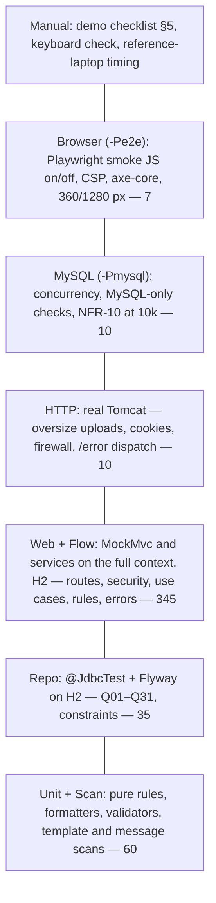
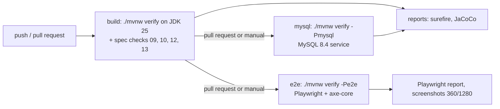

# 13 — Test Specification & Traceability

| | |
|---|---|
| **Status** | Draft |
| **Depends on** | 00 Plan (D1–D91), 01 Vision & Scope (§8 success criteria), 03 Requirements, 04 Use Cases, 05 Domain Model & Business Rules (§3 transitions, §4 rules, §5 scenarios), 07 Architecture (§3 packages, ADR-11, ADR-13), 08 Database Design (Q01–Q31, §9), 09 Web & API Contracts (R-xx, §7, K11), 10 UI Spec (SCR-xx, U7, U8, U10), 11 Security Spec (§12 SEC-01…SEC-56, K-S3), 12 Validation & Error Handling (§11, T-1…T-6), Appendix A |
| **Appendix** | `13a-test-catalogue.md`: every test case with its ID, level, fixture, steps, expected result, traces and priority |

This document says how the application is proved to work: which kinds of tests exist and what each kind is for, how the tests are set up (profile, clock, data, users, database reset), which test proves which requirement, what is checked by hand at the viva, and when testing is "done". The individual test cases (446) are in the appendix **13a**, so that this document stays readable. Nothing here adds a feature, a route or a screen.

| Section | Content |
|---|---|
| §1 | Test strategy and pyramid: levels, tools, what runs in `mvn test` and what in the `-Pmysql` / `-Pe2e` profiles |
| §2 | Test infrastructure: dependencies, test profile, fixed clock, database reset, fixtures, security helpers, other helpers, package layout, naming and tags |
| §3 | Test catalogue: summary of appendix 13a by group, and the open items of docs 09–12 resolved here |
| §4 | Master traceability matrix FR → UC → route → screen → table/query → test, and the reverse check |
| §5 | Demo acceptance checklist (doc 01 §8 and Appendix A §6) |
| §6 | Coverage targets and the CI recommendation |
| §7 | Defect reporting, test report and exit criteria |
| §8 | Verification of this document |
| §9 | Open questions and risks for doc 14 |

---

## 1. Test strategy and pyramid

### 1.1 What the tests must prove

| # | Goal | Main evidence |
|---|---|---|
| G-1 | The complaint lifecycle follows doc 05 §3 exactly: every allowed transition works with its side effects, every other combination is refused | §A of 13a: one test per transition row and actor, plus a 720-case matrix test (D97) |
| G-2 | Nobody sees or changes what they may not (D10, BR-60, doc 11) | the 62 `SEC-xx` tests, the generated wrong-role and not-visible sweeps over all 99 routes (D98) |
| G-3 | Every route of doc 09 answers as its contract says | one route test per route row (K11) |
| G-4 | Every use case works end to end, including its alternate flows | Given/When/Then acceptance tests for all 30 use cases |
| G-5 | Input problems and failures produce the answers of doc 12, in the right words | parameterised tests over every row of doc 12 §3, §5.2, §5.6, §6.1 and scans of the message catalogue |
| G-6 | The SQL of doc 08 returns the right rows on H2 **and** MySQL, and is fast enough at 10,000 complaints | the Q01–Q31 repository tests, the MySQL suite and the NFR-10 run |
| G-7 | The pages work in a real browser, with and without JavaScript, and are accessible | a small Playwright smoke and axe-core set |
| G-8 | The demo works on the day | the manual checklist of §5 |

### 1.2 Levels

| Level | Tool | What it tests | Spring context | Typical speed | Count (13a) |
|---|---|---|---|---|---|
| **Unit** | JUnit 6 + AssertJ | pure classes: `TransitionRules`, `ComplaintAccessPolicy`, validators, `ComplaintNumberGenerator.format`, `OtpHasher`, CSV escaping, `DisplayFormat`, `ComplaintStatus`, `TimelineService` labels, `ActionLinks`, `NotificationMessages`, `LoginAttemptService`, `ErrorReference` | none | ms | ≈ 40 |
| **Repo** | `@JdbcTest` + Flyway on H2 (MySQL mode) | every query Q01–Q31 through its repository method; constraints; migrations | JDBC slice | ≈ 10 ms per test | ≈ 35 |
| **Flow** | `@SpringBootTest` (no web), H2 | service methods inside the full context: transitions, side effects, transactions, jobs, fixtures | full | ≈ 20–50 ms per test | ≈ 75 |
| **Web** | `@SpringBootTest` + `@AutoConfigureMockMvc` + Spring Security Test, H2 | routes, security rules, validation, error mapping, pages as each viewer | full + MockMvc | ≈ 20–80 ms per test | ≈ 270 |
| **HTTP** | `@SpringBootTest(RANDOM_PORT)` + `java.net.http.HttpClient` | what MockMvc cannot see (§1.5) | full + Tomcat | ≈ 100 ms per test | ≈ 10 |
| **Scan** | JUnit reading templates, classes, handler mappings, `messages.properties` | rules that are easy to break silently (no `th:utext`, route inventory, message keys, layer rules) | none or full | ms | ≈ 20 |
| **MySQL** | failsafe `*MySqlIT`, real MySQL 8.4 | concurrency, MySQL-only behaviour, the 10k performance run | full | seconds | ≈ 10 |
| **Browser** | Playwright (Node) + Chromium + axe-core | JS on/off smoke, CSP, focus, accessibility, 360/1280 px | the running JAR | seconds | ≈ 7 |
| **Manual** | checklists | demo script (§5), keyboard check, the run on the reference laptop | the running JAR | minutes | 2 + §5 |

Counts are approximate because some 13a rows run on two levels (for example "Flow, Web").



The base of the pyramid is wide on purpose: the business rules live in pure functions (`TransitionRules.decide`, `ComplaintAccessPolicy.canView`, D39) that are cheap to test exhaustively. The middle is wider than in a textbook pyramid because the contract of this project *is* the web layer (doc 09): a route test on the full context with real services and real security is the cheapest test that proves a route row, and one cached context makes it fast.

### 1.3 What runs where (D92)

| Command | Runs | Needs | Target time |
|---|---|---|---|
| `./mvnw test` | Unit, Repo, Flow, Web, HTTP, Scan (tags `unit`, `repo`, `flow`, `web`, `http`, `scan`) | **JDK 25 only**: H2 in memory, no Docker, no MySQL, no Node, no network after the first build | < 4 min on a student laptop, < 2 min on CI |
| `./mvnw verify` | the same + the JaCoCo check (§6.1) | JDK 25 | + 10 s |
| `./mvnw verify -Pmysql` | + every `*MySqlIT` (tag `mysql`): the Q suite on MySQL, SEC-37, number generator under load, S10 with threads, BR-88 soft limit, NFR-10/NFR-12 at 10k | a MySQL 8.4 server: `TEST_MYSQL_URL`, `TEST_MYSQL_USER`, `TEST_MYSQL_PASSWORD` (a database `grievance_test` the user may alter) | ≈ 5 min |
| `./mvnw verify -Pe2e` | builds the app, starts it with `spring-boot:start` (profiles `dev,e2e`: H2 + demo data, test classpath), runs `npm ci && npx playwright test` in `app/e2e/`, stops it | Node 22 and Playwright's Chromium (`npx playwright install chromium`) | ≈ 3 min |

`mvn test` is what students run many times a day; it must never need anything that a college lab PC does not have. The two profiles are run on CI (§6.2) and at least once in the week before the demo (§7.4).

### 1.4 Why the full context instead of `@WebMvcTest` slices

`@WebMvcTest` would need mocks for every service, repository and for the filters that read the database (`UserStateFilter`, `LoginAttemptService`), and the mocks would have to repeat the business rules the route tests are meant to prove. With Spring's context cache, **one** `@SpringBootTest` context on H2 is started once (≈ 3–4 s, measured in the prototype) and shared by every Web and Flow test class. So route tests use real services and real security, and only the test-only error controller (TC-VE-14) and the fault-injection tests get contexts of their own (§2.10).

### 1.5 What MockMvc cannot cover

| Case | Why MockMvc is not enough | Level |
|---|---|---|
| Over-size multipart (K1, SEC-38) | MockMvc does not parse multipart through Tomcat, so neither the 413 nor `UploadSizeGuardFilter`'s redirect happens as in production | HTTP (+ Browser for SEC-38b) |
| Cookie flags, `jsessionid` in URLs (SEC-31) | the `Set-Cookie` header is written by Tomcat's session manager | HTTP |
| `StrictHttpFirewall` paths (SEC-33) | MockMvc normalises or rejects some paths before the filter chain | HTTP |
| Error dispatch to `/error` from filters and Tomcat (doc 12 §5.5, §6.2) | MockMvc does not forward `sendError` to `/error` | HTTP, always with `Accept: text/html` (doc 12 F-3; without it `BasicErrorController` answers JSON, confirmed in the prototype) |
| `PUT`/`DELETE`/`TRACE` (SEC-35) | Tomcat answers `TRACE` itself | HTTP |
| Session fixation | works in MockMvc **only** with `requestedSessionId` set and valid (doc 11 §12 note, confirmed: without it the id does not change) | Web with `Sessions.requestedSession` (§2.6) |
| CSP violations, JS behaviours, focus, axe-core, horizontal scroll | need a real browser engine | Browser |
| Parallel requests on one row (SEC-37, S10, D19, BR-88) | H2 locking differs from InnoDB | MySQL |

---

## 2. Test infrastructure

### 2.1 Dependencies and build plugins

The test dependencies of doc 07 §2.2 stay; this document adds one library and three plugin settings. Versions not managed by the Spring Boot 4.2 BOM are pinned exactly.

| Item | Scope / phase | Version | Why |
|---|---|---|---|
| `spring-boot-starter-webmvc-test`, `spring-boot-starter-security-test`, `spring-boot-starter-jdbc-test`, `com.h2database:h2` | test | managed (JUnit 6.1.3, AssertJ 3.27.7, Mockito 5.24.0, H2 2.5.252) | doc 07 §2.2 |
| `org.jsoup:jsoup` | test | **1.24.1** | parse rendered HTML for the page checks (SEC-44, SEC-49, error summary, `Forms.version(page)`), instead of fragile string matching |
| `maven-surefire-plugin` | `test` | managed 3.6.1 | runs everything except the tags `mysql` and `e2e`; JUnit parallel execution **off** (shared H2, §2.4) |
| `maven-failsafe-plugin` | `integration-test` in `-Pmysql` | managed 3.6.1 | runs `**/*MySqlIT.java` |
| `jacoco-maven-plugin` | `prepare-agent`, `report` (test), `check` (verify) | **0.8.14** | coverage gate of §6.1 (works with JDK 25, verified) |
| `spring-boot-maven-plugin` `start`/`stop`, `exec-maven-plugin` | `pre-`/`post-integration-test` in `-Pe2e` | managed / 3.6.2 | start the app for Playwright with **`testClasspath=all`** (H2 and `application-e2e.properties` available without being in the production JAR; the older `useTestClasspath=true` is deprecated in Boot 4.2 and did not put the test resources on the classpath, doc 14 §4.3, D119) |
| `app/e2e/package.json` | Node | `@playwright/test` 1.65.1, `@axe-core/playwright` 4.14.0 (pinned exactly; re-checked on npm by doc 14 on 2026-11-23: still the newest; Node ≥ 22.12, doc 14 §3.5) | browser tests (D99) |

### 2.2 Test profile and properties

`src/test/resources/application-test.properties` (every Spring test class runs with `@ActiveProfiles("test")` through its base class):

```properties
spring.datasource.url=jdbc:h2:mem:test;MODE=MySQL;DATABASE_TO_LOWER=TRUE;DB_CLOSE_DELAY=-1
spring.datasource.username=sa
spring.flyway.clean-disabled=true
# fast hashing in tests only; prod uses 12 (TC-SEC-56)
app.security.bcrypt-strength=4
# scheduled jobs off: tests call AutoCloseJob.run() / HousekeepingJob.run() directly ("-" disables a cron)
app.complaint.auto-close-cron=-
app.housekeeping.cron=-
app.otp.sender=demo
app.upload.dir=target/test-uploads
server.servlet.session.cookie.secure=false
spring.main.banner-mode=off
logging.level.com.smartgrievance=INFO
```

`src/test/resources/application-e2e.properties` (only for `-Pe2e`, together with `dev`): the same H2 URL with a different database name, `app.upload.dir=target/e2e-uploads`, and the demo seeder on. Real-Tomcat tests use the same `test` profile on a random port.

| Rule | Why |
|---|---|
| `@AutoConfigureTestDatabase(replace = NONE)` on every `@JdbcTest` | otherwise Boot replaces the data source with a plain embedded H2 **without** MySQL mode and the migrations do not run as on MySQL |
| No `@MockitoBean` in the shared base classes | every different set of mocks creates a new Spring context; faults are injected only in the fault-injection context (§2.10) |
| Never `Thread.sleep` | time moves only through `TestClock` (§2.3); asynchronous waits only in Browser and MySQL tests, with explicit conditions |

### 2.3 A fixed, movable clock (ADR-11, D94)

Every service reads time from the injected `java.time.Clock` (D18, ADR-11). The test configuration replaces it with one `TestClock` bean (marked `@Primary`):

| Property | Value |
|---|---|
| Start | **23-Nov-2026 10:00 IST** (`Asia/Kolkata`), so numbers are `GRV-2026-…` and the demo world's relative dates are fixed |
| API | `reset()` (back to the start, called in every base class's `@BeforeEach`), `advance(Duration)`, `set(LocalDateTime)` |
| Thread safety | `volatile` instant, so MySQL thread tests see the same time |
| Who uses it | services, repositories (`:now` parameters), `LoginAttemptService`, `RateLimiter`, OTP expiry, auto-close cutoff, `DisplayFormat` callers |
| What it does not move | the servlet session timeout (Tomcat's own clock). Expired sessions are simulated with an invalid requested session id (SEC-14), which is how the application sees them anyway |

The prototype proved the pattern: a page rendered `23-Nov-2026 10:00 AM`, and after `advance(5 h 30 min)` the same page rendered `23-Nov-2026 03:30 PM` (§8.2).

### 2.4 Database reset between tests (D95)

Web, Flow, HTTP and Repo tests **do not** rely on `@Transactional` rollback. Before each test the base class calls `TestDatabase.reset(dataSource)`:

1. `DELETE FROM` every table in foreign-key order: `notification`, `complaint_revision`, `complaint_event`, `attachment`, `complaint_watcher`, then the **duplicate** complaints (`duplicate_of_id IS NOT NULL`, the self-reference), then the other complaints, `complaint_sequence`, `mobile_otp`, `app_user`, `category`, `area`, `department`. The table names are fixed strings in the helper (NFR-04 holds even in tests).
2. Restart every identity counter (`ALTER TABLE … ALTER COLUMN id RESTART WITH 1` on H2, `ALTER TABLE … AUTO_INCREMENT = 1` on MySQL), so ids are predictable after every reset.
3. Re-run `V2__reference_data.sql` from the classpath, so the 5 departments, 6 categories and 7 areas are back with ids 1–5, 1–6 and 1–7.
4. Empty `target/test-uploads` and clear the in-memory throttling state (`LoginAttemptService.clearAll()`, `RateLimiter.clearAll()`; small public methods that the admin "reset password" path also uses for one key).

Why not rollback:

| Reason | Example |
|---|---|
| Some code runs in its own transaction | `AutoCloseJob` uses one `REQUIRES_NEW` transaction per complaint (SD-05), which a test transaction cannot roll back |
| Some behaviour happens only at commit or rollback | BR-25: files written for a transaction are deleted when it rolls back; a test transaction would hide that |
| Real Tomcat and threads | HTTP and MySQL tests run requests on other threads, outside the test's transaction |
| Identity counters are not rolled back | after a rolled-back insert H2 and MySQL keep the counter, so the fixed ids of `sample-data.sql` would point to the wrong rows in the next test |

Findings from the prototype (§8.2): the in-memory database (`DB_CLOSE_DELAY=-1`) is **shared by every cached Spring context in the JVM**, so a reset per test is required, and JUnit parallel execution stays off; and the duplicate complaints can only be deleted after their events (they are referenced by `complaint_event.related_complaint_id`). With the identity restart, `docs/db/verify/sample-data.sql` is reused **unchanged** as the fixture of the Q tests (copied to `src/test/resources/sql/q-fixture.sql`).

### 2.5 Test data: builders and the demo world (D100)

| Fixture | How | Used by |
|---|---|---|
| **`TestData`** builders | Insert exactly the rows a test needs, in any consistent state, through the repositories (fast, no service rules). Users by Appendix A key: `data.citizen("mahesh").verified().create()`, `data.officer("anita")` (Water Supply), `data.admin()`. Complaints: `data.complaint().owner(mahesh).category("Water Leakage").area("Kothrud").status(IN_PROGRESS).department("Water Supply").createdAgo(days(1)).watcher(jayesh).withHistory().create()`. The builder fills every column so the `CHECK`s of doc 08 §4.2 hold (`resolved_at` for `RESOLVED`, department for work statuses, `duplicate_of_id` for `DUPLICATE`); `withHistory()` writes the event chain of the status path. Files: `data.file("photo.png")` from `src/test/resources/files/`. | §A, §B, most of §C, §F |
| **`DemoWorld`** | Runs the real seeding logic of Appendix A at the `TestClock` time: 7 officers, 4 citizens, the 11 sample complaints `000001`…`000011` with events, revisions, watchers and notifications, `complaint_sequence(2026) = 11`. For this the seeding logic lives in a plain class `seed.DemoData` (no profile) that `DevDataSeeder` (`@Profile("dev")` runner) calls; doc 07 §3 is updated. | acceptance tests, SEC-49, scenarios S7/S9, dashboard counts, the e2e run |
| **q-fixture** | `docs/db/verify/sample-data.sql` unchanged, loaded after the reset | §H (Q01–Q31), "now" = 22-Nov-2026 12:00 |
| **Files** | `src/test/resources/files/`: `photo.png` (1×1, 67 bytes), `photo.jpg`, `doc.pdf` (minimal valid PDF), `exe-renamed.jpg` (`MZ` header), `html-renamed.jpg`, `image.svg`, `zip-renamed.pdf` (`PK` header), `anim.gif`, `empty.png` (0 bytes). Large files (5 MB + 1 byte, 6 MB, 27 MB, 60 MB) are generated in memory, never stored. | uploads, SEC-38…42 |

Because the demo world is built by the same code as the `dev` profile, TC-UT-17 also proves that the data shown at the viva is the data of Appendix A.

### 2.6 Security helpers (D96)

| Helper | What it does | When |
|---|---|---|
| `@WithAppUser("mahesh@example.com")` | A `WithSecurityContextFactory` that loads the **real** `app_user` row through `AppUserDetailsService` and puts a `CurrentUser` principal into the context. `setupBefore = TEST_EXECUTION`, so the user created in `@BeforeEach` exists | most Web tests with one fixed user |
| `appUser("anita")` | the same as a `RequestPostProcessor`, for parameterised tests whose user changes per case (wrong-role sweep, SEC-49) | generated tests |
| `Sessions.requestedSession(session)` | sets `session`, `requestedSessionId = session.getId()` and `requestedSessionIdValid = true` | **every** test that reuses a `MockHttpSession` (doc 11 §12 note): login, registration auto-login, logout, user-state changes |
| `Logins.formLogin(mvc, email, password)` | performs `POST /login` with CSRF and returns the authenticated `MockHttpSession` | session tests (SEC-12, SEC-13, SEC-26, SEC-27) |
| `csrf()` (Spring Security Test) | adds a valid token; `csrf().useInvalidToken()` for SEC-10/11 | every POST |
| `invalidSession()` | a request with a requested session id that is not valid | SEC-11, SEC-14, UC-02 timeout |

`@WithMockUser` is **not** used: our controllers take a `CurrentUser` principal, and `UserStateFilter` (D59) looks the user up on every request and ends the session of a user that does not exist, so a mock user would be logged out before reaching the controller.

### 2.7 Other helpers

| Helper (package `testsupport`) | Purpose |
|---|---|
| `Html.of(mvcResult)` | jsoup wrapper: `text("#who")`, `links()`, `buttons()`, `ids()`, `errorSummary()`, `hasNoForm()` |
| `Forms.version(page)` / `Forms.csrfAndVersion(...)` | read the hidden `version` of the rendered form, so acceptance tests post exactly what a browser would |
| `RouteCatalogue` | reads `src/test/resources/routes.csv` (doc 09 §3 as data: ID, method, path template, role prefix, sample path variables, needs multipart) for the sweeps and the inventory (D98) |
| `TransitionMatrix` | reads `src/test/resources/transition-matrix.csv` (13a §A.2) for TC-SM-30/31 (D97) |
| `LogCapture` | JUnit extension with a Logback `ListAppender` on the application and `SECURITY` loggers (TC-NF-13, TC-VE-32, SEC-54/55) |
| `Db` | small `JdbcClient` reads for assertions: `Db.status("GRV-2026-000001")`, `Db.events(no)`, `Db.notificationsOf(user)`, `Db.rowCounts()` (used to prove "nothing changed") |
| `HttpTestClient` | `HttpClient` with `Redirect.NEVER`, a cookie manager and `Accept: text/html` by default |

### 2.8 Package layout (mirrors doc 07 §3)

```text
src/test/java/com/smartgrievance/
├── testsupport/      TestClock, TestClockConfig, TestDatabase, TestData (+ builders), DemoWorld, WithAppUser,
│                     WithAppUserSecurityContextFactory, AppUsers (appUser()), Sessions, Logins, Html, Forms,
│                     RouteCatalogue, TransitionMatrix, LogCapture, Db, HttpTestClient,
│                     base classes: WebTestBase, FlowTestBase, HttpTestBase, RepositoryTestBase
├── auth/             RegistrationAcceptanceTest, LoginAcceptanceTest, PasswordAcceptanceTest, RegistrationRouteTest, …
├── otp/              OtpHasherTest, OtpServiceFlowTest, OtpSecurityWebTest, VerificationRouteTest, OtpConcurrencyMySqlIT
├── security/         AuthenticationWebTest, LoginThrottleWebTest, CsrfAndSessionWebTest, RoleSweepWebTest,
│                     RouteInventoryScanTest, UserStateWebTest, HeadersWebTest, CookieAndFirewallHttpTest,
│                     InputOutputWebTest, SecurityLogTest, BCryptConfigTest, LoginAttemptServiceTest
├── access/           ComplaintAccessPolicyTest, ObjectAccessWebTest, NotVisibleSweepWebTest
├── workflow/         TransitionMatrixTest, TransitionRulesGuardTest, WorkflowServiceFlowTest (A.1), RefusalFlowTest,
│                     DuplicateServiceFlowTest, AutoCloseJobFlowTest, *WorkflowRouteTest, ScenarioChainTest (S1–S5)
├── complaint/        ComplaintNumberGeneratorTest, ComplaintServiceFlowTest, SubmitAcceptanceTest, EditAcceptanceTest,
│                     WithdrawAcceptanceTest, DetailAcceptanceTest, CitizenComplaintRouteTest, CsvExportWebTest,
│                     QueriesRepositoryTest (Q01–Q31), QueriesMySqlIT, NumberGeneratorMySqlIT
├── watch/  attachment/  notification/  dashboard/  masterdata/  staff/  history/
│                     one …RouteTest per controller, …FlowTest per service, …AcceptanceTest per use case
├── common/           ErrorMappingWebTest (+ test-only ErrorTriggerController), FormBindingAdviceTest, ValidatorsTest,
│                     ErrorReferenceTest, ErrorPagesHttpTest, MessageCatalogueScanTest, ConstraintMessageScanTest
├── privacy/          StaffNameScanWebTest (SEC-49, SEC-50)
├── config/           ProdSafetyCheckTest
├── nfr/              PerformanceMySqlIT, ExplainMySqlIT, LayerRulesScanTest, DateFormatWebTest
└── scan/             TemplateScanTest, ErrorSummaryScanTest, SqlScanTest, TestIdScanTest
src/test/resources/
├── application-test.properties, application-e2e.properties
├── routes.csv, transition-matrix.csv, sql/q-fixture.sql, files/…, perf/load-10k.sql
app/e2e/                Playwright: playwright.config.ts (projects js-on, js-off; viewports 360, 1280), smoke.spec.ts,
                        a11y.spec.ts, csp.spec.ts, upload.spec.ts, focus.spec.ts
```

### 2.9 Naming conventions and tags (D93)

| Item | Rule | Example |
|---|---|---|
| Test case ID | `TC-<group>-<n>` with groups `SM` state machine, `BR` business rule, `UC` acceptance (`TC-UC-<uc><letter>`), `RT` route (`TC-RT-<route number>`, sweeps `G1`–`G4`), `SEC` (= `SEC-xx`), `VE` validation/error, `SC` scenario, `Q` query (= `Qnn`), `NF` non-functional, `UT` component, `SCAN` | `TC-SM-12`, `TC-UC-15b`, `TC-RT-43`, `TC-SEC-29a` |
| Test method | `@DisplayName` **starts with the TC ID**, then a sentence; method name in `lowerCamelCase` describing the behaviour | `@DisplayName("TC-SM-12 owner reopens a resolved complaint within the window")` `void ownerReopensWithinWindow()` |
| Parameterised case | `name = "{0} on {1} by {2} -> {3}"` so a failing cell names itself | `REOPEN on RESOLVED by W -> false` |
| Test class | by kind: `…Test` (unit), `…RepositoryTest`, `…FlowTest`, `…WebTest` / `…RouteTest` / `…AcceptanceTest`, `…HttpTest`, `…ScanTest`, `…MySqlIT` | `CitizenWorkflowRouteTest` |
| JUnit tag | `@Tag` on the base class or the class: `unit`, `repo`, `flow`, `web`, `http`, `scan`, `mysql`, plus `slow` for anything above 1 s | surefire `excludedGroups=mysql,e2e` |
| Playwright | file `<topic>.spec.ts`, test title starts with the TC ID | `test('TC-NF-16 no-JS smoke: submit and duplicate', …)` |

### 2.10 Spring context budget

| Context | Used by | Started |
|---|---|---|
| Main (`@SpringBootTest` + MockMvc, profile `test`, `TestClockConfig`) | all Web and Flow tests | once |
| JDBC slice (`@JdbcTest`) | Repo tests | once |
| Error trigger (main + `ErrorTriggerController` under `/test-only/**`) | TC-VE-14, TC-SEC-32 | once; kept out of the main context so SEC-19 sees exactly the 99 routes |
| Fault injection (main + `@MockitoSpyBean` on `FileStorageService`, `NotificationRepository`) | TC-BR-08, TC-BR-24, TC-NF-08, TC-SM-46, TC-UC-10d | once |
| Real Tomcat (`RANDOM_PORT`) | HTTP tests | once |
| MySQL (`-Pmysql` only) | `*MySqlIT` | once |

Five contexts in `mvn test`. A new `@MockitoBean`, `@TestPropertySource` or `@Import` in a single test class would add a sixth; reviewers reject that unless the test cannot be written otherwise.

---

## 3. Test catalogue (summary of appendix 13a)

Every test case has an ID, a title, a level, a fixture, steps, an expected result, the IDs it traces to and a priority. The full list is in **`13a-test-catalogue.md`**.

| Group (13a) | What | Must | Later | Total |
|---|---|---:|---:|---:|
| A `TC-SM` | State machine: one test per transition row and actor (22), the 720-case matrix, guards and refusals | 30 | 9 | 39 |
| B `TC-BR` | Business rules of doc 05 §4 not already proved in A | 35 | 2 | 37 |
| C `TC-UC` | Given/When/Then acceptance tests, main and alternate flows of all 30 use cases | 72 | 14 | 86 |
| D `TC-RT` | One test per route of doc 09 (99) + the wrong-role, not-visible, anonymous and inventory sweeps | 80 | 23 | 103 |
| E `TC-SEC` | The 62 security tests of doc 11 §12, mapped (not repeated) | 55 | 7 | 62 |
| F `TC-VE` | Validation and error handling of doc 12, incl. T-1…T-6 | 30 | 2 | 32 |
| G `TC-SC` | Scenarios S1–S12 of doc 05 §5 | 11 | 1 | 12 |
| H `TC-Q` | Queries Q01–Q31 on H2 and the MySQL suite | 32 | 3 | 35 |
| I `TC-NF` | Non-functional: NFR-10 at 10k, indexes, accessibility, responsive, paging, dates, transactions, Flyway, layering, smoke tests | 14 | 4 | 18 |
| J `TC-UT`, `TC-SCAN` | Components (access policy, `DisplayFormat`, `ComplaintStatus`, number format, OTP hasher, CSV, timeline labels, bootstrap admin, demo world, …) and scans | 19 | 3 | 22 |
| **Total** | | **378** | **68** | **446** |

### 3.1 State machine (13a §A)

- **One test per transition row and actor** (TC-SM-01…22): the 13 transitions plus edit, progress remark, unwatch and watch again, each for every actor the table allows (officer *and* admin where FR-36 applies), parameterised over the row's *from* statuses. Each checks the new status, the event (type, from, to, department, related complaint, remark), the changed columns, `version + 1` and **exactly** the expected notification recipients.
- **The expected matrix** (13a §A.2, 15 actions × 10 statuses) is written from doc 05 §3 and doc 09 §7.1, not from the code, and stored as `transition-matrix.csv` (D97). TC-SM-30 runs `TransitionRules.decide` for all 720 action × status × relation cells against it; TC-SM-31 checks `allowedActions`; TC-SM-32 proves that the *service* refuses the same cells with nothing written. The prototype ran the 720 cases in 0.6 s.
- **Guards and boundaries**: review deadline inclusive at exactly 7 days (TC-SM-34), auto-close one second later (TC-SM-35), reopen limit, BR-47, inactive departments, stale versions, BR-86/BR-88 on submit, the duplicate rules BR-40…BR-43 and access following the current department (BR-63).

### 3.2 Business rules (13a §B)

37 tests for the BR-xx not already covered by §A. The check script proves that **every** BR of doc 05 §4 (51 rules) is traced by at least one test case somewhere in 13a.

### 3.3 Acceptance tests (13a §C)

Given/When/Then for every use case, main and alternate flows, written as `…AcceptanceTest` classes that drive the real routes from the demo world. They post what the rendered page contains (CSRF token and `version` read with `Forms`), so they also prove that the pages and the routes fit together.

### 3.4 Route tests (13a §D, K11)

- **One route test per route row of doc 09 §3** (`TC-RT-<n>` for `R-<n>`, 99 rows): the happy path and every route-specific error column (validation → `200` same view, refusal → `302` + flash).
- **The generic columns are generated** from `routes.csv` (D98) so they cannot be forgotten for a new route: TC-RT-G1 runs every role-restricted route as each wrong role (85 × 2 requests → `403`, = SEC-16), TC-RT-G2 runs every `{no}` and `{id}` route as a right-role user who cannot view the object and with an unknown id (→ identical `404`), TC-RT-G3 runs every protected route anonymously (→ `302 /login`, R-77 `401`), TC-RT-G4 compares `routes.csv` with the handler mappings (= SEC-19).
- The sweeps also compare row counts and `version`s before and after, so "refused" always means "nothing changed".

### 3.5 Security tests (13a §E)

The 62 `SEC-xx` of doc 11 §12 (SEC-01…SEC-56 plus 29a, 29b, 30a, 37a, 38a, 38b) each get a `TC-SEC` row with the same number, its level and its test class; the expectations stay in doc 11 only. Special cases: SEC-16 and SEC-19 are the generated sweeps of §3.4; SEC-37 runs on MySQL with 10 threads (`OtpConcurrencyMySqlIT`); SEC-30a and SEC-38b are Playwright tests; SEC-45 is `TemplateScanTest`; SEC-49 is `StaffNameScanWebTest`, which renders R-20, R-21, R-24, R-29, R-40, R-42 and R-74 as owner, watcher and duplicate owner from the demo world and asserts with jsoup that no officer or admin full name or email (read from `app_user`) appears in the text **or** in attributes, and then applies the same assertion to every stored `notification.message` of a citizen recipient (U1, D70).

### 3.6 Validation and error handling (13a §F)

Parameterised over the doc 12 tables, so a new message row is a new test case automatically. The doc 12 prototype tests (§11.1) are the seeds (T-2):

| Prototype test (doc 12 §11.1) | Becomes |
|---|---|
| V-01 normalisation, flash once | TC-VE-01, TC-VE-12, TC-VE-23 |
| V-02 blank form, summary, ARIA, title | TC-VE-24 |
| V-03 `{min}`/`{max}` in MessageSource texts | TC-VE-01 |
| V-04 custom validators | TC-VE-13 |
| V-05 passwords not trimmed, not echoed | TC-VE-12, TC-UC-01c |
| V-06 uniqueness pre-check and race | TC-VE-16 |
| V-07 unknown / malformed number | TC-RT-G2, TC-VE-11 |
| V-08 refusals → redirect + flash | TC-VE-14, TC-VE-19 |
| V-09 CR LF counting, hidden `version` | TC-VE-04, TC-VE-10 |
| V-10, V-11 500 page and JSON with reference | TC-VE-14, TC-VE-21, TC-RT-77 |
| V-12 400 / 404 / 405 | TC-VE-11, TC-VE-20 |
| V-13 per-file upload errors | TC-VE-09 |
| V-14 `Accept-Language` ignored | TC-VE-31 |
| M-01 every key resolves and formats | TC-VE-27 |
| C-01…C-05 real Tomcat | TC-VE-18, TC-VE-20, TC-VE-22 (all with `Accept: text/html`, except the JSON check) |

### 3.7 Scenarios, queries, non-functional (13a §G–§I)

- **S1–S12** are executable (TC-SC-01…12); S1–S5 run as one ordered chain (`ScenarioChainTest`) because each continues from the previous state. Two expected results of doc 05 §5 were corrected while writing them (D104, §8.3).
- **Q01–Q31** run on H2 with the unchanged doc 08 sample data and the results recorded in doc 08 §9.1; the same class runs on MySQL in `-Pmysql` (`QueriesMySqlIT extends QueriesRepositoryTest`).
- **NFR-10** is measured on MySQL after loading 10,000 complaints with the doc 08 load script (adapted to look ids up by name), through real HTTP with a logged-in session; accessibility with axe-core; responsive layout at 360 and 1280 px.

### 3.8 Open items resolved here

| Item | Raised in | Decision |
|---|---|---|
| K11 one MockMvc test per route row, plus 403 and 404 variants | doc 09 §13 | §3.4: `TC-RT-<n>` per route + generated sweeps G1–G4 from `routes.csv` (D98) |
| U1 / SEC-49 no staff names for citizens | doc 10 §12, doc 11 §10.3 | `StaffNameScanWebTest` (§3.5) |
| U7 `app.js` behaviours, JS on and off | doc 10 §12 | TC-NF-16 (no-JS smoke: submit with a file, duplicate steps 1–2) and TC-NF-17 (JS-on: submit-disable, file pre-check, confirm, bell refresh, CSP) in Playwright projects `js-off` / `js-on` (D99) |
| U8 automated accessibility checker | doc 10 §12 | axe-core through Playwright on 13 screens, WCAG 2.1 A/AA tags, zero violations, plus a control page (TC-NF-03, D99); the contrast script stays (TC-NF-05) |
| U10 `DisplayFormat` and `ComplaintStatus` label/badge/icon | doc 10 §12 | TC-UT-02 (with the default locale set to `hi-IN`), TC-UT-03 (against the doc 10 §5.1 table and `app.css`), TC-SCAN-01 |
| K-S3 all SEC-xx into doc 13 | doc 11 §14 | 13a §E; SEC-16/19 generated, SEC-37 MySQL, SEC-30a/38b Browser, SEC-45 scan, SEC-49 scan test |
| MockMvc session-fixation note | doc 11 §12 | `Sessions.requestedSession` mandatory for reused sessions (§2.6); confirmed by the prototype in both directions |
| T-1 constraint message keys | doc 12 §12 | TC-VE-26 |
| T-2 port the prototype tests | doc 12 §12 | §3.6 table |
| T-3 message catalogue check in the build | doc 12 §12 | TC-VE-27 in `mvn test` (JUnit port of the app-relevant checks); the doc-consistency checks of `check-12-messages.py` run on CI (D101) |
| T-4 error summary field lists | doc 12 §12 | TC-VE-28 |
| T-5 focus and axe on a form with errors | doc 12 §12 | TC-VE-29 |
| T-6 BR-88 not a hard limit under concurrency | doc 12 §12 | TC-VE-30 asserts 10 ≤ n ≤ 11 on MySQL; H2 tests are sequential (D105) |

---

## 4. Master traceability matrix

### 4.1 Must requirements

One row per **Must** requirement of doc 03 (55). Use cases from doc 04 §1/§5, routes from doc 09 §11.2, screens from doc 10 §9.2, tables and queries from doc 08, test cases from the **Traces** column of 13a (the first seven by group order — acceptance, state machine, route, scenario, rule, security, validation, query, component, non-functional — then "+n more"). The script of §8 recomputes the test column and fails if any Must requirement has none.

| FR | Use case(s) | Route(s) | Screen(s) | Table(s) / query | Test cases |
|---|---|---|---|---|---|
| FR-01 | UC-01 | R-05, R-06 | SCR-02 | app_user | TC-UC-01a, TC-RT-05, TC-RT-06, TC-SEC-09, TC-SEC-13, TC-VE-01 |
| FR-02 | UC-01 | R-06, R-08, R-103, R-109, R-115 | SCR-02 | app_user (`uq_app_user_email`, `uq_app_user_mobile`) | TC-UC-01b, TC-UC-01c, TC-UC-43b, TC-RT-06, TC-RT-08, TC-RT-103, TC-RT-109 (+8) |
| FR-03 | UC-02 | R-01, R-02, R-03 | SCR-01, navbar | app_user | TC-UC-02a, TC-RT-01, TC-RT-02, TC-RT-03, TC-RT-G3, TC-SEC-01, TC-SEC-03 (+3) |
| FR-04 | UC-02 | R-04, R-02 | SCR-01, navbar | — (session) | TC-UC-02a, TC-UC-02c, TC-RT-02, TC-RT-04, TC-SEC-14, TC-SEC-15 |
| FR-05 | UC-02 | R-03 | SCR-01, navbar | app_user.active | TC-UC-02b, TC-UC-43d, TC-RT-02, TC-RT-03, TC-BR-31, TC-SEC-05, TC-SEC-06 (+2) |
| FR-07 | — (startup) | R-03 | SCR-01 | app_user | TC-UT-16 |
| FR-08 | UC-01 | R-06 | SCR-02 | app_user.role | TC-UC-01a, TC-RT-06, TC-SEC-46 |
| FR-09 | UC-04 | R-10, R-11, R-12 | SCR-03, SCR-10 | mobile_otp; Q30 | TC-UC-04a, TC-UC-04b, TC-UC-04c, TC-UC-04d, TC-RT-10, TC-RT-11, TC-RT-12 (+5) |
| FR-09a | UC-04 | R-20, R-22, R-23 | SCR-03, SCR-10 | app_user.mobile_verified | TC-UC-04e, TC-SM-43, TC-RT-20, TC-RT-22, TC-BR-34 |
| FR-09b | UC-04 | R-10, R-12 | SCR-03, SCR-10 | mobile_otp | TC-UC-01a, TC-UC-04a, TC-RT-10 |
| FR-10 | UC-10 | R-22, R-23 | SCR-12 | complaint, category, area | TC-UC-10a, TC-UC-10b, TC-RT-22, TC-RT-23, TC-VE-03 |
| FR-11 | UC-10 | R-23, R-26 | SCR-12 | attachment; Q29 | TC-UC-10a, TC-UC-10c, TC-RT-23, TC-SC-12, TC-BR-05, TC-BR-06, TC-SEC-38 (+4) |
| FR-12 | UC-10 | R-23, R-24 | SCR-13 | complaint_sequence; Q22, Q23 | TC-UC-10a, TC-SM-01, TC-RT-23, TC-BR-01, TC-UT-05 |
| FR-13 | UC-10 | R-23, R-29 | SCR-13, SCR-20 | complaint, complaint_event | TC-UC-10a, TC-SM-01 |
| FR-14 | UC-10 | R-24 | SCR-13 | complaint | TC-UC-10a, TC-RT-24 |
| FR-15 | UC-10 | R-23, R-74 | SCR-60, bell | notification; Q16 | TC-UC-10a, TC-SM-01, TC-SC-01 |
| FR-16 | UC-11 | R-25, R-26 | SCR-12 | complaint, attachment | TC-UC-11a, TC-SM-20, TC-RT-25, TC-RT-26, TC-SC-11, TC-VE-03, TC-VE-08 |
| FR-17 | UC-11 | R-26, R-29, R-73 | SCR-20 | complaint_event, complaint_revision; Q14 | TC-UC-11a, TC-UC-11b, TC-SM-20, TC-RT-26, TC-SC-11, TC-BR-09, TC-Q-14 |
| FR-18 | UC-12 | R-27, R-28 | SCR-20, SCR-21 | complaint, complaint_event; Q17 | TC-UC-12a, TC-UC-12b, TC-SM-19, TC-SM-37, TC-SM-38, TC-RT-27, TC-RT-28 (+1) |
| FR-19 | UC-11, UC-12 | R-29, R-25, R-26, R-27, R-28 | SCR-20, SCR-21 | complaint.version; Q19, Q20 | TC-UC-11c, TC-UC-12c, TC-SM-30, TC-SM-31, TC-RT-25, TC-SCAN-02 |
| FR-20 | UC-13 | R-20 | SCR-10, SCR-11 | complaint; Q01, Q02 | TC-UC-13a, TC-UC-13c, TC-RT-20, TC-Q-01, TC-Q-02 |
| FR-21 | UC-14, UC-16 | R-29, R-73 | SCR-20, SCR-91 | complaint, attachment, complaint_event; Q14 | TC-UC-14a, TC-UC-14b, TC-UC-16a, TC-RT-29, TC-RT-73, TC-Q-14 |
| FR-22 | UC-13 | R-21 | SCR-10, SCR-11 | complaint_watcher; Q03 | TC-UC-13b, TC-UC-13c, TC-RT-21, TC-Q-03 |
| FR-23 | UC-14 | R-29, R-73 | SCR-20, SCR-91 | complaint, complaint_watcher; Q04, Q05 | TC-UC-14e, TC-RT-29, TC-RT-G2, TC-BR-18, TC-SEC-20, TC-SEC-21, TC-UT-01 |
| FR-24 | UC-14 | R-29 | SCR-20 | complaint.duplicate_of_id | TC-UC-14c, TC-RT-29, TC-BR-14 |
| FR-25 | UC-15 | R-29, R-40, R-41, R-42, R-43 | SCR-20, SCR-21 | complaint.resolved_at | TC-UC-14a, TC-UC-15a, TC-SM-11, TC-RT-40, TC-RT-42, TC-VE-04 |
| FR-26 | UC-15 | R-41, R-43 | SCR-20, SCR-21 | complaint, complaint_event; Q19 | TC-UC-15a, TC-UC-15b, TC-SM-11, TC-SM-12, TC-RT-41, TC-RT-43, TC-SC-04 |
| FR-28 | UC-14 | R-29 | SCR-11, SCR-20 | complaint_watcher; Q04 | TC-UC-14d, TC-SM-41, TC-RT-29, TC-SC-03, TC-SEC-25 |
| FR-29 | UC-17 | R-71, R-72 | SCR-11, SCR-20 | complaint_watcher; Q28 | TC-UC-17a, TC-UC-17b, TC-SM-21, TC-SM-22, TC-RT-71, TC-RT-72, TC-SC-05 (+1) |
| FR-30 | UC-20 | R-31 | SCR-41 | complaint; Q07, Q26 | TC-UC-20a, TC-RT-31, TC-VE-07, TC-Q-07, TC-Q-26 |
| FR-31 | UC-20 | R-56 | SCR-20, SCR-21, SCR-41 | complaint, complaint_event; Q19 | TC-UC-20a, TC-SM-02, TC-RT-56 |
| FR-32 | UC-21 | R-57, R-58 | SCR-20, SCR-21 | complaint, department; Q19 | TC-UC-21a, TC-UC-21c, TC-SM-03, TC-RT-57, TC-RT-58, TC-VE-04 |
| FR-34 | UC-22 | R-61, R-62 | SCR-20, SCR-21 | complaint, complaint_event | TC-UC-22a, TC-SM-15, TC-RT-61, TC-RT-62 |
| FR-35 | UC-23 | R-63, R-64 | SCR-20, SCR-21 | complaint, complaint_event, complaint_watcher | TC-UC-23d, TC-SM-17, TC-RT-63, TC-RT-64 |
| FR-40 | UC-30 | R-30 | SCR-30 | complaint; Q06 | TC-UC-30a, TC-RT-30, TC-Q-06 |
| FR-41 | UC-31 | R-44, R-45 | SCR-20, SCR-21 | complaint, complaint_event; Q19 | TC-UC-31a, TC-UC-31b, TC-SM-05, TC-RT-44, TC-RT-45, TC-VE-04 |
| FR-42 | UC-33 | R-48, R-49 | SCR-20, SCR-21 | complaint.resolved_at; Q19 | TC-UC-33a, TC-SM-09, TC-RT-48, TC-RT-49, TC-RT-69, TC-RT-70, TC-VE-04 |
| FR-44 | UC-23 | R-54, R-55 | SCR-20, SCR-21 | complaint, complaint_event, complaint_watcher; Q28 | TC-UC-23a, TC-SM-18, TC-RT-54, TC-RT-55, TC-SC-02, TC-BR-12, TC-VE-05 |
| FR-45 | UC-22 | R-52, R-53 | SCR-20, SCR-21 | complaint, complaint_event | TC-UC-22b, TC-SM-16, TC-RT-52, TC-RT-53, TC-VE-04 |
| FR-47 | UC-30 | R-30, R-29, R-44, R-45, R-46, R-47, R-48, R-49, R-50, R-51, R-52, R-53, R-54, R-55 | SCR-30 | complaint.department_id; Q06 | TC-UC-14b, TC-UC-22c, TC-UC-30a, TC-SM-45, TC-RT-29, TC-RT-30, TC-RT-44 (+5) |
| FR-50 | UC-40 | R-80, R-81, R-82, R-83, R-84, R-85, R-86 | SCR-42, SCR-43 | department | TC-UC-40a, TC-UC-40b, TC-RT-80, TC-RT-81, TC-RT-82, TC-RT-83, TC-RT-84 (+4) |
| FR-51 | UC-41 | R-87, R-88, R-89, R-90, R-91, R-92, R-93 | SCR-44, SCR-45 | category | TC-UC-41a, TC-UC-41b, TC-RT-87, TC-RT-88, TC-RT-89, TC-RT-90, TC-RT-91 (+3) |
| FR-52 | UC-42 | R-94, R-95, R-96, R-97, R-98, R-99, R-100 | SCR-46, SCR-47 | area | TC-UC-42a, TC-RT-94, TC-RT-95, TC-RT-96, TC-RT-97, TC-RT-98, TC-RT-99 (+2) |
| FR-53 | UC-43 | R-101, R-102, R-103, R-104, R-105, R-106, R-107 | SCR-48, SCR-49, SCR-51 | app_user | TC-UC-43a, TC-UC-43b, TC-UC-43c, TC-UC-43d, TC-RT-101, TC-RT-102, TC-RT-103 (+6) |
| FR-56 | UC-40, UC-41, UC-42 | R-22, R-25, R-57, R-59, R-86, R-93, R-100 | SCR-12, SCR-21, SCR-42, SCR-44, SCR-46 | department, category, area (`active`) | TC-UC-21d, TC-UC-40d, TC-UC-41c, TC-UC-42a, TC-SM-39, TC-RT-22, TC-RT-57 (+4) |
| FR-60 | UC-50 | R-78 | SCR-40 | complaint; Q08, Q09 | TC-UC-50a, TC-RT-78, TC-Q-08, TC-Q-09 |
| FR-61 | UC-50 | R-78, R-31 | SCR-40 | complaint, category, department, area; Q10, Q11, Q12 | TC-UC-50a, TC-RT-31, TC-RT-78, TC-Q-10, TC-Q-11, TC-Q-12 |
| FR-62 | UC-50 | R-78, R-31 | SCR-40 | complaint, category; Q13 | TC-UC-50a, TC-RT-31, TC-RT-78, TC-BR-20, TC-Q-13 |
| FR-70 | UC-60 | R-74 | SCR-60, bell | notification; Q16 | TC-UC-12b, TC-SM-03, TC-SC-01, TC-BR-15 |
| FR-71 | UC-60 | R-77 | SCR-60, bell | notification; Q15 | TC-UC-60a, TC-RT-77, TC-SEC-02, TC-Q-15 |
| FR-72 | UC-60 | R-74, R-75, R-76 | SCR-60, bell | notification; Q24, Q27 | TC-UC-60a, TC-RT-74, TC-RT-75, TC-RT-76, TC-SEC-24, TC-Q-24, TC-Q-27 |
| FR-80 | UC-30, UC-50 | R-30, R-31, R-78, R-29 | SCR-20, SCR-30, SCR-40, SCR-41 | complaint, category; Q06, Q09, Q13 | TC-BR-19, TC-Q-09, TC-UT-13, TC-UT-17 |
| FR-81 | UC-11, UC-12, UC-15, UC-20…UC-23, UC-31…UC-34 | R-29 | SCR-20 | complaint_event, complaint_revision; Q14 | TC-BR-25, TC-Q-14 |
| FR-82 | UC-70 | R-29, R-74 | SCR-20, SCR-60 | complaint, complaint_event; Q18, Q21 | TC-UC-70a, TC-UC-70b, TC-SM-13, TC-SM-35, TC-SM-46, TC-SC-09, TC-Q-18 (+1) |
| FR-83 | all state-changing UCs (R-STATE) | R-28, R-41, R-43, R-45, R-47, R-49, R-51, R-53, R-55, R-56, R-58, R-60, R-62, R-64, R-66, R-68, R-70 | SCR-20, SCR-21 | complaint (status, version); Q19, Q20 | TC-UC-22c, TC-SM-30, TC-SM-32, TC-SM-33, TC-RT-28, TC-RT-41, TC-RT-43 (+15) |

### 4.2 Should and Could requirements

| FR | Pri | Test cases |
|---|---|---|
| FR-06 | S | TC-UC-03a, TC-UC-03b, TC-RT-07, TC-RT-08, TC-VE-02 |
| FR-09c | S | TC-UC-44b, TC-RT-113, TC-BR-35, TC-SEC-28 |
| FR-27 | S | TC-UC-15c, TC-SM-36, TC-RT-42, TC-RT-43 |
| FR-33 | S | TC-UC-21b, TC-SM-04, TC-SM-40, TC-RT-59, TC-RT-60, TC-VE-08 |
| FR-36 | S | TC-SM-06, TC-SM-08, TC-SM-10, TC-RT-65 … TC-RT-70 |
| FR-43 | S | TC-UC-32a, TC-SM-07, TC-SM-08, TC-RT-46, TC-RT-47, TC-RT-67, TC-RT-68 |
| FR-46 | S | TC-UC-34a, TC-SM-14, TC-RT-50, TC-RT-51 |
| FR-48 | C | TC-UC-33b, TC-RT-49, TC-BR-06 |
| FR-54 | S | TC-UC-44a, TC-RT-110, TC-RT-111, TC-RT-112, TC-SEC-29b |
| FR-55 | S | TC-UC-43e, TC-UC-44b, TC-RT-108, TC-RT-109, TC-RT-114, TC-RT-115, TC-VE-02 |
| FR-63 | S | TC-UC-51a, TC-RT-30, TC-Q-09 |
| FR-64 | C | TC-UC-50c |
| FR-65 | C | TC-UC-50b, TC-RT-32, TC-SEC-47, TC-SEC-51, TC-UT-07 |
| FR-73 | C | TC-UT-18 |
| FR-84 | S | TC-SM-42, TC-SC-10, TC-VE-19, TC-Q-20 |

Every non-functional requirement is traced as well: NFR-01 (TC-NF-11, TC-SEC-56), NFR-02 (TC-RT-G1, TC-SCAN-03), NFR-03 (TC-SEC-10, TC-SEC-45), NFR-04 (TC-SEC-43), NFR-05 (TC-BR-07, TC-BR-17), NFR-06 (TC-VE-14, TC-VE-20, TC-SEC-32), NFR-07 (TC-SEC-44, TC-SEC-45), NFR-10 (TC-NF-01), NFR-11 (TC-NF-06), NFR-12 (TC-NF-02), NFR-20 (TC-NF-03, TC-NF-04, TC-NF-16), NFR-21 (TC-UT-03, TC-NF-05), NFR-22 (TC-VE-24), NFR-23 (TC-UT-02, TC-NF-07), NFR-30 (TC-NF-08, TC-BR-24), NFR-31 (TC-NF-09), NFR-32 (TC-NF-10, TC-Q-25), NFR-40 (TC-NF-14), NFR-41 (TC-NF-15), NFR-42 (TC-NF-12), NFR-43 (TC-NF-13); the script checks all 22.

### 4.3 Reverse check: no test traces to nothing

The script of §8 reads the **Traces** column of every one of the 446 rows of 13a and checks that each names at least one ID that exists in the source documents (FR, NFR, BR, UC, R, SEC, T, S, Q, D, ADR). It also checks the other direction for every ID family: every Must FR, every use case, every transition T01–T13, every BR, every route, every SEC, every scenario and every query is traced by at least one test. Result: §8.1.

### 4.4 How priorities are set

| Priority | Rule |
|---|---|
| **Must** | traces a Must requirement, a business rule on the demo path, or a security control; runs in `mvn test`, except the smoke, no-JS and accessibility Browser tests (TC-NF-03, 04, 16, 17), which are Must but run in `-Pe2e` |
| **Later** | traces only Should or Could requirements, needs MySQL (concurrency, performance, MySQL-only checks), or is a browser test beyond the smoke set. Later tests are written when their module or profile exists; they never block the demo but do block the final exit (§7.4, item 3) |

---

## 5. Demo acceptance checklist (viva script)

A manual script for the six success criteria of doc 01 §8 and the demo cheat-sheet of Appendix A §6. Print it, run it top to bottom, and tick each box. Use **two browsers** (or a normal and a private window) so a citizen and a staff member can be logged in at the same time. Demo password for every seeded account: `Demo@1234`.

### 5.1 Before the viva

| ☐ | Step | Expected |
|---|---|---|
| ☐ | P1 `./mvnw verify` on the demo laptop | `BUILD SUCCESS`; the test report (§7.3) is printed |
| ☐ | P2 Create an empty `grievance_dev` database (utf8mb4, doc 14) and start `java -jar target/smart-grievance.jar` with profile `dev`; wait 6 minutes | log shows Flyway V1, V2, the bootstrap admin, the demo seeder; after the first auto-close run (every 5 minutes in `dev`, D106) the log says "Auto-close: 1 complaint(s) closed" |
| ☐ | P3 Open `http://localhost:8080/` | `302` to the login page, Bootstrap styling loads (no internet needed, ADR-12) |
| ☐ | P4 Have a JPG or PNG under 5 MB and a `.txt` file renamed to `.jpg` ready on the desktop | — |

### 5.2 The six success criteria (doc 01 §8)

| ☐ | # | Who | Action | Expected |
|---|---|---|---|---|
| ☐ | 1a | visitor | Register "Priya Nair", `priya@example.com`, `9820000009`, `Strong@123` | logged in, on the Verify page with "Demo OTP: nnnnnn" |
| ☐ | 1b | Priya | Enter the demo OTP | "Mobile verified, you can now file complaints"; My Complaints is empty |
| ☐ | 1c | Priya | New Complaint: Water Leakage, Viman Nagar, "Water leaking from main line", a 20+ character description, an address, attach the photo; also try the renamed `.txt` first | the fake file is refused with "…: only JPG, PNG or PDF files are allowed."; with the photo the confirmation page shows **GRV-2026-000012** and "View complaint" |
| ☐ | 2a | admin (`admin@example.com`) | Dashboard → Pending card → open 000012 → Start Review | "Review started"; Priya's bell count goes up after a page refresh |
| ☐ | 2b | admin | Assign | **Water Supply** is pre-selected (category default); "Assigned to Water Supply" |
| ☐ | 3a | anita (`anita.deshmukh@example.com`) | Department Queue → 000012 → Start Work with "Team will visit today" | "Work started"; status In Progress |
| ☐ | 3b | anita | Resolve with "Main line valve replaced" | flash "… The citizen has until dd-MMM-yyyy to review it" (today + 7 days) |
| ☐ | 3c | Priya | Refresh; open the bell list; open 000012 | notifications for registration, review, assignment, in progress, resolved (5); timeline shows each step with **"Water Supply Dept."** or "Grievance Cell", never a staff name; Close and Reopen buttons with "Please review by …" |
| ☐ | 4a | sneha (`sneha@example.com`) | New Complaint: Water Leakage, Kothrud, "Leak near Kothrud Depot again" | GRV-2026-000013 |
| ☐ | 4b | admin | Start Review, Assign → Water Supply | assigned |
| ☐ | 4c | anita | Open 000013 → Mark as duplicate → `grv-2026-000001` → Continue | step 2 shows 000001's title "Pipeline leaking on Karve Road …", area Kothrud, status In Progress |
| ☐ | 4d | anita | Enter a note → Confirm | "Linked to GRV-2026-000001 as a duplicate"; 000001's timeline shows "GRV-2026-000013 linked as a duplicate" |
| ☐ | 4e | sneha | Watching | GRV-2026-000001 is listed; opening it shows its timeline, "You are watching this complaint", only Unwatch; her bell has the "linked to GRV-2026-000001" notification |
| ☐ | 5a | Priya | Open 000012 → Reopen with "Still leaking at night" | "Complaint reopened and sent back to the department"; status Reopened |
| ☐ | 5b | anita | Queue shows 000012 as Reopened → Start Work → Resolve | Resolved again with a new review date |
| ☐ | 5c | Priya | Close with feedback "Fixed now, thank you" | "Thank you. The complaint is closed"; no more buttons |
| ☐ | 5d | mahesh (`mahesh@example.com`) | Open GRV-2026-000011 | status Closed; timeline ends with "Auto-closed: no response within 7 days" by **System** |
| ☐ | 6 | admin | Dashboard | **Total 13 · Pending 2 · Assigned 1 · In Progress 1 · Reopened 1 · Resolved 1 · Closed 3 · Rejected 1 · Duplicate 2 · Withdrawn 1**; Overdue equals the rows of the overdue list and includes 000005; clicking "Closed" lists exactly 000006, 000011, 000012 |

### 5.3 Extra demo steps (Appendix A §6 cheat-sheet)

Run after §5.2, because they change the counts.

| ☐ | Who | Action | Expected |
|---|---|---|---|
| ☐ | admin | Dashboard → Overdue list | 000005 (Road Maintenance) with "elapsed / SLA" days |
| ☐ | admin | Open 000008 (category Other) → Assign | nothing pre-selected ("admin decides"); choosing Road Maintenance → "Assigned to Road Maintenance" |
| ☐ | anita | Open 000001 → Resolve | mahesh **and** jayesh **and** sneha get a notification (owner and two watchers) |
| ☐ | amit (`amit.pawar@example.com`) | Department Queue | 000004 "Awaiting citizen until …", no buttons |
| ☐ | mahesh | Open 000004 → Close (or Reopen) | Closed (or Reopened, back in amit's queue) |
| ☐ | jayesh (`jayesh@example.com`) | Watching → 000001 → Unwatch; then open his own 000002 → banner link → Watch again | "You will no longer receive updates", 000001 leaves Watching but still opens; "You are watching this complaint again" |
| ☐ | rahul (`rahul@example.com`) | Log in → New Complaint | redirected to Verify ("Verify your mobile number to file complaints"); after the OTP the form opens |
| ☐ | kiran (`kiran.more@example.com`, inactive) | Log in | "Invalid email or password, or account inactive" |
| ☐ | sneha | Type `/complaints/GRV-2026-000005` in the address bar | "Page not found" (she is not owner or watcher, D10) |
| ☐ | any | Switch off JavaScript in the browser and repeat 1c and 4c–4d quickly | everything still works (D49) |

### 5.4 If something goes wrong during the viva

| Symptom | Likely cause | Action |
|---|---|---|
| 000011 is still Resolved in 5d | the app was started less than 5 minutes ago | wait for the next run (at most 5 minutes) and refresh; no restart is needed |
| Counts in 6 differ | extra steps were run before §5.2, or the database was not empty | explain the difference from the timeline; for a clean run recreate the database (P2) |
| Error page with a reference `ERR-…` | unexpected exception | read the reference aloud, `grep` it in `logs/app.log` (doc 12 §6.3) and show that the user saw no internals (NFR-06) |

---

## 6. Coverage targets and CI

### 6.1 Coverage (JaCoCo, D102)

"After M7" below means after **milestone M7** of doc 14 §11 (notifications), switched on with `coverage.later.skip=false` in the pom (D120). Coverage is a smoke alarm, not a goal: the catalogue decides *what* is tested, coverage shows what was forgotten. Limits are checked by `jacoco:check` in `./mvnw verify`.

| Scope | Line | Branch | Enforced from |
|---|---:|---:|---|
| `workflow.TransitionRules`, `access.ComplaintAccessPolicy` | 100 % | **100 %** | the first commit of the module (they are pure functions with a full matrix test) |
| packages `workflow`, `access` | 90 % | 85 % | the first commit of the module |
| service classes (`*Service`, `*Generator`, `*Job`, `FileStorageService`, `FileTypeDetector`) in `complaint`, `watch`, `attachment`, `otp`, `notification`, `history`, `security`, `staff`, `masterdata`, `dashboard` | 80 % | 70 % | after M7 (report only before) |
| `common` (`exception`, `validation`, `web`) | 80 % | 70 % | after M7 |
| whole bundle | 75 % | 60 % | after M7 |
| excluded | `SmartGrievanceApplication`, `config.*Properties` records, `seed.DevDataSeeder` (runner shell only; `DemoData` is covered by TC-UT-17) | | |

The prototype confirmed that JaCoCo 0.8.14 instruments JDK 25 classes and writes `target/site/jacoco/index.html` during `mvn verify`.

### 6.2 CI recommendation (GitHub Actions, not committed yet)

The workflow file is added together with the `app/` project (doc 14). **Superseded by the full draft `docs/ci/build.yml.draft` (doc 14 §10.4, newer action versions, MySQL URL with `+05:30`, spec-copy checks); the outline below is kept for the record.** Outline:

```yaml
# .github/workflows/build.yml (outline)
name: build
on: [push, pull_request, workflow_dispatch]
jobs:
  build:                       # every push: mvn verify on JDK 25 (Unit … Scan + coverage gate)
    runs-on: ubuntu-latest
    steps:
      - uses: actions/checkout@v5
      - uses: actions/setup-java@v5
        with: { distribution: temurin, java-version: '25', cache: maven }
      - run: ./mvnw -B verify
        working-directory: app
      - run: |                 # specification checks (Python is preinstalled on the runner)
          bash docs/specs/verify/check-09-traceability.sh
          bash docs/specs/verify/check-10-screens.sh
          python3 docs/specs/verify/check-12-messages.py
          python3 docs/specs/verify/check-13-traceability.py
      - uses: actions/upload-artifact@v5
        if: always()
        with: { name: reports, path: app/target }
  mysql:                       # pull requests and manual runs: the MySQL suite (SEC-37, concurrency, NFR-10)
    if: github.event_name != 'push'
    runs-on: ubuntu-latest
    services:
      mysql:
        image: mysql:8.4
        env: { MYSQL_ROOT_PASSWORD: test, MYSQL_DATABASE: grievance_test }
        ports: ['3306:3306']
        options: --health-cmd="mysqladmin ping -ptest" --health-interval=5s --health-retries=20
    env:
      TEST_MYSQL_URL: jdbc:mysql://localhost:3306/grievance_test?connectionTimeZone=Asia/Kolkata&forceConnectionTimeZoneToSession=true
      TEST_MYSQL_USER: root
      TEST_MYSQL_PASSWORD: test
    steps: [checkout, setup-java (as above), "./mvnw -B verify -Pmysql"]
  e2e:                         # pull requests and manual runs: Playwright smoke, CSP, axe-core
    if: github.event_name != 'push'
    runs-on: ubuntu-latest
    steps: [checkout, setup-java, "actions/setup-node@v5 (node 22)", "npx playwright install --with-deps chromium",
            "./mvnw -B verify -Pe2e", "upload app/e2e/playwright-report"]
```



---

## 7. Defects, test report and exit criteria (D103)

### 7.1 Severity

| Severity | Meaning | Examples |
|---|---|---|
| **S1 Blocker** | data lost or corrupted, a security control broken, or the demo path stops | another citizen's complaint opens; a transition writes no event; submit crashes |
| **S2 Major** | a Must requirement does not work as specified, no workaround | wrong notification recipients; a button shown for a refused action; wrong dashboard count |
| **S3 Minor** | a Should/Could item fails, or a Must item has a workaround | wrong message text; layout breaks at 360 px on one page; CSV export slow |
| **S4 Cosmetic** | spelling, alignment, colour shade | — |

### 7.2 Defect report template

Defects are GitHub issues with the label `defect` and this body:

```markdown
**ID:** DEF-nnn            **Severity:** S1 | S2 | S3 | S4      **Status:** New
**Found by / date:**        **Build (commit):**                  **Environment:** OS, JDK, DB (H2 | MySQL 8.4), browser
**Related IDs:** TC-…, FR-…, UC-…, R-…, BR-…, SEC-… (at least one)
**Preconditions / fixture:** e.g. demo world, logged in as anita
**Steps to reproduce:**
1. …
**Expected (quote the spec and its ID):**
**Actual:**
**Evidence:** screenshot, log lines, error reference ERR-XXXX-XXXX
**Fix:** commit …            **Regression test:** TC-… (new or existing)
```

Status flow: New → Open → Fixed → Verified → Closed (or Rejected with a reason, or Deferred with a target). Every fixed S1/S2 defect gets a regression test, either an existing TC that now covers it or a new row in 13a.

### 7.3 Test report (for the project report and the viva)

One page generated after the last full run: date and commit; environment; counts per level (passed / failed / skipped, from surefire and failsafe XML); coverage table (§6.1); the `-Pmysql` and `-Pe2e` results with dates; the NFR-10 times on the reference laptop (TC-NF-01); open defects by severity; the result of the four `check-*` scripts; the ticked demo checklist (§5).

### 7.4 Exit criteria

| # | Criterion | For the demo | Final |
|---|---|:-:|:-:|
| 1 | `./mvnw verify` green on JDK 25 from a clean clone: 0 failures, 0 errors; any `@Disabled` names a defect | ✔ | ✔ |
| 2 | every **Must** row of 13a is implemented and passes (TestIdScan report shows 100 % of Must IDs) | ✔ | ✔ |
| 3 | every **Later** row is implemented and passes, or is listed in the report as future work with a reason | | ✔ |
| 4 | `-Pmysql` and `-Pe2e` passed at least once within 7 days before the demo | ✔ | ✔ |
| 5 | coverage limits of §6.1 met | ✔ (rules enforced at that time) | ✔ |
| 6 | no open S1 or S2 defect; at most 5 open S3 with a documented workaround | ✔ | ✔ |
| 7 | `check-09`, `check-10`, `check-12`, `check-13` scripts pass | ✔ | ✔ |
| 8 | the demo checklist (§5) rehearsed end to end on the demo laptop with every box ticked, and the NFR-10 times recorded | ✔ | ✔ |

Entry criteria for testing a module: its specs are frozen, the code compiles, and the fixtures it needs (TestData builders, DemoWorld part) exist.

---

## 8. Verification

Run on 2026-11-23. The scripts are kept under `docs/specs/verify/` so they can be re-run after any change.

### 8.1 Traceability check

`python3 docs/specs/verify/check-13-traceability.py` parses docs 00, 03, 04, 05, 07, 08, 09, 10, 11, 12, this document and 13a:

| # | Check | Result |
|---|---|---|
| 1 | Test case IDs unique and well-formed, priority Must or Later | ✅ 446 / 446 |
| 2 | Reverse check: every test case traces to at least one ID; no unknown ID in any Traces cell or anywhere in 13a | ✅ 446 / 446 trace; 0 unknown |
| 3 | Must FRs with at least one test case | ✅ **55 / 55** (all FRs incl. Should/Could: 70 / 70) |
| 4 | Use cases with an acceptance test (`TC-UC`) | ✅ **30 / 30** |
| 5 | Transitions T01–T13 with a state-machine test (`TC-SM`) | ✅ **13 / 13** |
| 6 | SEC tests of doc 11 mapped to their own `TC-SEC` row | ✅ **62 / 62** |
| 7 | Routes of doc 09 with their own route-test row (`TC-RT-<n>`) | ✅ **99 / 99** |
| 8 | Business rules / scenarios / queries / NFRs traced | ✅ 51 / 51 · 12 / 12 · 31 / 31 · 21 / 21 |
| 9 | Expected matrix of 13a §A.2 agrees with doc 05 §3 (statuses and actors of 11 transitions; officer statuses of T11) | ✅ 15 actions, 58 allowed cells |
| 10 | §4.1 has one row per Must FR, each with a test; every TC, FR, UC, R, Q, SEC, BR, D and SCR ID in this document exists; each test listed in §4.1 really traces that FR | ✅ 55 rows; 335 test IDs used, 0 undefined |
| 11 | Open items K11, U1, U7, U8, U10, K-S3, T-1…T-6 resolved in §3.8 | ✅ 12 / 12 |
| 12 | The summary table of §3 equals the counts in 13a | ✅ 378 Must + 68 Later = 446 |

Distinct IDs traced by the catalogue: 70 FR, 21 NFR, 51 BR, 30 UC, 99 R, 62 SEC, 13 T, 12 S, 31 Q, 68 D, 2 ADR. **Negative test:** on a copy of the specs with one route-test row deleted, one unknown ID, one row without traces and a wrong priority, and one wrong matrix cell, the script reported 11 failures (routes 98 / 99, the unknown requirement number, the matrix mismatch for REOPEN/T08, the stale §3 counts …), so it does catch drift. The older scripts still pass after the edits to docs 05, 07 and 09–12: `check-09-traceability.sh`, `check-10-screens.sh`, `check-12-messages.py` all exit 0.

### 8.2 Prototype of the test techniques

A throwaway Spring Boot **4.2.0** project (not in the repository) on **OpenJDK 25.0.5.1** with the starters of doc 07 §2.2, the real `V1__schema.sql` / `V2__reference_data.sql` as its migrations, a prototype `TransitionRules` (doc 09 §7.2 shape), `CurrentUser` / `AppUserDetailsService` on `JdbcClient`, the doc 11 form login and CSP, a page showing `@fmt`, and the helpers of §2 (`TestClock`, `TestDatabase`, `@WithAppUser`, `Sessions`). `./mvnw verify` ran 736 tests in 11.7 s:

| Technique (doc 13 §) | Test | Result |
|---|---|---|
| Parameterised table test against the expected matrix (§3.1, D97) | `TransitionMatrixTest`: the 720 cells of `transition-matrix.csv`, `allowedActions`, deadline inclusive at 7 days and refused 1 s later with the notice key | ✅ 722 passed in 0.6 s |
| `@JdbcTest` + Flyway on H2 with the real migrations (§2.4, D95) | `MigrationAndQueryTest`: Flyway history `1`, `2`; after `TestDatabase.reset()` the **unchanged** `sample-data.sql` loads; Q01 (3 rows, order), Q06 (000013, 000012, 000001), Q19/Q20 (1 row, then 0, version 4), Q25 (check violation) | ✅ 5 passed |
| MockMvc with the custom `@WithAppUser` factory (§2.6, D96) | real `app_user` row as `CurrentUser`: citizen page 200 with "Mahesh Joshi"; officer on `/citizen/**` 403, on `/officer/queue` 200; anonymous `302 /login` | ✅ passed |
| Fixed clock (§2.3, D94) | the page shows `23-Nov-2026 10:00 AM`; after `advance(5 h 30 min)` `23-Nov-2026 03:30 PM` | ✅ passed |
| Session fixation with `requestedSessionId` (§2.6) | with `Sessions.requestedSession`: id changes at login; **without** it: id unchanged (the doc 11 pitfall reproduced) | ✅ both as expected |
| Real Tomcat (§1.5) | firewall path → 400 as HTML only with `Accept: text/html`, JSON without; session cookie `HttpOnly` | ✅ 2 passed |
| `DisplayFormat` / `ComplaintStatus` (U10) | default locale `hi-IN`: "22-Nov-2026 03:45 PM", "1 day"/"3 days", badge `status-in-progress` | ✅ 2 passed |
| Coverage tooling | JaCoCo 0.8.14 report written during `verify` on JDK 25 | ✅ |
| Playwright smoke against the running JAR (§1.3, D99) | Node + Playwright 1.63.0 (Chromium 1243) + axe-core 4.14.1: anonymous → login, log in, page content, log out, with **JS on and off**; 0 CSP violations; no horizontal scroll at 360 px; axe-core 0 violations (WCAG 2.1 A/AA) on both pages; control page with an unlabelled input → `label` | ✅ `SMOKE PASSED` |

### 8.3 Findings that changed the design

| # | Finding | Change |
|---|---|---|
| F-1 | The in-memory H2 database (`DB_CLOSE_DELAY=-1`) is shared by every cached Spring context in the JVM (the JDBC slice and the full context saw the same rows). | Reset before every test, JUnit parallel execution off (§2.4, D95) |
| F-2 | Deleting duplicate complaints first fails: they are still referenced by `complaint_event.related_complaint_id`. | Reset order: child tables first, then duplicates, then the rest (§2.4) |
| F-3 | Identity counters survive rollbacks and deletes, so `sample-data.sql` (fixed ids) breaks from the second test on. | Reset restarts identities; the doc 08 script is reused unchanged (§2.4) |
| F-4 | Flyway 12 on H2 writes a schema-creation row with `version` NULL into `flyway_schema_history`. | Migration tests filter `version IS NOT NULL` (TC-NF-09) |
| F-5 | Spring Security 7 redirects to the relative `/login`, not `http://localhost/login`. | Route tests assert `redirectedUrl("/login")` |
| F-6 | `axe.run` never finishes when JavaScript is disabled in the browser context (although `page.evaluate` still works). | axe-core only in the `js-on` project; `js-off` checks function and layout (D99) |
| F-7 | Writing S1 and S4 as tests showed that doc 05 contradicted FR-15/BR-68 (S1 "4 notifications") and FR-70 (S4 "Jayesh notified each time"). | BR-68 exception and S1/S4 corrected (D104) |
| F-8 | Generating §4.1 showed that FR-07 (bootstrap admin) and FR-73 (purge) had no test of their own; a first version of the matrix also matched `FR-05` inside `NFR-05`. | TC-UT-16 and TC-UT-18 added; the script uses whole-ID matching |

### 8.4 Diagrams

The two Mermaid diagrams (§1.2 pyramid, §6.2 CI pipeline) were rendered with `@mermaid-js/mermaid-cli` 12.2.0 and the pre-installed Chromium without errors.

---

## 9. Open questions and risks for doc 14

| # | Topic | For doc |
|---|---|---|
| B-1 | **Done in doc 14 §4 (D119, D120).** Maven: surefire `excludedGroups=mysql,e2e`, JUnit parallel off; failsafe in profile `mysql` with `TEST_MYSQL_*` variables; JaCoCo 0.8.14 rules of §6.1; profile `e2e` with `spring-boot:start`/`stop` (`useTestClasspath=true`, profiles `dev,e2e`) and `exec-maven-plugin` for `npm ci` + `npx playwright test`. | 14 |
| B-2 | **Done in doc 14 §5.4 (D115)**, plus `application-mysqltest.properties`. `application-test.properties` and `application-e2e.properties` as in §2.2 (H2, BCrypt 4, crons `-`, `app.upload.dir` under `target/`); the new property name `app.housekeeping.cron` (doc 08 O4) must exist so tests can switch the job off. | 14 |
| B-3 | **Done in doc 14 §5.2.** `application-dev.properties`: `app.complaint.auto-close-cron=0 */5 * * * *` for the demo (D106). | 14 |
| B-4 | **Done in doc 14 §6.1 (D114).** MySQL for `-Pmysql`: a database `grievance_test` (utf8mb4) and a user allowed to `ALTER TABLE` (identity restart); URL options as in doc 08 §6. On student laptops this profile is optional; CI runs it with the `mysql:8.4` service. | 14 |
| B-5 | **Done in doc 14 §3.5** (`docs/e2e/*.draft`). `app/e2e/`: `package.json` with exact versions (§2.1), `playwright.config.ts` (projects `js-on`, `js-off`; viewports 360 and 1280; `baseURL`), `npx playwright install chromium` once; college labs without internet can skip `-Pe2e`. | 14 |
| B-6 | **Decided in doc 14 §10.4:** kept as `docs/ci/build.yml.draft` and moved to `.github/workflows/` in milestone M0 (no app to build yet). Commit `.github/workflows/build.yml` from the outline of §6.2 together with `app/`. | 14 |
| B-7 | **Done in doc 14 §3.3 (D128).** Test resources copied from the docs: `docs/db/verify/sample-data.sql` → `sql/q-fixture.sql`, the 13a §A.2 matrix → `transition-matrix.csv`, doc 09 §3 → `routes.csv` (99 rows), `docs/db/verify/load-10k.sql` → `perf/load-10k.sql` (ids looked up by name). A future check could compare `routes.csv` with doc 09 automatically. | 14 |
| B-8 | **Done in doc 14 §11.5** (`docs/ci/test-report.py`). Reference-laptop performance run (TC-NF-01) and the printed test report (§7.3) are part of the viva preparation list. | 14 |
| R-a | Risk: `mvn test` slows down as tests grow. Mitigation: one shared context (§2.10), BCrypt 4, no sleeps; the `slow` tag lets students skip the heaviest classes locally. | — |
| R-b | Risk: the catalogue and the code drift apart. Mitigation: TC IDs in `@DisplayName`, `TestIdScanTest` (TC-SCAN-04) and `check-13-traceability.py` on CI. | — |
| R-c | Risk: MySQL-only behaviour (locking, error codes, time zone) is only seen in `-Pmysql`. Mitigation: run it on CI for every pull request and once in the week before the demo (§7.4). | — |

## Change log
| Date | Change |
|---|---|
| 2026-11-23 | Initial draft: strategy and pyramid, test infrastructure (profile, `TestClock`, database reset, fixtures, security helpers, layout, naming), catalogue summary with appendix 13a (446 test cases), master traceability matrix, demo checklist, coverage and CI, defects and exit criteria; K11, U1, U7, U8, U10, K-S3, T-1…T-6 resolved (D92–D106); verified with `check-13-traceability.py`, a prototype (736 tests + Playwright smoke) and mermaid-cli |
| 2026-11-23 | Doc 14 alignment: B-1…B-8 done; `-Pe2e` uses `testClasspath=all` (D119); "after M7" = milestone M7 of doc 14; CI outline superseded by `docs/ci/build.yml.draft` |
