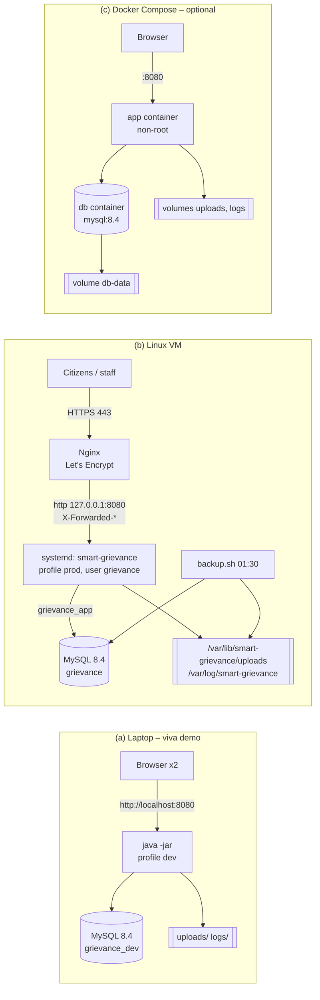

# 14 — Build & Deployment

| | |
|---|---|
| **Status** | Draft |
| **Depends on** | 00 Plan (D1–D106), 03 Requirements §3, 07 Architecture, 08 Database (O4, O5), 09 Contracts (K12), 10 UI (U9), 11 Security (K-S4, K-S5, K-S9), 12 Validation (B-1…B-3), 13 Test Spec + 13a (B-1…B-8), Appendix A |

This is the last specification document. It says **how to turn the specs into a running system**: what to install, how the Maven project is laid out and built, every configuration value, how the database is created and backed up, how to run the app on a laptop, on a Linux server and (optionally) in Docker, how to operate it, how to release it, and in which order to build it (the milestone plan of §11, which is the students' roadmap).

Everything in this document was **tried out** in a throwaway project built from the files given here (§12). The files themselves are committed as drafts, so they can be copied instead of typed:

| Draft in the repository | Becomes (milestone M0) |
|---|---|
| `docs/build/pom.xml.draft` | `app/pom.xml` |
| `docs/build/application*.properties.draft`, `logback-spring.xml.draft`, `spring.factories.draft` | `app/src/main/resources/…`, `app/src/test/resources/…` (§5) |
| `docs/build/AppProperties.java.draft`, `ProdEnvironmentCheck.java.draft` | `app/src/main/java/com/smartgrievance/config/` |
| `docs/build/gitignore.draft`, `gitattributes.draft` | `/.gitignore`, `/.gitattributes` |
| `docs/specs/common-passwords.txt.draft` | `app/src/main/resources/com/smartgrievance/common/validation/common-passwords.txt` |
| `docs/e2e/package.json.draft`, `playwright.config.ts.draft` | `app/e2e/` |
| `docs/ci/build.yml.draft`, `dependabot.yml.draft` | `.github/workflows/build.yml`, `.github/dependabot.yml` |
| `docs/ci/test-report.py` | stays (used by CI and before the viva) |
| `docs/deploy/…` (SQL, scripts, systemd, Nginx, Docker) | stays; copied to the server when deploying |

---

## 1. Scope and decisions

### 1.1 Open items resolved here

| Item | Raised in | Decision | Where |
|---|---|---|---|
| O4 | doc 08 §10 | `HousekeepingJob` runs daily at **02:30 IST** (`app.housekeeping.cron=0 30 2 * * *`, zone `app.timezone`); tests switch it off with `-`; retention days and batch size are settings too (D115) | §5.5, §9.4 |
| O5 | doc 08 §10 | JDBC URL `…?connectionTimeZone=%2B05:30&forceConnectionTimeZoneToSession=true&characterEncoding=UTF-8` (**+05:30 instead of `Asia/Kolkata`**: a MySQL without time-zone tables refuses the zone name, verified, D111); databases created with `utf8mb4` / `utf8mb4_0900_ai_ci`; two demo photos in `classpath:seed/files/` (D127) | §6.1, §6.2, §6.6 |
| K12 | doc 09 §13 | `spring.servlet.multipart.max-file-size=26MB`, `max-request-size=26MB`, `server.tomcat.max-swallow-size=64MB`, `app.export.max-rows=5000` | §5.1 |
| U9 | doc 10 §12 | **WebJars for all three libraries**, no copies in `static/vendor/`: Bootstrap 5.3.8, Bootstrap Icons **1.13.2**, Chart.js **4.6.1** (versions checked on Maven Central, D109, D110) | §4.1 |
| K-S4 | doc 11 §14 | All properties in §5 (cookie flags with `COOKIE_SECURE`, `app.security.*`, `app.complaint.max-per-day`, swallow size, `spring.web.error.*`); forwarded headers **only behind a trusted proxy** (`FORWARD_HEADERS_STRATEGY=native`, trusted proxies 127.0.0.1/::1, D121); HTTPS with Nginx + Let's Encrypt (§8.2); `security.log` kept 366 days (D116); `uploads/` mode 750 owned by the service user (D123) | §5, §8.2, §9.2, §9.5 |
| K-S5 | doc 11 §14 | Dependabot (Maven, npm, Actions) + an optional `-Psecurity-scan` profile with OWASP Dependency-Check 13.0.0 before each release (D118) | §4.3, §10.5 |
| K-S9 | doc 11 §14 | Officer and admin guide and DPDP incident checklist | Appendices 14-A, 14-B |
| B-1 (12) | doc 12 §12 | `spring.web.error.*`, `spring.messages.*`, `spring.mvc.problemdetails.enabled=false`; no `server.error.*` | §5.1 |
| B-2 (12) | doc 12 §12 | Log pattern with `%X{ref:-}`, application log 90 days; support guide step "find a reference id" | §5.8, §9.6 |
| B-3 (12) | doc 12 §12 | `messages.properties` and `common-passwords.txt` copied **unchanged**; CI `diff`s the copies against the docs (D128) | §3.3 |
| B-1 (13) | doc 13 §9 | surefire (`excludedGroups=mysql,e2e`, parallel off), failsafe in `-Pmysql`, JaCoCo 0.8.14 with the §6.1 rules, `-Pe2e` with `spring-boot:start`/`stop` and `exec-maven-plugin` (D119, D120) | §4 |
| B-2 (13) | doc 13 §9 | `application-test.properties` and `application-e2e.properties` as in doc 13 §2.2, plus `application-mysqltest.properties` | §5.4 |
| B-3 (13) | doc 13 §9 | `dev`: `app.complaint.auto-close-cron=0 */5 * * * *` (D106) | §5.2 |
| B-4 (13) | doc 13 §9 | `grievance_test` database and user (`ALL` on that database only) | §6.1 |
| B-5 (13) | doc 13 §9 | `app/e2e/package.json` with exact versions (Playwright 1.65.1, axe 4.14.0), `playwright.config.ts` (projects `js-on`/`js-off` × 360/1280 px) | §3.5 |
| B-6 (13) | doc 13 §9 | CI workflow kept as `docs/ci/build.yml.draft`; **moved to `.github/workflows/` in M0** (there is no app to build yet) | §10.4, §11 |
| B-7 (13) | doc 13 §9 | Test resources copied from the docs (table §3.3) | §3.3 |
| B-8 (13) | doc 13 §9 | Timing run (TC-NF-01) and the printed test report (`docs/ci/test-report.py`) are M9 tasks | §11.5 |
| — | doc 07 §6 | "final values come in doc 14": §5 | §5 |

### 1.2 New decisions (D107–D128)

The full rows are in the decisions log of doc 00 §6.

| ID | Decision (short) |
|---|---|
| D107 | Only **JDK 25** (+ MySQL) must be installed; Maven comes through the committed Maven Wrapper 3.3.4 → Maven **3.9.16** |
| D108 | `com.smartgrievance:smart-grievance:0.1.0-SNAPSHOT`, final JAR always `target/smart-grievance.jar`, version in `build-info.properties` and the Git tag |
| D109 | Exact versions for everything Spring Boot does not manage (table §4.1), all checked on Maven Central / npm on 2026-11-23 |
| D110 | U9: Bootstrap Icons and Chart.js as WebJars (`org.webjars.npm`), served under `/webjars/**`; `static/vendor/` is not used |
| D111 | MySQL URL with `connectionTimeZone=%2B05:30` (works without time-zone tables) and `characterEncoding=UTF-8` |
| D112 | `ProdEnvironmentCheck` (an `EnvironmentPostProcessor`) stops a `prod` start with a plain message when `DB_URL`, `DB_USERNAME` or `DB_PASSWORD` is missing, or when `dev` and `prod` are combined, before any bean exists |
| D113 | Spring Boot **Actuator added, only `/actuator/health`**, no details, allowed from localhost or for an ADMIN (overrides doc 11 §9.3 "not a dependency") |
| D114 | Least-privilege database accounts: `grievance_owner` for Flyway only (`spring.flyway.user`), `grievance_app` with `SELECT, INSERT, UPDATE, DELETE`, `grievance_backup` read-only |
| D115 | O4: housekeeping daily 02:30 IST; every `@Scheduled` cron uses `zone = "${app.timezone}"` |
| D116 | Logging: IST time stamps whatever the server zone, `app.log` 90 days (20 MB parts, 2 GB cap), `security.log` 366 days (1 GB cap), console threshold WARN in `prod`, console only in tests |
| D117 | Static files and WebJars are sent with `Cache-Control: no-cache` (always revalidated, 304), so an upgrade is never hidden by a stale cache |
| D118 | Supply chain: Dependabot weekly + `-Psecurity-scan` (OWASP Dependency-Check, fail at CVSS ≥ 7) before each release |
| D119 | Test wiring: surefire with `-Duser.timezone=UTC` (proves nothing depends on the JVM zone), Spring profile `mysqltest` with `TEST_MYSQL_*`, `-Pe2e` with `testClasspath=all` (the old `useTestClasspath` did not put test resources on the classpath in Boot 4.2, verified) |
| D120 | Coverage gate in two executions: `check-core` always, `check-later` switched on (`coverage.later.skip=false`) after milestone M7 |
| D121 | HTTPS through Nginx + Let's Encrypt; the app listens on 127.0.0.1 and trusts `X-Forwarded-*` from 127.0.0.1/::1 only |
| D122 | Main deployment = executable JAR + systemd on one Linux VM; Docker Compose is optional |
| D123 | Service user `grievance`, `UMask=0027`, `uploads/` and `logs/` mode 750, systemd sandboxing (`ProtectSystem=strict`) |
| D124 | Semantic versioning from 0.1.0, tags `vX.Y.Z`, `CHANGELOG.md` (Keep a Changelog), the viva build is `v1.0.0` |
| D125 | Ten milestones M0–M9; every one of the 446 test cases of 13a, every FR and every route belongs to exactly one milestone (checked by `check-14-milestones.py`) |
| D126 | JVM: `-Xms128m`/`256m`, `-Xmx512m`, `-XX:+ExitOnOutOfMemoryError`; port 8080, context path `/`; `-Duser.timezone` is not needed |
| D127 | O5: two small demo photos for GRV-…-000003 in `src/main/resources/seed/files/`, copied by the seeder with the BR-24 naming |
| D128 | Spec copies (`db/migration`, `messages.properties`, `common-passwords.txt`) are byte-identical to the docs; a CI step `diff`s them |

---

## 2. Prerequisites (student laptop)

### 2.1 What to install

| Tool | Version | Needed for | Check |
|---|---|---|---|
| **JDK** | **25** (Eclipse Temurin 25 or OpenJDK 25) | everything | `java -version` → `openjdk version "25.…"` and `javac -version` → `javac 25…` |
| Maven | nothing to install: `./mvnw` downloads Maven **3.9.16** on first use (D107). A system Maven ≥ 3.9 also works. | build | `./mvnw -v` → `Apache Maven 3.9.16 … Java version: 25…` |
| **MySQL** | **8.4 LTS** Community Server + client (8.0 also works: every SQL statement was verified on 8.0.46 **and** 8.4.13, §12) | running the app (`dev`, `prod`), `-Pmysql` | `mysql --version` → `… 8.4.x` |
| Git | 2.40 or newer | source control | `git --version` |
| Node.js | **26 LTS** (≥ 22.12; only for the browser tests `-Pe2e`) | `-Pe2e` | `node -v` → `v26.…` |
| IDE | IntelliJ IDEA (Community is enough) or Eclipse IDE for Java Developers, a release that lists Java 25 support (2025-09 or newer) | editing, debugging | Help → About |
| Browser | current Chrome, Edge or Firefox | using the app | — |

Hardware: 4 GB RAM is enough to run MySQL, the app (512 MB heap) and a browser; 8 GB is comfortable with an IDE. About 3 GB of free disk for the JDK, MySQL, the Maven cache (~400 MB) and Playwright's Chromium (~300 MB).

Not needed: Docker, Python, Node (unless `-Pe2e`), an internet connection after the first build (WebJars are inside the JAR, ADR-12).

### 2.2 Windows 10 / 11

Run these in **Windows Terminal (PowerShell)**. `winget` is included in Windows 10 (21H2+) and 11.

1. **JDK 25**: `winget install EclipseAdoptium.Temurin.25.JDK` (if winget does not find it, download the `.msi` from adoptium.net and tick **"Set JAVA_HOME variable"** and **"Add to PATH"**). Close and reopen the terminal, then `java -version` and `echo $env:JAVA_HOME`.
2. **Git**: `winget install Git.Git`. Then once: `git config --global core.autocrlf true` (the repository's `.gitattributes` keeps `mvnw` with LF endings, §3.4).
3. **MySQL 8.4 LTS**: download "MySQL Community Server 8.4 LTS – Windows (x86, 64-bit), MSI Installer" from dev.mysql.com. Choose *Development Computer*, keep port **3306**, set a root password you will remember, keep "Start the MySQL Server at System Startup" (service name `MySQL84`). Add `C:\Program Files\MySQL\MySQL Server 8.4\bin` to the user `Path` so `mysql` and `mysqldump` work in the terminal. Check: `mysql -u root -p -e "SELECT VERSION();"`.
4. **Node.js (only for `-Pe2e`)**: `winget install OpenJS.NodeJS.LTS`, then `node -v`.
5. **IDE**: `winget install JetBrains.IntelliJIDEA.Community` (or Eclipse from eclipse.org).
6. Build commands use `mvnw.cmd` instead of `./mvnw` (`.\mvnw.cmd clean verify`).

### 2.3 Ubuntu 24.04 LTS (and similar)

```bash
sudo apt update
sudo apt install -y openjdk-25-jdk-headless git        # JDK 25.0.5 in noble-updates (verified)
java -version                                          # if several JDKs: sudo update-alternatives --config java
echo 'export JAVA_HOME=/usr/lib/jvm/java-25-openjdk-amd64' >> ~/.bashrc

# MySQL: Ubuntu 24.04 ships 8.0 (8.0.46, fine for development). For 8.4 LTS add the MySQL APT
# repository first (dev.mysql.com/downloads/repo/apt/, choose "mysql-8.4-lts"), then:
sudo apt install -y mysql-server
sudo systemctl enable --now mysql
sudo mysql -e "SELECT VERSION();"                      # root uses socket authentication on Ubuntu

# Node.js only for -Pe2e (nvm keeps it in your home folder)
curl -o- https://raw.githubusercontent.com/nvm-sh/nvm/v0.40.3/install.sh | bash
nvm install 26 && node -v
```

On Ubuntu `sudo mysql` logs in as root without a password; the SQL scripts of §6.1 are run with `sudo mysql < file.sql`.

### 2.4 Version check (copy and run)

```bash
java -version 2>&1 | head -1     # openjdk version "25..."
javac -version                   # javac 25...
git --version                    # git version 2.4x...
mysql --version                  # mysql  Ver 8.4.x (or 8.0.x)
node -v                          # v26.x (only for -Pe2e)
cd app && ./mvnw -v              # Apache Maven 3.9.16 ... Java version: 25...
```

### 2.5 IDE settings

| Setting | IntelliJ IDEA | Eclipse |
|---|---|---|
| Open the project | *File → Open* → `app/pom.xml` → *Open as Project* | *File → Import → Maven → Existing Maven Projects* → `app/` |
| JDK | *Project Structure → SDK* = 25, language level 25 | *Preferences → Java → Installed JREs* = 25, compiler compliance 25 |
| Maven | *Settings → Build Tools → Maven → Maven home path* = "Use Maven wrapper" | default embedded Maven is fine |
| File encoding | *Settings → Editor → File Encodings*: everything UTF-8, **"Transparent native-to-ascii conversion" off** (it would rewrite the ’ characters in `messages.properties`) | *Preferences → General → Workspace → Text file encoding* = UTF-8; *Content Types → Java Properties File* = UTF-8 |
| Run the app | run `SmartGrievanceApplication` (the `dev` profile is the default, `spring.profiles.default=dev`) | *Run As → Java Application* |
| Tests | right-click `src/test/java` → *Run All Tests* (tags `mysql` are excluded only by Maven; in the IDE do not run `*MySqlIT` without MySQL) | *Run As → JUnit Test* |
| DevTools | *Settings → Build → Compiler → Build project automatically* + *Advanced Settings → Allow auto-make to start even if developed application is currently running* | *Project → Build Automatically* |

---

## 3. Repository layout and project skeleton

### 3.1 Target layout (after M0)

```text
arya_project/
├── .github/
│   ├── workflows/build.yml          ← docs/ci/build.yml.draft (M0)
│   └── dependabot.yml               ← docs/ci/dependabot.yml.draft (M0)
├── .gitattributes  .gitignore       ← docs/build/*.draft (M0)
├── README.md                        quick start: prerequisites, ./mvnw verify, run, demo logins
├── CHANGELOG.md                     §10.2
├── docs/
│   ├── Synopsis.pdf
│   ├── specs/                       00 … 14, 13a, appendix A, messages.properties.draft,
│   │                                common-passwords.txt.draft, verify/ (check scripts)
│   ├── db/                          migration/ (V1, V2 — the specification copy), verify/
│   ├── build/                       pom.xml, properties, logback, two config classes (drafts)
│   ├── deploy/                      db/ (SQL), scripts/ (run, backup, reset), systemd/, nginx/, docker/
│   ├── ci/                          build.yml.draft, dependabot.yml.draft, test-report.py
│   ├── e2e/                         package.json.draft, playwright.config.ts.draft
│   └── ui-mockups/
└── app/                             the Spring Boot project (doc 07)
    ├── mvnw  mvnw.cmd  .mvn/wrapper/maven-wrapper.properties
    ├── pom.xml
    ├── src/main/java/com/smartgrievance/…            packages of doc 07 §3
    ├── src/main/resources/
    │   ├── application.properties  application-dev.properties  application-prod.properties
    │   ├── logback-spring.xml  messages.properties
    │   ├── META-INF/spring.factories                  registers ProdEnvironmentCheck (§5.7)
    │   ├── db/migration/V1__schema.sql  V2__reference_data.sql
    │   ├── com/smartgrievance/common/validation/common-passwords.txt
    │   ├── seed/files/garbage-magarpatta-1.jpg  garbage-magarpatta-2.jpg   (§6.6)
    │   ├── templates/…                                doc 07 §7, doc 10 §2
    │   └── static/css/app.css  js/app.js  js/early.js  images/logo.svg  favicon.ico
    ├── src/test/java/com/smartgrievance/…            doc 13 §2.8
    ├── src/test/resources/
    │   ├── application-test.properties  application-e2e.properties  application-mysqltest.properties
    │   ├── routes.csv  transition-matrix.csv  sql/q-fixture.sql  perf/load-10k.sql
    │   └── files/…                                    doc 13 §2.5
    └── e2e/  package.json  package-lock.json  playwright.config.ts  tests/*.spec.ts
```

Folders created at run time and never committed: `app/target/`, `app/logs/`, `app/uploads/`, `app/e2e/node_modules/`, `app/e2e/playwright-report/`.

### 3.2 Creating the skeleton (milestone M0, step by step)

1. Create a branch `m0-skeleton` from the main branch.
2. Generate the project with **Spring Initializr** (start.spring.io or the IDE wizard) using exactly these settings, and unzip it as `app/`:

   | Field | Value |
   |---|---|
   | Project / Language | Maven / Java |
   | Spring Boot | 4.2.0 |
   | Group / Artifact / Name | `com.smartgrievance` / `smart-grievance` / `smart-grievance` |
   | Package name | `com.smartgrievance` |
   | Packaging / Java | Jar / 25 |
   | Configuration | Properties |
   | Dependencies | Spring Web, Thymeleaf, Spring Security, Validation, JDBC API, Flyway Migration, MySQL Driver, Spring Boot Actuator, Spring Boot DevTools |

3. **Replace** the generated `pom.xml` with §4.4 (`docs/build/pom.xml.draft`): Initializr does not add the WebJars, the Thymeleaf extras, the test tools, JaCoCo or the profiles.
4. Pin the wrapper: `cd app && mvn -N wrapper:wrapper -Dmaven=3.9.16` (or edit `distributionUrl` in `.mvn/wrapper/maven-wrapper.properties` to `…/apache-maven/3.9.16/apache-maven-3.9.16-bin.zip`). Check with `./mvnw -v`.
5. Rename the main class to `SmartGrievanceApplication` and add `@ConfigurationPropertiesScan`.
6. Copy the files of §3.3 and the configuration of §5 (`docs/build/*.draft` → `app/…`, dropping `.draft`). Delete the generated `application.properties` first.
7. Add `config.AppProperties` (§5.5), `config.ProdEnvironmentCheck` and `META-INF/spring.factories` (§5.7).
8. Add the test-support base classes and the M0 tests (§11, M0).
9. Run `./mvnw clean verify` → `BUILD SUCCESS`, then `./mvnw spring-boot:run` against `grievance_dev` (§6.1) and open `http://localhost:8080/`.
10. Move `docs/ci/build.yml.draft` → `.github/workflows/build.yml` and `docs/ci/dependabot.yml.draft` → `.github/dependabot.yml`; copy `docs/build/gitignore.draft` → `.gitignore`, `gitattributes.draft` → `.gitattributes`.
11. Commit ("M0: project skeleton, build and CI"), push, open a pull request and check that the workflow is green.

### 3.3 Files copied from `docs/` into the app

Copies are **byte-for-byte** (UTF-8 without BOM). The docs stay the specification: a change is made in the doc first and copied again. CI fails if a copy differs (D128).

| From (docs) | To (app) | Note | Checked by |
|---|---|---|---|
| `docs/db/migration/V1__schema.sql`, `V2__reference_data.sql` | `src/main/resources/db/migration/` | Future `V3__…` files are added to **both** folders (doc 08 §4.4) | CI `diff -r` |
| `docs/specs/messages.properties.draft` | `src/main/resources/messages.properties` | 182 keys; `check-12-messages.py` keeps checking the draft | CI `diff` |
| `docs/specs/common-passwords.txt.draft` | `src/main/resources/com/smartgrievance/common/validation/common-passwords.txt` | read by `StrongPasswordValidator` with `getResourceAsStream("common-passwords.txt")`; `#` lines ignored | CI `diff` |
| `docs/db/verify/sample-data.sql` | `src/test/resources/sql/q-fixture.sql` | unchanged (doc 13 §2.4) | TC-Q-01…31 |
| `docs/db/verify/load-10k.sql` | `src/test/resources/perf/load-10k.sql` | ids looked up by name (doc 13 B-7) | TC-NF-01 |
| 13a §A.2 expected matrix | `src/test/resources/transition-matrix.csv` | 15 actions × 10 statuses × relations, 58 allowed cells | TC-SM-30, `check-13-traceability.py` |
| doc 09 §3 route tables | `src/test/resources/routes.csv` | 99 rows: ID, method, path template, role prefix, sample variables, multipart | TC-RT-G1…G4 |
| `docs/ui-mockups/css/app.css` | `src/main/resources/static/css/app.css` | starting point; afterwards the app copy is the master and the mock-up copy is updated by hand when colours change (`check-10-contrast.py` reads the mock-up copy) | TC-NF-05 |
| doc 13 §2.5 file list | `src/test/resources/files/` | small test files made by the students (1×1 PNG, minimal PDF, renamed files) | uploads tests |
| `docs/e2e/*.draft` | `app/e2e/` | then `npm install` once to create `package-lock.json` (commit it) | `-Pe2e` |

### 3.4 `.gitignore` and `.gitattributes`

`docs/build/gitignore.draft` → `/.gitignore`:

```gitignore
# Repository root .gitignore (doc 14 §3.4)
# build output
app/target/
app/e2e/node_modules/
app/e2e/playwright-report/
app/e2e/test-results/
# runtime data written next to the JAR (never commit personal data or logs)
app/uploads/
app/logs/
uploads/
logs/
# secrets (doc 11 §9.1)
.env
*.env
!*.env.example
docs/deploy/docker/.env
# IDE and OS files
.idea/
*.iml
.vscode/
.settings/
.project
.classpath
.DS_Store
Thumbs.db
```

`docs/build/gitattributes.draft` → `/.gitattributes` (keeps `mvnw` runnable after a checkout on Windows):

```gitattributes
# Repository root .gitattributes (doc 14 §3.4): stable line endings on Windows and Linux
* text=auto
mvnw text eol=lf
*.sh text eol=lf
*.cmd text eol=crlf
*.bat text eol=crlf
*.jar binary
*.png binary
*.jpg binary
*.pdf binary
```

### 3.5 The browser-test folder `app/e2e/`

`docs/e2e/package.json.draft` (exact versions, no `^`; the `engines` minimum comes from `@axe-core/playwright`, which needs Node ≥ 22.12):

```json
{
  "name": "smart-grievance-e2e",
  "version": "0.1.0",
  "private": true,
  "description": "Browser tests for Smart Grievance (doc 13 §3.8, doc 14 §3.5). Run through ./mvnw verify -Pe2e.",
  "engines": {
    "node": ">=22.12"
  },
  "scripts": {
    "test": "playwright test",
    "report": "playwright show-report"
  },
  "devDependencies": {
    "@axe-core/playwright": "4.14.0",
    "@playwright/test": "1.65.1"
  }
}
```

`docs/e2e/playwright.config.ts.draft` (projects of doc 13 §3.8: `js-on`/`js-off` × 360/1280 px; `BASE_URL` comes from Maven; `CHROMIUM_PATH` lets an offline lab use an installed Chromium):

```ts
import { defineConfig, devices } from '@playwright/test';

// doc 13 §3.8 (D99): projects js-on / js-off at 360 and 1280 px; BASE_URL comes from the Maven e2e profile.
const baseURL = process.env.BASE_URL ?? 'http://localhost:8090';
// optional: use an already installed Chromium (offline labs, CI images)
const executablePath = process.env.CHROMIUM_PATH || undefined;

const viewports = [
  { name: '360', viewport: { width: 360, height: 800 } },
  { name: '1280', viewport: { width: 1280, height: 800 } },
];

export default defineConfig({
  testDir: './tests',
  fullyParallel: false,
  workers: 1,
  retries: process.env.CI ? 1 : 0,
  reporter: [['list'], ['html', { open: 'never', outputFolder: 'playwright-report' }]],
  use: { baseURL, trace: 'off', screenshot: 'only-on-failure', launchOptions: { executablePath } },
  projects: viewports.flatMap((v) => [
    { name: `js-on-${v.name}`, use: { ...devices['Desktop Chrome'], viewport: v.viewport, javaScriptEnabled: true } },
    { name: `js-off-${v.name}`, use: { ...devices['Desktop Chrome'], viewport: v.viewport, javaScriptEnabled: false } },
  ]),
});
```

Once per machine: `cd app/e2e && npm ci && npx playwright install chromium` (about 300 MB). Labs without internet skip `-Pe2e`; CI runs it (doc 13 B-5).

---

## 4. Maven build (`pom.xml`)

### 4.1 Dependencies

Spring Boot's dependency management (the parent BOM) pins every version it knows; we never override those. The versions marked **pinned** are not managed by Boot and were checked on Maven Central on 2026-11-23 (D109).

| Dependency | Scope | Version | Why |
|---|---|---|---|
| `spring-boot-starter-webmvc` | compile | managed (Spring 7.1.0, Tomcat 11.0.27) | MVC + embedded Tomcat (doc 07 §2) |
| `spring-boot-starter-thymeleaf` | compile | managed (Thymeleaf 3.1.7) | views |
| `spring-boot-starter-security` | compile | managed (Security 7.2.0) | doc 11 |
| `spring-boot-starter-validation` | compile | managed (Hibernate Validator 9.1.6) | doc 12, `@Validated AppProperties` |
| `thymeleaf-extras-springsecurity6` | compile | managed (3.1.7) | `sec:` attributes (no `…7` artifact exists) |
| `thymeleaf-layout-dialect` | compile | managed (4.0.1) | `layout:decorate` |
| `spring-boot-starter-jdbc` | compile | managed (HikariCP) | `JdbcClient` (D3) |
| `spring-boot-starter-flyway` + `flyway-mysql` | compile | managed (Flyway 12.11.0) | migrations (ADR-03) |
| `mysql-connector-j` | runtime | managed (26.10.0) | MySQL driver |
| `spring-boot-starter-actuator` | compile | managed | `/actuator/health` only (D113) |
| `org.webjars:bootstrap` | compile | **pinned 5.3.8** | CSS/JS (ADR-12) |
| `org.webjars.npm:bootstrap-icons` | compile | **pinned 1.13.2** (2026-10-09) | icon font, `/webjars/bootstrap-icons/font/bootstrap-icons.min.css` (U9, D110) |
| `org.webjars.npm:chart.js` | compile | **pinned 4.6.1** (2026-10-23) | FR-64, `/webjars/chart.js/dist/chart.umd.min.js` (U9, D110) |
| `webjars-locator-lite` | compile | managed (1.1.5) | version-free WebJar URLs |
| `spring-boot-devtools` | runtime, **optional** | managed | restart in `dev`; never in the JAR (checked, §12) |
| `spring-boot-starter-webmvc-test`, `-security-test`, `-jdbc-test` | test | managed (JUnit 6.1.3, AssertJ, Mockito) | doc 13 §2.1 |
| `com.h2database:h2` | test | managed (2.5.252) | tests and `-Pe2e` only, never in the JAR |
| `org.jsoup:jsoup` | test | **pinned 1.24.1** | HTML assertions (doc 13 §2.1) |

Templates link the libraries as `@{/webjars/bootstrap/css/bootstrap.min.css}`, `@{/webjars/bootstrap/js/bootstrap.bundle.min.js}`, `@{/webjars/bootstrap-icons/font/bootstrap-icons.min.css}` and `@{/webjars/chart.js/dist/chart.umd.min.js}` (the Bootstrap CSS, the icon CSS and Chart.js answered `200` in the verification, §12). The `/vendor/**` permit rule of doc 11 §4.2 stays harmless but unused.

### 4.2 Plugins

| Plugin | Version | Phase / goal | Configuration |
|---|---|---|---|
| `spring-boot-maven-plugin` | managed (4.2.0) | `repackage` (package), `build-info` | `finalName` = `smart-grievance` → `target/smart-grievance.jar`; `build-info` writes `META-INF/build-info.properties` (version and build time for the footer and the start-up log, D108) |
| `maven-surefire-plugin` | managed (3.6.1) | `test` | `excludedGroups=mysql,e2e`, excludes `**/*IT.java`, JUnit parallel execution **off** (shared H2, D95), `argLine` = JaCoCo agent + `-XX:+EnableDynamicAgentLoading` (Mockito on JDK 25) + **`-Duser.timezone=UTC`** (D119) |
| `jacoco-maven-plugin` | **pinned 0.8.14** | `prepare-agent`, `report` (test), `check` (verify) | two executions (D120): `check-core` = `TransitionRules` and `ComplaintAccessPolicy` 100 % line and branch, packages `workflow` and `access` 90 % / 85 %; `check-later` = services 80 % / 70 %, `common.*` 80 % / 70 %, bundle 75 % / 60 %, skipped while `coverage.later.skip=true`. Excluded: `SmartGrievanceApplication`, `config.*Properties*`, `seed.DevDataSeeder` (doc 13 §6.1) |
| `maven-failsafe-plugin` | managed (3.6.1) | `integration-test`, `verify` in `-Pmysql` | includes `**/*MySqlIT.java`, `groups=mysql` |
| `exec-maven-plugin` | **pinned 3.6.2** | `pre-integration-test` / `integration-test` in `-Pe2e` | `npm ci`, then `npx playwright test` with `BASE_URL` |
| `dependency-check-maven` | **pinned 13.0.0** | `verify` in `-Psecurity-scan` | `failBuildOnCVSS=7`, `NVD_API_KEY` from the environment, HTML + JSON report |

JaCoCo 0.8.16 also exists (2026-10-26); 0.8.14 stays because it is the version verified with JDK 25 in doc 13 and this document. Dependabot proposes the update (§10.5).

### 4.3 Profiles

| Command | Maven profile | What runs | Needs |
|---|---|---|---|
| `./mvnw clean verify` | (none) | compile, Unit/Repo/Flow/Web/HTTP/Scan tests on H2, JaCoCo report + gate, JAR | JDK 25 |
| `./mvnw verify -Pmysql` | `mysql` | the above + failsafe `*MySqlIT` with Spring profiles `test,mysqltest` | MySQL with `grievance_test` (§6.1) or `TEST_MYSQL_URL` / `_USER` / `_PASSWORD` |
| `./mvnw verify -Pe2e` | `e2e` | the above + `spring-boot:start` (profiles `dev,e2e`, H2 from the test classpath, port **8090**, JMX 9011) → `npm ci` → `npx playwright test` → `spring-boot:stop` | Node ≥ 22.12, Chromium (`npx playwright install chromium`) |
| `./mvnw verify -Psecurity-scan` | `security-scan` | the default build + OWASP Dependency-Check | internet, a free NVD API key in `NVD_API_KEY` (the first run downloads the NVD data and can take ten minutes or more) |
| `./mvnw verify -Pmysql,e2e` | both | everything (before the viva, §11.5) | all of the above |

Useful properties: `-Dcoverage.later.skip=false` (gate after M7), `-De2e.skip.npm.install=true` (CI installs once), `-De2e.port=8091` (if 8090 is taken), `-DskipTests` (only to build a JAR for a quick manual try; never for a release).

Two findings from the verification run changed the plan of doc 13 B-1:

- In Spring Boot 4.2 `useTestClasspath` of `spring-boot:start` is **deprecated** and, as configured in doc 13, the started app did **not** see `src/test/resources`: it ignored `application-e2e.properties` and connected to the MySQL `grievance_dev` database. The replacement **`<testClasspath>all</testClasspath>`** puts test classes, test resources and H2 on the classpath; the app then used `jdbc:h2:mem:e2e` and wrote its logs to `target/e2e-logs/` (verified).
- DevTools reads `spring.devtools.restart.enabled` only as a **system property**, so the profile passes `-Dspring.devtools.restart.enabled=false` in `jvmArguments` (with it in a properties file the app still ran in the `restartedMain` thread).

### 4.4 Complete `pom.xml`

`docs/build/pom.xml.draft` → `app/pom.xml`. Validated by `mvn verify`, `-Pmysql`, `-Pe2e` and `-Dcoverage.later.skip=false` (§12).

```xml
<?xml version="1.0" encoding="UTF-8"?>
<!--
  Smart Public Grievance and Complaint Management System
  Build specification: docs/specs/14-build-and-deployment.md §4 (D107-D128)
-->
<project xmlns="http://maven.apache.org/POM/4.0.0"
         xmlns:xsi="http://www.w3.org/2001/XMLSchema-instance"
         xsi:schemaLocation="http://maven.apache.org/POM/4.0.0 https://maven.apache.org/xsd/maven-4.0.0.xsd">
    <modelVersion>4.0.0</modelVersion>

    <parent>
        <groupId>org.springframework.boot</groupId>
        <artifactId>spring-boot-starter-parent</artifactId>
        <version>4.2.0</version>
        <relativePath/>
    </parent>

    <groupId>com.smartgrievance</groupId>
    <artifactId>smart-grievance</artifactId>
    <version>0.1.0-SNAPSHOT</version>
    <packaging>jar</packaging>
    <name>Smart Grievance</name>
    <description>Smart Public Grievance and Complaint Management System (MCA project)</description>

    <properties>
        <java.version>25</java.version>
        <project.build.sourceEncoding>UTF-8</project.build.sourceEncoding>
        <project.reporting.outputEncoding>UTF-8</project.reporting.outputEncoding>

        <!-- front-end libraries (WebJars, not managed by Spring Boot; ADR-12, D110) -->
        <bootstrap.version>5.3.8</bootstrap.version>
        <bootstrap-icons.version>1.13.2</bootstrap-icons.version>
        <chartjs.version>4.6.1</chartjs.version>

        <!-- test and build tools not managed by Spring Boot (doc 13 §2.1) -->
        <jsoup.version>1.24.1</jsoup.version>
        <jacoco.version>0.8.14</jacoco.version>
        <exec-maven-plugin.version>3.6.2</exec-maven-plugin.version>
        <dependency-check.version>13.0.0</dependency-check.version>

        <!-- coverage gate (doc 13 §6.1, D102): "later" rules switch on after milestone M7 (doc 14 §11) -->
        <coverage.later.skip>true</coverage.later.skip>

        <!-- e2e profile (doc 13 §3.8, D99) -->
        <e2e.port>8090</e2e.port>
        <e2e.jmx.port>9011</e2e.jmx.port>
        <e2e.skip.npm.install>false</e2e.skip.npm.install>
    </properties>

    <dependencies>
        <!-- web, views, security -->
        <dependency>
            <groupId>org.springframework.boot</groupId>
            <artifactId>spring-boot-starter-webmvc</artifactId>
        </dependency>
        <dependency>
            <groupId>org.springframework.boot</groupId>
            <artifactId>spring-boot-starter-thymeleaf</artifactId>
        </dependency>
        <dependency>
            <groupId>org.springframework.boot</groupId>
            <artifactId>spring-boot-starter-security</artifactId>
        </dependency>
        <dependency>
            <groupId>org.springframework.boot</groupId>
            <artifactId>spring-boot-starter-validation</artifactId>
        </dependency>
        <dependency>
            <groupId>org.thymeleaf.extras</groupId>
            <artifactId>thymeleaf-extras-springsecurity6</artifactId>
        </dependency>
        <dependency>
            <groupId>nz.net.ultraq.thymeleaf</groupId>
            <artifactId>thymeleaf-layout-dialect</artifactId>
        </dependency>

        <!-- data access -->
        <dependency>
            <groupId>org.springframework.boot</groupId>
            <artifactId>spring-boot-starter-jdbc</artifactId>
        </dependency>
        <dependency>
            <groupId>org.springframework.boot</groupId>
            <artifactId>spring-boot-starter-flyway</artifactId>
        </dependency>
        <dependency>
            <groupId>org.flywaydb</groupId>
            <artifactId>flyway-mysql</artifactId>
        </dependency>
        <dependency>
            <groupId>com.mysql</groupId>
            <artifactId>mysql-connector-j</artifactId>
            <scope>runtime</scope>
        </dependency>

        <!-- health check: only /actuator/health, localhost or ADMIN (D113) -->
        <dependency>
            <groupId>org.springframework.boot</groupId>
            <artifactId>spring-boot-starter-actuator</artifactId>
        </dependency>

        <!-- front-end libraries served from the JAR (no CDN, ADR-12) -->
        <dependency>
            <groupId>org.webjars</groupId>
            <artifactId>bootstrap</artifactId>
            <version>${bootstrap.version}</version>
        </dependency>
        <dependency>
            <groupId>org.webjars.npm</groupId>
            <artifactId>bootstrap-icons</artifactId>
            <version>${bootstrap-icons.version}</version>
        </dependency>
        <dependency>
            <groupId>org.webjars.npm</groupId>
            <artifactId>chart.js</artifactId>
            <version>${chartjs.version}</version>
        </dependency>
        <dependency>
            <groupId>org.webjars</groupId>
            <artifactId>webjars-locator-lite</artifactId>
        </dependency>

        <!-- developer convenience: never packaged into the JAR -->
        <dependency>
            <groupId>org.springframework.boot</groupId>
            <artifactId>spring-boot-devtools</artifactId>
            <scope>runtime</scope>
            <optional>true</optional>
        </dependency>

        <!-- tests (doc 13 §2.1) -->
        <dependency>
            <groupId>org.springframework.boot</groupId>
            <artifactId>spring-boot-starter-webmvc-test</artifactId>
            <scope>test</scope>
        </dependency>
        <dependency>
            <groupId>org.springframework.boot</groupId>
            <artifactId>spring-boot-starter-security-test</artifactId>
            <scope>test</scope>
        </dependency>
        <dependency>
            <groupId>org.springframework.boot</groupId>
            <artifactId>spring-boot-starter-jdbc-test</artifactId>
            <scope>test</scope>
        </dependency>
        <dependency>
            <groupId>com.h2database</groupId>
            <artifactId>h2</artifactId>
            <scope>test</scope>
        </dependency>
        <dependency>
            <groupId>org.jsoup</groupId>
            <artifactId>jsoup</artifactId>
            <version>${jsoup.version}</version>
            <scope>test</scope>
        </dependency>
    </dependencies>

    <build>
        <!-- final artifact: target/smart-grievance.jar (doc 07 §2.1) -->
        <finalName>smart-grievance</finalName>

        <plugins>
            <plugin>
                <groupId>org.springframework.boot</groupId>
                <artifactId>spring-boot-maven-plugin</artifactId>
                <executions>
                    <execution>
                        <!-- writes META-INF/build-info.properties (version shown in the footer and the startup log) -->
                        <id>build-info</id>
                        <goals>
                            <goal>build-info</goal>
                        </goals>
                    </execution>
                </executions>
            </plugin>

            <!-- unit, repo, flow, web, HTTP and scan tests: everything except MySQL and browser tests -->
            <plugin>
                <groupId>org.apache.maven.plugins</groupId>
                <artifactId>maven-surefire-plugin</artifactId>
                <configuration>
                    <excludedGroups>mysql,e2e</excludedGroups>
                    <excludes>
                        <exclude>**/*IT.java</exclude>
                    </excludes>
                    <!-- @{argLine} = JaCoCo agent; UTC proves that nothing depends on the JVM time zone (D18, D119) -->
                    <argLine>@{argLine} -XX:+EnableDynamicAgentLoading -Xshare:off -Duser.timezone=UTC -Dfile.encoding=UTF-8</argLine>
                    <properties>
                        <configurationParameters>
                            junit.jupiter.execution.parallel.enabled=false
                        </configurationParameters>
                    </properties>
                    <trimStackTrace>false</trimStackTrace>
                </configuration>
            </plugin>

            <!-- coverage: agent for surefire/failsafe, HTML report, gate (doc 13 §6.1) -->
            <plugin>
                <groupId>org.jacoco</groupId>
                <artifactId>jacoco-maven-plugin</artifactId>
                <version>${jacoco.version}</version>
                <configuration>
                    <excludes>
                        <exclude>com/smartgrievance/SmartGrievanceApplication*</exclude>
                        <exclude>com/smartgrievance/config/*Properties*</exclude>
                        <exclude>com/smartgrievance/seed/DevDataSeeder*</exclude>
                    </excludes>
                </configuration>
                <executions>
                    <execution>
                        <id>prepare-agent</id>
                        <goals>
                            <goal>prepare-agent</goal>
                        </goals>
                    </execution>
                    <execution>
                        <id>report</id>
                        <phase>test</phase>
                        <goals>
                            <goal>report</goal>
                        </goals>
                    </execution>
                    <execution>
                        <!-- enforced from the first commit of the module -->
                        <id>check-core</id>
                        <goals>
                            <goal>check</goal>
                        </goals>
                        <configuration>
                            <haltOnFailure>true</haltOnFailure>
                            <rules>
                                <rule>
                                    <element>CLASS</element>
                                    <includes>
                                        <include>com.smartgrievance.workflow.TransitionRules</include>
                                        <include>com.smartgrievance.access.ComplaintAccessPolicy</include>
                                    </includes>
                                    <limits>
                                        <limit><counter>LINE</counter><value>COVEREDRATIO</value><minimum>1.00</minimum></limit>
                                        <limit><counter>BRANCH</counter><value>COVEREDRATIO</value><minimum>1.00</minimum></limit>
                                    </limits>
                                </rule>
                                <rule>
                                    <element>PACKAGE</element>
                                    <includes>
                                        <include>com.smartgrievance.workflow</include>
                                        <include>com.smartgrievance.access</include>
                                    </includes>
                                    <limits>
                                        <limit><counter>LINE</counter><value>COVEREDRATIO</value><minimum>0.90</minimum></limit>
                                        <limit><counter>BRANCH</counter><value>COVEREDRATIO</value><minimum>0.85</minimum></limit>
                                    </limits>
                                </rule>
                            </rules>
                        </configuration>
                    </execution>
                    <execution>
                        <!-- report only until M7; set coverage.later.skip=false from M8 on -->
                        <id>check-later</id>
                        <goals>
                            <goal>check</goal>
                        </goals>
                        <configuration>
                            <skip>${coverage.later.skip}</skip>
                            <haltOnFailure>true</haltOnFailure>
                            <rules>
                                <rule>
                                    <element>CLASS</element>
                                    <includes>
                                        <include>com.smartgrievance.*.*Service</include>
                                        <include>com.smartgrievance.*.*Generator</include>
                                        <include>com.smartgrievance.*.*Job</include>
                                        <include>com.smartgrievance.attachment.FileTypeDetector</include>
                                    </includes>
                                    <limits>
                                        <limit><counter>LINE</counter><value>COVEREDRATIO</value><minimum>0.80</minimum></limit>
                                        <limit><counter>BRANCH</counter><value>COVEREDRATIO</value><minimum>0.70</minimum></limit>
                                    </limits>
                                </rule>
                                <rule>
                                    <element>PACKAGE</element>
                                    <includes>
                                        <include>com.smartgrievance.common.*</include>
                                    </includes>
                                    <limits>
                                        <limit><counter>LINE</counter><value>COVEREDRATIO</value><minimum>0.80</minimum></limit>
                                        <limit><counter>BRANCH</counter><value>COVEREDRATIO</value><minimum>0.70</minimum></limit>
                                    </limits>
                                </rule>
                                <rule>
                                    <element>BUNDLE</element>
                                    <limits>
                                        <limit><counter>LINE</counter><value>COVEREDRATIO</value><minimum>0.75</minimum></limit>
                                        <limit><counter>BRANCH</counter><value>COVEREDRATIO</value><minimum>0.60</minimum></limit>
                                    </limits>
                                </rule>
                            </rules>
                        </configuration>
                    </execution>
                </executions>
            </plugin>
        </plugins>
    </build>

    <profiles>
        <!-- ./mvnw verify -Pmysql : *MySqlIT against MySQL 8.4 (doc 13 §1.3, D92, D105) -->
        <profile>
            <id>mysql</id>
            <build>
                <plugins>
                    <plugin>
                        <groupId>org.apache.maven.plugins</groupId>
                        <artifactId>maven-failsafe-plugin</artifactId>
                        <configuration>
                            <includes>
                                <include>**/*MySqlIT.java</include>
                            </includes>
                            <groups>mysql</groups>
                            <argLine>@{argLine} -XX:+EnableDynamicAgentLoading -Xshare:off -Duser.timezone=UTC -Dfile.encoding=UTF-8</argLine>
                            <!-- TEST_MYSQL_URL / _USER / _PASSWORD are read by application-mysqltest.properties -->
                            <trimStackTrace>false</trimStackTrace>
                        </configuration>
                        <executions>
                            <execution>
                                <goals>
                                    <goal>integration-test</goal>
                                    <goal>verify</goal>
                                </goals>
                            </execution>
                        </executions>
                    </plugin>
                </plugins>
            </build>
        </profile>

        <!-- ./mvnw verify -Pe2e : start the app (dev,e2e on H2), run Playwright, stop (doc 13 §3.8, D99) -->
        <profile>
            <id>e2e</id>
            <build>
                <plugins>
                    <plugin>
                        <groupId>org.springframework.boot</groupId>
                        <artifactId>spring-boot-maven-plugin</artifactId>
                        <executions>
                            <execution>
                                <id>e2e-start</id>
                                <phase>pre-integration-test</phase>
                                <goals>
                                    <goal>start</goal>
                                </goals>
                                <configuration>
                                    <!-- all = test classes + test resources (application-e2e.properties) + H2; useTestClasspath is deprecated in Boot 4.2 -->
                                    <testClasspath>all</testClasspath>
                                    <profiles>
                                        <profile>dev</profile>
                                        <profile>e2e</profile>
                                    </profiles>
                                    <arguments>
                                        <argument>--server.port=${e2e.port}</argument>
                                    </arguments>
                                    <!-- DevTools must not restart the app under Playwright (read only as a system property) -->
                                    <jvmArguments>-Dspring.devtools.restart.enabled=false -Xmx512m</jvmArguments>
                                    <jmxPort>${e2e.jmx.port}</jmxPort>
                                    <maxAttempts>120</maxAttempts>
                                </configuration>
                            </execution>
                            <execution>
                                <id>e2e-stop</id>
                                <phase>post-integration-test</phase>
                                <goals>
                                    <goal>stop</goal>
                                </goals>
                                <configuration>
                                    <jmxPort>${e2e.jmx.port}</jmxPort>
                                </configuration>
                            </execution>
                        </executions>
                    </plugin>
                    <plugin>
                        <groupId>org.codehaus.mojo</groupId>
                        <artifactId>exec-maven-plugin</artifactId>
                        <version>${exec-maven-plugin.version}</version>
                        <executions>
                            <execution>
                                <id>npm-ci</id>
                                <phase>pre-integration-test</phase>
                                <goals>
                                    <goal>exec</goal>
                                </goals>
                                <configuration>
                                    <skip>${e2e.skip.npm.install}</skip>
                                    <executable>npm</executable>
                                    <workingDirectory>${project.basedir}/e2e</workingDirectory>
                                    <arguments>
                                        <argument>ci</argument>
                                        <argument>--no-audit</argument>
                                        <argument>--no-fund</argument>
                                    </arguments>
                                </configuration>
                            </execution>
                            <execution>
                                <id>playwright-test</id>
                                <phase>integration-test</phase>
                                <goals>
                                    <goal>exec</goal>
                                </goals>
                                <configuration>
                                    <executable>npx</executable>
                                    <workingDirectory>${project.basedir}/e2e</workingDirectory>
                                    <arguments>
                                        <argument>playwright</argument>
                                        <argument>test</argument>
                                    </arguments>
                                    <environmentVariables>
                                        <BASE_URL>http://localhost:${e2e.port}</BASE_URL>
                                    </environmentVariables>
                                </configuration>
                            </execution>
                        </executions>
                    </plugin>
                </plugins>
            </build>
        </profile>

        <!-- ./mvnw verify -Psecurity-scan : OWASP Dependency-Check before a release (D118) -->
        <profile>
            <id>security-scan</id>
            <build>
                <plugins>
                    <plugin>
                        <groupId>org.owasp</groupId>
                        <artifactId>dependency-check-maven</artifactId>
                        <version>${dependency-check.version}</version>
                        <configuration>
                            <failBuildOnCVSS>7</failBuildOnCVSS>
                            <!-- free key from https://nvd.nist.gov/developers/request-an-api-key -->
                            <nvdApiKeyEnvironmentVariable>NVD_API_KEY</nvdApiKeyEnvironmentVariable>
                            <formats>
                                <format>HTML</format>
                                <format>JSON</format>
                            </formats>
                            <skipTestScope>true</skipTestScope>
                        </configuration>
                        <executions>
                            <execution>
                                <goals>
                                    <goal>check</goal>
                                </goals>
                            </execution>
                        </executions>
                    </plugin>
                </plugins>
            </build>
        </profile>
    </profiles>
</project>
```

---

## 5. Configuration

### 5.1 `application.properties` (all profiles)

Profile files only override; every key lives here first. `spring.profiles.default=dev` means a plain `java -jar` or an IDE run uses `dev`.

```properties
# =====================================================================
# Smart Grievance - shared settings for every profile (doc 14 §5.1)
# Profile files override these: dev (default), prod, test, e2e.
# Every app.* key is bound to config.AppProperties (@Validated, unknown keys refused).
# =====================================================================
spring.application.name=smart-grievance
spring.profiles.default=dev

# ---- web server (doc 14 §7.5) ----
server.port=8080
server.shutdown=graceful
spring.lifecycle.timeout-per-shutdown-phase=20s
server.compression.enabled=true
server.compression.mime-types=text/html,text/css,application/javascript,application/json,image/svg+xml
# behind a reverse proxy only: prod sets FORWARD_HEADERS_STRATEGY=native (doc 14 §8.2, doc 11 K-S4)
server.forward-headers-strategy=none

# ---- session and cookie (FR-04, doc 11 §4.8, D58) ----
server.servlet.session.timeout=30m
server.servlet.session.tracking-modes=cookie
server.servlet.session.cookie.http-only=true
server.servlet.session.cookie.same-site=lax
server.servlet.session.cookie.secure=false

# ---- uploads (FR-11, D36, D63): 5 MB per file is checked by FileStorageService ----
spring.servlet.multipart.enabled=true
spring.servlet.multipart.max-file-size=26MB
spring.servlet.multipart.max-request-size=26MB
server.tomcat.max-swallow-size=64MB

# ---- errors: Spring Boot 4 names, server.error.* is ignored (NFR-06, doc 12 §6.4, D86) ----
spring.web.error.include-stacktrace=never
spring.web.error.include-message=never
spring.web.error.include-binding-errors=never
spring.web.error.include-exception=false
spring.web.error.include-path=never
spring.web.error.whitelabel.enabled=false
spring.mvc.problemdetails.enabled=false

# ---- messages (doc 12 §8.1, D77) ----
spring.messages.basename=messages
spring.messages.encoding=UTF-8
spring.messages.fallback-to-system-locale=false
spring.messages.use-code-as-default-message=false
spring.messages.always-use-message-format=false

# ---- views and static files ----
spring.thymeleaf.cache=true
spring.thymeleaf.mode=HTML
# static files and WebJars: browsers re-validate (304) instead of caching blindly (doc 11 §4.7)
spring.web.resources.cache.cachecontrol.no-cache=true

# ---- database and migrations (doc 08 §4.4) ----
spring.flyway.enabled=true
spring.flyway.locations=classpath:db/migration
spring.flyway.clean-disabled=true
spring.flyway.validate-on-migrate=true
spring.datasource.hikari.pool-name=grievance-pool
spring.datasource.hikari.maximum-pool-size=10
spring.datasource.hikari.connection-timeout=10000

# ---- actuator: health only, no details (D113) ----
management.endpoints.access.default=none
management.endpoint.health.access=read-only
management.endpoints.web.exposure.include=health
management.endpoint.health.show-details=never
management.endpoint.health.show-components=never
management.endpoint.health.probes.enabled=false
management.info.env.enabled=false

# ---- logging: file layout in logback-spring.xml (doc 14 §5.8) ----
logging.file.path=logs
logging.level.root=INFO
logging.level.com.smartgrievance=INFO
logging.level.SECURITY=INFO

# =====================================================================
# Application settings (doc 03 §3); bound to AppProperties
# =====================================================================
app.timezone=Asia/Kolkata

# complaints (FR-25, FR-27, FR-82, BR-88)
app.complaint.review-window-days=7
app.complaint.max-reopens=2
app.complaint.auto-close-cron=0 0 * * * *
app.complaint.max-per-day=10

# housekeeping (FR-73, D28): daily 02:30 IST
app.housekeeping.cron=0 30 2 * * *
app.housekeeping.notification-retention-days=90
app.housekeeping.otp-retention-days=30
app.housekeeping.batch-size=1000

# attachments (FR-11, NFR-05, BR-22..24)
app.upload.dir=./uploads
app.upload.max-file-size=5MB
app.upload.max-files-per-complaint=5
app.upload.allowed-types=image/jpeg,image/png,application/pdf

# CSV export (FR-65, D43)
app.export.max-rows=5000

# OTP (FR-09, BR-85, D16, D66)
app.otp.sender=demo
app.otp.length=6
app.otp.ttl=5m
app.otp.max-attempts=3
app.otp.resend-cooldown=60s
app.otp.max-sends-per-hour=5

# security (NFR-01, FR-05, FR-01; doc 11 §3.3, §3.5)
app.security.bcrypt-strength=12
app.security.login.max-failures-per-account=5
app.security.login.max-failures-per-ip=20
app.security.login.window=15m
app.security.login.lock=15m
app.security.register.max-per-ip-per-hour=10

# bootstrap admin (FR-07, D26); prod overrides email and password from the environment
app.admin.email=admin@example.com
app.admin.password=${ADMIN_PASSWORD:Admin@1234}
app.admin.name=System Administrator
app.admin.mobile=9000000000
```

Notes:

- `server.error.*` is **not** used: Spring Boot 4 ignores it (doc 12 §6.4, D86). `include-path=never` keeps complaint numbers out of JSON errors.
- The `management.*` lines leave exactly one endpoint, `GET /actuator/health`, answering `{"status":"UP"}` (200) or `{"status":"DOWN"}` (503) with no details (D113). The probe groups are off, otherwise the JSON also lists `"groups"` (found in the verification). Security: §9.1.
- `spring.web.resources.cache.cachecontrol.no-cache=true` gives static files and WebJars `Cache-Control: no-cache` plus `Last-Modified`, so the browser revalidates and gets `304` (D117); Spring Security's own no-cache headers stay on pages and files (doc 11 §4.7).
- `server.shutdown=graceful`: on `SIGTERM` (systemd stop, Ctrl+C) Tomcat stops accepting requests and lets running ones finish for up to 20 s (verified: "Graceful shutdown complete").

### 5.2 `application-dev.properties`

```properties
# =====================================================================
# dev profile (default): local MySQL, demo data, fast feedback (doc 14 §5.2)
# The password below is for a developer laptop only (doc 11 §9.1).
# =====================================================================
spring.datasource.url=jdbc:mysql://localhost:3306/grievance_dev?connectionTimeZone=%2B05:30&forceConnectionTimeZoneToSession=true&characterEncoding=UTF-8
spring.datasource.username=grievance_dev
spring.datasource.password=${DEV_DB_PASSWORD:Dev@Grievance1}

spring.thymeleaf.cache=false
logging.level.com.smartgrievance=DEBUG

# demo (D106): auto-close every 5 minutes so GRV-...-000011 closes during the viva
app.complaint.auto-close-cron=0 */5 * * * *
app.otp.sender=demo
```

`DEV_DB_PASSWORD` lets a student who chose another local password override it without editing the file.

### 5.3 `application-prod.properties`

```properties
# =====================================================================
# prod profile: everything secret or site-specific comes from the environment
# (doc 14 §5.3 and the environment table §5.6; doc 11 §9.1)
# A missing DB_URL / DB_USERNAME / DB_PASSWORD stops the start-up.
# =====================================================================
spring.datasource.url=${DB_URL}
spring.datasource.username=${DB_USERNAME}
spring.datasource.password=${DB_PASSWORD}
# Flyway runs as the schema owner; the pool user has no DDL rights (D114). Defaults to the pool user.
spring.flyway.user=${DB_MIGRATION_USERNAME:${DB_USERNAME}}
spring.flyway.password=${DB_MIGRATION_PASSWORD:${DB_PASSWORD}}

server.port=${SERVER_PORT:8080}
server.address=${SERVER_ADDRESS:0.0.0.0}
server.servlet.session.cookie.secure=${COOKIE_SECURE:true}
# native = trust X-Forwarded-* from the proxies below only (doc 14 §8.2)
server.forward-headers-strategy=${FORWARD_HEADERS_STRATEGY:none}
server.tomcat.remoteip.internal-proxies=${TRUSTED_PROXIES:127\\.0\\.0\\.1|0:0:0:0:0:0:0:1}

spring.thymeleaf.cache=true
logging.file.path=${LOG_DIR:logs}
logging.level.com.smartgrievance=INFO
logging.threshold.console=${LOG_CONSOLE_THRESHOLD:WARN}

app.upload.dir=${UPLOAD_DIR:./uploads}
app.otp.sender=${OTP_SENDER:demo}
app.admin.email=${ADMIN_EMAIL:admin@example.com}
# empty default: ProdSafetyCheck P-2 refuses to start while no admin exists (doc 11 §9.2)
app.admin.password=${ADMIN_PASSWORD:}
app.admin.name=${ADMIN_NAME:System Administrator}
app.admin.mobile=${ADMIN_MOBILE:9000000000}
```

- `spring.flyway.user` / `password` let Flyway create tables as `grievance_owner` while the connection pool uses the DML-only `grievance_app` (D114). When `DB_MIGRATION_*` is not set, both use `DB_USERNAME` (one-user installs still work). Verified: Flyway applied V1/V2 as the owner, and `CREATE TABLE` as `grievance_app` was refused (`ERROR 1142`).
- `app.admin.password=${ADMIN_PASSWORD:}` has an **empty** default in `prod`: `ProdSafetyCheck` P-2 refuses to start while no admin exists and no strong password is given (doc 11 §9.2). After the first start the variable can be removed (doc 11 §9.1).
- `logging.threshold.console=WARN` keeps the systemd journal short; the full log is in `LOG_DIR/app.log`. Docker sets `LOG_CONSOLE_THRESHOLD=INFO` because `docker logs` reads the console.

### 5.4 Test profiles (`src/test/resources/`)

`application-test.properties` (doc 13 §2.2, unchanged apart from `spring.datasource.password=` made explicit):

```properties
# =====================================================================
# test profile: every Spring test (doc 13 §2.2, D92, D94, D95)
# =====================================================================
spring.datasource.url=jdbc:h2:mem:test;MODE=MySQL;DATABASE_TO_LOWER=TRUE;DB_CLOSE_DELAY=-1
spring.datasource.username=sa
spring.datasource.password=
spring.flyway.clean-disabled=true
# fast hashing in tests only; prod uses 12 (TC-SEC-56)
app.security.bcrypt-strength=4
# scheduled jobs off: tests call AutoCloseJob.run() / HousekeepingJob.run() directly ("-" disables a cron)
app.complaint.auto-close-cron=-
app.housekeeping.cron=-
app.otp.sender=demo
app.upload.dir=target/test-uploads
server.servlet.session.cookie.secure=false
spring.main.banner-mode=off
logging.level.com.smartgrievance=INFO
```

`application-e2e.properties` (used only by `-Pe2e`, together with `dev`; the demo seeder runs because `dev` is active):

```properties
# =====================================================================
# e2e profile: used together with dev by ./mvnw verify -Pe2e (doc 13 §2.2, D99)
# H2 from the test classpath, demo seeder on (dev), files and logs under target/
# =====================================================================
spring.datasource.url=jdbc:h2:mem:e2e;MODE=MySQL;DATABASE_TO_LOWER=TRUE;DB_CLOSE_DELAY=-1
spring.datasource.username=sa
spring.datasource.password=
app.upload.dir=target/e2e-uploads
logging.file.path=target/e2e-logs
app.complaint.auto-close-cron=-
app.housekeeping.cron=-
spring.devtools.restart.enabled=false
spring.devtools.livereload.enabled=false
spring.thymeleaf.cache=true
```

`application-mysqltest.properties` (activated by the `*MySqlIT` base class with `@ActiveProfiles({"test", "mysqltest"})`; CI sets the three variables, a laptop uses the defaults of §6.1):

```properties
# =====================================================================
# mysqltest profile: *MySqlIT classes (@ActiveProfiles({"test","mysqltest"})), run by -Pmysql
# CI and laptops set TEST_MYSQL_URL / TEST_MYSQL_USER / TEST_MYSQL_PASSWORD (doc 14 §6.1)
# =====================================================================
spring.datasource.url=${TEST_MYSQL_URL:jdbc:mysql://localhost:3306/grievance_test?connectionTimeZone=%2B05:30&forceConnectionTimeZoneToSession=true&characterEncoding=UTF-8}
spring.datasource.username=${TEST_MYSQL_USER:grievance_test}
spring.datasource.password=${TEST_MYSQL_PASSWORD:Test@Grievance1}
```

### 5.5 `AppProperties` and the complete key inventory

All `app.*` keys bind to one validated record (doc 07 §6). `ignoreUnknownFields = false` turns a typo such as `app.otp.tll` into a start-up error instead of a silently ignored line (verified with the scratch project: every key below bound with the right type: `ZoneId`, `Path`, `Duration`, `DataSize`, `List`).

`docs/build/AppProperties.java.draft` → `config/AppProperties.java`:

```java
package com.smartgrievance.config;

import jakarta.validation.Valid;
import jakarta.validation.constraints.*;
import java.nio.file.Path;
import java.time.Duration;
import java.time.ZoneId;
import java.util.List;
import org.springframework.boot.context.properties.ConfigurationProperties;
import org.springframework.util.unit.DataSize;
import org.springframework.validation.annotation.Validated;

/** Every app.* key of doc 14 §5.5. Unknown keys under "app" are refused at start-up. */
@Validated
@ConfigurationProperties(prefix = "app", ignoreUnknownFields = false)
public record AppProperties(
        @NotNull ZoneId timezone,
        @Valid @NotNull Complaint complaint,
        @Valid @NotNull Housekeeping housekeeping,
        @Valid @NotNull Upload upload,
        @Valid @NotNull Export export,
        @Valid @NotNull Otp otp,
        @Valid @NotNull Security security,
        @Valid @NotNull Admin admin) {

    public record Complaint(@Min(1) int reviewWindowDays, @Min(0) int maxReopens,
                            @NotBlank String autoCloseCron, @Min(1) int maxPerDay) {}

    public record Housekeeping(@NotBlank String cron, @Min(1) int notificationRetentionDays,
                               @Min(1) int otpRetentionDays, @Min(1) int batchSize) {}

    public record Upload(@NotNull Path dir, @NotNull DataSize maxFileSize,
                         @Min(1) @Max(5) int maxFilesPerComplaint, @NotEmpty List<String> allowedTypes) {}

    public record Export(@Min(1) int maxRows) {}

    public record Otp(@Pattern(regexp = "demo") String sender, @Min(4) @Max(8) int length,
                      @NotNull Duration ttl, @Min(1) int maxAttempts,
                      @NotNull Duration resendCooldown, @Min(1) int maxSendsPerHour) {}

    public record Security(@Min(4) @Max(31) int bcryptStrength, @Valid @NotNull Login login,
                           @Valid @NotNull Register register) {
        public record Login(@Min(1) int maxFailuresPerAccount, @Min(1) int maxFailuresPerIp,
                            @NotNull Duration window, @NotNull Duration lock) {}
        public record Register(@Min(1) int maxPerIpPerHour) {}
    }

    public record Admin(@NotBlank @Email String email, String password,
                        @NotBlank String name, @Pattern(regexp = "[6-9]\\d{9}") String mobile) {}
}
```

`app.otp.sender` accepts only `demo` until an SMS sender exists (ADR-08); a new sender adds its name to the pattern.

**Key inventory.** Every `app.*` key mentioned in docs 03–13 and Appendix A. `check-14-properties.py` (in `docs/specs/verify/`) compares this table, the property drafts and the docs (§12).

| Key | Default (`application.properties`) | dev | prod (env) | test | Used by | Defined in |
|---|---|---|---|---|---|---|
| `app.timezone` | `Asia/Kolkata` | | | | `ClockConfig`, `@Scheduled(zone)`, `DisplayFormat` | doc 07 §6, D18 |
| `app.complaint.review-window-days` | `7` | | | | FR-25, FR-82, BR-30 | doc 03 §3 |
| `app.complaint.max-reopens` | `2` | | | | FR-27, BR-32 | doc 03 §3 |
| `app.complaint.auto-close-cron` | `0 0 * * * *` (hourly) | `0 */5 * * * *` (D106) | | `-` | `AutoCloseJob` (FR-82) | doc 03 §3 |
| `app.complaint.max-per-day` | `10` | | | | BR-88 | doc 11 §7.4 |
| `app.housekeeping.cron` | `0 30 2 * * *` (02:30 IST) | | | `-` | `HousekeepingJob` (FR-73) | **this doc (O4, D115)** |
| `app.housekeeping.notification-retention-days` | `90` | | | | FR-73, D28 | **this doc** |
| `app.housekeeping.otp-retention-days` | `30` | | | | D28 | **this doc** |
| `app.housekeeping.batch-size` | `1000` | | | | doc 08 §7.1 | **this doc** |
| `app.upload.dir` | `./uploads` | | `UPLOAD_DIR` | `target/test-uploads` (e2e: `target/e2e-uploads`) | `FileStorageService` (NFR-05) | doc 03 §3 |
| `app.upload.max-file-size` | `5MB` | | | | FR-11, D36 | doc 03 §3 |
| `app.upload.max-files-per-complaint` | `5` | | | | FR-11, BR-23 | doc 03 §3 |
| `app.upload.allowed-types` | `image/jpeg,image/png,application/pdf` | | | | FR-11, BR-22 | doc 03 §3 |
| `app.export.max-rows` | `5000` | | | | FR-65, D43 | doc 09 (K12) |
| `app.otp.sender` | `demo` | `demo` | `OTP_SENDER` (default `demo`, P-5 warns) | `demo` | ADR-08, FR-09b | doc 03 §3 |
| `app.otp.length` | `6` | | | | FR-09 | doc 03 §3 |
| `app.otp.ttl` | `5m` | | | | FR-09, BR-85 | doc 03 §3 |
| `app.otp.max-attempts` | `3` | | | | BR-85 | doc 03 §3 |
| `app.otp.resend-cooldown` | `60s` | | | | BR-85 | doc 03 §3 |
| `app.otp.max-sends-per-hour` | `5` | | | | BR-85 | doc 03 §3 |
| `app.security.bcrypt-strength` | `12` | | | `4` | NFR-01, D67, P-7 | doc 11 §3.3 |
| `app.security.login.max-failures-per-account` | `5` | | | | FR-05, D56 | doc 11 §3.5 |
| `app.security.login.max-failures-per-ip` | `20` | | | | D56 | doc 11 §3.5 |
| `app.security.login.window` | `15m` | | | | D56 | doc 11 §3.5 |
| `app.security.login.lock` | `15m` | | | | D56, `login.locked` | doc 11 §3.5 |
| `app.security.register.max-per-ip-per-hour` | `10` | | | | FR-01 | doc 11 §3.5 |
| `app.admin.email` | `admin@example.com` | | `ADMIN_EMAIL` | | FR-07, P-6 | doc 03 §3 |
| `app.admin.password` | `${ADMIN_PASSWORD:Admin@1234}` | | `ADMIN_PASSWORD` (no default) | | FR-07, P-2 | doc 03 §3, doc 11 §9.1 |
| `app.admin.name` | `System Administrator` | | `ADMIN_NAME` | | FR-07, D26 | doc 08 |
| `app.admin.mobile` | `9000000000` | | `ADMIN_MOBILE` | | FR-07, D26 | doc 08 |

Names that look like keys but are **not** properties (the check script knows them):

| Name | What it is |
|---|---|
| `app.css`, `app.js`, `app.log` | file names (`static/css/app.css`, `static/js/app.js`, `logs/app.log`) |
| `app.errorReason`, `app.errorReference` | request attribute names (doc 12 §5.5, §6.3) |
| `app.loginEmail` | session attribute name (doc 11 §3.11) |
| `app.otp.hmac-key` | **future** only (K-S10): needed if the app ever runs on more than one instance; today the key is random per start (doc 11 §6.2) |
| `app.admin`, `app.security`, `app.housekeeping` | prefixes mentioned in text (`app.admin.*`, `app.security.*`, `app.housekeeping.*`) |

### 5.6 Environment variables (`prod`)

| Variable | Required | Example / default | Maps to |
|---|:-:|---|---|
| `SPRING_PROFILES_ACTIVE` | ✔ | `prod` | active profile (or `--spring.profiles.active=prod`) |
| `DB_URL` | ✔ | `jdbc:mysql://localhost:3306/grievance?connectionTimeZone=%2B05:30&forceConnectionTimeZoneToSession=true&characterEncoding=UTF-8` | `spring.datasource.url` |
| `DB_USERNAME` | ✔ | `grievance_app` | `spring.datasource.username` |
| `DB_PASSWORD` | ✔ | (secret) | `spring.datasource.password` (P-3) |
| `DB_MIGRATION_USERNAME` | recommended | `grievance_owner` (default: `DB_USERNAME`) | `spring.flyway.user` |
| `DB_MIGRATION_PASSWORD` | recommended | (secret) (default: `DB_PASSWORD`) | `spring.flyway.password` |
| `ADMIN_EMAIL` | recommended | `grievance.cell@college.example` (default `admin@example.com`, P-6 warns) | `app.admin.email` |
| `ADMIN_PASSWORD` | ✔ **until the admin exists** | (secret, password rule, not `Admin@1234`) | `app.admin.password` (P-2) |
| `ADMIN_NAME`, `ADMIN_MOBILE` | — | `System Administrator`, `9000000000` | `app.admin.name`, `app.admin.mobile` |
| `COOKIE_SECURE` | — | `true` (set `false` only for a plain-HTTP lab demo; P-4 warns) | `server.servlet.session.cookie.secure` |
| `FORWARD_HEADERS_STRATEGY` | behind a proxy | `none` (default) / `native` behind Nginx | `server.forward-headers-strategy` |
| `TRUSTED_PROXIES` | — | `127\.0\.0\.1\|0:0:0:0:0:0:0:1` (regex) | `server.tomcat.remoteip.internal-proxies` |
| `SERVER_ADDRESS` | behind a proxy | `0.0.0.0` (default) / `127.0.0.1` behind Nginx | `server.address` |
| `SERVER_PORT` | — | `8080` | `server.port` |
| `UPLOAD_DIR` | recommended | `/var/lib/smart-grievance/uploads` (default `./uploads`) | `app.upload.dir` |
| `LOG_DIR` | recommended | `/var/log/smart-grievance` (default `logs`) | `logging.file.path` |
| `LOG_CONSOLE_THRESHOLD` | — | `WARN` (Docker: `INFO`) | `logging.threshold.console` |
| `OTP_SENDER` | — | `demo` (only value today) | `app.otp.sender` |
| `NVD_API_KEY` | build only | — | `-Psecurity-scan` |
| `TEST_MYSQL_URL`, `TEST_MYSQL_USER`, `TEST_MYSQL_PASSWORD` | build only | see §5.4 | `-Pmysql` |
| `DEV_DB_PASSWORD` | dev only | `Dev@Grievance1` | `dev` datasource password |

Where the variables live: `/etc/smart-grievance/env` for systemd (template `docs/deploy/systemd/env.example`, mode 640), `.env` next to `compose.yaml` for Docker (template `.env.example`), or `set`/`$env:` in the terminal for a quick try. None of these files is committed (`.gitignore`, §3.4).

### 5.7 Start-up checks: `ProdEnvironmentCheck` and `ProdSafetyCheck`

Without a check, a `prod` start with no environment variables fails deep inside Hikari with **"'url' must start with "jdbc""** (seen in the verification: unresolved `${DB_URL}` placeholders stay as text in Spring Boot property sources). That is correct (exit code 1) but useless to a student. Because the data source is created long before any `ApplicationRunner`, the friendly check must run **before the beans**: an `EnvironmentPostProcessor` (D112).

`docs/build/ProdEnvironmentCheck.java.draft` → `config/ProdEnvironmentCheck.java`:

```java
package com.smartgrievance.config;

import java.util.ArrayList;
import java.util.LinkedHashMap;
import java.util.List;
import java.util.Map;
import org.springframework.boot.EnvironmentPostProcessor;
import org.springframework.boot.SpringApplication;
import org.springframework.core.Ordered;
import org.springframework.core.env.ConfigurableEnvironment;

/**
 * doc 14 §5.7 (D112): runs before any bean is created. In the prod profile it stops the start-up
 * with a plain message when a required environment variable is missing, instead of a deep
 * "'url' must start with jdbc" stack trace. ProdSafetyCheck (doc 11 §9.2) does the remaining checks later.
 */
public class ProdEnvironmentCheck implements EnvironmentPostProcessor, Ordered {

    private static final Map<String, String> REQUIRED = new LinkedHashMap<>();
    static {
        REQUIRED.put("spring.datasource.url", "DB_URL");
        REQUIRED.put("spring.datasource.username", "DB_USERNAME");
        REQUIRED.put("spring.datasource.password", "DB_PASSWORD");
    }

    @Override
    public void postProcessEnvironment(ConfigurableEnvironment env, SpringApplication application) {
        if (!env.matchesProfiles("prod")) {
            return;
        }
        if (env.matchesProfiles("dev")) {
            throw new IllegalStateException("P-1: the dev and prod profiles must not be combined");
        }
        List<String> missing = new ArrayList<>();
        REQUIRED.forEach((property, variable) -> {
            String value;
            try {
                value = env.getProperty(property);
            } catch (IllegalArgumentException unresolvedPlaceholder) {
                value = null;
            }
            if (value == null || value.isBlank()) {
                missing.add(variable);
            }
        });
        if (!missing.isEmpty()) {
            throw new IllegalStateException("prod profile: required environment variable(s) not set: "
                    + String.join(", ", missing) + " (see docs/specs/14-build-and-deployment.md §5.6)");
        }
    }

    @Override
    public int getOrder() {
        return Ordered.LOWEST_PRECEDENCE;
    }
}
```

Registered in `src/main/resources/META-INF/spring.factories` (`docs/build/spring.factories.draft`; Spring Boot 4 moved the interface to `org.springframework.boot.EnvironmentPostProcessor`):

```properties
org.springframework.boot.EnvironmentPostProcessor=com.smartgrievance.config.ProdEnvironmentCheck
```

Verified output (exit code 1, nothing else started, no log files created):

```text
ERROR org.springframework.boot.SpringApplication -- Application run failed
java.lang.IllegalStateException: prod profile: required environment variable(s) not set: DB_URL, DB_USERNAME, DB_PASSWORD (see docs/specs/14-build-and-deployment.md §5.6)
```

and with `--spring.profiles.active=dev,prod`: `IllegalStateException: P-1: the dev and prod profiles must not be combined`. `ProdSafetyCheck` (doc 11 §9.2, an `ApplicationRunner` with `@Order(0)`) keeps P-1 as a second guard and does P-2…P-7, which need the database (is there an admin row?) or are warnings.

Start-up order in `prod`: `ProdEnvironmentCheck` → logging (`logback-spring.xml`) → `DataSource` → **Flyway** (as `grievance_owner`) → all beans → Tomcat accepts requests → `ProdSafetyCheck` (`@Order(0)`) → `AdminBootstrap` (`@Order(1)`) → `DevDataSeeder` (`@Order(2)`, `dev` only). If a runner throws, the application stops again (Spring Boot closes the context and exits with 1).

### 5.8 `logback-spring.xml`

`docs/build/logback-spring.xml.draft` → `src/main/resources/logback-spring.xml` (D116):

```xml
<?xml version="1.0" encoding="UTF-8"?>
<!--
  Logging layout (doc 14 §5.8; doc 11 §10.4, §11; doc 12 §6.3, §9)
  logs/app.log       application log, daily + 20 MB parts, kept 90 days (max 2 GB)
  logs/security.log  logger "SECURITY" only, daily, kept 366 days (max 1 GB)
  console            everything; threshold from logging.threshold.console (prod: WARN)
  Times are always IST, whatever the server's zone. %X{ref:-} prints the error reference (ERR-XXXX-XXXX).
  The test profile writes to the console only.
-->
<configuration>
    <include resource="org/springframework/boot/logging/logback/defaults.xml"/>

    <property name="LOG_DIR" value="${LOG_PATH:-logs}"/>
    <property name="PATTERN"
              value="%d{yyyy-MM-dd HH:mm:ss.SSS,Asia/Kolkata} %-5level [%15.15thread] %-40.40logger{39} %X{ref:-} : %msg%n%wEx"/>
    <property name="SECURITY_PATTERN"
              value="%d{yyyy-MM-dd HH:mm:ss.SSS,Asia/Kolkata} %-5level %msg%n"/>

    <appender name="CONSOLE" class="ch.qos.logback.core.ConsoleAppender">
        <filter class="ch.qos.logback.classic.filter.ThresholdFilter">
            <level>${CONSOLE_LOG_THRESHOLD:-TRACE}</level>
        </filter>
        <encoder>
            <pattern>${PATTERN}</pattern>
            <charset>UTF-8</charset>
        </encoder>
    </appender>

    <springProfile name="!test">
        <appender name="APP_FILE" class="ch.qos.logback.core.rolling.RollingFileAppender">
            <file>${LOG_DIR}/app.log</file>
            <rollingPolicy class="ch.qos.logback.core.rolling.SizeAndTimeBasedRollingPolicy">
                <fileNamePattern>${LOG_DIR}/app.%d{yyyy-MM-dd,Asia/Kolkata}.%i.log.gz</fileNamePattern>
                <maxFileSize>20MB</maxFileSize>
                <maxHistory>90</maxHistory>
                <totalSizeCap>2GB</totalSizeCap>
            </rollingPolicy>
            <encoder>
                <pattern>${PATTERN}</pattern>
                <charset>UTF-8</charset>
            </encoder>
        </appender>

        <appender name="SECURITY_FILE" class="ch.qos.logback.core.rolling.RollingFileAppender">
            <file>${LOG_DIR}/security.log</file>
            <rollingPolicy class="ch.qos.logback.core.rolling.TimeBasedRollingPolicy">
                <fileNamePattern>${LOG_DIR}/security.%d{yyyy-MM-dd,Asia/Kolkata}.log.gz</fileNamePattern>
                <maxHistory>366</maxHistory>
                <totalSizeCap>1GB</totalSizeCap>
            </rollingPolicy>
            <encoder>
                <pattern>${SECURITY_PATTERN}</pattern>
                <charset>UTF-8</charset>
            </encoder>
        </appender>

        <logger name="SECURITY" level="INFO" additivity="false">
            <appender-ref ref="SECURITY_FILE"/>
            <appender-ref ref="CONSOLE"/>
        </logger>

        <root level="INFO">
            <appender-ref ref="CONSOLE"/>
            <appender-ref ref="APP_FILE"/>
        </root>
    </springProfile>

    <springProfile name="test">
        <logger name="SECURITY" level="INFO"/>
        <root level="INFO">
            <appender-ref ref="CONSOLE"/>
        </root>
    </springProfile>
</configuration>
```

| Output | Content | Rotation | Kept |
|---|---|---|---|
| `LOG_DIR/app.log` | everything except the `SECURITY` logger | daily and at 20 MB (`app.2026-11-23.0.log.gz`) | 90 days, at most 2 GB (doc 11 §10.4) |
| `LOG_DIR/security.log` | logger `SECURITY` only (`additivity=false`), one `key=value` event per line (doc 11 §11) | daily (`security.2026-11-23.log.gz`) | **366 days**, at most 1 GB |
| console | everything, filtered by `logging.threshold.console` | — | journal / `docker logs` |
| tests (`test` profile) | console only; `LogCapture` adds its own `ListAppender` (doc 13 §2.7) | — | — |

Example lines from the verification run (server clock in UTC, log in IST):

```text
2026-11-23 08:07:07.923 WARN  STARTUP_CHECK check=P-4 result=warn
2026-11-23 08:07:07.923 ERROR [           main] c.s.config.StartupLogRunner              ERR-TEST-0001 : UNEXPECTED ref=ERR-TEST-0001 method=GET path=/scratch user=anonymous
java.lang.IllegalStateException: scratch stack trace
	at com.smartgrievance.config.StartupLogRunner.run(StartupLogRunner.java:21)
```

The first line is from `security.log`; the reference appears both in the MDC column and in the message, and the stack trace follows directly (doc 12 §6.3).

---

## 6. Database set-up

### 6.1 Databases and users

| Database | Used by | Users (least privilege, D114) |
|---|---|---|
| `grievance_dev` | `dev` profile on a laptop | `grievance_dev`: all rights on `grievance_dev` only |
| `grievance_test` | `-Pmysql` | `grievance_test`: all rights on `grievance_test` only (`TestDatabase.reset()` needs `DELETE` and `ALTER TABLE`, doc 13 B-4) |
| `grievance` | `prod` | `grievance_owner` (DDL, Flyway only) · `grievance_app` (`SELECT, INSERT, UPDATE, DELETE`) · `grievance_backup` (`SELECT, SHOW VIEW, TRIGGER, LOCK TABLES`) |

All databases: `CHARACTER SET utf8mb4 COLLATE utf8mb4_0900_ai_ci` (D29). Why the app user may `DELETE`: `HousekeepingJob` purges `notification` and `mobile_otp` (D28); nothing else is ever deleted (BR-72, BR-73). Why `UPDATE`: also needed for `SELECT … FOR UPDATE` (D19).

**Laptop** — `docs/deploy/db/01-dev-and-test.sql` (Windows: `mysql -u root -p < docs\deploy\db\01-dev-and-test.sql`; Ubuntu: `sudo mysql < docs/deploy/db/01-dev-and-test.sql`):

```sql
-- =====================================================================
-- Smart Grievance: databases and users for a STUDENT LAPTOP (doc 14 §6.1)
-- Run once as the MySQL root user:
--   mysql -u root -p < docs/deploy/db/01-dev-and-test.sql
-- The passwords below are for a developer laptop only. They also appear in
-- application-dev.properties / application-mysqltest.properties.
-- Never use them on a server (use 02-prod.sql there).
-- =====================================================================

-- utf8mb4 + the MySQL 8 default collation (D29): Devanagari names, emoji, case-insensitive compare
CREATE DATABASE IF NOT EXISTS grievance_dev
  CHARACTER SET utf8mb4 COLLATE utf8mb4_0900_ai_ci;
CREATE DATABASE IF NOT EXISTS grievance_test
  CHARACTER SET utf8mb4 COLLATE utf8mb4_0900_ai_ci;

-- dev: the app (incl. Flyway) owns its database; nothing else
CREATE USER IF NOT EXISTS 'grievance_dev'@'localhost' IDENTIFIED BY 'Dev@Grievance1';
GRANT ALL PRIVILEGES ON grievance_dev.* TO 'grievance_dev'@'localhost';

-- test (-Pmysql): TestDatabase.reset() needs DELETE and ALTER TABLE (identity restart, doc 13 §2.4)
CREATE USER IF NOT EXISTS 'grievance_test'@'localhost' IDENTIFIED BY 'Test@Grievance1';
GRANT ALL PRIVILEGES ON grievance_test.* TO 'grievance_test'@'localhost';

-- Some clients connect over TCP as 127.0.0.1 instead of "localhost": allow both.
CREATE USER IF NOT EXISTS 'grievance_dev'@'127.0.0.1' IDENTIFIED BY 'Dev@Grievance1';
GRANT ALL PRIVILEGES ON grievance_dev.* TO 'grievance_dev'@'127.0.0.1';
CREATE USER IF NOT EXISTS 'grievance_test'@'127.0.0.1' IDENTIFIED BY 'Test@Grievance1';
GRANT ALL PRIVILEGES ON grievance_test.* TO 'grievance_test'@'127.0.0.1';
```

**Server** — `docs/deploy/db/02-prod.sql` (replace the three passwords first):

```sql
-- =====================================================================
-- Smart Grievance: production database and least-privilege users (doc 14 §6.1, D114)
-- Run once as the MySQL root user on the server. Replace the three passwords
-- first (long random values, e.g. `openssl rand -base64 24`) and keep them in
-- /etc/smart-grievance/env (doc 14 §5.6), never in Git.
--   mysql -u root -p < 02-prod.sql
-- Accounts:
--   grievance_owner   used ONLY by Flyway at start-up (DB_MIGRATION_*): creates and alters tables
--   grievance_app     the application's connection pool (DB_*): reads and writes rows, no DDL
--   grievance_backup  mysqldump only (doc 14 §6.4): read-only
-- Host 'localhost' = the app runs on the same machine as MySQL (doc 14 §8.2).
-- For Docker Compose the host part is '%' (the compose file creates its own users, §8.3).
-- =====================================================================

CREATE DATABASE IF NOT EXISTS grievance
  CHARACTER SET utf8mb4 COLLATE utf8mb4_0900_ai_ci;

CREATE USER IF NOT EXISTS 'grievance_owner'@'localhost' IDENTIFIED BY 'CHANGE-ME-owner-password';
GRANT CREATE, ALTER, DROP, INDEX, REFERENCES, SELECT, INSERT, UPDATE, DELETE
  ON grievance.* TO 'grievance_owner'@'localhost';

-- DML only. DELETE is needed by HousekeepingJob (notification, mobile_otp; D28).
-- SELECT ... FOR UPDATE needs SELECT + UPDATE (complaint number generator, D19).
CREATE USER IF NOT EXISTS 'grievance_app'@'localhost' IDENTIFIED BY 'CHANGE-ME-app-password';
GRANT SELECT, INSERT, UPDATE, DELETE ON grievance.* TO 'grievance_app'@'localhost';

-- --single-transaction needs no LOCK TABLES on InnoDB; --no-tablespaces avoids the PROCESS privilege
CREATE USER IF NOT EXISTS 'grievance_backup'@'localhost' IDENTIFIED BY 'CHANGE-ME-backup-password';
GRANT SELECT, SHOW VIEW, TRIGGER, LOCK TABLES ON grievance.* TO 'grievance_backup'@'localhost';
```

Both scripts were run as written on MySQL 8.0.46 (§12); `SHOW GRANTS FOR 'grievance_app'@'localhost'` printed exactly `GRANT SELECT, INSERT, UPDATE, DELETE ON grievance.*`.

### 6.2 JDBC URL

```text
jdbc:mysql://<host>:3306/<database>?connectionTimeZone=%2B05:30&forceConnectionTimeZoneToSession=true&characterEncoding=UTF-8
```

| Option | Why |
|---|---|
| `connectionTimeZone=%2B05:30` (`+05:30`, URL-encoded) | Connector/J treats the server as being in IST. **Not** `Asia/Kolkata` (doc 08 §6 draft): with `forceConnectionTimeZoneToSession=true` the driver sends `SET time_zone='Asia/Kolkata'`, which MySQL refuses with `ERROR 1298 Unknown or incorrect time zone` unless its time-zone tables are loaded. Ubuntu packages and the Windows installer do **not** load them (verified: `mysql.time_zone_name` had 0 rows and Flyway failed at start-up); the Docker image does. India has no daylight saving, so `+05:30` is the same zone and works everywhere (D111). |
| `forceConnectionTimeZoneToSession=true` | the session's `time_zone` is `+05:30`, so ad-hoc SQL such as `NOW()` in the `mysql` client matches the app. The app itself never uses `NOW()` and writes `LocalDateTime` values from its `Clock` into `DATETIME` columns without conversion (D18, BR-74), so the option is a convenience, not a correctness need. |
| `characterEncoding=UTF-8` | Connector/J uses `utf8mb4` for Devanagari names and emoji; explicit for clarity |
| not used | `useSSL`/`sslMode` (localhost connection; add `sslMode=REQUIRED` if MySQL runs on another host), `allowPublicKeyRetrieval` (not needed with the default `caching_sha2_password` over a local socket/TCP after the first connection; add it only if the driver asks), `serverTimezone` (old name) |

### 6.3 How Flyway runs

- On every start Flyway validates the applied migrations (checksums) and applies new ones **before** the application accepts work (NFR-31). Order: §5.7.
- First start on an empty database (verified on MySQL 8.0.46, 8.4.13 and H2): `Migrating schema grievance to version "1 - schema"`, `"2 - reference data"`, `Successfully applied 2 migrations … now at version v2` in about 0.4 s.
- `spring.flyway.clean-disabled=true`: Flyway can never wipe a database.
- A changed migration that was already applied stops the start (`Migration checksum mismatch for migration version 2`, §9.7). Rule (ADR-03): **never edit an applied migration**; add `V3__<what>.sql` to `docs/db/migration/` and to `app/src/main/resources/db/migration/` (§3.3).
- H2 adds a row with `version = NULL` for the schema it created (seen in the verification); queries on `flyway_schema_history` in tests filter `version IS NOT NULL`.

### 6.4 Backup and restore

The database and `uploads/` are one unit (ADR-06, doc 08 §7.2): attachment rows point to files.

**Backup (Linux)** — `docs/deploy/scripts/backup.sh` (cron example: `30 1 * * * /opt/smart-grievance/backup.sh` as a user with a `~/.my.cnf` for `grievance_backup`):

```bash
#!/usr/bin/env bash
# Back up the database AND the uploads folder together (doc 14 §6.4, doc 08 §7.2, ADR-06).
#   BACKUP_DIR=/var/backups/smart-grievance ./backup.sh
# Needs ~/.my.cnf (chmod 600) for the grievance_backup user:
#   [mysqldump]
#   user=grievance_backup
#   password="..."        <- quotes needed: a # in an unquoted value starts a comment
set -euo pipefail
DB="${DB_NAME:-grievance}"
UPLOAD_DIR="${UPLOAD_DIR:-/var/lib/smart-grievance/uploads}"
BACKUP_DIR="${BACKUP_DIR:-/var/backups/smart-grievance}"
STAMP="$(TZ=Asia/Kolkata date +%Y%m%d-%H%M)"
mkdir -p "$BACKUP_DIR"
umask 077
SQL="$BACKUP_DIR/$DB-$STAMP.sql.gz"
FILES="$BACKUP_DIR/uploads-$STAMP.tar.gz"
trap 'rm -f "$SQL.part" "$FILES.part"' EXIT
mysqldump --single-transaction --no-tablespaces --routines --triggers \
  --set-gtid-purged=OFF --default-character-set=utf8mb4 "$DB" | gzip > "$SQL.part"
# right after the dump, so rows and files match (a file newer than the dump is harmless)
tar -czf "$FILES.part" -C "$(dirname "$UPLOAD_DIR")" "$(basename "$UPLOAD_DIR")"
mv "$SQL.part" "$SQL"
mv "$FILES.part" "$FILES"
# keep 7 daily copies (+ copy one per week elsewhere by hand or with a second cron line)
find "$BACKUP_DIR" -name "*.gz" -mtime +7 -delete
echo "Backup written: $SQL and $FILES"
```

**Backup (Windows, by hand)**:

```bat
mysqldump -u grievance_backup -p --single-transaction --no-tablespaces --routines --triggers --set-gtid-purged=OFF --default-character-set=utf8mb4 grievance > grievance-20261123.sql
tar -czf uploads-20261123.tar.gz uploads
```

(`tar` is built into Windows 10/11; the dev database is `grievance_dev` with the user `grievance_dev`.)

**Restore** (tested: dump → new database → Flyway history and reference data present):

1. Stop the application.
2. `mysql -u root -p -e "DROP DATABASE grievance; CREATE DATABASE grievance CHARACTER SET utf8mb4 COLLATE utf8mb4_0900_ai_ci;"` (the grants of §6.1 stay, they are per database name).
3. `gunzip -c grievance-YYYYMMDD-HHMM.sql.gz | mysql -u root -p grievance`
4. Replace the uploads folder: `rm -rf /var/lib/smart-grievance/uploads && tar -xzf uploads-YYYYMMDD-HHMM.tar.gz -C /var/lib/smart-grievance && chown -R grievance:grievance /var/lib/smart-grievance/uploads`.
5. Start the application. The dump contains `flyway_schema_history`, so Flyway sees the schema as current (or applies newer migrations if the JAR is newer).
6. Check: log in as admin, open a complaint with attachments, `/actuator/health` = UP.

Rules: keep 7 daily and 4 weekly copies, at least one **off the server**; try a restore into a scratch database once a month; before the viva a manual dump is enough (doc 08 §7.2). A password containing `#` must be quoted in `~/.my.cnf` (`password="…"`), otherwise `#` starts a comment and `mysqldump` fails with `Access denied` (found in the verification). The script writes `.part` files and renames them only on success, so a failed dump never looks like a backup.

### 6.5 Upgrade procedure (a new version of the app)

1. Read `CHANGELOG.md` for the new version (new migrations, new settings, new environment variables).
2. **Back up** (§6.4).
3. Copy the new JAR to `/opt/smart-grievance/smart-grievance.jar.new`.
4. `sudo systemctl stop smart-grievance && sudo mv /opt/smart-grievance/smart-grievance.jar.new /opt/smart-grievance/smart-grievance.jar && sudo systemctl start smart-grievance`.
5. Watch `journalctl -u smart-grievance -f` and `tail -f /var/log/smart-grievance/app.log`: Flyway lines for the new `V<n>`, then `Started SmartGrievanceApplication`.
6. Check `curl -fsS http://127.0.0.1:8080/actuator/health` and log in.
7. **Rollback**: Flyway has no "down" migrations. Stop, restore the backup of step 2 (database **and** uploads), put the old JAR back, start.

Spring Boot, JDK or MySQL upgrades follow the same steps, after a full `./mvnw verify -Pmysql,e2e` on the new versions (§10.6).

### 6.6 Demo sample files (O5, D127)

| File (in `src/main/resources/seed/files/`) | For | Rules |
|---|---|---|
| `garbage-magarpatta-1.jpg`, `garbage-magarpatta-2.jpg` | GRV-…-000003 "2 photos" (Appendix A §5) | real JPEGs (the seeder's files pass through the same `FileTypeDetector`), each ≤ 100 KB and ≤ 1024 px, taken or drawn by the students (no copyrighted images), **EXIF data removed** (no GPS, K-S6), no faces or number plates |

`DemoData` copies each file to `{app.upload.dir}/{yyyy}/{MM}/{uuid}.jpg` (BR-24, date from the `Clock`) and inserts the `attachment` rows with the original names, in the seeder's single transaction (doc 08 §4.5); if the transaction fails, the copied files are deleted (BR-25). The files are inside the JAR in every profile but are read only by `DevDataSeeder` (`dev`). Test files for uploads are separate (doc 13 §2.5).

### 6.7 Resetting the demo data

The seeder runs only on an empty database (D27). To get fresh demo data with dates relative to today:

1. Stop the app.
2. `mysql -u root -p < docs/deploy/scripts/reset-demo-db.sql` (drops and recreates `grievance_dev`, keeps the grants).
3. Delete the `uploads/` folder next to the app (Windows: `rmdir /s /q uploads`).
4. Start the app (`dev`): Flyway V1, V2 → bootstrap admin → 11 demo complaints, `complaint_sequence = 11`.

```sql
-- Reset the DEMO database (doc 14 §8.1): run as root, then start the app with the dev profile.
--   mysql -u root -p < docs/deploy/scripts/reset-demo-db.sql
-- Flyway recreates the schema, AdminBootstrap the admin, DevDataSeeder the Appendix A data
-- (with dates relative to "now"). Also delete the app's uploads/ folder (demo files are re-copied).
-- NEVER run this against a production database.
DROP DATABASE IF EXISTS grievance_dev;
CREATE DATABASE grievance_dev CHARACTER SET utf8mb4 COLLATE utf8mb4_0900_ai_ci;
GRANT ALL PRIVILEGES ON grievance_dev.* TO 'grievance_dev'@'localhost';
GRANT ALL PRIVILEGES ON grievance_dev.* TO 'grievance_dev'@'127.0.0.1';
```

---

## 7. Build and run

### 7.1 Commands

| Task | Linux / macOS (in `app/`) | Windows (in `app\`) |
|---|---|---|
| Full build with tests and coverage | `./mvnw clean verify` | `mvnw.cmd clean verify` |
| + MySQL tests | `./mvnw verify -Pmysql` | `mvnw.cmd verify -Pmysql` |
| + browser tests | `./mvnw verify -Pe2e` | `mvnw.cmd verify -Pe2e` |
| Only the unit tests of one class | `./mvnw test -Dtest=TransitionRulesTest` | same with `mvnw.cmd` |
| Run from source (dev, DevTools restart) | `./mvnw spring-boot:run` | `mvnw.cmd spring-boot:run` |
| Run from source with another profile | `./mvnw spring-boot:run -Dspring-boot.run.profiles=prod` | same |
| Run the JAR (dev) | `java -jar target/smart-grievance.jar` or `docs/deploy/scripts/run.sh` | `java -jar target\smart-grievance.jar` or `run.bat` |
| Run the JAR (prod) | `export DB_URL=… DB_USERNAME=… DB_PASSWORD=… ADMIN_PASSWORD=…` then `java -jar target/smart-grievance.jar --spring.profiles.active=prod` | `set DB_URL=…` (one `set` per variable) then `java -jar target\smart-grievance.jar --spring.profiles.active=prod` |
| Test report | `python3 ../docs/ci/test-report.py target` | `py ..\docs\ci\test-report.py target` |
| Dependency updates (information) | `./mvnw versions:display-dependency-updates versions:display-plugin-updates` | same |

`clean` matters after renaming or deleting classes and resources; without it old files stay in `target/`.

### 7.2 Running in development

`./mvnw spring-boot:run` (or the IDE) starts the `dev` profile against `grievance_dev`. DevTools restarts the app within a few seconds after a class changes; templates and `static/` files are re-read on every request (`spring.thymeleaf.cache=false`). The log shows `The following 1 profile is active: "dev"` (or `No active profile set, falling back to 1 default profile: "dev"` for a plain start), then Flyway, the bootstrap admin and the seeder.

### 7.3 Start scripts

`docs/deploy/scripts/run.sh` (Linux/macOS; checks the JAR and the JDK version first):

```bash
#!/usr/bin/env bash
# Start Smart Grievance from the built JAR (doc 14 §7.3). Linux / macOS.
#   ./run.sh            dev profile (local MySQL grievance_dev, demo data)
#   ./run.sh prod       prod profile; export DB_URL, DB_USERNAME, DB_PASSWORD, ADMIN_PASSWORD first (§5.6)
# Run it from the app/ folder (logs/ and uploads/ are created there).
set -euo pipefail
PROFILE="${1:-dev}"
JAR="target/smart-grievance.jar"
[ -f "$JAR" ] || { echo "No $JAR - run ./mvnw clean verify first"; exit 1; }
JAVA="${JAVA_HOME:+$JAVA_HOME/bin/}java"
"$JAVA" -version 2>&1 | grep -q 'version "25' || { echo "JDK 25 is required (java -version)"; exit 1; }
# 4 GB laptop: 512 MB heap is enough; -Duser.timezone is NOT needed (the app uses its own Clock, D18)
exec "$JAVA" -Xms128m -Xmx512m -XX:+ExitOnOutOfMemoryError \
  -jar "$JAR" --spring.profiles.active="$PROFILE"
```

`docs/deploy/scripts/run.bat` (Windows):

```bat
@echo off
rem Start Smart Grievance from the built JAR (doc 14 section 7.3). Windows 10/11.
rem   run.bat          dev profile (local MySQL grievance_dev, demo data)
rem   run.bat prod     prod profile; set DB_URL, DB_USERNAME, DB_PASSWORD, ADMIN_PASSWORD first
rem Run it from the app\ folder (logs\ and uploads\ are created there).
setlocal
set PROFILE=%1
if "%PROFILE%"=="" set PROFILE=dev
if not exist target\smart-grievance.jar (
  echo No target\smart-grievance.jar - run mvnw.cmd clean verify first
  exit /b 1
)
java -version 2>&1 | findstr /c:"version \"25" >nul || (
  echo JDK 25 is required - check JAVA_HOME and PATH
  exit /b 1
)
java -Xms128m -Xmx512m -XX:+ExitOnOutOfMemoryError -jar target\smart-grievance.jar --spring.profiles.active=%PROFILE%
endlocal
```

Both are run from `app/`, so `logs/` and `uploads/` are created there. Verified: `run.sh` started the dev profile; with JDK 21 first on the `PATH` it stopped with "JDK 25 is required".

### 7.4 JVM options (D126)

| Option | Value | Why |
|---|---|---|
| `-Xms` / `-Xmx` | `128m` (laptop) or `256m` (server) / **`512m`** | a 4 GB laptop also runs MySQL, a browser and an IDE, and 512 MB is ample for one college's traffic. Raise `-Xmx` only if the log shows `OutOfMemoryError`. |
| `-XX:+ExitOnOutOfMemoryError` | on (server, Docker) | a broken JVM exits and systemd/Docker restarts it instead of limping on |
| `-XX:MaxRAMPercentage=75` | Docker only | uses the container's memory limit |
| `-Duser.timezone=Asia/Kolkata` | **not needed** | the app takes every time from its `Clock` in `app.timezone` (D18, ADR-11) and the log pattern prints IST itself (D116). Setting it only changes third-party output and JVM tools; it does no harm. Tests run with `UTC` on purpose (D119). |
| `-Dfile.encoding=UTF-8` | not needed | UTF-8 is the default since JDK 18 |
| `-XX:TieredStopAtLevel=1` | optional in the IDE | faster start, slower code; never in prod |

### 7.5 Port and context path

| Setting | Default | Change with |
|---|---|---|
| port | `8080` | `SERVER_PORT=8081`, `--server.port=8081` or `server.port` in a profile file |
| bind address | all interfaces | `SERVER_ADDRESS=127.0.0.1` behind Nginx (§8.2) |
| context path | `/` | **keep `/`.** All URLs in doc 09 are root-relative and Thymeleaf's `@{…}` would follow a context path, but the Nginx file, the health checks and the demo script assume `/`. |
| e2e port | `8090` (JMX `9011`) | `-De2e.port=…` |

### 7.6 systemd unit

`docs/deploy/systemd/smart-grievance.service` (checked with `systemd-analyze verify`; no warnings):

```ini
# =====================================================================
# systemd unit for Smart Grievance on a Linux VM (doc 14 §7.6)
#   sudo cp smart-grievance.service /etc/systemd/system/
#   sudo systemctl daemon-reload && sudo systemctl enable --now smart-grievance
#   journalctl -u smart-grievance -f        (console: WARN and above in prod)
#   tail -f /var/log/smart-grievance/app.log
# Layout: /opt/smart-grievance/smart-grievance.jar (owner root, read-only for the service)
#         /var/lib/smart-grievance/uploads     (owner grievance, mode 750)
#         /var/log/smart-grievance             (owner grievance, mode 750)
#         /etc/smart-grievance/env             (owner root, group grievance, mode 640)
# =====================================================================
[Unit]
Description=Smart Public Grievance and Complaint Management System
After=network-online.target mysql.service
Wants=network-online.target
Requires=mysql.service

[Service]
Type=simple
User=grievance
Group=grievance
WorkingDirectory=/var/lib/smart-grievance
EnvironmentFile=/etc/smart-grievance/env
Environment=SPRING_PROFILES_ACTIVE=prod
# 4 GB VM shared with MySQL: 512 MB heap is plenty for one college (doc 14 §7.4)
ExecStart=/usr/bin/java -Xms256m -Xmx512m -XX:+ExitOnOutOfMemoryError -jar /opt/smart-grievance/smart-grievance.jar
SuccessExitStatus=143
Restart=on-failure
RestartSec=10
TimeoutStopSec=30
UMask=0027

# hardening: the service can write only its uploads and logs
NoNewPrivileges=true
PrivateTmp=true
ProtectSystem=strict
ProtectHome=true
ReadWritePaths=/var/lib/smart-grievance /var/log/smart-grievance
ProtectKernelTunables=true
ProtectControlGroups=true
RestrictSUIDSGID=true
LockPersonality=true

[Install]
WantedBy=multi-user.target
```

`docs/deploy/systemd/env.example` → `/etc/smart-grievance/env`:

```bash
# /etc/smart-grievance/env  (owner root, group grievance, chmod 640) - doc 14 §5.6
# One VAR=value per line, no quotes, no "export". Never commit the real file.
DB_URL=jdbc:mysql://localhost:3306/grievance?connectionTimeZone=%2B05:30&forceConnectionTimeZoneToSession=true&characterEncoding=UTF-8
DB_USERNAME=grievance_app
DB_PASSWORD=change-me-app-password
DB_MIGRATION_USERNAME=grievance_owner
DB_MIGRATION_PASSWORD=change-me-owner-password

ADMIN_EMAIL=grievance.cell@your-college.example
# needed only until the first start has created the admin; remove it afterwards (doc 11 §9.1)
ADMIN_PASSWORD=change-me-Admin1

SERVER_ADDRESS=127.0.0.1
SERVER_PORT=8080
COOKIE_SECURE=true
FORWARD_HEADERS_STRATEGY=native
# TRUSTED_PROXIES: leave unset; the default trusts 127.0.0.1 and ::1 only (application-prod.properties)

UPLOAD_DIR=/var/lib/smart-grievance/uploads
LOG_DIR=/var/log/smart-grievance
LOG_CONSOLE_THRESHOLD=WARN
OTP_SENDER=demo
```

---

## 8. Deployment options



### 8.1 (a) Local demo for the viva

The demo runs the `dev` profile on one laptop with demo data, two browsers (or a normal and a private window) and no internet.

| When | Step |
|---|---|
| Day before | `./mvnw clean verify -Pmysql,e2e` (or at least `verify`); print the test report (§11.5); reset the demo data (§6.7); back up `grievance_dev` (`mysqldump grievance_dev`), so it can be restored in a minute if something breaks |
| 30 min before | start the app (`run.sh` / `run.bat`), **at least 6 minutes before the demo** so the 5-minute auto-close (D106) has closed GRV-…-000011; open `http://localhost:8080/` in both browsers; put the demo photo and the renamed `.txt` on the desktop (doc 13 §5.1 P4) |
| During | follow the run-sheet (Appendix 14-C), which points to doc 13 §5 |
| If something fails | doc 13 §5.4; an error page shows a reference → §9.6 step 1 |

Demo logins: Appendix A §6 (password `Demo@1234` for every seeded account; the admin uses `Admin@1234` in `dev`).

### 8.2 (b) One Linux VM with Nginx and HTTPS (D121, D122)

For a college server or a cloud VM (Ubuntu 24.04, 2 vCPU, 4 GB RAM, 40 GB disk — uploads are the main storage need, doc 08 §8).

1. **Packages**: `sudo apt install -y openjdk-25-jre-headless mysql-server nginx certbot python3-certbot-nginx` (MySQL 8.4 from the MySQL APT repository if wanted, §2.3).
2. **User and folders** (D123):
   ```bash
   sudo useradd --system --home /var/lib/smart-grievance --shell /usr/sbin/nologin grievance
   sudo mkdir -p /opt/smart-grievance /var/lib/smart-grievance/uploads /var/log/smart-grievance /etc/smart-grievance
   sudo chown -R grievance:grievance /var/lib/smart-grievance /var/log/smart-grievance
   sudo chmod 750 /var/lib/smart-grievance /var/lib/smart-grievance/uploads /var/log/smart-grievance
   sudo cp smart-grievance.jar /opt/smart-grievance/ && sudo chmod 644 /opt/smart-grievance/smart-grievance.jar
   ```
3. **Database**: edit the passwords in `02-prod.sql`, run `sudo mysql < 02-prod.sql`.
4. **Environment**: `sudo cp env.example /etc/smart-grievance/env`, fill in, then `sudo chown root:grievance /etc/smart-grievance/env && sudo chmod 640 /etc/smart-grievance/env`.
5. **Service**: copy the unit (§7.6), `sudo systemctl daemon-reload && sudo systemctl enable --now smart-grievance`; check `curl -fsS http://127.0.0.1:8080/actuator/health` → `{"status":"UP"}`.
6. **Nginx**: copy `docs/deploy/nginx/smart-grievance.conf` to `/etc/nginx/sites-available/`, replace the domain, `sudo ln -s /etc/nginx/sites-available/smart-grievance.conf /etc/nginx/sites-enabled/`, `sudo nginx -t && sudo systemctl reload nginx`. Before the first certificate exists, comment out the `443` server block (or run certbot with `--nginx`, which edits the file).
7. **HTTPS**: `sudo certbot --nginx -d grievance.example.org` (renewal is automatic: `systemctl list-timers | grep certbot`).
8. **Firewall**: `sudo ufw allow OpenSSH && sudo ufw allow 'Nginx Full' && sudo ufw enable`. Port 8080 and 3306 stay closed (the app listens on 127.0.0.1 only; MySQL on Ubuntu binds to 127.0.0.1 by default).
9. First login as `ADMIN_EMAIL`, change the password (UC-03), remove `ADMIN_PASSWORD` from the env file and restart.
10. Backups: install `backup.sh` with a cron line (§6.4).

`docs/deploy/nginx/smart-grievance.conf`:

```nginx
# =====================================================================
# Nginx reverse proxy for Smart Grievance on one Linux VM (doc 14 §8.2)
# /etc/nginx/sites-available/smart-grievance.conf  ->  ln -s into sites-enabled
# Replace grievance.example.org with your domain. Certificates from Let's Encrypt:
#   sudo certbot --nginx -d grievance.example.org
# The app listens on 127.0.0.1:8080 only (SERVER_ADDRESS=127.0.0.1) and trusts
# X-Forwarded-* from 127.0.0.1 only (FORWARD_HEADERS_STRATEGY=native, doc 11 K-S4).
# =====================================================================

# HTTP: only the ACME challenge and a redirect to HTTPS
server {
    listen 80;
    listen [::]:80;
    server_name grievance.example.org;

    location /.well-known/acme-challenge/ {
        root /var/www/html;
    }
    location / {
        return 301 https://$host$request_uri;
    }
}

server {
    # Nginx 1.24 (Ubuntu 24.04) syntax; from Nginx 1.25.1 write "listen 443 ssl;" plus "http2 on;"
    listen 443 ssl http2;
    listen [::]:443 ssl http2;
    server_name grievance.example.org;

    ssl_certificate     /etc/letsencrypt/live/grievance.example.org/fullchain.pem;
    ssl_certificate_key /etc/letsencrypt/live/grievance.example.org/privkey.pem;
    ssl_protocols TLSv1.2 TLSv1.3;
    ssl_prefer_server_ciphers off;
    ssl_session_cache shared:SSL:10m;

    # The app sends HSTS, CSP and the other security headers itself (doc 11 §4.7): do not add them twice.
    server_tokens off;

    # 5 files x 5 MB + form = 26 MB; 64 MB so that the app (not Nginx) answers over-size
    # uploads with its friendly redirect (UploadSizeGuardFilter, max-swallow-size, D63)
    client_max_body_size 64m;
    client_body_timeout 120s;

    # health check only from this machine (the app checks it again, D113)
    location /actuator/ {
        allow 127.0.0.1;
        allow ::1;
        deny all;
        proxy_pass http://127.0.0.1:8080;
        proxy_set_header Host              $host;
        proxy_set_header X-Forwarded-For   $proxy_add_x_forwarded_for;
        proxy_set_header X-Forwarded-Proto $scheme;
    }

    location / {
        proxy_pass http://127.0.0.1:8080;
        proxy_http_version 1.1;
        proxy_set_header Host              $host;
        proxy_set_header X-Real-IP         $remote_addr;
        proxy_set_header X-Forwarded-For   $proxy_add_x_forwarded_for;
        proxy_set_header X-Forwarded-Proto $scheme;
        proxy_set_header X-Forwarded-Host  $host;
        proxy_set_header X-Forwarded-Port  $server_port;
        # stream uploads straight to the app so its own size handling applies
        proxy_request_buffering off;
        proxy_read_timeout 120s;
    }
}
```

Why these settings:

| Setting | Reason |
|---|---|
| `SERVER_ADDRESS=127.0.0.1` | nobody can bypass Nginx (and its HTTPS) by calling port 8080 directly |
| `FORWARD_HEADERS_STRATEGY=native` + `TRUSTED_PROXIES` = loopback only | Tomcat's `RemoteIpValve` takes the scheme and client address from `X-Forwarded-*` **only** when the request comes from 127.0.0.1/::1. Then `request.isSecure()` is true, so Spring Security sends HSTS and the `Secure` cookie is accepted, and the security log records the real client IP. Without a proxy the strategy stays `none`, otherwise any client could fake its IP (and dodge the per-IP lockout, D56) with a header. |
| `client_max_body_size 64m` | equal to `max-swallow-size`: the app's `UploadSizeGuardFilter` answers 26–64 MB uploads with a friendly redirect (D63); above 64 MB Nginx answers 413 itself |
| `proxy_request_buffering off` | the upload streams to the app, which reads only the headers to decide (D63) |
| `/actuator/` allowed from localhost only | the health check is for the server itself; the app checks again (D113) |
| no security headers in Nginx | the app sends CSP, HSTS, `X-Frame-Options` … (doc 11 §4.7); doubling them can create conflicting values |
| `listen 443 ssl http2` | Nginx 1.24 syntax (Ubuntu 24.04); from 1.25.1 use `listen 443 ssl;` + `http2 on;` |

### 8.3 (c) Docker and Docker Compose (optional)

Docker is **not required** for the project; it is offered for students who already use it. The image contains only a JRE and the JAR built by Maven on the host (no Maven inside the image, so the build stays the one of §7). Verified with Docker 29.10 (§12).

`docs/deploy/docker/Dockerfile` (with `Dockerfile.dockerignore`, which sends only `target/smart-grievance.jar` to the builder):

```dockerfile
# =====================================================================
# OPTIONAL (doc 14 §8.3): container image for Smart Grievance.
# Build the JAR first on the host (./mvnw clean verify), then from the app/ folder:
#   docker build -f ../docs/deploy/docker/Dockerfile -t smart-grievance:0.1.0 .
# or let compose.yaml build it. The image holds only the JRE and the JAR.
# =====================================================================
FROM eclipse-temurin:25-jre-noble

# curl is only for the HEALTHCHECK below; the JRE image has no curl or wget
RUN apt-get update \
 && apt-get install -y --no-install-recommends curl \
 && rm -rf /var/lib/apt/lists/* \
 && groupadd --system app \
 && useradd --system --gid app --home-dir /app --shell /usr/sbin/nologin app \
 && mkdir -p /app/uploads /app/logs \
 && chown -R app:app /app \
 && chmod 750 /app/uploads /app/logs

WORKDIR /app
COPY --chown=app:app target/smart-grievance.jar /app/smart-grievance.jar

USER app
EXPOSE 8080

# prod profile; secrets come from compose (.env), never from the image (doc 11 §9.1)
ENV SPRING_PROFILES_ACTIVE=prod \
    UPLOAD_DIR=/app/uploads \
    LOG_DIR=/app/logs \
    LOG_CONSOLE_THRESHOLD=INFO \
    JAVA_TOOL_OPTIONS="-XX:MaxRAMPercentage=75 -XX:+ExitOnOutOfMemoryError"

HEALTHCHECK --interval=30s --timeout=5s --start-period=60s --retries=3 \
  CMD curl -fsS http://localhost:8080/actuator/health || exit 1

ENTRYPOINT ["java", "-jar", "/app/smart-grievance.jar"]
```

`docs/deploy/docker/compose.yaml`:

```yaml
# =====================================================================
# OPTIONAL (doc 14 §8.3): the app + MySQL 8.4 LTS on one machine with Docker Compose.
# 1. ./mvnw clean verify            (in app/, builds target/smart-grievance.jar)
# 2. cp .env.example .env           (in this folder) and set every password
# 3. docker compose up -d --build   (in this folder)
# 4. open http://localhost:8080/    (log in as ADMIN_EMAIL / ADMIN_PASSWORD)
# Data lives in the named volumes db-data, uploads and logs (back up db-data + uploads together).
# =====================================================================
name: smart-grievance

services:
  db:
    image: mysql:8.4
    restart: unless-stopped
    environment:
      MYSQL_ROOT_PASSWORD: ${MYSQL_ROOT_PASSWORD:?set MYSQL_ROOT_PASSWORD in .env}
      MYSQL_DATABASE: grievance
      # read by mysql-init/10-users.sh to create the two least-privilege users (doc 14 §6.1)
      APP_DB_PASSWORD: ${DB_PASSWORD:?set DB_PASSWORD in .env}
      OWNER_DB_PASSWORD: ${DB_MIGRATION_PASSWORD:?set DB_MIGRATION_PASSWORD in .env}
    command:
      - --character-set-server=utf8mb4
      - --collation-server=utf8mb4_0900_ai_ci
    volumes:
      - db-data:/var/lib/mysql
      - ./mysql-init:/docker-entrypoint-initdb.d:ro
    healthcheck:
      test: ["CMD-SHELL", "mysqladmin ping -h 127.0.0.1 -uroot -p\"$$MYSQL_ROOT_PASSWORD\" --silent"]
      interval: 5s
      timeout: 5s
      retries: 30
      start_period: 30s
    # no "ports:" on purpose: MySQL is reachable only from the app container

  app:
    build:
      context: ../../../app
      dockerfile: ../docs/deploy/docker/Dockerfile
    image: smart-grievance:${APP_VERSION:-latest}
    restart: unless-stopped
    depends_on:
      db:
        condition: service_healthy
    environment:
      SPRING_PROFILES_ACTIVE: prod
      DB_URL: jdbc:mysql://db:3306/grievance?connectionTimeZone=%2B05:30&forceConnectionTimeZoneToSession=true&characterEncoding=UTF-8
      DB_USERNAME: grievance_app
      DB_PASSWORD: ${DB_PASSWORD}
      DB_MIGRATION_USERNAME: grievance_owner
      DB_MIGRATION_PASSWORD: ${DB_MIGRATION_PASSWORD}
      ADMIN_EMAIL: ${ADMIN_EMAIL:?set ADMIN_EMAIL in .env}
      ADMIN_PASSWORD: ${ADMIN_PASSWORD:?set ADMIN_PASSWORD in .env}
      # plain HTTP on a lab machine: false; behind HTTPS: true (doc 11 §4.8)
      COOKIE_SECURE: ${COOKIE_SECURE:-false}
      FORWARD_HEADERS_STRATEGY: ${FORWARD_HEADERS_STRATEGY:-none}
    ports:
      - "${APP_PORT:-8080}:8080"
    volumes:
      - uploads:/app/uploads
      - logs:/app/logs

volumes:
  db-data:
  uploads:
  logs:
```

`docs/deploy/docker/mysql-init/10-users.sh` (runs once on an empty volume):

```bash
#!/bin/bash
# OPTIONAL (doc 14 §8.3): runs once, when the db-data volume is empty.
# Creates the Flyway owner and the DML-only application user of doc 14 §6.1 (D114).
# The official mysql image has already created the database "grievance" (MYSQL_DATABASE).
set -euo pipefail

mysql --protocol=socket -uroot -p"${MYSQL_ROOT_PASSWORD}" <<SQL
CREATE USER IF NOT EXISTS 'grievance_owner'@'%' IDENTIFIED BY '${OWNER_DB_PASSWORD}';
GRANT CREATE, ALTER, DROP, INDEX, REFERENCES, SELECT, INSERT, UPDATE, DELETE
  ON grievance.* TO 'grievance_owner'@'%';
CREATE USER IF NOT EXISTS 'grievance_app'@'%' IDENTIFIED BY '${APP_DB_PASSWORD}';
GRANT SELECT, INSERT, UPDATE, DELETE ON grievance.* TO 'grievance_app'@'%';
SQL
```

`docs/deploy/docker/.env.example` → `.env`:

```bash
# Copy to .env (same folder as compose.yaml) and fill in. Never commit .env (it is in .gitignore).
# Use letters, digits and the characters @ # % + = - _ only: no quotes, spaces, $ or backslashes.
MYSQL_ROOT_PASSWORD=change-me-root
DB_PASSWORD=change-me-app
DB_MIGRATION_PASSWORD=change-me-owner
ADMIN_EMAIL=grievance.cell@your-college.example
# at least 8 characters with a letter and a digit, not Admin@1234 (doc 11 §3.3, §9.2)
ADMIN_PASSWORD=change-me-Admin1
# false for plain http://localhost; true when users reach the app over HTTPS
COOKIE_SECURE=false
APP_PORT=8080
APP_VERSION=0.1.0
```

Use: `cd docs/deploy/docker && cp .env.example .env` (edit), `docker compose up -d --build`, `docker compose logs -f app`, `docker compose down` (keeps data) or `docker compose down -v` (**deletes** the database and uploads). Backup: `docker compose exec db mysqldump -uroot -p"$MYSQL_ROOT_PASSWORD" --single-transaction grievance > grievance.sql` and `docker compose cp app:/app/uploads ./uploads-backup`.

---

## 9. Operations

### 9.1 Health check (D113)

| Request | From | Answer |
|---|---|---|
| `GET /actuator/health` | the machine itself (`127.0.0.1`/`::1`), e.g. `curl`, the Docker `HEALTHCHECK`, a cron monitor | `200 {"status":"UP"}`; `503 {"status":"DOWN"}` when MySQL or the disk check fails (verified by stopping MySQL: 503 DOWN, after restart 200 UP) |
| same | a logged-in ADMIN from anywhere | same |
| same | anyone else | treated like any protected page: `302 /login` (anonymous) or `403` (logged in, other role); through Nginx `403` before reaching the app |
| `/actuator/info`, `/actuator/env`, … | anyone | not exposed: `404` for a logged-in user (verified) |

Changes to doc 11: §9.3 "Actuator: not a dependency" becomes "only `health`, no details, localhost or ADMIN" — the condition doc 11 itself set. The rule is one entry in `SecurityConfig`, before `anyRequest()`:

```java
.requestMatchers(HttpMethod.GET, "/actuator/health").access(localhostOrAdmin())   // D113, doc 14 §9.1
```

where `localhostOrAdmin()` is an `AuthorizationManager<RequestAuthorizationContext>` that allows when `InetAddress.getByName(request.getRemoteAddr()).isLoopbackAddress()` or the user has `ROLE_ADMIN`. Behind Nginx the remote address is the real client (forwarded headers, §8.2), so a forged `X-Forwarded-For` cannot make a request look local (verified: forged header → `302 /login`). The route-inventory test (SEC-19) compares `RequestMappingHandlerMapping` handlers only; Actuator registers its own handler mapping, so `routes.csv` stays at 99 routes, and `/actuator/health` is listed with the infrastructure routes of doc 09 §3.11.

### 9.2 Logs and log rotation

| Where | dev (laptop) | prod (systemd) | Docker |
|---|---|---|---|
| application log | `app/logs/app.log` | `/var/log/smart-grievance/app.log` | volume `logs` (`/app/logs/app.log`) |
| security log | `app/logs/security.log` | `/var/log/smart-grievance/security.log` | volume `logs` |
| console | terminal / IDE | `journalctl -u smart-grievance` (WARN+) | `docker compose logs app` (INFO+) |

Rotation and retention are done by Logback itself (§5.8); **no logrotate rule** is needed (a second rotator would fight Logback). Disk: at 10 000 complaints a busy day writes a few MB; the caps (2 GB + 1 GB) are the worst case. Permissions: the folder is 750 and files 640 (`UMask=0027`), owned by `grievance`, so other server users cannot read personal data in logs (doc 12 §9.2). Never raise `org.springframework.security` to DEBUG in prod (doc 11 §9.3).

### 9.3 Monitoring basics

A mini-project does not need a monitoring stack. Enough:

| What | How | Alarm when |
|---|---|---|
| App alive | cron every 5 min: `curl -fsS --max-time 10 http://127.0.0.1:8080/actuator/health >/dev/null || logger -t smart-grievance "health check failed"` | `DOWN` or no answer |
| Errors | `grep -c " ERROR " /var/log/smart-grievance/app.log` once a day | > 0: look up the references (§9.6) |
| Security | the hourly `SECURITY_SUMMARY` line (doc 11 §11.3): `grep SECURITY_SUMMARY security.log | tail` | a jump in `loginFailure`, `notVisible404`, `denied403` |
| Disk | `df -h /var/lib/smart-grievance` weekly | > 80 % used |
| Certificates | `sudo certbot renew --dry-run` monthly | failure |
| Backups | size and date of the newest files in `/var/backups/smart-grievance` | older than 2 days |

### 9.4 Scheduled jobs

All jobs run inside the app (`@EnableScheduling`, one instance assumed, doc 07 §8). Every cron is written `@Scheduled(cron = "${…}", zone = "${app.timezone}")`, so "02:30" means 02:30 IST on a UTC server too (D115).

| Job | Setting | dev | prod | test | What it does |
|---|---|---|---|---|---|
| `AutoCloseJob` (FR-82, T09) | `app.complaint.auto-close-cron` | every 5 min (D106) | hourly at :00 | off (`-`) | closes `RESOLVED` complaints older than the review window, one `REQUIRES_NEW` transaction each (doc 05 SD-05); logs `Auto-close: n complaint(s) closed` |
| `HousekeepingJob` (FR-73, Could) | `app.housekeeping.cron` | 02:30 | 02:30 | off (`-`) | deletes notifications older than 90 days and OTP rows older than 30 days in batches of 1 000 (doc 08 §7.1) |
| `SecurityEvents` summary (doc 11 §11.3) | fixed hourly | hourly | hourly | runs, no output checked | one `SECURITY_SUMMARY` line, counters reset |

### 9.5 `uploads/` disk usage and permissions (D123)

- Size: about 1.5 MB per attachment, ~20–25 GB at 10 000 complaints (doc 08 §8). `du -sh /var/lib/smart-grievance/uploads`; plan the disk for the uploads, not the database.
- Layout: `yyyy/MM/{uuid}.{jpg|png|pdf}` (BR-24); never rename or move files by hand (rows point to them). Files of soft-deleted attachments stay (BR-26).
- Permissions: folders 750, files 640, owner `grievance`; nothing executable (doc 11 §7.5). The systemd unit can write only there and in the log folder (`ProtectSystem=strict`, `ReadWritePaths`). On Windows the folder inherits the user's rights; do not put it in a shared or synced folder (OneDrive), because uploads contain personal data.
- A missing file gives a 404 and a `FILE_MISSING` error line (doc 12 §9.1): restore it from the backup.

### 9.6 Support guide (for the Grievance Cell and the operator)

**1. Find the reference id of an error.** The user sees "…give this reference to the Grievance Cell: ERR-7K3M-Q9TD" (doc 12 §6.3). Search the application log, including rotated files:

```bash
grep -n "ERR-7K3M-Q9TD" /var/log/smart-grievance/app.log
zgrep -n "ERR-7K3M-Q9TD" /var/log/smart-grievance/app.*.log.gz       # older days
grep -n -A 40 "ERR-7K3M-Q9TD" /var/log/smart-grievance/app.log | less   # with the stack trace
```

Windows (PowerShell, in `app\logs`): `Select-String -Path app.log -Pattern "ERR-7K3M-Q9TD" -Context 0,40`. The line `UNEXPECTED ref=… method=… path=… user=<id>` tells which request failed and for which user id; the stack trace follows. The reference is also printed in the MDC column of every line of that trace (`%X{ref:-}`, §5.8). Never send the stack trace to the user.

**2. Reset a user's password.** Admin → *Users → Officers* (or *Citizens*) → the user → *Reset password* (R-108/R-109, R-114/R-115, FR-55). Give the new password to the user in person or by phone, never by email or chat; ask them to change it (UC-03). The reset also clears a login lock on that email (D56) and ends the user's other sessions (D59).

**3. Unlock a locked account** (`/login?locked`, "Too many failed attempts…"). Locks last 15 minutes and are never permanent (D56). Options: wait 15 minutes; or reset the password (step 2), which clears the email lock at once; a lock **per IP** (20 failures from one address, e.g. a college lab behind one NAT) clears after 15 minutes or when the app restarts (the counters are in memory). Check `security.log` for `LOCKOUT key=email|ip` to see which kind it was; repeated lockouts of many accounts from one IP are an attack: note the IP and consider blocking it in the firewall.

**4. The admin forgot the admin password.** There is no second admin (D45). Generate a BCrypt hash on the server and update the row (the version increment ends old sessions, BR-89, D59):

```bash
htpasswd -bnBC 12 "" 'New#Admin2026' | tr -d ':\n'     # apache2-utils; prints $2y$12$…
mysql -u root -p grievance -e "UPDATE app_user SET password_hash='<hash>', version = version + 1 WHERE role='ADMIN';"
```

Spring Security's `BCryptPasswordEncoder` accepts `$2y$` hashes (verified, §12). Then log in and change the password again in the app.

**5. A citizen did not get the OTP.** In the demo sender the code is on the screen and in the log (`DEMO-OTP`, doc 11 §6.6). After a restart old codes stop working (the HMAC key is new): press *Resend*. If the limits are reached (`OTP_LIMIT` in `security.log`), wait (60 s cooldown, 5 per hour) or mark the citizen verified (R-113) after checking their identity.

**6. "I cannot see my complaint."** Ask for the complaint number and the email. Admin → *All complaints* → search the number. If the owner is another account, the citizen used a second account (only the owner and watchers see a complaint, D2). Never tell a caller details of a complaint they do not own.

**7. A privacy request** (correction, "delete my data", a complaint about misuse): Appendix 14-B §B.5.

### 9.7 Troubleshooting

| Symptom (what you see) | Cause | Fix |
|---|---|---|
| `Communications link failure … Connection refused` at start-up | MySQL is not running or listens elsewhere | Windows: *Services* → `MySQL84` → Start; Ubuntu: `sudo systemctl start mysql`; check the port in `DB_URL` |
| `Access denied for user 'grievance_dev'@'localhost'` | user missing or wrong password | run §6.1 again; check `DEV_DB_PASSWORD`/`DB_PASSWORD`; on Ubuntu connect with `localhost` (socket) or `127.0.0.1` (both users exist) |
| `Unknown database 'grievance_dev'` | database not created | §6.1 |
| `Unknown or incorrect time zone: 'Asia/Kolkata'` | old URL from a draft (doc 08) and no time-zone tables | use `connectionTimeZone=%2B05:30` (§6.2) |
| `Validate failed: Migration checksum mismatch for migration version 2 -> Applied to database : 996065414 -> Resolved locally : 1076273291` (verified text) | an applied migration file was edited | **revert the file** (`git checkout -- …/V2__reference_data.sql`); put the change in a new `V3__…`. Only on a throwaway dev database: drop and recreate it (§6.7). Never `flyway repair` in prod without understanding the change. |
| `Detected applied migration not resolved locally: 3` | an older JAR runs against a newer database | use the newer JAR, or restore the backup taken before the upgrade (§6.5) |
| `Web server failed to start. Port 8080 was already in use.` (verified) | another app (often an old instance) uses the port | stop it: Windows `netstat -ano | findstr :8080` then `taskkill /PID <pid> /F`; Linux `ss -ltnp | grep 8080`; or start with `--server.port=8081` |
| `UnsupportedClassVersionError … class file version 69.0` (verified) | the JAR was built with JDK 25 but run with an older Java | put JDK 25 first on the `PATH` / set `JAVA_HOME` (`java -version`) |
| `prod profile: required environment variable(s) not set: …` | §5.7 | set the listed variables (§5.6) |
| `'url' must start with "jdbc"` | an app version without `ProdEnvironmentCheck` started in `prod` without `DB_URL` | set `DB_URL` |
| App refuses to start with `P-2` / `P-3` / `P-7` | `ProdSafetyCheck` (doc 11 §9.2) | strong `ADMIN_PASSWORD` while no admin exists / set `DB_PASSWORD` / BCrypt ≥ 10 |
| `Failed to bind properties under 'app…'` | typo or wrong type in an `app.*` key (unknown keys are refused, §5.5) | fix the key; units: `5m`, `60s`, `5MB` |
| Upload: `413` page or "connection reset" | over 26 MB on a route without the upload guard (by design → `error/4xx`), over 64 MB (connection reset by design, D63), or Nginx `client_max_body_size` too small | the normal limits are 5 MB per file, 25 MB together; check `client_max_body_size 64m` (§8.2) |
| Times on screen 5 h 30 min off | code called `LocalDateTime.now()` without the `Clock` | use the injected `Clock` (ADR-11); tests run with `-Duser.timezone=UTC` to catch this (D119) |
| Times in `mysql` client look different from the app | `NOW()` in a session without `+05:30` | the app never uses `NOW()`; compare stored values, or connect with `--init-command="SET time_zone='+05:30'"` |
| Browser console: `Refused to apply inline style …` / `Refused to execute inline script …` | a template uses `style="…"`, `<style>` or `<script>…</script>` (CSP, D64) | move it to `app.css` / `app.js`; chart data goes in `data-chart` (doc 11 §4.7) |
| Browser console: `Refused to load the script 'https://cdn…'` | a CDN link copied from a mock-up | use the WebJar path (§4.1) |
| No styling at all, `/webjars/…` gives 404 | `webjars-locator-lite` missing or a versioned path typed by hand | keep the dependency; use version-free paths |
| Login keeps failing with the right password | the account is locked (`/login?locked` text) or inactive (same text as wrong password, D57) | §9.6 step 3; admin → activate |
| Changes to templates not visible | running the JAR (cache on) or `prod` | use `spring-boot:run`/IDE with `dev`; rebuild the JAR |
| `-Pe2e`: `Executable doesn't exist at …/chromium…` | Playwright's browser not installed | `cd app/e2e && npx playwright install chromium`, or set `CHROMIUM_PATH` to an installed Chromium |
| `-Pe2e`: tests talk to MySQL / wrong data | `testClasspath` not `all` (old `useTestClasspath`) | pom of §4.4 |
| `-Pmysql`: `ALTER command denied` | the test user lacks rights on `grievance_test` | §6.1 (`ALL` on `grievance_test.*`) |
| `mysqldump: Access denied` with the right password | `#` in an unquoted password in `~/.my.cnf` | `password="…"` (§6.4) |
| `/actuator/health` gives a login page | called from another machine | by design (D113); call it on the server |
| Windows: `'.' is not recognized` / `./mvnw: Permission denied` (Linux) | wrong wrapper script | Windows `mvnw.cmd`; Linux `chmod +x mvnw` (and `.gitattributes` keeps LF) |
| `messages.properties` texts show `\u2019` or `?` | the IDE converted the file | §2.5 encoding settings; restore the file from `docs/specs/messages.properties.draft` |

---

## 10. Release, versioning and CI

### 10.1 Semantic versioning (D124)

`MAJOR.MINOR.PATCH`, starting at `0.1.0`:

| Change | Example | Bump |
|---|---|---|
| bug fix, no new setting or migration | wrong flash text | PATCH `0.4.1` |
| new feature, new setting with a default, new migration that keeps data | CSV export, `V3__…` adding a column | MINOR `0.5.0` |
| something an operator must act on: a new **required** environment variable, a migration that changes or removes data, a changed URL | `SMS_API_KEY` required | MAJOR (after 1.0) |

`0.x` releases are the milestones (§11: M3 → `0.3.0` …); **`1.0.0` is the version shown at the viva**. The version lives only in `pom.xml` (`<version>`); `-SNAPSHOT` between releases.

### 10.2 Git tags and changelog

- Tag every release on the main branch: `git tag -a v0.3.0 -m "M3: complaint submission"` and `git push origin v0.3.0`. GitHub *Releases* can attach `smart-grievance.jar` and the test report.
- `CHANGELOG.md` at the repository root in the *Keep a Changelog* format: sections `Added`, `Changed`, `Fixed`, `Security`, `Migrations` (new `V<n>`), `Configuration` (new or changed settings and variables), newest version first, with the date (dd-MMM-yyyy) and the milestone.
- Commit messages: `M<n>: <what>` or `fix: <what> (TC-…, defect #…)`, so the history maps to milestones and test cases.

### 10.3 Release checklist

| ☐ | Step |
|---|---|
| ☐ | All milestone pull requests merged; CI green on the main branch (build, mysql, e2e jobs) |
| ☐ | `./mvnw clean verify -Pmysql,e2e` green locally on JDK 25 |
| ☐ | `./mvnw verify -Psecurity-scan`: no dependency with CVSS ≥ 7 (or a documented exception) |
| ☐ | the `check-*` scripts pass (`check-09`, `-10`, `-12`, `-13`, `-14-properties`, `-14-milestones`) |
| ☐ | coverage gate of doc 13 §6.1 met (`check-later` on after M7) |
| ☐ | exit criteria of doc 13 §7.4 for this release; no open S1/S2 defect |
| ☐ | `<version>` set (no `-SNAPSHOT`), `CHANGELOG.md` updated, new settings/variables listed in this doc §5 |
| ☐ | tag `vX.Y.Z` pushed; JAR and test report attached to the GitHub release |
| ☐ | for a server: backup, upgrade (§6.5), health check, smoke test (log in as each role) |
| ☐ | set the next `-SNAPSHOT` version |

### 10.4 CI pipeline (GitHub Actions)

Kept as **`docs/ci/build.yml.draft`** because there is no `app/` yet; milestone **M0 moves it to `.github/workflows/build.yml`** in the same commit that creates `app/` (doc 13 B-6). It extends the outline of doc 13 §6.2 with the newest action versions (`checkout@v7`, `setup-java@v6`, `setup-node@v7`, `upload-artifact@v7`), the doc-14 checks, the copy check (§3.3), the test report on the run page and the JAR artifact.

```yaml
# =====================================================================
# DRAFT - GitHub Actions workflow for Smart Grievance (doc 14 §10.4, doc 13 §6.2)
# Not active: it lives in docs/ci/ because there is no app/ to build yet.
# Milestone M0 (doc 14 §11) moves it to .github/workflows/build.yml in the same
# commit that creates app/.
# =====================================================================
name: build

on:
  push:
    branches: ["**"]
  pull_request:
  workflow_dispatch:

permissions:
  contents: read

concurrency:
  group: build-${{ github.ref }}
  cancel-in-progress: true

defaults:
  run:
    working-directory: app

jobs:
  build:
    # every push: unit, repo, flow, web, HTTP and scan tests + coverage gate + JAR
    runs-on: ubuntu-24.04
    timeout-minutes: 20
    steps:
      - uses: actions/checkout@v7
      - uses: actions/setup-java@v6
        with:
          distribution: temurin
          java-version: "25"
          cache: maven
      - name: Build and test
        run: ./mvnw -B -ntp clean verify
      - name: Specification checks (docs 09, 10, 12, 13, 14)
        working-directory: .
        run: |
          bash docs/specs/verify/check-09-traceability.sh
          bash docs/specs/verify/check-10-screens.sh
          python3 docs/specs/verify/check-12-messages.py
          python3 docs/specs/verify/check-13-traceability.py
          python3 docs/specs/verify/check-14-properties.py
          python3 docs/specs/verify/check-14-milestones.py
      - name: Copies of the specs are unchanged (doc 14 §3.3)
        working-directory: .
        run: |
          diff -r docs/db/migration app/src/main/resources/db/migration
          diff docs/specs/messages.properties.draft app/src/main/resources/messages.properties
          diff docs/specs/common-passwords.txt.draft \
               app/src/main/resources/com/smartgrievance/common/validation/common-passwords.txt
      - name: Test report on the run page (doc 14 §11.5)
        if: always()
        working-directory: .
        run: python3 docs/ci/test-report.py app/target >> "$GITHUB_STEP_SUMMARY"
      - name: Upload test and coverage reports
        if: always()
        uses: actions/upload-artifact@v7
        with:
          name: reports-build
          path: |
            app/target/surefire-reports/
            app/target/site/jacoco/
          retention-days: 14
      - name: Upload the JAR
        uses: actions/upload-artifact@v7
        with:
          name: smart-grievance-jar
          path: app/target/smart-grievance.jar
          retention-days: 14

  mysql:
    # pull requests and manual runs: *MySqlIT on MySQL 8.4 LTS (SEC-37, concurrency, NFR-10)
    if: github.event_name != 'push'
    needs: build
    runs-on: ubuntu-24.04
    timeout-minutes: 30
    services:
      mysql:
        image: mysql:8.4
        env:
          MYSQL_ROOT_PASSWORD: test
          MYSQL_DATABASE: grievance_test
        ports: ["3306:3306"]
        options: >-
          --health-cmd="mysqladmin ping -h 127.0.0.1 -ptest --silent"
          --health-interval=5s --health-timeout=5s --health-retries=30
    env:
      TEST_MYSQL_URL: jdbc:mysql://127.0.0.1:3306/grievance_test?connectionTimeZone=%2B05:30&forceConnectionTimeZoneToSession=true&characterEncoding=UTF-8
      TEST_MYSQL_USER: root
      TEST_MYSQL_PASSWORD: test
    steps:
      - uses: actions/checkout@v7
      - uses: actions/setup-java@v6
        with:
          distribution: temurin
          java-version: "25"
          cache: maven
      - name: MySQL tests
        run: ./mvnw -B -ntp verify -Pmysql
      - name: Upload failsafe reports
        if: always()
        uses: actions/upload-artifact@v7
        with:
          name: reports-mysql
          path: app/target/failsafe-reports/
          retention-days: 14

  e2e:
    # pull requests and manual runs: Playwright smoke, CSP, axe-core (D99)
    if: github.event_name != 'push'
    needs: build
    runs-on: ubuntu-24.04
    timeout-minutes: 30
    steps:
      - uses: actions/checkout@v7
      - uses: actions/setup-java@v6
        with:
          distribution: temurin
          java-version: "25"
          cache: maven
      - uses: actions/setup-node@v7
        with:
          node-version: "26"
          cache: npm
          cache-dependency-path: app/e2e/package-lock.json
      - name: Install the Playwright browser
        working-directory: app/e2e
        run: npm ci --no-audit --no-fund && npx playwright install --with-deps chromium
      - name: Browser tests
        run: ./mvnw -B -ntp verify -Pe2e -De2e.skip.npm.install=true
      - name: Upload the Playwright report
        if: always()
        uses: actions/upload-artifact@v7
        with:
          name: playwright-report
          path: app/e2e/playwright-report/
          retention-days: 14
```

| Job | When | Runs | Artifacts |
|---|---|---|---|
| `build` | every push and pull request | `./mvnw clean verify` on JDK 25 (Maven cache), the six `check-*` scripts, the spec-copy `diff`s, the test report | surefire + JaCoCo reports, `smart-grievance.jar` |
| `mysql` | pull requests, manual | `-Pmysql` against the `mysql:8.4` service | failsafe reports |
| `e2e` | pull requests, manual | Node 26, Chromium, `-Pe2e` | Playwright HTML report |

### 10.5 Dependabot and the dependency check (K-S5, D118)

- `docs/ci/dependabot.yml.draft` → `.github/dependabot.yml` (M0): weekly Maven and npm updates (Monday 06:00 IST, grouped: Spring Boot, WebJars, build plugins, Playwright), monthly GitHub Actions updates. Spring Boot **minor/major** updates are ignored there; they are planned upgrades (§10.6). Every Dependabot pull request runs the full CI before it is merged.

```yaml
# =====================================================================
# DRAFT - Dependabot version updates (doc 14 §10.5, doc 11 K-S5, D118)
# Milestone M0 moves it to .github/dependabot.yml together with the workflow.
# Dependabot *security* alerts are switched on in the repository settings
# (Settings -> Code security -> Dependabot alerts / security updates).
# =====================================================================
version: 2
updates:
  - package-ecosystem: maven
    directory: /app
    schedule:
      interval: weekly
      day: monday
      time: "06:00"
      timezone: Asia/Kolkata
    open-pull-requests-limit: 5
    groups:
      # Spring Boot manages most versions: one PR when the parent moves
      spring-boot:
        patterns: ["org.springframework.boot:*"]
      webjars:
        patterns: ["org.webjars*"]
      build-plugins:
        patterns: ["org.jacoco:*", "org.codehaus.mojo:*", "org.owasp:*", "org.jsoup:*"]
    ignore:
      # a new Spring Boot minor/major is a planned upgrade (doc 14 §10.6), not a weekly PR
      - dependency-name: "org.springframework.boot:spring-boot-starter-parent"
        update-types: ["version-update:semver-major", "version-update:semver-minor"]

  - package-ecosystem: npm
    directory: /app/e2e
    schedule:
      interval: weekly
      day: monday
      time: "06:00"
      timezone: Asia/Kolkata
    open-pull-requests-limit: 3
    groups:
      playwright:
        patterns: ["@playwright/*", "@axe-core/*"]

  - package-ecosystem: github-actions
    directory: /
    schedule:
      interval: monthly
```

- In the repository settings switch on *Dependabot alerts* and *Dependabot security updates* (free for public and private repositories).
- `-Psecurity-scan` runs OWASP Dependency-Check 13.0.0 against the runtime dependencies (`skipTestScope`) and fails at CVSS ≥ 7. It needs an NVD API key (free) and downloads about 300 MB of vulnerability data on the first run, so it is **not** part of every build; run it before each release and attach `target/dependency-check-report.html`. A false positive is suppressed in `app/dependency-check-suppressions.xml` with a comment and a date.
- `./mvnw versions:display-dependency-updates` lists what is outdated (information only).

### 10.6 Upgrading Spring Boot, the JDK and libraries

Spring Boot minor releases get about 12 months of open-source support (doc 00 §3). Plan one upgrade per semester: change the parent version, read the release notes ("deprecated" properties and plugin parameters — as `useTestClasspath` in 4.2, §4.3), run `./mvnw clean verify -Pmysql,e2e`, fix, release as a MINOR version. The JDK stays on 25 (LTS) for the project's life. Pinned versions (§4.1) are updated through Dependabot pull requests.

---

## 11. Implementation milestone plan (the roadmap)

### 11.1 Overview (D125)

Ten milestones, each a small vertical slice that ends with a green build, a demo-able feature and a tag. The order follows the dependencies of the specs: security and users first, then master data (complaints need categories and departments), then the complaint life cycle from submission to resolution, then the features built on top (duplicates, notifications, dashboard), then hardening.

```mermaid
flowchart LR
    M0[M0 Skeleton,<br/>build, CI] --> M1[M1 Auth,<br/>accounts, OTP]
    M1 --> M2[M2 Master data<br/>and staff]
    M2 --> M3[M3 Submit, edit,<br/>withdraw, files]
    M3 --> M4[M4 Lists, detail,<br/>timeline]
    M4 --> M5[M5 Workflow:<br/>admin, officer, citizen]
    M5 --> M6[M6 Duplicates<br/>and watchers]
    M6 --> M7[M7 Notifications]
    M7 --> M8[M8 Dashboard<br/>and reports]
    M8 --> M9[M9 Hardening, e2e,<br/>demo, viva]
```



| Milestone | Release | Suggested time | Test cases (Must) |
|---|---|---|---|
| M0 Skeleton, build and CI | `0.0.1` | 1 week | 30 (29) |
| M1 Authentication, accounts and OTP | `0.1.0` | 1½ weeks | 70 (66) |
| M2 Master data and staff accounts | `0.2.0` | 1 week | 61 (49) |
| M3 Complaint submission, edit, withdraw, attachments | `0.3.0` | 1½ weeks | 54 (53) |
| M4 Tracking: lists, detail, timeline, download | `0.4.0` | 1 week | 37 (37) |
| M5 Workflow (admin, officer, citizen review, auto-close) | `0.5.0` | 2 weeks | 100 (73) |
| M6 Duplicates and watchers | `0.6.0` | 1 week | 37 (37) |
| M7 Notifications | `0.7.0` | ½ week | 19 (18) |
| M8 Dashboard and reports | `0.8.0` | 1 week | 15 (8) |
| M9 Hardening, e2e, demo data, viva | `1.0.0` | 1½ weeks | 23 (8) |
| **Total** | | **about 12 weeks** | **446 (378)** |

### 11.2 Rules for every milestone (common definition of done)

1. Work on a branch `m<n>-<topic>`; open a pull request; merge only with a green CI (`build` job; `mysql` and `e2e` jobs from M3 on).
2. Every listed test case exists, its `@DisplayName` starts with its TC ID (D93), and it passes. A `Later` case may be postponed only with a note in the pull request; it must be done by M9.
3. Every listed route has its controller method, template and route test; `routes.csv` gets the milestone's rows (the sweeps TC-RT-G1…G4 grow with it).
4. Coverage: `check-core` from M3 (when `TransitionRules` and `ComplaintAccessPolicy` appear); `check-later` from M8 (`coverage.later.skip=false` in the pom after M7, D120).
5. No new message text outside `messages.properties` (the scan tests of M0 enforce it); a new key is added to `docs/specs/messages.properties.draft` first (§3.3).
6. `DemoData` (Appendix A) grows with each milestone: users in M1–M2, complaints with events, revisions and attachments in M3–M5, watchers and duplicates in M6, notifications in M7. TC-UT-17 checks the whole world from M6 on.
7. Update `CHANGELOG.md`, bump the version, tag the release (§10).
8. A five-minute demo of the milestone in the browser (with JavaScript on and off from M3 on) to the guide or the team.

### 11.3 Milestones

Each table lists the specs to read, the requirements and routes the milestone **delivers** (each FR and each route belongs to exactly one milestone), the test cases of 13a it must make green (each of the 446 IDs exactly once; `A…B` means every ID from A to B in catalogue order), and what else it builds.

#### M0 — Skeleton, build and CI

| | |
|---|---|
| Goal | An empty but complete project: it builds, tests, packages, starts on MySQL, shows the login placeholder and error pages, and CI runs. |
| Specs | 07 (§2, §3, §6, §8), 08 §4.4, 10 §3–§5 (layouts, visual system), SCR-90…93, 12 §5–§6, §8 (message source), 13 §2, this doc §3–§5 |
| FRs | — |
| NFRs | NFR-04 (SQL scan base), NFR-06, NFR-21, NFR-23, NFR-31, NFR-32, NFR-40, NFR-42, NFR-43 |
| Routes | — (infrastructure: `/error`, `/webjars/**`, static files, `/actuator/health`) |
| Test cases: 30 cases, 29 Must | TC-SEC-30, TC-SEC-32, TC-SEC-33, TC-SEC-35, TC-SEC-45, TC-VE-11…14, TC-VE-18, TC-VE-20…22, TC-VE-26, TC-VE-27, TC-VE-31, TC-Q-25, TC-Q-42, TC-NF-05, TC-NF-09, TC-NF-10, TC-NF-12, TC-NF-14, TC-UT-02…04, TC-UT-14, TC-UT-15, TC-SCAN-01, TC-SCAN-03 |
| Also builds | §3.2 steps 1–11; `AppProperties`, `ProdEnvironmentCheck`, `ClockConfig`, `SchedulingConfig`; `SecurityConfig` skeleton (all URL rules of doc 11 §4.2, headers and CSP, firewall, health rule; login page placeholder); `common` package: exceptions (doc 12 §5.1), `GlobalExceptionHandler`, `AppErrorViewResolver`, `ErrorReference`, `FormBindingAdvice`, custom validators, `Flash`, `DisplayFormat`, `PageResult`, `UniqueKeys`; `ComplaintStatus`/`StatusGroup`; layouts `main`/`public`, fragments `alerts`, `form`, `status-badge`; `error/403`, `404`, `500`, `4xx`; `app.css`, `early.js`; test support of doc 13 §2 (`TestClock`, `TestDatabase`, base classes, `Html`, `Db`, `LogCapture`, `HttpTestClient`, `ErrorTriggerController`); the copies of §3.3; CI and Dependabot moved to `.github/` |
| Definition of done | `./mvnw clean verify` green on JDK 25 from a clean clone on Windows and Linux; `java -jar` with `dev` starts on `grievance_dev` (Flyway V1, V2); `prod` without variables stops with the §5.7 message; CI green; tag `v0.0.1` |

#### M1 — Authentication, accounts and OTP

| | |
|---|---|
| Goal | Visitors register, verify their mobile with the demo OTP, log in and out, change their password; roles land on their home pages; brute-force and session rules work. |
| Specs | 03 M1, 04 UC-01…04, 05 BR-80…89, 09 §3.1–3.2, §4.1, 10 SCR-01…04, 11 §3, §4, §6, 12 §3.2–3.3, §4, 13a §C (UC-01…04), §E |
| FRs | FR-01, FR-02, FR-03, FR-04, FR-05, FR-06, FR-07, FR-08, FR-09, FR-09a, FR-09b, FR-09c |
| NFRs | NFR-01, NFR-02, NFR-03, NFR-22 |
| Routes | R-01, R-02, R-03, R-04, R-05, R-06, R-07, R-08, R-10, R-11, R-12 |
| Test cases: 70 cases, 66 Must | TC-BR-28, TC-BR-31…33, TC-UC-01a…01c, TC-UC-02a…02c, TC-UC-03a, TC-UC-03b, TC-UC-04a…04e, TC-RT-G1…G4, TC-RT-01…12, TC-SEC-01, TC-SEC-03…06, TC-SEC-08…19, TC-SEC-26…28, TC-SEC-31, TC-SEC-34, TC-SEC-36, TC-SEC-37a, TC-SEC-48, TC-SEC-52, TC-SEC-56, TC-VE-01, TC-VE-23…25, TC-VE-28, TC-Q-30, TC-NF-11, TC-UT-06, TC-UT-08, TC-UT-09, TC-UT-16 |
| Also builds | `user` and `auth` packages, `security` package (doc 11 §4.10: throttled provider, `LoginAttemptService`, `RateLimiter`, handlers, entry points, `AuthSessionService`, `UserStateFilter`, `SecurityEvents`), `otp` package (`OtpHasher`, `OtpService`, `DemoOtpSender`, `VerifiedCitizenInterceptor`), `AdminBootstrap`, `DemoData` users (Appendix A §4), `routes.csv` rows R-01…R-12 and the four sweeps, `@WithAppUser`, `Sessions`, `Logins` |
| Definition of done | demo: register Priya, verify with the OTP, log in as each role, lockout after 5 failures; security headers and cookie flags checked; tag `v0.1.0` |

#### M2 — Master data and staff accounts

| | |
|---|---|
| Goal | The admin manages departments, categories, areas, officers and citizens. |
| Specs | 03 M5, 04 UC-40…44, 05 BR-73, BR-81, BR-82, BR-87, 09 §3.9–3.10, §4.4, 10 SCR-42…51, 12 §3.3, §3.7, §5.4 |
| FRs | FR-50, FR-51, FR-52, FR-53, FR-54, FR-55, FR-56 |
| NFRs | NFR-11 (paged lists) |
| Routes | R-80…R-100 (21 master-data routes), R-101…R-115 |
| Test cases: 61 cases, 49 Must | TC-BR-26, TC-BR-29, TC-BR-30, TC-BR-35, TC-BR-37, TC-UC-40a…40d, TC-UC-41a…41c, TC-UC-42a, TC-UC-43a…43e, TC-UC-44a, TC-UC-44b, TC-RT-80…115, TC-SEC-07, TC-SEC-29b, TC-VE-02, TC-VE-06, TC-VE-16 |
| Also builds | `masterdata` and `staff` packages, admin templates (`admin/departments`, `department-form`, … `officers`, `officer-form`, `citizens`, `reset-password`), unique-key translation for names, email and mobile (D84), `ADMIN_ACTION` events, `DemoData` officers and citizens complete |
| Definition of done | demo: create a department and a category with a default department, deactivate a department used as a default (refused, D42), create an officer, deactivate and reset a citizen; tag `v0.2.0` |

#### M3 — Complaint submission, edit, withdraw and attachments

| | |
|---|---|
| Goal | A verified citizen files a complaint with up to 5 files and gets a number; the owner edits it and withdraws it; files are checked by content and stored safely. |
| Specs | 03 M2, 04 UC-10…12, 05 §3 (T01, T13, edit), §4 BR-10…27, 06 (submit flow), 08 §5.5, §5.8, §5.9, 09 §3.3, §4.2, §5.5, §9, 10 SCR-12, SCR-13, SCR-21 (withdraw), 11 §7, 12 §3.4, §3.9–3.11 |
| FRs | FR-10, FR-11, FR-12, FR-13, FR-14, FR-15, FR-16, FR-17, FR-18, FR-19, FR-84 |
| NFRs | NFR-05, NFR-30 |
| Routes | R-22, R-23, R-24, R-25, R-26, R-27, R-28 |
| Test cases: 54 cases, 53 Must | TC-SM-01, TC-SM-19, TC-SM-20, TC-SM-30, TC-SM-31, TC-SM-38, TC-SM-43, TC-BR-01…10, TC-BR-27, TC-BR-34, TC-BR-36, TC-UC-10a…10d, TC-UC-11a, TC-UC-11b, TC-UC-11d, TC-UC-12a, TC-UC-12b, TC-RT-22…28, TC-SEC-38, TC-SEC-38a, TC-SEC-39, TC-SEC-40, TC-SEC-42, TC-SEC-46, TC-VE-03, TC-VE-09, TC-VE-10, TC-VE-17, TC-SC-12, TC-Q-19, TC-Q-20, TC-Q-22, TC-Q-23, TC-Q-29, TC-UT-01, TC-UT-05 |
| Also builds | `complaint` package (`ComplaintRepository`, `ComplaintNumberGenerator`, `ComplaintService`), `attachment` package (`FileStorageService`, `FileTypeDetector`, `UploadSizeGuardFilter`, `FileScanner` no-op), `history` repositories (events, revisions), `access.ComplaintAccessPolicy` and `workflow.TransitionRules` **complete** (pure functions with the full matrix, 100 % coverage gate on), `NotificationService` write side and `NotificationMessages` for T01/T13 (the bell comes in M7), `DemoData` complaints 000001…000011 with event chains, `seed/files/` photos (§6.6), `app.js` (submit-disable, file pre-check, counters) |
| Definition of done | demo of doc 13 §5.2 step 1c (incl. the renamed `.txt` refused) with JS on and off; the number generator test on MySQL (`-Pmysql`) green; tag `v0.3.0` |

#### M4 — Tracking: lists, detail, timeline and download

| | |
|---|---|
| Goal | Citizens see My Complaints and Watching, open the detail page with the merged timeline and attachments; everybody sees only what they may see (404 otherwise). |
| Specs | 03 M3, 04 UC-13, UC-14, UC-16, 05 BR-60…64, 08 §5.1, §5.10, 09 §3.3, §3.6, §5.1–5.3, §7, 10 SCR-10, SCR-11, SCR-20, §7 (timeline), 11 §5, §7.6, §10.3 |
| FRs | FR-20, FR-21, FR-22, FR-23, FR-24, FR-28, FR-81 |
| NFRs | NFR-07, NFR-11, NFR-20 |
| Routes | R-20, R-21, R-29, R-73 |
| Test cases: 37 cases, 37 Must | TC-BR-17, TC-BR-18, TC-BR-25, TC-UC-11c, TC-UC-12c, TC-UC-13a…13c, TC-UC-14b…14e, TC-UC-16a…16c, TC-RT-20, TC-RT-21, TC-RT-29, TC-RT-73, TC-SEC-20, TC-SEC-21, TC-SEC-23, TC-SEC-25, TC-SEC-41, TC-SEC-43, TC-SEC-44, TC-Q-01…05, TC-Q-14, TC-Q-26, TC-NF-06, TC-UT-11, TC-UT-12, TC-SCAN-02 |
| Also builds | `ComplaintQueryService` (lists, detail, filters), `TimelineService` (actor labels per viewer, D48), `web.ActionLinks` and the `allowedActions` contract (buttons appear as their routes arrive), `AttachmentController` (download headers, D44), fragments `complaint-list`, `complaint-summary`, `timeline`, `attachments`, `pagination`, `filters`; `NOT_VISIBLE` security events |
| Definition of done | demo: Mahesh's lists, detail of 000001 with timeline and photos, Sneha gets 404 on 000005 (doc 13 §5.3); tag `v0.4.0` |

#### M5 — Workflow: admin, officer, citizen review and auto-close

| | |
|---|---|
| Goal | The complete status life cycle: review, assign, reassign, start, remark, resolve (with work-done files), send back, reject; the owner closes or reopens; the job auto-closes; the officer's queue and the admin's list work. |
| Specs | 03 M4, Officer, FR-80…84, 04 UC-15, UC-20…22, UC-30…34, UC-70, 05 §3 (T02…T11), §4 BR-30…33, BR-65, BR-66, BR-70, BR-71, §5 S1, S4, S7, S9, S11, 06 (sequence diagrams), 08 §5.3, §5.7, 09 §3.4, §4.3, §5.4, §7, §10, 10 SCR-21, SCR-30, SCR-41, 12 §3.5, §5.3, §5.6 |
| FRs | FR-25, FR-26, FR-27, FR-30, FR-31, FR-32, FR-33, FR-34, FR-36, FR-40, FR-41, FR-42, FR-43, FR-45, FR-46, FR-47, FR-48, FR-80, FR-82, FR-83 |
| NFRs | NFR-30 (all-or-nothing for every action), NFR-43 (transition log line) |
| Routes | R-30, R-31, R-40…R-53, R-56…R-62, R-65…R-70 |
| Test cases: 100 cases, 73 Must | TC-SM-02…16, TC-SM-34…36, TC-SM-39…42, TC-SM-45, TC-SM-46, TC-BR-11, TC-BR-19, TC-BR-20, TC-BR-24, TC-UC-14a, TC-UC-15a…15d, TC-UC-20a, TC-UC-21a…21d, TC-UC-22a…22c, TC-UC-30a…30c, TC-UC-31a, TC-UC-31b, TC-UC-32a, TC-UC-33a, TC-UC-33b, TC-UC-34a, TC-UC-70a, TC-UC-70b, TC-RT-30, TC-RT-31, TC-RT-40…53, TC-RT-56…62, TC-RT-65…70, TC-SEC-22, TC-SEC-50, TC-VE-04, TC-VE-07, TC-VE-08, TC-VE-15, TC-VE-19, TC-SC-01, TC-SC-04, TC-SC-07, TC-SC-09, TC-SC-11, TC-Q-06, TC-Q-07, TC-Q-18, TC-Q-21, TC-NF-08, TC-NF-13, TC-UT-13 |
| Also builds | `workflow` package (`ComplaintWorkflowService`, `OfficerWorkflowController`, `AdminWorkflowController`, `CitizenWorkflowController`, `AutoCloseJob`), shared `complaint/action-form` template, officer queue and admin list with status groups and overdue (D34, D35), days overdue in Java (D23), notification recipients for staff (BR-67), confirm prompts in `app.js` |
| Definition of done | demo of doc 13 §5.2 steps 2a–3c and 5a–5d; auto-close seen in the dev log within 5 minutes; tag `v0.5.0` |

#### M6 — Duplicates and watchers

| | |
|---|---|
| Goal | Officers (own department) and the admin (any) link duplicates in two steps; the duplicate's owner becomes a watcher, can unwatch and watch again. |
| Specs | 03 FR-29, FR-35, FR-44, 04 UC-17, UC-23, 05 T12, BR-40…52, §5 S2, S3, S5, S6, S8, 08 §5.5, §5.6, 09 §3.4 (duplicate rows), §3.5, 10 SCR-21 (step 2), 11 §5.5 |
| FRs | FR-29, FR-35, FR-44 |
| NFRs | — |
| Routes | R-54, R-55, R-63, R-64, R-71, R-72 |
| Test cases: 37 cases, 37 Must | TC-SM-17, TC-SM-18, TC-SM-21, TC-SM-22, TC-SM-32, TC-SM-33, TC-SM-37, TC-SM-44, TC-BR-12…16, TC-UC-12d, TC-UC-17a, TC-UC-17b, TC-UC-23a…23d, TC-RT-54, TC-RT-55, TC-RT-63, TC-RT-64, TC-RT-71, TC-RT-72, TC-SEC-29, TC-SEC-29a, TC-VE-05, TC-SC-02, TC-SC-03, TC-SC-05, TC-SC-06, TC-SC-08, TC-Q-17, TC-Q-28, TC-UT-17 |
| Also builds | `DuplicateService`, `watch` package (`WatchService`, `WatchController`, `WatcherRepository`), duplicate banner, `DUPLICATE_RECEIVED` timeline entries (D55, D69), `DemoData` complete (000002 duplicate, Jayesh watching 000001); TC-SM-32/33 now cover every action of the matrix |
| Definition of done | demo of doc 13 §5.2 steps 4a–4e and the Jayesh step of §5.3; tag `v0.6.0` |

#### M7 — Notifications

| | |
|---|---|
| Goal | The bell with the unread count on every page, the notification list, open and mark-all-read; the housekeeping purge. |
| Specs | 03 M7, 04 UC-60, 05 BR-67…69, 08 §5.4, §5.11, 09 §3.7, §8 (R-77 JSON), 10 SCR-60, navbar, 11 §10.3, 12 §8.6 |
| FRs | FR-70, FR-71, FR-72, FR-73 |
| NFRs | — |
| Routes | R-74, R-75, R-76, R-77 |
| Test cases: 19 cases, 18 Must | TC-BR-21…23, TC-UC-60a, TC-UC-60b, TC-RT-74…77, TC-SEC-02, TC-SEC-24, TC-SEC-49, TC-Q-15, TC-Q-16, TC-Q-24, TC-Q-27, TC-Q-31, TC-UT-10, TC-UT-18 |
| Also builds | `NotificationController`, the read side of `NotificationService`, `GlobalModelAdvice` unread count, `JsonAuthenticationEntryPoint` path for R-77, bell refresh and session warning in `app.js` (D37, D72), `HousekeepingJob` (§9.4), the staff-name scan SEC-49 over every citizen page; **then set `coverage.later.skip=false`** |
| Definition of done | demo: Priya's 5 notifications (D104), Jayesh notified when 000001 is resolved; coverage `check-later` passes; tag `v0.7.0` |

#### M8 — Dashboard and reports

| | |
|---|---|
| Goal | The admin dashboard (cards, tables, overdue list, Chart.js chart), the officer summary cards, the CSV export. |
| Specs | 03 M6, 04 UC-50, UC-51, 05 BR-65, BR-66, 08 §5.2, 09 §3.3 (R-32), §3.8, §5.7, 10 SCR-40, SCR-30 cards, 11 §8.3 |
| FRs | FR-60, FR-61, FR-62, FR-63, FR-64, FR-65 |
| NFRs | NFR-10 (first measurement with `load-10k.sql`), NFR-12 |
| Routes | R-32, R-78 |
| Test cases: 15 cases, 8 Must | TC-UC-50a…50c, TC-UC-51a, TC-RT-32, TC-RT-78, TC-SEC-47, TC-SEC-51, TC-Q-08…13, TC-UT-07 |
| Also builds | `dashboard` package (`DashboardRepository`, `DashboardService`, `AdminDashboardController`, `OfficerSummary`), `data-chart` attribute and the chart code in `app.js` (Chart.js WebJar), CSV writer with formula escaping (D43, D75), `export_csv` admin event |
| Definition of done | demo of doc 13 §5.2 step 6 (the exact counts) and the overdue list; tag `v0.8.0` |

#### M9 — Hardening, browser tests, demo data and viva

| | |
|---|---|
| Goal | Everything that proves quality end to end: browser tests with JS on/off and axe-core, MySQL concurrency and performance, the remaining security checks, the test report, a rehearsed demo. |
| Specs | 11 §9 (`ProdSafetyCheck`), §11, §12, 12 §9, 13 §5, §7, this doc §8.1, §11.5, Appendix 14-C |
| FRs | — |
| NFRs | NFR-10, NFR-12, NFR-20, NFR-41 |
| Routes | — |
| Test cases: 23 cases, 8 Must | TC-SEC-30a, TC-SEC-37, TC-SEC-38b, TC-SEC-53…55, TC-VE-29, TC-VE-30, TC-VE-32, TC-SC-10, TC-Q-40, TC-Q-41, TC-Q-43, TC-NF-01…04, TC-NF-07, TC-NF-15…18, TC-SCAN-04 |
| Also builds | `ProdSafetyCheck` P-2…P-7, `app/e2e/tests/*.spec.ts` (doc 13 §2.8: smoke, a11y, csp, upload, focus), `PerformanceMySqlIT` and `ExplainMySqlIT`, `TestIdScanTest`, final `routes.csv` check (99 rows), README quick start, release notes, a dry run of §8.2 or §8.3 if a server is used |
| Definition of done | the exit criteria of doc 13 §7.4 (all eight); `./mvnw clean verify -Pmysql,e2e` green; the printed test report (§11.5); the demo checklist of doc 13 §5 ticked on the demo laptop; tag `v1.0.0` |

### 11.4 Checking the plan

`docs/specs/verify/check-14-milestones.py` reads §11.3 and checks that every test case ID of 13a, every FR of doc 03 and every route of doc 09 appears in exactly one milestone, and that the counts in §11.1 match (§12).

### 11.5 Timing run and the printed test report (doc 13 B-8)

Part of M9 and of the day before the viva:

1. On the **reference laptop** (Core i3, 4 GB, doc 08 §8): `./mvnw clean verify -Pmysql,e2e` with a stopwatch; record the time of each phase (the scratch project of §12 took 15 s for `clean verify`, 19 s with `-Pmysql` and 24 s with `-Pe2e`; the full suite will take several minutes — doc 13 R-a).
2. TC-NF-01 (`PerformanceMySqlIT`) loads `perf/load-10k.sql` and writes the page times to `target/perf-report.txt`; copy them into the report (target < 2 s each, NFR-10; doc 08 measured < 20 ms per query).
3. `python3 docs/ci/test-report.py app/target > test-report.md` (tested on the scratch build, §12): date, commit, Java, tests per level, failures, slowest classes, coverage per package; then add by hand the `-Pe2e` result, the NFR-10 times, open defects and the ticked checklist (doc 13 §7.3).
4. Print it (or export to PDF) for the project report and bring it to the viva.

---

## 12. Verification

Run on **2026-11-23** in a throwaway project outside the repository, built from the drafts of this document: `pom.xml`, all six property files, `logback-spring.xml`, `AppProperties`, `ProdEnvironmentCheck` + `spring.factories`, the real `docs/db/migration/*.sql` and `docs/specs/messages.properties.draft` (as `messages.properties`), plus a minimal main class, a stand-in `SecurityConfig` (form login, the health rule of §9.1), a runner that writes one `SECURITY` line and one error with an MDC reference, and two tests (`BuildSmokeTest` with the `test` profile, `FlywayMySqlIT` tagged `mysql`). Environment: OpenJDK **25.0.5.1**, Maven 3.9.11 (system) and 3.9.16 (wrapper), MySQL **8.0.46** (Ubuntu package) and **8.4.13** (Docker image `mysql:8.4`), Node 22.23.5 with Playwright 1.65.1 and the pre-installed Chromium, Nginx 1.24.0, Docker 29.10.

| # | Check | Result |
|---|---|---|
| V1 | `mvn -B verify`: context starts with `test`; Flyway applied V1 and V2 on H2; 5/6/7 reference rows; `login.locked` resolves to "Too many failed attempts. Please wait 15 minutes and try again."; every `app.*` key bound with its type (`ZoneId`, `Path`, `Duration`, `DataSize`, list) and the test overrides (BCrypt 4, crons `-`); `GET /` → `302 /login`; `/actuator/health` → `200 {"status":"UP"}` from localhost, `302` from `203.0.113.9`, `200` for an ADMIN from there; `/actuator/info` → 404; the three WebJars → 200 with `Cache-Control: no-cache` | ✅ 4/4 tests, `BUILD SUCCESS`, `target/smart-grievance.jar` (50 MB, 81 libraries; **no** H2, DevTools or jsoup inside), JaCoCo report and `check-core` met. Test profile wrote no log files. Fixed on the way: `flyway_schema_history` on H2 has a `NULL`-version row; the health JSON listed `"groups"` until probes were switched off |
| V2 | `mvn -B verify -Dcoverage.later.skip=false` | ✅ the later gate runs and fails as intended on the stand-in code ("lines covered ratio is 0.64, but expected minimum is 0.75"): the switch works |
| V3 | `mvn -B verify -Pmysql` on MySQL 8.0.46 with the users of `01-dev-and-test.sql` | ✅ failsafe ran `FlywayMySqlIT`: V1/V2 applied, `@@session.time_zone` = `+05:30`, database `utf8mb4` / `utf8mb4_0900_ai_ci` |
| V4 | the same with the doc 08 URL `connectionTimeZone=Asia/Kolkata` | ❌ as expected: `Unknown or incorrect time zone: 'Asia/Kolkata'` (the server had 0 time-zone rows) → D111 |
| V5 | `-Pmysql` against **MySQL 8.4.13** (Docker) | ✅ same result as V3 |
| V6 | doc 08's `run-verification.py` and `concurrency-test.sh` against MySQL 8.4.13 | ✅ output identical to `docs/db/verify/verification-output.txt` except timings (all 31 query blocks, constraint errors 3819/1062); 16 clients × 25 numbers → 400 issued, 400 distinct, 1…400 — closes the "tested on 8.0 only" gap of docs 07/08 |
| V7 | `java -jar target/smart-grievance.jar --spring.profiles.active=prod` **without** variables | before `ProdEnvironmentCheck`: exit 1 after a long trace ending in `'url' must start with "jdbc"` (and a `logs/` folder); with it: exit 1, one line `prod profile: required environment variable(s) not set: DB_URL, DB_USERNAME, DB_PASSWORD …`, no log files. `dev,prod` → `P-1: the dev and prod profiles must not be combined` |
| V8 | `prod` **with** the variables of §5.6 against `grievance` (users of `02-prod.sql`) | ✅ started in 4.2 s; Flyway migrated as `grievance_owner`; `GET /` → `302 /login` with `Set-Cookie: JSESSIONID=…; Secure; HttpOnly; SameSite=Lax`; health UP; `CREATE TABLE` as `grievance_app` → `ERROR 1142`; MySQL stopped → health `503 DOWN`, restarted → `200 UP`; `SIGTERM` → "Graceful shutdown complete" |
| V9 | Logging (`logback-spring.xml`) | ✅ `logs/app.log` and `logs/security.log` created; the `SECURITY` line only in `security.log` (and console); the error line carries `ERR-TEST-0001` in the MDC column with the stack trace after it; times printed in IST while the JVM ran in UTC; console in `prod` showed only the banner and WARN+ (48 lines) |
| V10 | Troubleshooting texts (§9.7) | ✅ reproduced: a second instance → "Port 8080 was already in use"; an edited V2 → "Migration checksum mismatch for migration version 2 … Applied to database : 996065414 … Resolved locally : 1076273291"; JDK 21 running the JAR → `UnsupportedClassVersionError … 69.0` |
| V11 | Backup and restore | ✅ `backup.sh` with the `grievance_backup` user → `.sql.gz` + `uploads.tar.gz`; restore into a new database showed `flyway_schema_history` V1/V2 and 6 categories; a wrong password leaves no files (exit 2); a `#` in an unquoted `.my.cnf` password failed → note in §6.4 |
| V12 | `mvn -B verify -Pe2e` | ✅ after two fixes (§4.3: `testClasspath=all`, DevTools system property): app started with profiles `dev,e2e` on `jdbc:h2:mem:e2e`, port 8090, logs in `target/e2e-logs/`; `npm ci`; Playwright 6 passed / 2 skipped (axe needs JS) in projects `js-on`/`js-off` × 360/1280; app stopped; `BUILD SUCCESS` |
| V13 | Maven Wrapper | ✅ `mvn -N wrapper:wrapper -Dmaven=3.9.16` → `./mvnw -v` = Apache Maven 3.9.16 on Java 25.0.5.1 |
| V14 | Docker Compose (§8.3) with `mysql:8.4` and `eclipse-temurin:25-jre-noble` | ✅ `docker compose config` valid; `up -d --build`: db healthy, app **healthy** (container `HEALTHCHECK`), runs as `uid=999(app)`, uploads/logs mode 750; Flyway migrated as `grievance_owner`; `GRANT SELECT, INSERT, UPDATE, DELETE ON grievance.* TO grievance_app@%`; `GET /` → 302 `/login` (no `Secure` flag with `COOKIE_SECURE=false`); `/actuator/health` from the host → login redirect (not loopback, as designed) |
| V15 | Nginx 1.24 + self-signed certificate in place of Let's Encrypt, app with `SERVER_ADDRESS=127.0.0.1`, `FORWARD_HEADERS_STRATEGY=native` | ✅ `nginx -t` OK (the IPv6 `listen` lines removed only because the container has no IPv6); `http://` → `301 https://…`; `https://…/` → `302 /login` with **`Strict-Transport-Security: max-age=31536000 ; includeSubDomains`** and a `Secure` cookie (so `isSecure()` is true behind the proxy); health via Nginx from localhost 200, with a forged `X-Forwarded-For: 203.0.113.7` → `302 /login`; a 70 MB upload → `413` from Nginx; a 30 MB upload → `413` from Tomcat (the stand-in has no `UploadSizeGuardFilter`; the real app redirects, D63); the app listened on 127.0.0.1:8080 only. `http2 on` (Nginx ≥ 1.25.1) was replaced by `listen … ssl http2` for Ubuntu 24.04 |
| V16 | systemd unit | ✅ `systemd-analyze verify` without warnings (not started: the container has no systemd as PID 1) |
| V17 | Scripts | ✅ `run.sh` started `dev` with JDK 25 and refused JDK 21; `reset-demo-db.sql` recreated `grievance_dev` (the app then migrated it); `bash -n` on all shell scripts; `run.bat` has CRLF line endings (not executed: no Windows here) |
| V18 | CI and Dependabot drafts | ⚠️ partly: valid YAML (`build.yml.draft`, `dependabot.yml.draft`, `compose.yaml`); action versions checked as the newest major tags (`checkout` v7, `setup-java` v6, `setup-node` v7, `upload-artifact` v7). Not run on GitHub (no `app/` yet) and not linted with `actionlint` (running a downloaded binary was not allowed here) |
| V19 | Versions exist (Maven Central / npm, 2026-11-23) | ✅ Spring Boot 4.2.0, `org.webjars:bootstrap` 5.3.8, `org.webjars.npm:bootstrap-icons` 1.13.2 (2026-10-09), `org.webjars.npm:chart.js` 4.6.1 (2026-10-23), `webjars-locator-lite` 1.1.5, jsoup 1.24.1, JaCoCo 0.8.14 (0.8.16 newest), exec-maven-plugin 3.6.2, dependency-check-maven 13.0.0 (resolved with `-Psecurity-scan …:help`; no scan run: needs an NVD key), maven-wrapper-plugin 3.3.4, Maven 3.9.16; npm `@playwright/test` 1.65.1, `@axe-core/playwright` 4.14.0 (needs Node ≥ 22.12), `bootstrap-icons` 1.13.2, `chart.js` 4.6.1; Node 26.13.1 "Lithium" is the active LTS (24.22.3 "Krypton" maintenance) |
| V20 | `check-14-properties.py` | ✅ 13 docs scanned (03–13, 13a, Appendix A), 37 distinct `app.*` names: 28 are keys in the property drafts, 9 are listed as "not a property" (§5.5); the 30 keys of the drafts = the 30 inventory rows; every key segment matches an `AppProperties` component; 23 draft files embedded verbatim in this document. `OK: all checks passed` |
| V21 | `check-14-milestones.py` | ✅ 10 milestones; 446/446 test cases (378/378 Must) in exactly one milestone; 70/70 FRs and 99/99 routes in exactly one milestone; counts in §11.1 and in each milestone row match. `OK: all checks passed` |
| V22 | `test-report.py` on the scratch build | ✅ printed the one-page Markdown report (2 classes, 5 tests incl. 1 MySQL, coverage per package) |
| V23 | Mermaid diagrams (§8, §11.1) | ⚠️ **not rendered**: running `mermaid-cli` was not permitted in this session. Both diagrams use only `flowchart LR`, `subgraph`, `-->`/`-->|label|`, `[( )]` and `[[ ]]` shapes and `<br/>` labels, the same syntax as the diagrams rendered for docs 06–13. Render once in M0 (`npx @mermaid-js/mermaid-cli -i …`) or check them on GitHub, which renders Mermaid. |
| V24 | BCrypt `$2y$` hash for §9.6 step 4 | ✅ `htpasswd -bnBC 12` (apache2-utils) produced a `$2y$12$…` hash; Spring Security 7.2.0 `BCryptPasswordEncoder(12).matches()` returned `true` for the password and `false` for a wrong one, and `upgradeEncoding` was `false` |

Not verified here: Windows commands (`winget`, `run.bat`, PowerShell `Select-String`), the MySQL APT repository on Ubuntu, a real Let's Encrypt certificate, systemd actually running the service, GitHub Actions and Dependabot on GitHub, a full Dependency-Check scan. They are standard procedures; M0 (Windows build) and M9 (server dry run) cover them.

---

## 13. Open questions and risks for the whole project

| # | Topic | Mitigation / owner |
|---|---|---|
| R-1 | **Scope and time.** 99 routes, 28 screens and 446 test cases in about 12 weeks is a lot for a student team. | Follow the milestone order; `Must` cases first; `Later` cases may slip to M9 or become future work with a reason (doc 13 §7.4 criterion 3). The demo needs M0–M8 Must + the M9 checklist. |
| R-2 | **Spring Boot 4.2 support window** (about 12 months) may end soon after the viva. | Fine for the project; a later team upgrades per §10.6. |
| R-3 | **Version drift** between this document and Dependabot updates (e.g. JaCoCo 0.8.16). | Update §4.1 when a pinned version changes; the pom draft and doc 14 are checked together (`check-14-properties.py` compares them). |
| R-4 | **MySQL 8.0 vs 8.4** on student laptops (Ubuntu ships 8.0). | Both verified with identical results (§12 V6); CI uses 8.4. |
| R-5 | **Time-zone tables** absent on most MySQL installs. | D111 (`+05:30`) removes the dependency; never use `CONVERT_TZ` or named zones in SQL. |
| R-6 | **Demo OTP sender** in a real deployment means mobiles are not really verified (K-S8). | P-5 warns; a real SMS gateway is future work with its own rate limits and costs. |
| R-7 | **Single instance** assumed (in-memory lockouts, OTP key, scheduler, sessions; K-S10). | Documented; running two instances would need Spring Session, shared rate limits, `app.otp.hmac-key` and ShedLock. |
| R-8 | **Uploads disk** (20–25 GB at 10k complaints) and backups of personal data. | §9.5, §6.4; backups are personal data too: keep them encrypted or on access-controlled storage. |
| R-9 | **EXIF/GPS in photos** (K-S6) and no antivirus (K-S7). | Future work; demo photos stripped (§6.6); officer guide warns about PDFs (Appendix 14-A). |
| R-10 | **Spec/code drift** after coding starts. | The copy `diff`s (D128), the check scripts on CI, TC IDs in `@DisplayName`, and the rule "spec first, then code" (doc 00 §5). |
| R-11 | **Offline college labs** cannot download Maven dependencies, Node packages or Chromium. | Build once with internet (the `~/.m2` cache then works offline: `./mvnw -o verify`); skip `-Pe2e` in the lab; WebJars need no internet at run time. |
| R-12 | **DPDP Rules 2025** are being phased in; exact obligations for a municipal portal must be checked before a real deployment. | Appendix 14-B is a mini-project checklist, not legal advice. |
| R-13 | `useTestClasspath` removal in Boot 4.4 and other deprecations | already replaced (§4.3); watch the build log for `[WARNING] … deprecated`. |

---

## Appendix 14-A — Officer and admin user guide (short)

Give this page to every officer and to the Grievance Cell admin with their account.

### A.1 Everyone on staff

1. **Log in** at the address you were given with your email and the password from the admin. Change it at once (*user menu → Change password*). Never share your password; the admin never asks for it.
2. You are logged out after 30 minutes without activity; a warning appears 5 minutes before ("Stay logged in"). Save long texts before leaving the desk.
3. **Remarks are seen by the citizen.** Write them politely and factually. **Do not write your own name, phone number, or another person's personal details**; the citizen sees "{Department} Dept." or "Grievance Cell" as the author (D48), and that protects you.
4. **Never copy citizens' contact data** (officers do not see email or mobile, by design) and never discuss a complaint with anyone who is not its owner.
5. **Attachments**: open photos and PDFs **in the browser** (the app shows them inline). Do not download PDFs and open them in a desktop reader with scripts enabled; never run a downloaded file. Report anything strange (a "photo" that is not a photo) to the admin.
6. If a page shows an error with a reference `ERR-…`, note the reference and the time and tell the admin.
7. Log out (*user menu → Log out*) on shared computers.

### A.2 Department officer

| Task | Where | Notes |
|---|---|---|
| See your work | *Department Queue* (home page) | overdue complaints first, then the oldest; filters for status, category, area, search by number or title; "Awaiting citizen until …" rows need nothing from you |
| Start work | complaint → **Start work** | remark required (10–500 characters), e.g. "Team will visit today" |
| Progress remark | complaint → **Add remark** | status does not change; the citizen sees it |
| Resolve | complaint → **Resolve** | say what was done; up to 3 "work done" photos or PDFs; the citizen then has 7 days to close or reopen |
| Wrong department | complaint → **Send back to admin** | name the right department or a related complaint number in the remark |
| Duplicate | complaint → **Mark as duplicate** → enter the original's number → check the preview → confirm with a note | only within your department; otherwise send it back to the admin |
| Reject | complaint → **Reject** | only for complaints outside the municipality's scope; the reason is shown to the citizen |
| Reopened complaint | appears again in your queue as *Reopened* | read the citizen's reason, then Start work again |

### A.3 Grievance Cell admin

| Task | Where | Notes |
|---|---|---|
| Daily overview | *Dashboard* | cards link to filtered lists; check the overdue list every day |
| New complaints | *All complaints* → status *Pending* → **Start review** → **Assign** | the category's default department is pre-selected; "Other" needs a choice |
| Reassign, reject, duplicates (any department) | complaint page | a reason is always required |
| Master data | *Master data* → departments, categories, areas | deactivate instead of delete; a department that is a category's default cannot be deactivated (change the category first) |
| Officers | *Users → Officers* | create with a department and an initial password; give it in person; deactivate when someone leaves (they are logged out at their next click) |
| Citizens | *Users → Citizens* | activate/deactivate, mark mobile verified (only after checking identity), reset password (§9.6) |
| CSV export | *All complaints* → filters → **Export CSV** | contains complaint data of citizens: store it only on your computer, never e-mail it outside, delete it when done; at most 5 000 rows |
| Error references | §9.6 step 1 (or ask the operator) | |
| Privacy requests and incidents | Appendix 14-B | |

---

## Appendix 14-B — DPDP incident checklist (one page)

For a personal-data breach (someone saw, copied, changed or lost data they should not: a leaked CSV, a stolen laptop with a backup, an account taken over, a security bug that showed other citizens' complaints). Based on doc 11 §10.5; **not legal advice** — check the current text of the Digital Personal Data Protection Act 2023 and the DPDP Rules 2025, and any CERT-In directions that apply to the institution, before relying on the time limits below.

### B.1 First hour — contain

| ☐ | Step |
|---|---|
| ☐ | Write down: who noticed what, when (date and time IST), how |
| ☐ | Stop the leak: deactivate the affected staff or citizen accounts (R-107/R-112), reset passwords (§9.6), revoke shared files, take the server off the network or stop the service if data is still flowing |
| ☐ | **Do not** delete logs, the database or uploads; do not "clean up" before the evidence is saved |
| ☐ | Inform the person responsible for the system (project guide / Grievance Cell head / data protection contact of the institution) |

### B.2 Same day — preserve evidence

| ☐ | Evidence | How |
|---|---|---|
| ☐ | Security log of the period | copy `security.log` and the `security.*.log.gz` files (kept 366 days): `LOGIN_*`, `LOCKOUT`, `ACCESS_DENIED`, `NOT_VISIBLE`, `ADMIN_ACTION` (incl. `export_csv` with row counts), `SECURITY_SUMMARY` |
| ☐ | Application log | `app.log` + rotated files; note `ERR-…` references around the time |
| ☐ | Web server log | `/var/log/nginx/access.log*` (client IPs, URLs, times) |
| ☐ | Database state | `mysqldump` (§6.4) into a separate, access-controlled place; `complaint_event` and `complaint_revision` show who changed what |
| ☐ | Checksums | `sha256sum` of every copied file, written into the incident note |

### B.3 Within 1–3 days — assess

| ☐ | Question |
|---|---|
| ☐ | Which data? (names, emails, mobiles, complaint texts, addresses, photos — doc 11 §10.1) |
| ☐ | Whose data, and how many people? (count from the logs/export row counts) |
| ☐ | Was it seen only, or copied, changed or deleted? Is it still exposed? |
| ☐ | Cause: weak/shared password, lost device, misconfiguration, software bug (then: a test that reproduces it, a fix, a regression test — doc 13 §7) |

### B.4 Notify

| ☐ | Whom | When (check the current rules) | What |
|---|---|---|---|
| ☐ | **Data Protection Board of India** | without delay after becoming aware; the DPDP Rules 2025 ask for a detailed report within 72 hours | nature, extent, time, likely impact, measures taken, contact person |
| ☐ | **Affected citizens (Data Principals)** | without delay | in plain language: what happened, what data, what we did, what they should do (e.g. change password, beware of calls asking for OTPs), whom to contact |
| ☐ | **CERT-In** | if the institution is covered by its directions: cyber-security incidents within 6 hours | as per the CERT-In form |
| ☐ | Institution management / municipal authority | same day | summary |

### B.5 Afterwards and for privacy requests

| ☐ | Step |
|---|---|
| ☐ | Fix the cause, release a patch (§10), restore from backup if data was changed or lost |
| ☐ | Write a short incident report (timeline, cause, impact, actions, lessons) and keep it with the evidence |
| ☐ | Review: who can export CSV, who has admin rights, backup storage, passwords |
| ☐ | Privacy requests from citizens (correction, access, complaint about use of data): the Grievance Cell answers them; corrections of name or mobile are made by the admin (no self-service in this release, doc 11 §10.5); deletion requests are answered with the retention rule (complaints are a public record, D28) and recorded |

---

## Appendix 14-C — Viva demo run-sheet

The detailed, tick-box script is **doc 13 §5** (before the viva, the six success criteria, extra steps, what to do if something goes wrong). This sheet only adds the order of the day and the timings.

| Time | What | Reference |
|---|---|---|
| Day before | `./mvnw clean verify -Pmysql,e2e`; test report printed; demo data reset; `grievance_dev` dumped | §8.1, §11.5, §6.7 |
| T − 30 min | laptop on mains power, Wi-Fi off (shows "works offline"), app started (`run.sh`/`run.bat`), log window visible | §7.3 |
| T − 25 min | two browsers: citizen window and staff window; zoom 125 % for the projector | doc 13 §5 |
| T − 24 min | check doc 13 §5.1 P1–P4 (auto-close has run after 5 min: "Auto-close: 1 complaint(s) closed") | doc 13 §5.1 |
| T 0 – 3 min | architecture in one slide: browser → Spring Security → controllers → services → JDBC → MySQL; Flyway; one JAR | doc 07 §1 |
| T 3 – 15 min | the six success criteria 1a…6 | doc 13 §5.2 |
| T 15 – 20 min | extra steps (overdue, "Other" category, watchers, unverified citizen, inactive officer, 404 for a stranger, JavaScript off) | doc 13 §5.3 |
| T 20 – 25 min | quality evidence: test report, `./mvnw verify` output, coverage page, one Playwright report, the `security.log` lines of the demo | §11.5, §9.2 |
| Questions | specs as the answer key: decisions log doc 00 §6, traceability doc 13 §4 | |
| If something breaks | doc 13 §5.4; restore the dump of the day before (1 minute); an `ERR-…` page → `grep` it in `logs/app.log` and explain that the user saw no internals | §9.6 |

---

## Change log
| Date | Change |
|---|---|
| 2026-11-23 | Initial draft: prerequisites, repository layout and skeleton steps, complete `pom.xml` and profiles, all property files and the `app.*` inventory, environment variables, start-up checks, `logback-spring.xml`, database set-up with least-privilege users, JDBC URL, backup/restore and upgrade, build and run commands, scripts and systemd, deployment options (viva laptop, VM with Nginx/HTTPS, optional Docker Compose), operations and support guide, troubleshooting, release and CI, the milestone plan M0–M9 covering all 446 test cases, verification, risks, officer/admin guide, DPDP incident checklist, viva run-sheet; O4, O5, K12, U9, K-S4, K-S5, K-S9, doc 12 B-1…B-3 and doc 13 B-1…B-8 resolved (D107–D128); verified with a scratch project on JDK 25, MySQL 8.0 and 8.4, Docker and Nginx |
